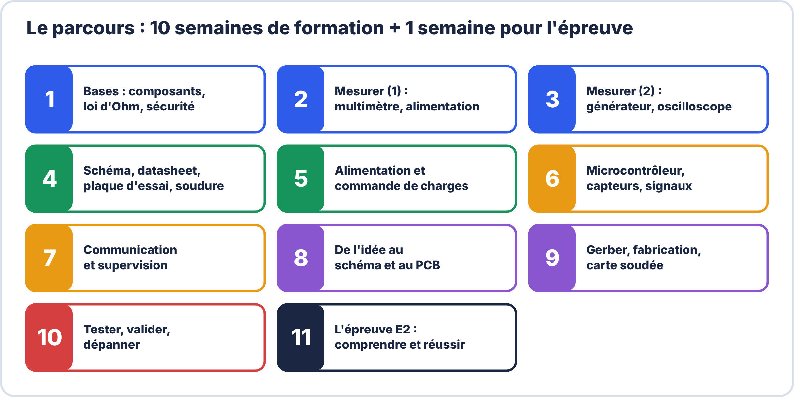

# ⚡ L'essentiel en 1 an

> **Formation express, autonome** : 10 semaines de 4 h + 1 semaine pour comprendre et réussir l'épreuve E2.
> Utilisable **en classe** par un enseignant ou **seul(e)** par un élève, sans avoir suivi la Seconde ni la Première.

## 🎯 Objectif

À la fin du parcours, tu sais **comprendre un circuit électronique** et reconnaître ses composants, **utiliser les instruments** (multimètre, alimentation, GBF, oscilloscope, fer à souder), **lire une datasheet**, **dessiner un schéma et un PCB jusqu'aux fichiers Gerber**, **souder**, **valider** une carte avec un PV et **dépanner** un circuit simple avec méthode. Ce sont les attentes de l'épreuve **E2** (C03, C07, C11).

## 🧵 Deux fils rouges

1. **La carte clignoteur NE555** : on la calcule, la simule, la dessine, la fabrique, la soude, la valide, puis on la dépanne (semaines 4, 8, 9, 10).
2. **La station de mesure communicante** : capteur → microcontrôleur → UART/I²C → ESP32 → MQTT → supervision (semaines 6 et 7).

## 🗓️ Les 11 semaines

| Semaine | Thème | Tu sauras… |
|---|---|---|
| [1](S01-semaine.md) | Composants, lois de base, sécurité | lire un schéma simple, calculer avec la loi d'Ohm, lire les couleurs d'une résistance |
| [2](S02-semaine.md) | Multimètre et alimentation de laboratoire | mesurer U, I, R, continuité ; régler la limitation de courant |
| [3](S03-semaine.md) | GBF, oscilloscope, signaux | régler un oscilloscope et mesurer période, fréquence, amplitude |
| [4](S04-semaine.md) | Schéma, datasheet, montage, soudure | lire une datasheet, câbler, souder selon IPC |
| [5](S05-semaine.md) | Alimentation et charges | dimensionner une alimentation, piloter une charge avec un transistor |
| [6](S06-semaine.md) | Microcontrôleur, capteurs, signal | programmer une entrée/sortie, lire un capteur, filtrer |
| [7](S07-semaine.md) | Système communicant | faire communiquer des modules et diagnostiquer une liaison |
| [8](S08-semaine.md) | Du schéma au PCB | dessiner un schéma, passer l'ERC, router une carte |
| [9](S09-semaine.md) | Du PCB à la carte soudée | passer le DRC, produire les Gerber, souder et mettre sous tension |
| [10](S10-semaine.md) | Tester, valider, dépanner | rédiger un PV, dépanner par la méthode |
| [11](S11-semaine.md) | L'épreuve E2 | comprendre l'évaluation et réussir une épreuve blanche |

## 🧰 Comment suivre le parcours

Chaque semaine contient : **objectifs**, **déroulé**, **TP virtuel** dans [ElectroLab](https://yahnlp.github.io/ElectroLab/) (à faire **avant** le réel), **cours illustré**, **atelier réel**, **exercices corrigés**, **auto-test** et **livrable**.

- **Enseignant** : chaque semaine est une séquence de 4 h prête à l'emploi.
- **Élève en autonomie** : lis, fais l'ElectroLab, fais l'atelier, vérifie avec les corrigés, puis l'auto-test.
- Les cadres **« 🤔 À ton avis ? »** te font réfléchir avant de lire la réponse.
- Le cadre **« 📚 Pour approfondir »** en fin de semaine renvoie vers les trois années de la formation : il est **facultatif**, ce parcours se suffit à lui-même.

La liste des gestes à maîtriser est dans le [🎛️ Passeport instruments](passeport-instruments.md).

## 📦 Matériel conseillé

Multimètre, alimentation de laboratoire à limitation de courant, GBF, oscilloscope (ex. Owon SDS5032E-V, 2 voies 30 MHz), fer à souder, plaque d'essai, composants du clignoteur, carte Arduino/ESP32, ordinateur avec KiCad et un navigateur pour ElectroLab.
