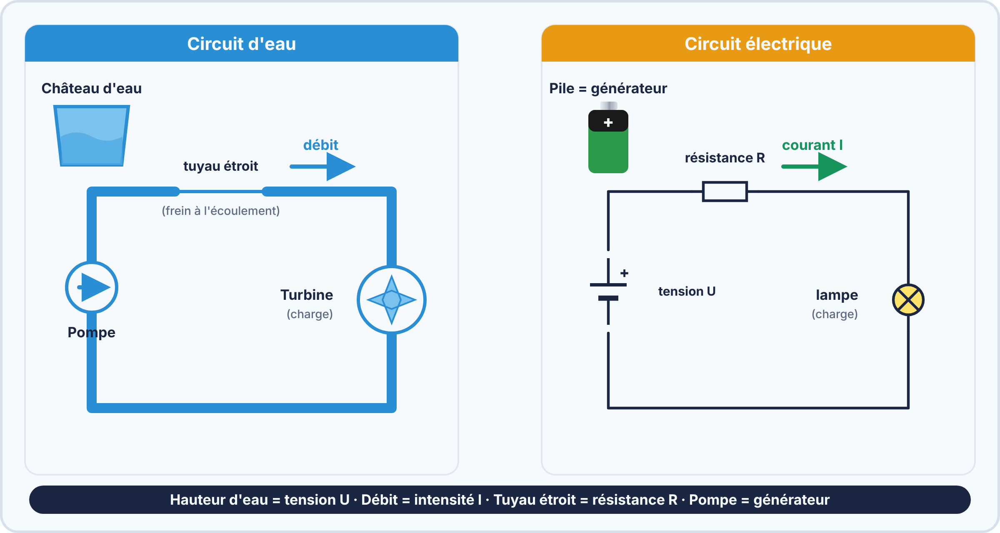
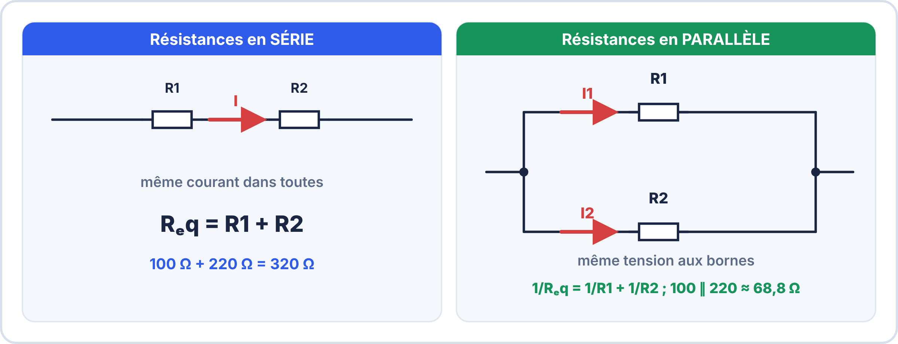
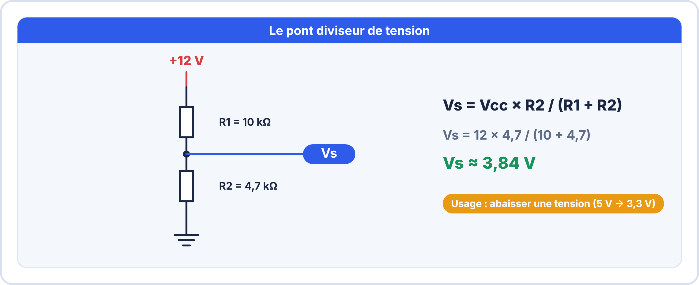
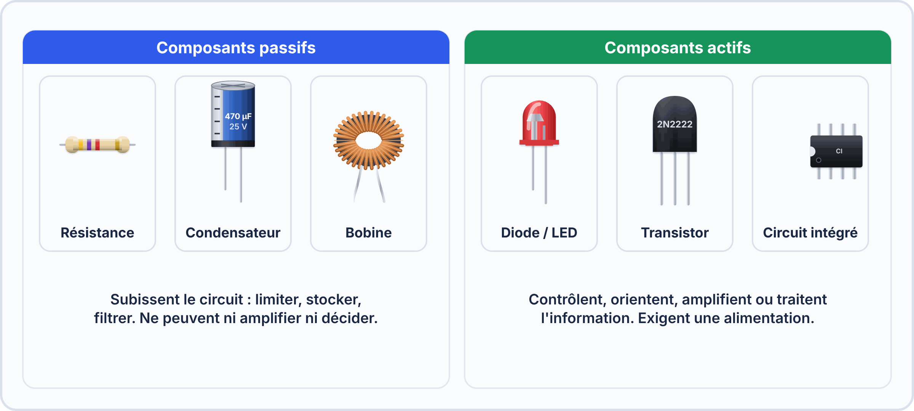
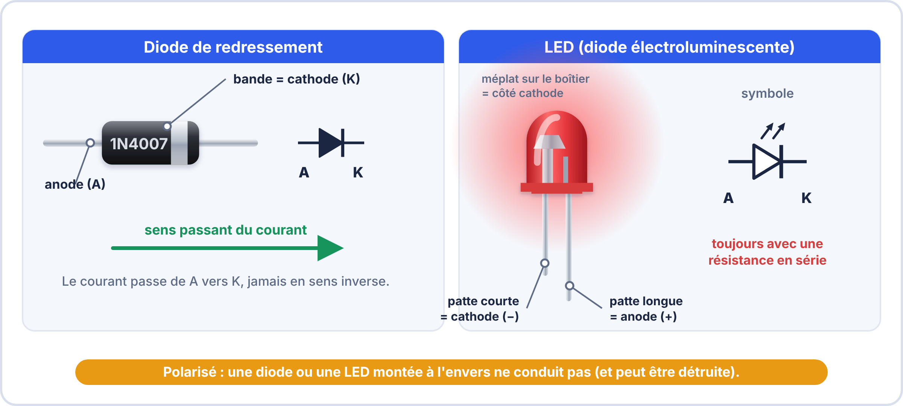
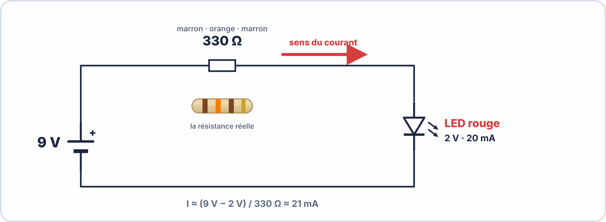
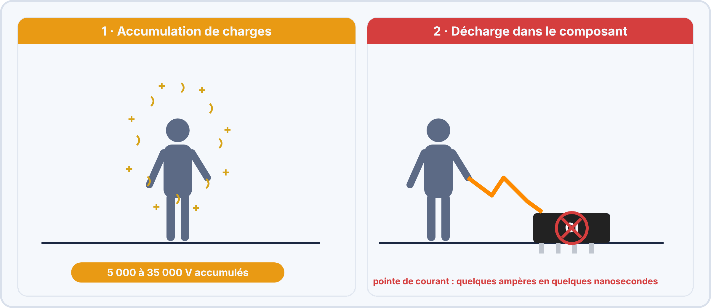

# Semaine 1 : Les bases de l'électronique

> **Durée** : 4 h · **Compétence E2** : C07 · **Aucun prérequis**

## 🎯 À la fin de la semaine, je sais…

- expliquer ce que sont la **tension**, le **courant** et la **résistance** ;
- appliquer la **loi d'Ohm** et calculer une **puissance** ;
- **lire la valeur d'une résistance** avec ses bagues de couleur ;
- reconnaître les **composants courants** et leur symbole ;
- calculer la **résistance de protection d'une LED** ;
- appliquer les **règles de sécurité** de base.

## 🗓️ Déroulé

| Durée | Activité |
|---|---|
| 1 h | TP virtuel ElectroLab (loi d'Ohm, associations, puissance, LED) |
| 1 h 15 | Cours : grandeurs, loi d'Ohm, résistances, composants |
| 1 h | Atelier réel : LED et résistance sur plaque d'essai |
| 45 min | Exercices, sécurité et auto-test |

## 🖥️ TP virtuel dans ElectroLab : à faire avant le TP réel

Ouvre [ElectroLab](https://yahnlp.github.io/ElectroLab/), menu **TP ▾**, puis fais ces TP :

- **Découverte du multimètre : tension, courant, loi d'Ohm** (1 h)
- **Associations de résistances et diviseur de courant** (1 h)
- **Puissance, effet Joule et dimensionnement d'une résistance** (1 h)
- **LED : calcul de la résistance de limitation** (1 h)

> [!TIP] 🖥️ Pourquoi d'abord le simulateur ?
> On peut se tromper sans rien casser, répéter autant de fois que nécessaire et obtenir une correction automatique.

---

## 📖 Le cours

**🤔 À ton avis ?** Pourquoi une LED branchée directement sur une pile de 9 V grille-t-elle en un éclair ?

??? question "Réponse"
    Rien ne **limite le courant** : la LED est traversée par un courant bien trop fort. Il faut une **résistance en série**. Toute la semaine sert à comprendre pourquoi, et à savoir la calculer.

### 1. Tension, courant, résistance

L'électricité se comprend bien avec une **analogie** : l'eau dans un tuyau.

| Grandeur | Symbole | Unité | Dans le tuyau |
|---|---|---|---|
| **Tension** | $U$ | volt (V) | la pression de l'eau |
| **Courant** | $I$ | ampère (A) | le débit |
| **Résistance** | $R$ | ohm (Ω) | un rétrécissement du tuyau |

Les unités se déclinent avec des **préfixes** : $1\,\mathrm{kΩ} = 1\,000\,\mathrm{Ω}$ ; $1\,\mathrm{mA} = 0{,}001\,\mathrm{A}$ ; $1\,\mathrm{\mu F} = 10^{-6}\,\mathrm{F}$.

### 2. La loi d'Ohm

> [!TIP] 💡 La loi d'Ohm
> $$U = R \times I \qquad I = \frac{U}{R} \qquad R = \frac{U}{I}$$
> Plus la résistance est grande, plus le courant est faible.

**Exemple** : une tension de 5 V aux bornes d'une résistance de 330 Ω donne $I = \dfrac{5}{330} \approx 15{,}2\,\mathrm{mA}$.

### 3. La puissance

La **puissance** mesure l'énergie transformée en une seconde, en **watts** (W) :

$$P = U \times I \qquad P = R \times I^2 \qquad P = \frac{U^2}{R}$$

> [!WARNING] ⚠️ Une résistance a une puissance maximale
> Les résistances courantes supportent **0,25 W**. Au-delà, elles **chauffent** et se détruisent. Exemple : 9 V sur 330 Ω donnent $P = \dfrac{9^2}{330} \approx 0{,}245\,\mathrm{W}$ : on est à la limite. On choisit alors une résistance de 0,5 W.

### 4. Lire une résistance : le code des couleurs

Les bagues se lisent à partir de celle qui est **la plus proche d'une extrémité** : deux chiffres, un multiplicateur, puis la tolérance.

**Exemple** : marron – noir – orange – or = 1, 0, × 1 000, ± 5 % → **10 kΩ ± 5 %**. La valeur réelle est donc comprise entre 9,5 kΩ et 10,5 kΩ.

Les valeurs vendues suivent la **série E12** : 10 · 12 · 15 · 18 · 22 · 27 · 33 · 39 · 47 · 56 · 68 · 82, puis × 10, × 100, etc.

### 5. Associer des résistances

Le **pont diviseur** abaisse une tension : avec $R_1$ vers le +, $R_2$ vers la masse, la sortie vaut $V_s = V_{cc} \times \dfrac{R_2}{R_1 + R_2}$.

### 6. Les composants à connaître

- **Passifs** (résistance, condensateur, bobine) : ils **limitent, stockent, filtrent**.
- **Actifs** (diode, LED, transistor, circuit intégré) : ils **contrôlent, amplifient ou traitent** l'information ; ils demandent une alimentation.

| Composant | Rôle | À retenir |
|---|---|---|
| **Diode** | laisse passer le courant dans **un seul sens** | tension de seuil ≈ 0,7 V |
| **LED** | diode qui éclaire | seuil ≈ 2 V ; **toujours** une résistance en série |
| **Condensateur** | stocke de l'énergie, lisse les tensions | en farads ; les « chimiques » sont **polarisés** |
| **Transistor** | interrupteur commandé par un petit courant | broches B, C, E (semaine 7) |

> [!WARNING] ⚠️ Erreurs fréquentes
> - LED branchée **sans résistance** ou **à l'envers** (la patte longue est l'**anode +**).
> - Condensateur chimique branché **à l'envers** : il chauffe et peut éclater.
> - Confondre **kΩ** et **Ω** : 330 kΩ n'est pas 330 Ω.

### 7. Calculer la résistance d'une LED

LED rouge (tension 2 V, courant voulu 20 mA) sur 5 V :

$$R = \frac{V_{cc} - V_{LED}}{I} = \frac{5 - 2}{0{,}020} = 150\,\Omega$$

C'est une valeur de la série E12 : on prend **150 Ω**.

### 8. Sécurité : les bons réflexes

- **Très basse tension** (jusqu'à 50 V alternatif ou 120 V continu) : pas de risque d'électrisation. Au-delà, **habilitation électrique** obligatoire (par exemple BR) : on n'intervient pas sans.
- **Électricité statique** : on touche les cartes **par les bords** ; les circuits intégrés restent dans leurs sachets antistatiques.
- **Fer à souder** : toujours reposé sur son support ; aspiration des fumées ; étain **sans plomb**.
- **Déchets** : une carte ou une batterie hors service est un **déchet électronique (DEEE)**, jamais à la poubelle ordinaire.

---

## 🛠️ Atelier réel : une LED sur plaque d'essai

**Matériel** : alimentation 5 V, plaque d'essai, résistance 150 Ω, LED rouge, multimètre.

1. **Calcule** la résistance pour une LED (2 V) à 20 mA sur 5 V.
2. **Retrouve ses bagues** : quelles couleurs pour 150 Ω ?
3. **Mesure** la résistance au multimètre (hors tension) : est-elle dans sa tolérance ?
4. **Monte** LED + résistance sur la plaque (patte longue de la LED côté résistance).
5. **Mesure** la tension aux bornes de la LED, puis de la résistance.
6. **Mesure** le courant (multimètre en série, calibre mA).
7. **Remplace** la résistance par 330 Ω : que se passe-t-il ?

??? success "Résultats attendus"
    1. $R = \dfrac{5 - 2}{0{,}020} = 150\,\Omega$.
    2. **marron – vert – marron – or** (1, 5, × 10, ± 5 %).
    3. Entre 142,5 Ω et 157,5 Ω ($150 \pm 5\,\%$).
    4. La LED s'allume.
    5. Environ 2 V aux bornes de la LED et 3 V aux bornes de la résistance (la somme fait 5 V).
    6. Environ 20 mA ($\dfrac{3}{150}$).
    7. $I = \dfrac{5 - 2}{330} \approx 9\,\mathrm{mA}$ : la LED éclaire **moins fort**.

## ✍️ Exercices

1. Une LED verte (2,1 V) doit être traversée par 10 mA sur une alimentation de 9 V. Quelle résistance, et quelle valeur de la série E12 ?
2. On associe 100 Ω et 220 Ω : résistance équivalente en série ? en parallèle ?
3. Pont diviseur : 12 V, $R_1 = 10\,\mathrm{kΩ}$, $R_2 = 4{,}7\,\mathrm{kΩ}$. Quelle tension de sortie ?
4. Une résistance de 330 Ω reçoit 9 V. Quelle puissance dissipe-t-elle ? Une résistance de 0,25 W convient-elle ?
5. Quelle est la valeur d'une résistance jaune – violet – rouge – or ?

??? success "Corrigés"
    1. $R = \dfrac{9 - 2{,}1}{0{,}010} = 690\,\Omega$ → **680 Ω** (E12).
    2. Série : $320\,\Omega$ ; parallèle : $\dfrac{100 \times 220}{320} \approx 68{,}8\,\Omega$.
    3. $V_s = 12 \times \dfrac{4{,}7}{14{,}7} \approx 3{,}84\,\mathrm{V}$.
    4. $P = \dfrac{9^2}{330} \approx 0{,}245\,\mathrm{W}$ : **à la limite** de 0,25 W : on prend 0,5 W.
    5. 4, 7, × 100 → **4,7 kΩ ± 5 %**.

## ✅ Auto-test

1. Que vaut la tension aux bornes d'une résistance de 220 Ω parcourue par 10 mA ?
2. Quelle patte d'une LED est l'anode (+) ?
3. À partir de quelle tension faut-il une habilitation électrique ?
4. Pourquoi ne branche-t-on jamais une LED directement sur une pile ?

??? success "Réponses"
    1. $U = 220 \times 0{,}010 = 2{,}2\,\mathrm{V}$.
    2. La **patte longue**.
    3. Au-delà de **50 V alternatif** ou **120 V continu**.
    4. Sans résistance, le courant n'est pas limité : la LED est détruite.

## 📦 Livrable

Fiche « mes composants » : pour 8 composants, le symbole, le rôle et une valeur typique.

> [!NOTE] 📚 Pour approfondir (facultatif)
> Ce parcours se suffit à lui-même. Si tu veux aller plus loin, tu peux consulter les séances de Seconde S01 (code couleurs et loi d'Ohm), S02 (diodes et LED) et S05 (sécurité et environnement), accessibles depuis l'onglet **Seconde**.
