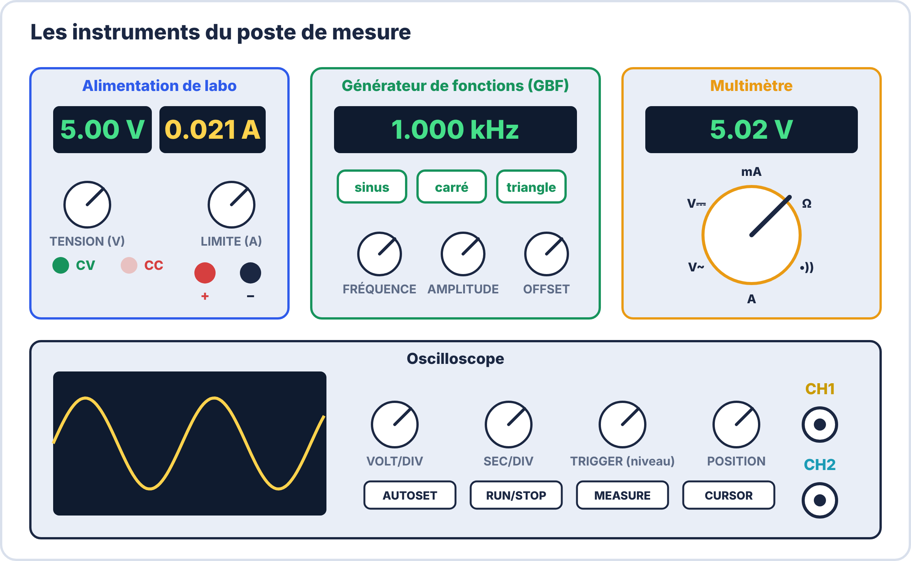
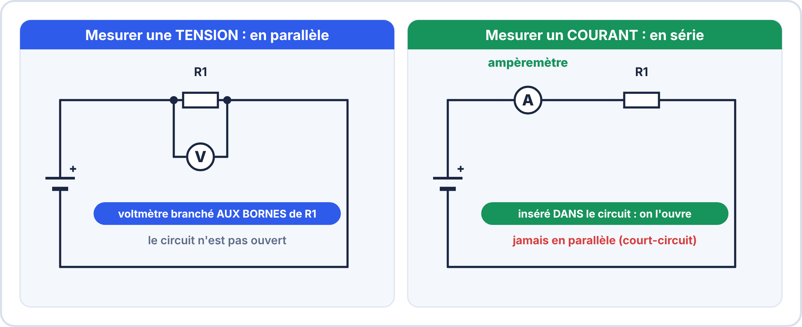
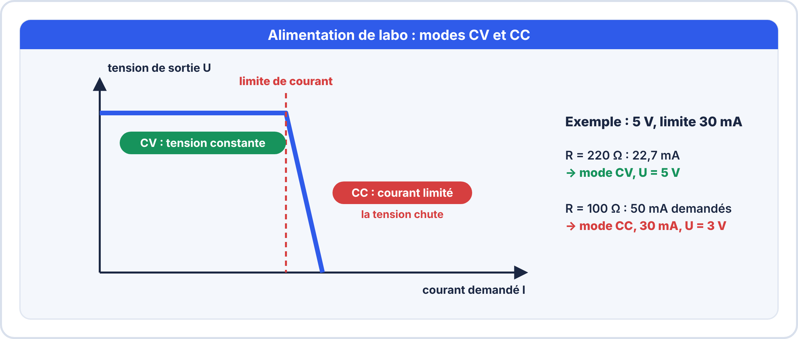

# Semaine 2 : Mesurer (1) : le multimètre et l'alimentation de laboratoire

> **Durée** : 4 h · **Compétences E2** : C07, C11

## 🎯 À la fin de la semaine, je sais…

- choisir le **mode** et **brancher** un multimètre pour mesurer une tension, un courant, une résistance, une continuité ;
- **régler une alimentation de laboratoire** (tension et limite de courant) et interpréter ses modes **CV** et **CC** ;
- estimer la **marge de précision** d'une mesure ;
- éviter les **erreurs de branchement** qui détruisent les appareils.

## 🗓️ Déroulé

| Durée | Activité |
|---|---|
| 1 h | TP virtuels ElectroLab (multimètre, tester des composants, alimentation) |
| 1 h | Cours : les instruments, mesurer U, I, R ; l'alimentation de labo |
| 1 h 15 | Atelier réel : mesures sur un montage LED |
| 45 min | Exercices et auto-test |

## 🖥️ TP virtuel dans ElectroLab : à faire avant le TP réel

Ouvre [ElectroLab](https://yahnlp.github.io/ElectroLab/), menu **TP ▾** :

- **Découverte du multimètre : tension, courant, loi d'Ohm** (1 h)
- **Tester les composants hors tension (ohmmètre, diode, continuité)** (1 h)

Puis ouvre ces deux sujets (bouton **Ouvrir**, choisis le fichier `.json`) :

- [`alim-cv.json`](../seconde/S12-tests-au-multimetre-et-controle-qualite/tp/alim-cv.json) : alimentation 5 V sur une résistance de 220 Ω. Relève U et I (attendu : environ 5,0 V et 22,7 mA, mode **CV**).
- [`alim-cc.json`](../seconde/S12-tests-au-multimetre-et-controle-qualite/tp/alim-cc.json) : même montage avec 100 Ω et une limite de 30 mA. L'alimentation passe en **CC** (attendu : environ 30 mA et 3,0 V).

---

## 📖 Le cours

**🤔 À ton avis ?** Tu mesures 5,0 V à la sortie d'une carte qui devrait envoyer un signal. Es-tu sûr que le signal est correct ?

??? question "Réponse"
    Pas encore : le multimètre donne une valeur **moyenne**. Pour être sûr qu'un signal est correct, il faut aussi **le voir** à l'oscilloscope (semaine 3). Cette semaine, on apprend à bien mesurer les grandeurs **continues**.

### 1. Le poste de mesure

### 2. Le multimètre

| Je mesure… | Mode | Branchement | Circuit |
|---|---|---|---|
| une **tension** | V⎓ (continu) ou V∿ (alternatif) | en **parallèle**, aux bornes du composant | sous tension |
| un **courant** | A ou mA | en **série** : on **ouvre** le circuit pour insérer l'appareil | sous tension |
| une **résistance** | Ω | aux bornes du composant isolé | **hors tension** |
| une **continuité** (fil, piste) | symbole « bip » | aux deux extrémités | **hors tension** |
| une **diode / LED** | symbole diode | anode et cathode | **hors tension** |

> [!WARNING] ⚠️ Le piège qui détruit un multimètre
> Mesurer une **tension** avec l'appareil resté en position **ampèremètre** crée un **court-circuit** et fait griller son fusible. **Avant de brancher** : vérifie la position **et** les bornes (COM et la borne V/Ω pour la tension).

### 3. La continuité

En mode continuité, le multimètre **bipe** quand le chemin entre les deux pointes est fermé. On vérifie ainsi une **piste**, un **fil**, un **fusible**. On teste **toujours hors tension**.

### 4. La précision d'une mesure

Aucun instrument n'est parfait. Le constructeur indique une **précision**, par exemple **± (0,5 % de la lecture + 2 chiffres)**.

**Exemple** : lecture 5,02 V (résolution 0,01 V).
- 0,5 % de 5,02 = 0,025 V ;
- 2 chiffres = 2 × 0,01 = 0,02 V ;
- marge ≈ 0,045 V, arrondie à 0,05 V → **(5,02 ± 0,05) V**.

### 5. L'alimentation de laboratoire

Elle possède **deux réglages** : la **tension** et la **limite de courant** (un fusible réglable). Elle fonctionne en deux modes :

- **CV** (tension constante) : fonctionnement normal.
- **CC** (courant constant) : le courant a atteint la limite ; l'alimentation **baisse la tension** pour protéger le montage. Si le voyant **CC** s'allume, **il y a une anomalie** (court-circuit, consommation trop forte).

> [!TIP] 💡 Procédure de mise sous tension
> 1. Sortie **coupée** (OFF). 2. Régler la **tension**. 3. Court-circuiter les bornes avec un fil et régler la **limite de courant** (par exemple 30 mA), puis retirer le fil. 4. Brancher le montage, mettre la sortie ON et **observer le courant affiché**.

> [!WARNING] ⚠️ Erreurs fréquentes
> - Brancher le montage **avant** de régler la tension.
> - Laisser la limite de courant **au maximum**.
> - Mesurer une résistance **sous tension** ou **dans le circuit** : la mesure est fausse.

---

## 🛠️ Atelier réel : mesures sur un montage LED

**Matériel** : alimentation de labo, plaque d'essai, résistance 150 Ω, LED, multimètre.

1. Règle l'alimentation à **5,0 V**, limite **30 mA**, sortie coupée. Mesure la tension à vide.
2. Mesure la résistance de 150 Ω **hors tension**.
3. Monte la LED et sa résistance. Mets la sortie ON. Lis le **courant affiché** par l'alimentation.
4. **Vérifie ce courant** avec le multimètre (en série, calibre mA).
5. Mesure la tension aux bornes de la **LED**, puis de la **résistance**. Que vaut leur somme ?
6. Remplace la résistance par **100 Ω** et mets la limite à **15 mA** : que se passe-t-il ?

??? success "Résultats attendus"
    1. Environ 5,00 V à vide.
    2. Entre 142,5 Ω et 157,5 Ω.
    3. Environ 20 mA, voyant **CV**.
    4. Le multimètre donne la même valeur, à la marge de précision près.
    5. Environ 2 V (LED) et 3 V (résistance) : la somme est égale à la tension d'alimentation.
    6. Le courant voudrait atteindre $\dfrac{3}{100} = 30\,\mathrm{mA}$, mais il est limité à 15 mA : l'alimentation passe en **CC**.

## ✍️ Exercices

1. On veut mesurer le courant dans une résistance. Où place-t-on l'ampèremètre : en série ou en parallèle ?
2. Un multimètre de précision ± (0,5 % + 2 chiffres) indique 12,00 V (résolution 0,01 V). Quelle marge ?
3. Pourquoi mesure-t-on une résistance hors tension ?
4. Le voyant CC d'une alimentation s'allume dès que tu branches : que penses-tu ?
5. On règle une alimentation à 9 V pour une LED + résistance consommant 20 mA. Quelle limite de courant choisis-tu ?

??? success "Corrigés"
    1. En **série** : le courant doit traverser l'appareil.
    2. $0{,}5\,\% \times 12 = 0{,}06$ ; 2 chiffres = 0,02 ; marge **0,08 V** → $(12{,}00 \pm 0{,}08)\,\mathrm{V}$.
    3. Sous tension, les autres composants et la source **faussent** la mesure, et l'appareil peut être endommagé.
    4. La consommation dépasse la limite : **court-circuit** probable ou composant à l'envers. On coupe et on cherche l'erreur.
    5. Environ **30 à 40 mA** (une marge au-dessus de la consommation attendue).

## ✅ Auto-test

1. Quel est le mode du multimètre pour tester un fil ?
2. Que signifie « CC » sur une alimentation ?
3. Quelle erreur détruit le fusible d'un multimètre ?
4. Comment écrire un résultat de mesure avec sa marge ?

??? success "Réponses"
    1. Le mode **continuité** (bip).
    2. Le courant a atteint la **limite** réglée : la tension chute.
    3. Mesurer une **tension** avec l'appareil en position **ampèremètre**.
    4. « valeur ± marge », avec l'unité : $(5{,}02 \pm 0{,}05)\,\mathrm{V}$.

## 📦 Livrable

Relevé de 6 mesures (tension, courant, résistance, continuité) avec l'instrument, le mode, la valeur et la marge.

> [!NOTE] 📚 Pour approfondir (facultatif)
> Ce parcours se suffit à lui-même. Pour aller plus loin : Seconde S12 (tests au multimètre et contrôle qualité) et Terminale S02 (rapport de mesures).
