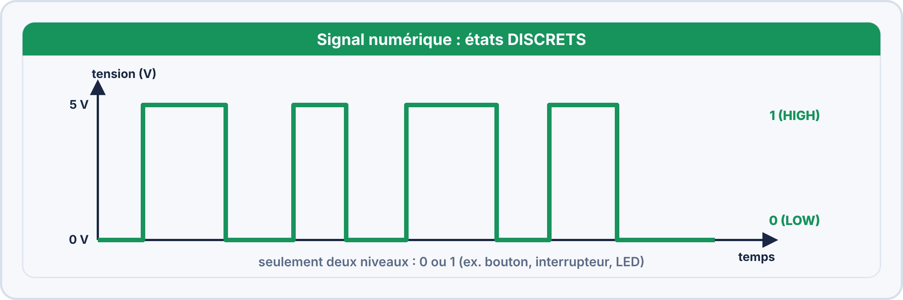
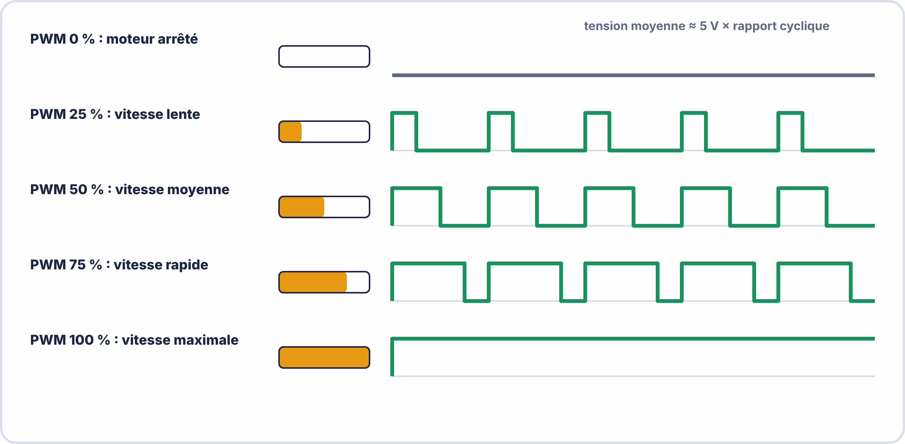

# Semaine 3 : Mesurer (2) : générateur et oscilloscope

> **Durée** : 4 h · **Compétences E2** : C07, C11

## 🎯 À la fin de la semaine, je sais…

- régler un **générateur de fonctions** (forme, fréquence, amplitude, offset) ;
- régler un **oscilloscope** (VOLT/DIV, SEC/DIV, déclenchement, couplage, sonde) ;
- lire sur l'écran **l'amplitude, la période et la fréquence** d'un signal ;
- mesurer un **rapport cyclique** (signal PWM) ;
- distinguer un signal **analogique** d'un signal **numérique**.

## 🗓️ Déroulé

| Durée | Activité |
|---|---|
| 1 h | TP virtuels ElectroLab (lire un signal, rapport cyclique, couplage AC/DC) |
| 1 h | Cours : signaux, réglages de l'oscilloscope, lecture |
| 1 h 15 | Atelier réel : générateur et oscilloscope (avec la fiche de ton appareil) |
| 45 min | Exercices et auto-test |

## 🔬 TP virtuel dans OscilloLab : à faire avant le TP réel

Ouvre [OscilloLab](https://yahnlp.github.io/OscilloLab/), choisis **ton oscilloscope** (OWON ou RIGOL), lis **📖 Les bases de l'oscilloscope** (10 minutes), puis fais, dans l'ordre : **TP 1** prise en main · **TP 2** compenser la sonde · **TP 3** piège ×1 / ×10 · **TP 4** lire sur la grille · **TP 5** couplage DC / AC / GND · **TP 16** pince de masse oubliée. Chaque TP explique la notion, donne le **pas à pas touche par touche** (avec **👆 Montre-moi**) et se **corrige automatiquement**. Mode d'emploi : [Utiliser OscilloLab](../ressources/oscillolab.md).

## 🖥️ TP virtuel dans ElectroLab : à faire avant le TP réel

Ouvre [ElectroLab](https://yahnlp.github.io/ElectroLab/), menu **TP ▾** :

- **Lire un signal à l'oscilloscope : régler, mesurer T, f, Umax, Upp… (6 signaux)** (1 h 15)
- **Signaux périodiques : GBF, oscilloscope et multimètre** (1 h 15)
- **Signal rectangulaire : rapport cyclique, temps haut, valeur moyenne (5 signaux)** (1 h 15)
- **Couplage AC / DC : mesurer une ondulation sur une tension continue** (1 h)

> [!TIP] 📘 Les fiches de ton oscilloscope
> Deux fiches illustrées expliquent **tous les boutons, les réglages, la lecture de l'écran, les mesures et la capture** pour les oscilloscopes du laboratoire :
> - [🔭 Fiche OWON SDS5032E(V)](../ressources/oscilloscopes/owon-sds5032e.md) (2 voies, 30 MHz) ;
> - [🔭 Fiche RIGOL DS1054Z](../ressources/oscilloscopes/rigol-ds1104z.md) (4 voies, 100 MHz).
>
> Pour t'entraîner pas à pas : [🧪 TP « Passeport oscilloscope »](../ressources/oscilloscopes/tp-passeport-oscilloscope.md) (13 missions).

---

## 📖 Le cours

**🤔 À ton avis ?** Un signal clignote 100 fois par seconde. Le multimètre affiche « 2,5 V » : que se passe-t-il vraiment ?

??? question "Réponse"
    Le signal passe très vite de 0 V à 5 V : le multimètre en affiche la **valeur moyenne**, 2,5 V. Seul l'**oscilloscope** montre la **forme** du signal et sa **vitesse**.

### 1. Analogique ou numérique ?

Un signal **analogique** varie de façon **continue** (température, son). Un signal **numérique** ne prend que **deux niveaux** (0 ou 5 V) : c'est ce que produisent les microcontrôleurs.

### 2. Les réglages de l'oscilloscope

L'oscilloscope trace la **tension en fonction du temps**. L'écran est un quadrillage de **carreaux** (divisions).

| Réglage | Il règle… | Unité |
|---|---|---|
| **VOLT/DIV** | l'échelle **verticale** | V par carreau |
| **SEC/DIV** | l'échelle **horizontale** | s, ms ou µs par carreau |
| **Déclenchement** (trigger) | le point où l'image **se fige** | niveau en V |
| **Couplage** | DC : tout ; AC : on supprime la composante continue ; GND : zéro | |

### 3. Lire l'écran

$$U_{pp} = \text{carreaux (hauteur)} \times \text{V/DIV} \qquad T = \text{carreaux (largeur)} \times \text{s/DIV} \qquad f = \frac{1}{T}$$

**Valeur efficace d'un sinus** : $U_{eff} = \dfrac{U_{max}}{\sqrt{2}} = \dfrac{U_{pp}}{2\sqrt{2}}$. Un sinus de 2 V crête à crête a $U_{eff} \approx 0{,}71\,\mathrm{V}$.

### 4. Le rapport cyclique et la PWM

Pour un signal carré :

$$\text{rapport cyclique} = \frac{t_{haut}}{T} \times 100\,\%$$

**Valeur moyenne** d'un signal de 5 V : $5\,\mathrm{V} \times \text{rapport cyclique}$. À 25 %, on obtient 1,25 V. Sur un Arduino Uno, `analogWrite(9, 64)` donne $\dfrac{64}{255} \approx 25\,\%$ à environ **490 Hz**.

### 5. La sonde

La sonde **×10** divise le signal par 10 et améliore la mesure : il faut **déclarer ×10** dans l'oscilloscope. On la **compense** sur le signal de test de la façade : le carré doit être **bien droit**.

> [!WARNING] ⚠️ Erreurs fréquentes
> - Sonde sur ×10 mais voie réglée sur ×1 : toutes les valeurs sont **10 fois trop petites**.
> - Pince de masse branchée **ailleurs que sur la masse** du circuit : court-circuit.
> - Oublier le **déclenchement** : l'image défile et ne se lit pas.

### 6. Pour aller plus loin : l'analyseur logique

Certains oscilloscopes ont des **voies numériques** (analyseur logique) : on voit plusieurs signaux numériques en même temps et on peut **décoder** une liaison (UART, I²C, semaine 7).

---

## 🛠️ Atelier réel : générateur et oscilloscope

**Matériel** : oscilloscope, sonde ×10, générateur de fonctions.

0. **Ouvre la fiche** de ton oscilloscope et suis la **mise en route en 6 étapes** (réglages d'usine, sonde, compensation).
1. Règle la sonde sur ×10 (et la voie aussi). Branche-la au **signal de test** de la façade, appuie sur **Autoset**, puis **compense** la sonde.
2. Règle le générateur : **sinus, 1 kHz, 2 V crête à crête**. Branche-le sur la voie 1. Relève $T$, $f$ et $U_{pp}$ **à la main**, puis avec les **mesures automatiques**.
3. Passe en **carré 500 Hz**. Règle un **rapport cyclique de 25 %** : relève $t_{haut}$.
4. Ajoute un **offset** de 1,5 V, puis passe en couplage **AC** : que se passe-t-il ?
5. Si tu disposes d'un Arduino : observe la broche 9 avec `analogWrite(9, 64)` : relève la fréquence et le rapport cyclique.

??? success "Résultats attendus"
    2. $T = 1\,\mathrm{ms}$, $f = 1\,\mathrm{kHz}$, $U_{pp} = 2\,\mathrm{V}$ ; lecture manuelle et automatique concordent à la précision de l'écran près.
    3. $t_{haut} = 0{,}25 \times 2\,\mathrm{ms} = 0{,}5\,\mathrm{ms}$.
    4. L'offset décale tout le signal vers le haut ; en **AC**, le signal **se recentre sur zéro**.
    5. Environ 490 Hz et 25 %.

## ✍️ Exercices

1. Période de 8 carreaux à 0,5 ms/DIV : quelle fréquence ?
2. Une sonde ×10 est utilisée, mais la voie est restée réglée sur ×1. L'écran indique 1,2 V crête à crête : quelle est la vraie valeur ?
3. Un signal est à l'état haut 3 ms sur une période de 12 ms. Rapport cyclique ? Valeur moyenne s'il vaut 5 V à l'état haut ?
4. Quelle est la valeur efficace d'un sinus de 10 V crête à crête ?
5. Un signal numérique de 5 V est à l'état haut 80 % du temps : quelle valeur moyenne ?

??? success "Corrigés"
    1. $T = 4\,\mathrm{ms}$ ; $f = 250\,\mathrm{Hz}$.
    2. Le signal est atténué 10 fois : la vraie valeur est **12 V**.
    3. $\dfrac{3}{12} = 25\,\%$ ; valeur moyenne : $5 \times 0{,}25 = 1{,}25\,\mathrm{V}$.
    4. $U_{eff} = \dfrac{10}{2\sqrt{2}} \approx 3{,}54\,\mathrm{V}$.
    5. $5 \times 0{,}8 = 4\,\mathrm{V}$.

## ✅ Auto-test

1. Que règle le bouton VOLT/DIV ? SEC/DIV ?
2. Quelle relation entre période et fréquence ?
3. À quoi sert le couplage AC ?
4. Pourquoi « compenser » une sonde ?

??? success "Réponses"
    1. VOLT/DIV : l'échelle **verticale** (tension) ; SEC/DIV : l'échelle **horizontale** (temps).
    2. $f = \dfrac{1}{T}$.
    3. À **supprimer la composante continue** pour voir une petite variation.
    4. Pour que la sonde ne **déforme pas** le signal : le carré de test doit être droit.

## 📦 Livrable

Photo ou copie d'écran (ou croquis coté) d'un signal mesuré, avec les réglages, $T$, $f$, $U_{pp}$ et le rapport cyclique.

> [!NOTE] 📚 Pour approfondir (facultatif)
> Ce parcours se suffit à lui-même. Pour aller plus loin : Première S05 (tests et mesures avancés, oscilloscope mixte) et Terminale S01 (multimètre et oscilloscope).
