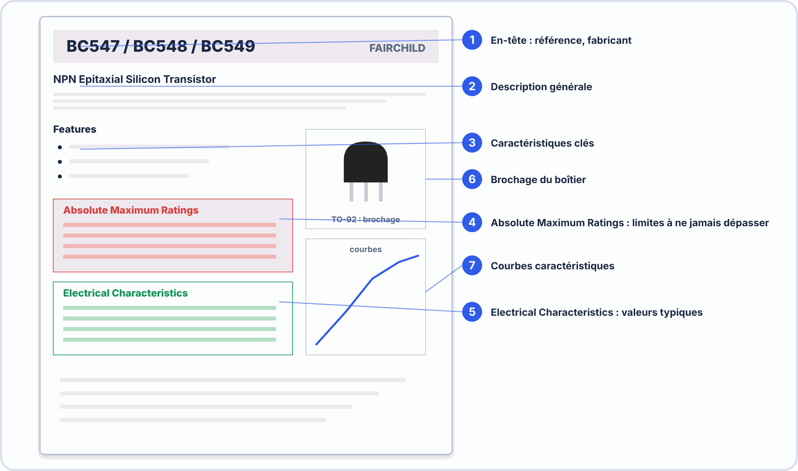
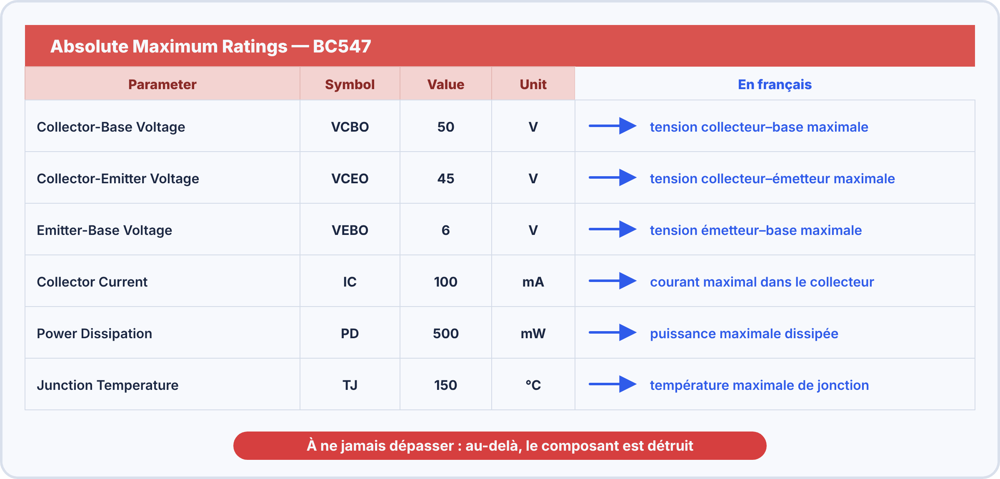
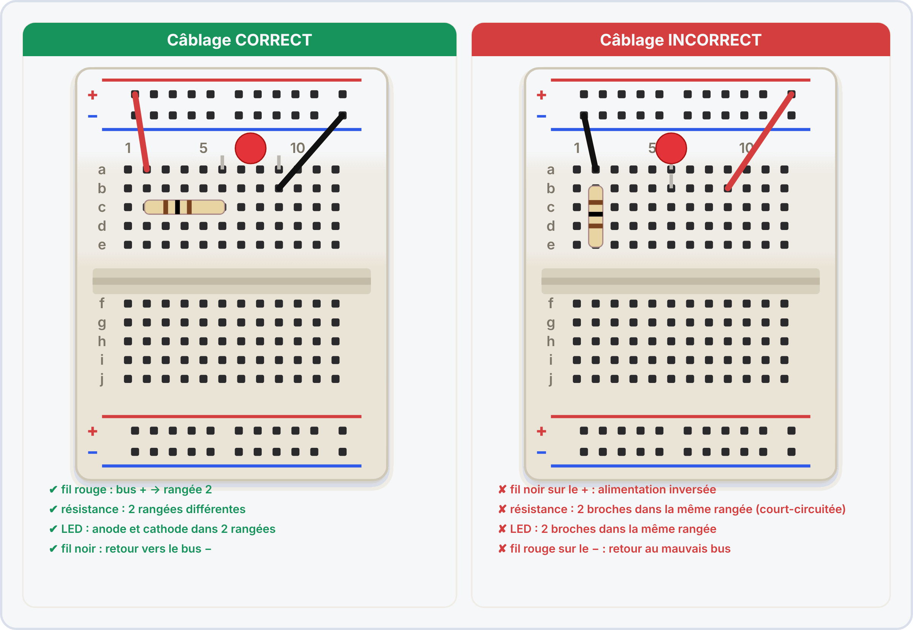
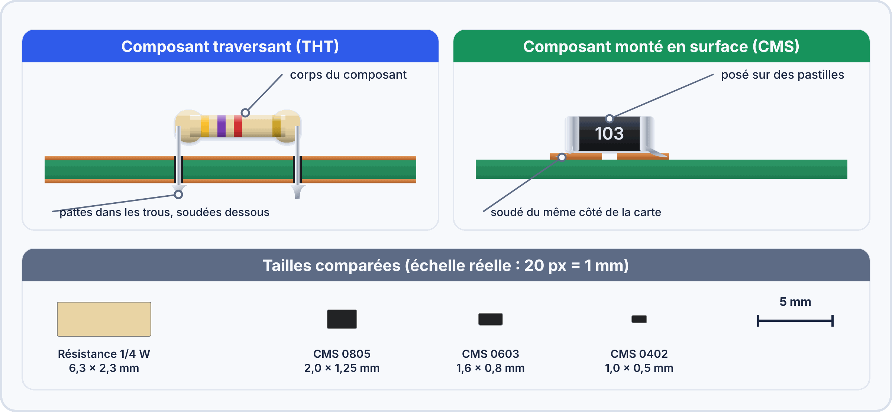
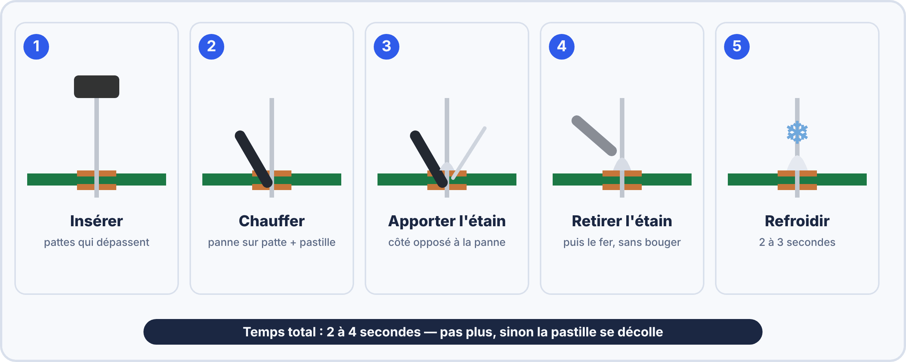
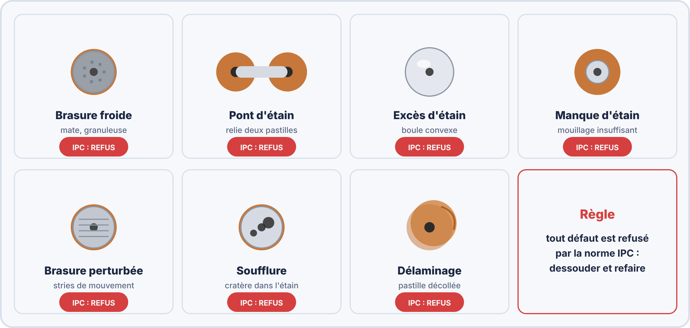

# Semaine 4 : Lire un schéma et une datasheet, monter et souder

> **Durée** : 4 h · **Compétence E2** : C07

## 🎯 À la fin de la semaine, je sais…

- **lire un schéma** normalisé et le découper en blocs ;
- **trouver dans une datasheet** le brochage, les limites et les valeurs utiles ;
- **monter un circuit** sur plaque d'essai, puis le **souder** ;
- **contrôler une brasure** selon les critères IPC-A-610.

## 🗓️ Déroulé

| Durée | Activité |
|---|---|
| 1 h | TP virtuel ElectroLab (NE555 en astable) ; lecture de schémas |
| 1 h | Cours : symboles, datasheet (7805, BC547, NE555) |
| 1 h | Atelier réel : plaque d'essai |
| 1 h | Soudure, contrôle IPC et auto-test |

## 🖥️ TP virtuel dans ElectroLab : à faire avant le TP réel

Ouvre [ElectroLab](https://yahnlp.github.io/ElectroLab/), menu **TP ▾** :

- **NE555 en multivibrateur astable (4 fréquences)** (1 h 30) : tu vérifies la formule de la fréquence.

---

## 📖 Le cours

**🤔 À ton avis ?** On te donne une carte inconnue avec un composant marqué « LM7805 ». Comment savoir comment le brancher sans rien griller ?

??? question "Réponse"
    On lit sa **datasheet** (la notice du fabricant) et le **schéma** de la carte. Cette semaine, tu apprends à lire ces deux documents.

### 1. Lire un schéma

Un schéma est un **plan** : il montre **comment les composants sont reliés**, pas où ils sont posés.

- Chaque composant a un **repère** : **R**1 (résistance), **C**1 (condensateur), **D**1 (diode), **Q**1 (transistor), **U**1 (circuit intégré), **J**1 (connecteur).
- Les **traits** sont des fils. Un **point plein** à un croisement veut dire « relié » ; **sans point**, les fils ne sont pas reliés.
- Par convention : le **+** en haut, la **masse (GND)** en bas, le signal de **gauche à droite**.

> [!TIP] 💡 Méthode
> Pour comprendre un schéma, **découpe-le en blocs** (alimentation, traitement, sortie), puis lis chaque bloc.

### 2. Lire une datasheet

Une datasheet contient toujours les mêmes parties.

| À chercher | Pourquoi |
|---|---|
| **Brochage** (*pin configuration*) | brancher chaque broche au bon endroit |
| **Absolute maximum ratings** | limites à **ne jamais dépasser** |
| **Electrical characteristics** (min / typ / max) | valeurs **garanties**, pour calculer |
| **Package** | choisir l'empreinte du circuit imprimé |

> [!TIP] 💡 Min, typ, max
> Les valeurs **garanties** sont **min** et **max**. La valeur « typique » est ce qu'on mesure en général, **sans garantie**. Pour un calcul de sécurité, on prend **le cas le plus défavorable**.

### 3. Trois composants à connaître

**Le régulateur 7805** : sortie **5 V** (garantie de 4,8 à 5,2 V), entrée de **7 V à 35 V maximum**.

**Le transistor BC547** : $V_{CE}$ max = 45 V ; $I_C$ max = 100 mA ; gain $h_{FE}$ de 110 à 800 (très dispersé) ; saturé : $V_{CE(sat)} \approx 0{,}2\,\mathrm{V}$.

**Le NE555** en astable :

$$f = \frac{1{,}44}{(R_a + 2R_b) \times C} \qquad DC = \frac{R_a + R_b}{R_a + 2R_b}$$

Avec $R_a = 10\,\mathrm{kΩ}$, $R_b = 68\,\mathrm{kΩ}$, $C = 10\,\mathrm{\mu F}$ : $f \approx 0{,}99\,\mathrm{Hz}$ et $DC \approx 53\,\%$. C'est le **clignoteur** que tu vas construire pendant le parcours.

> [!WARNING] ⚠️ Erreurs fréquentes
> - Utiliser la datasheet du **mauvais composant** (vérifie la référence exacte et le fabricant).
> - Confondre **limite absolue** et **valeur de fonctionnement**.
> - Lire le brochage **vu du dessous** au lieu de vu du dessus.

### 4. La plaque d'essai

Sur une plaque d'essai (*breadboard*), les trous d'une **même colonne de 5** sont reliés ; les **rails** (lignes + et −) courent sur toute la longueur. On monte un circuit **sans souder**, pour le tester.

> [!TIP] 💡 Méthode de montage
> 1. Relier les rails +5 V et GND. 2. Poser les composants **dans l'ordre du schéma**. 3. **Vérifier avant d'alimenter** : sens des LED, polarité des condensateurs, absence de court-circuit entre + et −.

### 5. Souder à l'étain

Boîtiers à pattes traversantes (THT) ou composants montés en surface (CMS) : les deux se soudent, le THT est plus simple à la main.

Les **5 étapes** d'une brasure :

1. Fer chaud (≈ 350 °C), panne propre.
2. Chauffer **en même temps** la patte et la pastille.
3. Amener l'étain **sur la pastille**, pas sur le fer.
4. Retirer l'étain, puis le fer.
5. Laisser refroidir **sans bouger**.

### 6. Contrôler une brasure (IPC-A-610, classe 2)

Une brasure correcte est **brillante**, en **cône**, et le trou est rempli à **75 % au moins**.

---

## 🛠️ Atelier réel

**Matériel** : plaque d'essai, alimentation 5 V, LED, résistance 150 Ω, plaquette de soudure, fer, étain, 3 résistances.

1. Ouvre la datasheet du **7805** : note la tension d'entrée maximale, la sortie, et le brochage.
2. Monte sur la plaque : alimentation 5 V → résistance 150 Ω → LED → masse. Vérifie, puis alimente.
3. **Dessine** le schéma de ce que tu viens de monter, avec les repères et les valeurs.
4. Soude **3 résistances** sur la plaquette : contrôle chaque brasure (brillante, cône, remplissage).
5. Repère sur la plaquette un défaut volontaire (soudure froide) et corrige-le.

??? success "Résultats attendus"
    1. Entrée maximale **35 V**, sortie **5 V** ; broches : 1 entrée, 2 masse, 3 sortie.
    2. La LED s'allume (environ 20 mA).
    3. Schéma : source 5 V, R1 = 150 Ω, D1, masse.
    4. Brasures brillantes en cône ; trous remplis à 75 % au moins.
    5. Une soudure froide est **terne et craquelée** : on la reprend (chauffer, ajouter un peu d'étain).

## ✍️ Exercices

1. Un 7805 est alimenté en 7,5 V. Peut-il réguler à 5 V ? Et en 6 V ? (chute minimale d'environ 2 V)
2. NE555 : $R_a = 4{,}7\,\mathrm{kΩ}$, $R_b = 33\,\mathrm{kΩ}$, $C = 10\,\mathrm{\mu F}$. Quelle fréquence ?
3. Pourquoi calcule-t-on avec les limites de la datasheet plutôt qu'avec les valeurs typiques ?
4. Une brasure traversante est remplie à 70 % : est-elle conforme en classe 2 ?
5. Deux fils se croisent sur un schéma, sans point : sont-ils reliés ?

??? success "Corrigés"
    1. À 7,5 V : **oui** (7,5 − 5 = 2,5 V ≥ 2 V). À 6 V : **non** (1 V < 2 V).
    2. $f = \dfrac{1{,}44}{(4{,}7 + 66) \times 10^{3} \times 10^{-5}} \approx 2{,}04\,\mathrm{Hz}$.
    3. Pour que le montage fonctionne dans le **cas le plus défavorable** (composant le moins favorable, température extrême).
    4. **Non** : il faut au moins 75 %.
    5. **Non** : seul un **point plein** indique une liaison.

## ✅ Auto-test

1. Que signifie « absolute maximum ratings » ?
2. Quelle est la tension d'entrée maximale d'un 7805 ?
3. Combien de trous sont reliés dans une colonne d'une plaque d'essai ?
4. À quoi reconnaît-on une soudure froide ?

??? success "Réponses"
    1. Les limites à **ne jamais dépasser** : au-delà, le composant peut être détruit.
    2. **35 V**.
    3. **5 trous**.
    4. Elle est **terne et craquelée**.

## 📦 Livrable

Fiche de synthèse d'une datasheet (brochage, limites, valeurs utiles) et plaquette soudée contrôlée.

> [!NOTE] 📚 Pour approfondir (facultatif)
> Ce parcours se suffit à lui-même. Pour aller plus loin : Seconde S03 (breadboard, schémas), S04 (soudure et IPC) et S06 (lecture de datasheet) ; Première S01 (« Lire une datasheet »).
