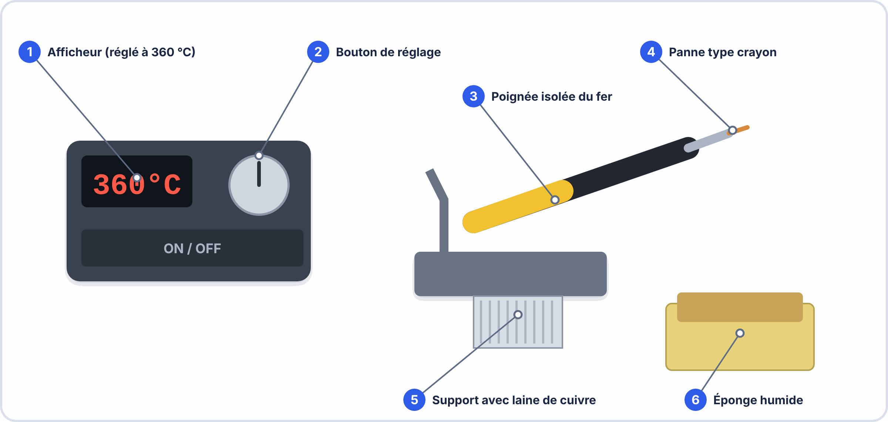

# Semaine 5 : Souder proprement et contrôler la qualité

> **Durée** : 4 h · **Compétence E2** : C07

## 🎯 À la fin de la semaine, je sais…

- **préparer** un poste de soudure et travailler en **sécurité** ;
- **souder** un composant traversant en cinq étapes, et connaître le principe du **CMS** ;
- **dessouder** et **reprendre** une brasure défectueuse ;
- **contrôler** une brasure selon les critères **IPC-A-610** (classe 2) ;
- **protéger** les composants contre les **décharges électrostatiques** (ESD).

## 🗓️ Déroulé

| Durée | Activité |
|---|---|
| 30 min | Cours : sécurité, matériel, brasure |
| 1 h | Atelier : soudure de résistances sur plaquette |
| 45 min | Cours : défauts, dessoudage, contrôle IPC |
| 1 h 30 | Atelier : le clignoteur NE555 sur plaque à pastilles |
| 15 min | Auto-test |

> [!NOTE] 🖥️ Pas de TP virtuel cette semaine
> ElectroLab simule des circuits, pas des gestes : la soudure **s'apprend en la faisant**. Révise cependant les calculs du clignoteur (semaine 4) avant l'atelier.

---

## 📖 Le cours

**🤔 À ton avis ?** Une soudure brille. Est-ce forcément une bonne soudure ?

??? question "Réponse"
    **Non** : une soudure peut briller et être mal faite (trop d'étain, pas assez de chauffe de la pastille). On la juge sur sa **forme** (cône, bords concaves), son **remplissage** et l'**absence de pont**. Cette semaine, tu apprends les critères.

### 1. Sécurité et poste de travail

| Risque | Précaution |
|---|---|
| **Brûlure** (fer à plus de 300 °C) | Toujours reposer le fer sur son **support**, jamais sur la table |
| **Fumées** de flux | Aérer ou **aspirer** ; ne pas se pencher au-dessus |
| **Plomb** (étain 60/40) | Se **laver les mains** après, ne pas manger sur le poste |
| **Projection** (fil coupé, étain) | **Lunettes** de protection |
| **ESD** | Bracelet antistatique, tapis relié à la terre |

### 2. Le matériel

- **Fer à souder** réglable (environ **320 à 370 °C**), panne propre et **étamée** (recouverte d'une fine couche d'étain brillante).
- **Étain** en fil avec **flux** intégré. Le **flux** nettoie le métal et aide l'étain à s'étaler.
- **Éponge humide** ou **laine de laiton** pour nettoyer la panne.
- **Pince coupante**, **pince fine**, **pompe à dessouder** et **tresse à dessouder**.

### 3. La brasure en cinq étapes

1. Fer chaud, panne **propre et étamée**.
2. Chauffer **en même temps** la patte et la pastille (1 à 2 s).
3. Amener l'étain **sur la pastille**, pas sur le fer.
4. Retirer l'étain, puis le fer (le tout dure **2 à 4 s**).
5. Laisser refroidir **sans bouger** : une brasure qui bouge pendant le refroidissement devient **froide**.

> [!TIP] 💡 Dans quel ordre souder ?
> On soude d'abord les composants **les plus bas** (résistances, diodes), puis les condensateurs, puis les circuits intégrés et connecteurs. On **coupe** les pattes **après** la soudure, au ras de la brasure.

### 4. Composants traversants et CMS

Les composants **traversants** (THT) ont des pattes qui passent à travers la carte : ils sont solides et faciles à souder à la main. Les composants **CMS** sont posés **sur** la surface : plus petits, ils se soudent avec une **pâte à braser** (four ou air chaud) en industrie, ou à la **panne fine** avec une pince en atelier. On repère la taille d'un CMS par son code (0805 = 2,0 × 1,25 mm).

### 5. Contrôler une brasure (IPC-A-610)

La norme **IPC-A-610** décrit ce qu'est une brasure **acceptable** selon trois classes de produit.

| Classe | Produits | Exigence |
|---|---|---|
| **1** | grand public simple | **fonctionner** |
| **2** | électronique **professionnelle** (notre cas) | **fonctionner longtemps** |
| **3** | santé, aéronautique | **ne jamais défaillir** |

Une brasure correcte de classe 2 est **brillante** (ou satinée selon l'étain), en **cône** concave, et le trou est rempli à **75 % au moins**.

### 6. Les défauts et leurs causes

| Défaut | Aspect | Cause probable | Correction |
|---|---|---|---|
| **Soudure froide** | terne, craquelée, en boule | chauffe insuffisante, mouvement | **refondre** avec un peu d'étain neuf |
| **Pont de soudure** | étain entre deux pastilles | trop d'étain | **tresse** à dessouder |
| **Manque de soudure** | trou non rempli, cône absent | pas assez d'étain ou de chauffe | **ajouter** de l'étain |
| **Boule** (pastille non mouillée) | étain qui ne s'étale pas | pastille sale ou oxydée | **nettoyer**, reprendre |
| **Pointe** | étain en aiguille | fer retiré trop lentement | **refondre** |

### 7. Dessouder

- **Tresse** : on la pose sur la brasure, on chauffe : l'étain monte dans la tresse par **capillarité**.
- **Pompe** : on chauffe, puis on **déclenche** la pompe qui aspire l'étain fondu.
- Dans les deux cas, **ne pas forcer** : on risque d'arracher la **pastille**.

### 8. Les décharges électrostatiques (ESD)

Une décharge que **tu ne sens pas** (moins de 3 000 V) peut déjà **détruire** ou **fragiliser** un circuit intégré, surtout un composant **CMOS**. Les précautions : bracelet antistatique relié à la terre, composants conservés dans leur **sac antistatique**, ne pas toucher les broches.

> [!WARNING] ⚠️ Erreurs fréquentes
> - Poser l'étain sur le **fer** au lieu de la pastille.
> - **Déplacer** le composant pendant le refroidissement.
> - Chauffer **trop longtemps** : la pastille se détache du cuivre.
> - Souder avec une panne **sale** : l'étain ne mouille pas.
> - Oublier de **couper** les pattes trop longues (risque de court-circuit).

---

## 🛠️ Atelier réel

### Partie A : entraînement sur plaquette (1 h)

**Matériel** : plaquette de soudure, fer, étain, 6 résistances, pince coupante, multimètre.

1. Prépare le poste (sécurité, étamage de la panne).
2. Soude **6 résistances**, puis coupe les pattes.
3. **Contrôle** chaque brasure : forme, brillance, remplissage.
4. Provoque **volontairement** une soudure froide, puis **corrige-la**.
5. Provoque un **pont** entre deux pastilles voisines, repère-le à la **continuité**, puis supprime-le à la tresse.

### Partie B : le clignoteur NE555 sur plaque à pastilles (1 h 30)

Reprends le clignoteur de la semaine 4 : $R_a = 10\,\mathrm{kΩ}$, $R_b = 68\,\mathrm{kΩ}$, $C = 10\,\mathrm{\mu F}$, LED + résistance de 150 Ω.

1. Soude les composants **dans l'ordre** (résistances, support DIP-8, condensateur polarisé, LED, connecteur).
2. **Contrôle visuel**, puis **continuité** (aucun bip entre + et −).
3. Alimente en 5 V et **mesure** la période de clignotement avec un chronomètre.
4. Compare à la valeur calculée (≈ 1 Hz).

??? success "Résultats attendus"
    - **A.2 et A.3** : brasures en cône, brillantes, trous remplis à 75 % au moins.
    - **A.4** : la soudure froide est **terne et craquelée** ; après refonte avec un peu d'étain neuf, elle devient brillante.
    - **A.5** : le pont donne un **bip** entre deux pastilles qui ne devraient pas être reliées ; la tresse enlève l'excès d'étain.
    - **B.3 et B.4** : fréquence **proche de 1 Hz** (± 10 % à cause des tolérances des composants). Si la LED ne clignote pas : inspecter les brasures du **support**, vérifier le sens du **condensateur** et de la **LED**.

## ✍️ Exercices

1. Pourquoi chauffe-t-on **la patte et la pastille** en même temps ?
2. Une brasure traversante est remplie à 70 % : est-elle conforme en classe 2 ?
3. Tu observes une brasure terne et craquelée. Quel est le défaut, la cause, la correction ?
4. Deux pastilles voisines sont reliées par de l'étain. Comment le détectes-tu avant d'alimenter ? Comment le corriges-tu ?
5. Pourquoi ne faut-il pas toucher les broches d'un circuit CMOS sans précaution ?
6. Quel contrôle fait-on **avant** d'alimenter une carte soudée ?

??? success "Corrigés"
    1. Pour que **l'étain coule** sur les deux surfaces et forme une liaison solide ; chauffer un seul des deux donne une brasure **froide**.
    2. **Non** : il faut au moins 75 %.
    3. **Soudure froide** ; chauffe insuffisante ou mouvement ; on **refond** avec un peu d'étain neuf.
    4. Par un test de **continuité** (bip entre deux pastilles) ; on le retire à la **tresse à dessouder**.
    5. Une **décharge électrostatique** imperceptible peut **détruire** le composant.
    6. Un **contrôle visuel** puis un test de **continuité** entre + et −.

## ✅ Auto-test

1. Quelle est la température approximative du fer ?
2. Quels sont les trois défauts de brasure les plus courants ?
3. Que signifie « classe 2 » dans IPC-A-610 ?
4. Que fait-on d'une brasure terne ?

??? success "Réponses"
    1. Environ **320 à 370 °C**.
    2. **Soudure froide**, **pont**, **manque de soudure**.
    3. Électronique **professionnelle** : le produit doit fonctionner **longtemps**.
    4. On la **refond** avec un peu d'étain neuf.

## 📦 Livrable

Plaquette d'entraînement contrôlée (fiche de contrôle remplie) et clignoteur soudé en état de marche.

> [!NOTE] 📚 Pour approfondir (facultatif)
> Ce parcours se suffit à lui-même. Pour aller plus loin : Seconde S04 (soudure à l'étain), Seconde S05 (maintenance de niveau 1) et Terminale S07 (IPC-A-610 appliquée).
