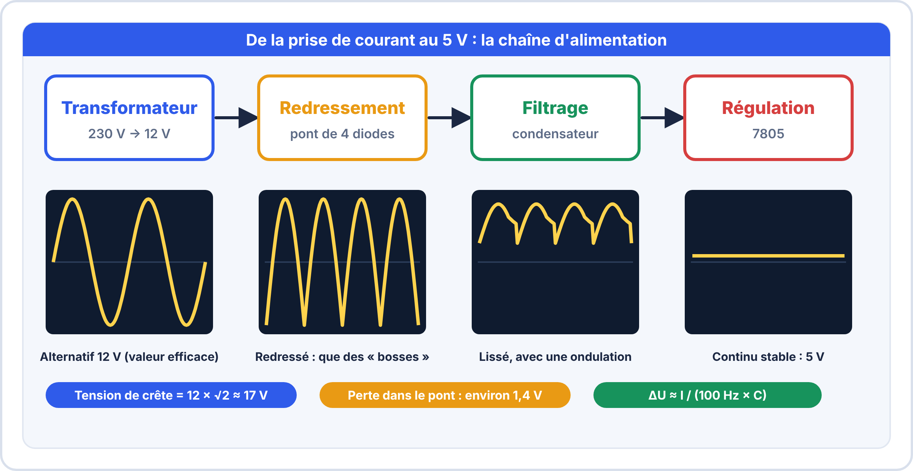
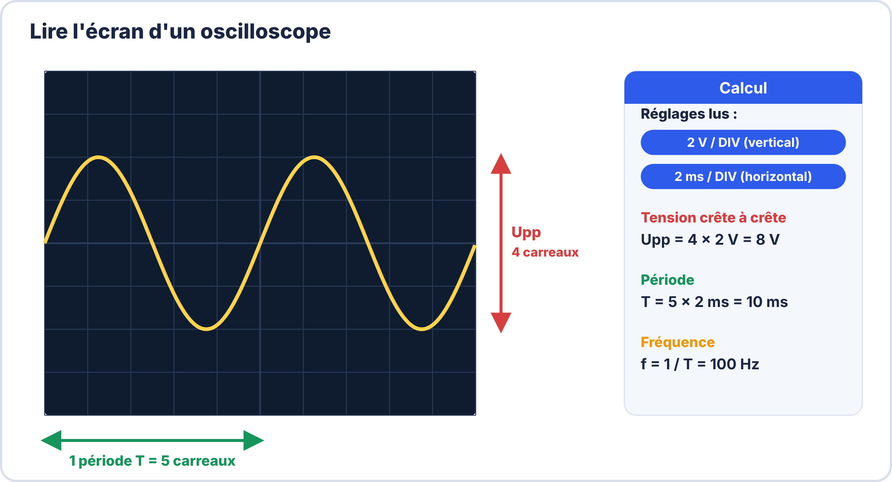

# Semaine 6 : Alimenter un montage

> **Durée** : 4 h · **Compétences E2** : C07, C11

## 🎯 À la fin de la semaine, je sais…

- décrire la **chaîne d'alimentation** d'un appareil (transformateur, redressement, filtrage, régulation) ;
- faire un **bilan de puissance** et prévoir une marge ;
- calculer la **puissance dissipée** et la **température** d'un régulateur linéaire ;
- choisir entre régulateur **linéaire** et **à découpage** ;
- estimer **l'autonomie** d'une batterie ;
- **protéger** une alimentation (diode, fusible, découplage) et **mesurer** son ondulation.

## 🗓️ Déroulé

| Durée | Activité |
|---|---|
| 1 h 15 | TP virtuels ElectroLab (redressement, filtrage, régulation) |
| 1 h | Cours : de la prise au 5 V |
| 1 h | Cours : bilan de puissance, chaleur, autonomie |
| 45 min | Atelier réel : mesure de l'alimentation du clignoteur |

## 🖥️ TP virtuel dans ElectroLab : à faire avant le TP réel

Ouvre [ElectroLab](https://yahnlp.github.io/ElectroLab/), menu **TP ▾** :

- **Le transformateur : rapport de transformation** (1 h)
- **Redressement simple et double alternance** (1 h 30)
- **Filtrage par condensateur : choix de C** (1 h 30)
- **Régulation linéaire avec un 7805** (1 h 30)
- **Diode Zener : stabilisation de tension** (1 h 15), pour aller plus loin

---

## 📖 Le cours

**🤔 À ton avis ?** Un régulateur 7805 alimenté en 12 V pour fournir 5 V à 500 mA devient brûlant. Où va l'énergie « en trop » ?

??? question "Réponse"
    Elle est **transformée en chaleur** dans le régulateur. On va apprendre à la calculer.

### 1. De la prise au 5 V : la chaîne d'alimentation

Un appareil branché au secteur transforme les 230 V alternatifs en une **tension continue stable**, en quatre étapes.

| Étape | Rôle | Composant |
|---|---|---|
| **Transformateur** | abaisser la tension alternative (isolement du secteur) | transformateur |
| **Redressement** | ne garder qu'un seul sens (le « + ») | pont de 4 diodes |
| **Filtrage** | lisser les « bosses » | gros condensateur |
| **Régulation** | fournir une tension **stable** quelle que soit la charge | 7805 |

**Rapport de transformation** : $\dfrac{U_2}{U_1} = \dfrac{N_2}{N_1}$. Un transformateur 230 V → 12 V a un rapport de $\dfrac{12}{230} \approx 0{,}052$ (environ 1/19). Le **12 V est une valeur efficace** : la crête vaut $12 \times \sqrt{2} \approx 17\,\mathrm{V}$.

**Après le pont de diodes**, la tension de crête perd environ **1,4 V** (deux diodes en série conduisent à chaque instant) : $17 - 1{,}4 \approx 15{,}6\,\mathrm{V}$.

**Le condensateur de filtrage** se charge à la crête puis se décharge dans la charge. L'ondulation (variation crête-à-crête) est d'autant plus faible que $C$ est grand et le courant faible :

$$\Delta U \approx \frac{I}{f_{ond} \times C} \qquad (f_{ond} = 100\,\mathrm{Hz} \text{ en double alternance})$$

**Exemple** : $I = 100\,\mathrm{mA}$, $C = 1000\,\mathrm{\mu F}$ : $\Delta U = \dfrac{0{,}1}{100 \times 10^{-3}} = 1\,\mathrm{V}$. Le régulateur placé derrière **supprime** cette ondulation, à condition que la tension d'entrée reste **au moins 2 V au-dessus** de sa sortie, même au creux de l'ondulation.

### 2. Le bilan de puissance

Avant de choisir une alimentation, on **additionne les courants** de tous les composants :

| Composant | Tension | Courant |
|---|---|---|
| Microcontrôleur | 3,3 V | 80 mA |
| Capteur | 3,3 V | 2 mA |
| LED | 3,3 V | 10 mA |
| **Total** | | **92 mA** |

On prévoit une **marge de 25 %** : $I_{source} \geq 1{,}25 \times I_{total}$, soit ici 115 mA minimum.

### 3. Le régulateur linéaire et la chaleur

Un régulateur linéaire « mange » l'excès de tension **en chaleur** :

$$P_{diss} = (U_{in} - U_{out}) \times I_{out} \qquad \eta \approx \frac{U_{out}}{U_{in}}$$

**Exemple** : 12 V → 5 V à 500 mA : $P = 7 \times 0{,}5 = 3{,}5\,\mathrm{W}$ et $\eta \approx 42\,\%$ : plus de la moitié de l'énergie part en chaleur. Si l'écart est grand ou le courant fort, on utilise un **convertisseur à découpage** (rendement 85 à 90 %).

| | Linéaire (7805) | À découpage (buck) |
|---|---|---|
| Rendement | faible si l'écart est grand | **85 à 95 %** |
| Chaleur | importante | faible |
| Bruit | **très faible** | plus élevé (commutation) |
| Complexité | 1 composant + 2 condensateurs | module ou circuit + bobine |
| Usage typique | faible courant, signal sensible | fort courant, batterie |

Les **condensateurs de découplage** (100 nF près de chaque circuit intégré, 10 à 100 µF sur l'alimentation) fournissent localement les pointes de courant.

### 4. La température du composant

$$T_j = T_{amb} + P_{diss} \times R_{\theta ja}$$

Pour un 7805 sans radiateur, $R_{\theta ja} \approx 65\,°\mathrm{C/W}$. On vise **moins de 105 °C** (125 °C maximum moins 20 °C de marge).

**Exemple** : $P = 1{,}2\,\mathrm{W}$ à 25 °C ambiants : $T_j = 25 + 1{,}2 \times 65 = 103\,°\mathrm{C}$ : à la limite, il faut un **radiateur**. Avec 3,5 W, $T_j$ dépasserait 250 °C : destruction.

**Choisir un radiateur** : on calcule la résistance thermique **maximale** acceptable $R_{\theta,tot} = \dfrac{T_{j,max} - T_{amb}}{P}$. Pour 3 W, 105 °C et 25 °C : $\dfrac{80}{3} \approx 27\,°\mathrm{C/W}$ : le 7805 seul (65 °C/W) ne suffit pas, il faut un **radiateur** qui ramène la résistance thermique totale **sous 27 °C/W**.

### 5. L'autonomie sur batterie

$$t = \frac{\text{capacité (mAh)}}{I_{moy}\,(\mathrm{mA})} \times 0{,}8$$

Le 0,8 tient compte du fait qu'on n'utilise pas toute la capacité. **Exemple** : 1000 mAh à 50 mA : $t = 20 \times 0{,}8 = 16\,\mathrm{h}$.

Avec une **mise en veille** : 150 mA pendant 5 s puis 0,1 mA pendant 55 s :

$$I_{moy} = \frac{150 \times 5 + 0{,}1 \times 55}{60} \approx 12{,}6\,\mathrm{mA}$$

### 6. Protéger l'alimentation

| Protection | Rôle | Remarque |
|---|---|---|
| **Diode en série** | empêche l'inversion de polarité | perd environ 0,7 V |
| **Fusible** | coupe en cas de surintensité | calibre ≈ 1,5 × courant normal |
| **Découplage** | absorbe les pointes de courant | au plus près du circuit |
| **Diode Zener / TVS** | écrête les surtensions | selon le cas |

> [!WARNING] ⚠️ Erreurs fréquentes
> - Utiliser le courant de **pointe** au lieu du courant **moyen** pour l'autonomie.
> - Oublier la **chute de tension** (diode : 0,7 V ; régulateur : 2 V).
> - Confondre tension **efficace** et tension de **crête** après un transformateur.
> - Mesurer une ondulation en couplage **DC** : on ne voit que la valeur moyenne ; il faut le couplage **AC**.

### 7. Mesurer l'ondulation à l'oscilloscope

> [!TIP] 📘 Besoin d'aide pour les réglages ?
> Consulte la fiche de ton appareil : [OWON](../ressources/oscilloscopes/owon-sds5032e.md) ou [RIGOL](../ressources/oscilloscopes/rigol-ds1104z.md), et la mission 9 du [TP Passeport oscilloscope](../ressources/oscilloscopes/tp-passeport-oscilloscope.md).

On place la sonde sur la sortie de l'alimentation en couplage **AC**, base de temps de 5 ms, sensibilité de 20 mV/div ; on lit l'amplitude **crête-à-crête**.

Une alimentation à découpage donne des **pointes brèves** (haute fréquence) ; une alimentation linéaire filtrée donne une **dent de scie** à 100 Hz.

---

## 🛠️ Atelier réel

**Fil rouge 1 : alimentation du clignoteur.**

1. **Bilan** : NE555 ≈ 10 mA, LED = 20 mA : total ?
2. **7805 sous 12 V** : puissance dissipée, puis $T_j$ ($R_{\theta ja} = 65\,°\mathrm{C/W}$, 25 °C ambiants).
3. Même calcul sous **9 V** : que gagne-t-on ?
4. **Autonomie** sur une pile 9 V de 500 mAh.
5. Faut-il un **radiateur** ? Justifie.
6. **Mesure** : alimente le clignoteur en 9 V via le 7805 et mesure la tension de sortie, puis l'ondulation à l'oscilloscope (couplage AC).

??? success "Résultats attendus"
    1. $I_{total} = 30\,\mathrm{mA}$ ; avec 25 % de marge : 37,5 mA minimum côté source.
    2. $P = (12 - 5) \times 0{,}03 = 0{,}21\,\mathrm{W}$ ; $T_j = 25 + 0{,}21 \times 65 \approx 38{,}7\,°\mathrm{C}$.
    3. $P = 4 \times 0{,}03 = 0{,}12\,\mathrm{W}$ : moins de chaleur.
    4. $t = \dfrac{500}{30} \times 0{,}8 \approx 13\,\mathrm{h}$.
    5. **Non** : 38,7 °C est très inférieur aux 105 °C exploitables.
    6. Sortie entre **4,8 et 5,2 V** (garantie du 7805) ; ondulation de l'ordre de **quelques millivolts** sur une pile (pas de secteur redressé).

## ✍️ Exercices

1. Un 7805 alimenté en 24 V débite 100 mA. Que se passe-t-il ?
2. Un convertisseur à découpage de rendement 90 % délivre 5 V sous 100 mA. Quelle puissance prélève-t-il ?
3. Pic de consommation de 220 mA : quelle source minimale ?
4. Courant moyen d'un système à 150 mA pendant 5 s puis 0,1 mA pendant 55 s ?
5. Un transformateur 230 V → 9 V alimente un pont de diodes. Quelle est la tension de crête **après** le pont (2 diodes de 0,7 V) ?
6. Filtrage : $I = 200\,\mathrm{mA}$, $C = 2200\,\mathrm{\mu F}$, redressement double alternance (100 Hz). Quelle ondulation ?

??? success "Corrigés"
    1. $P = 19 \times 0{,}1 = 1{,}9\,\mathrm{W}$ ; $T_j = 25 + 1{,}9 \times 65 \approx 148{,}5\,°\mathrm{C}$ : **supérieur à 125 °C**, le composant est détruit. Il faut un découpage ou un radiateur.
    2. $P_{in} = \dfrac{5 \times 0{,}1}{0{,}9} \approx 0{,}556\,\mathrm{W}$ (pertes ≈ 0,056 W).
    3. $220 \times 1{,}25 = 275\,\mathrm{mA}$.
    4. $\dfrac{750 + 5{,}5}{60} \approx 12{,}6\,\mathrm{mA}$.
    5. Crête : $9 \times 1{,}414 \approx 12{,}7\,\mathrm{V}$ ; après le pont : $12{,}7 - 1{,}4 \approx 11{,}3\,\mathrm{V}$.
    6. $\Delta U = \dfrac{0{,}2}{100 \times 2{,}2 \times 10^{-3}} \approx 0{,}91\,\mathrm{V}$.

## ✅ Auto-test

1. Quelle formule donne la puissance dissipée par un régulateur linéaire ?
2. Dans quel ordre trouve-t-on les quatre blocs d'une alimentation secteur ?
3. À quoi sert la marge de 25 % ?
4. Pourquoi un régulateur linéaire chauffe-t-il ?

??? success "Réponses"
    1. $P_{diss} = (U_{in} - U_{out}) \times I_{out}$.
    2. **Transformateur → redressement → filtrage → régulation**.
    3. À absorber les **pointes** de consommation et le vieillissement.
    4. Il **dissipe en chaleur** la différence $U_{in} - U_{out}$.

## 📦 Livrable

Bilan de puissance du clignoteur (tableau, $P_{diss}$, $T_j$, autonomie) et relevé de la tension de sortie avec son ondulation.

> [!NOTE] 📚 Pour approfondir (facultatif)
> Ce parcours se suffit à lui-même. Pour aller plus loin : Terminale S03 (dimensionnement d'alimentation) et S10 (atelier alimentation), Seconde S12 (tests et alimentation).
