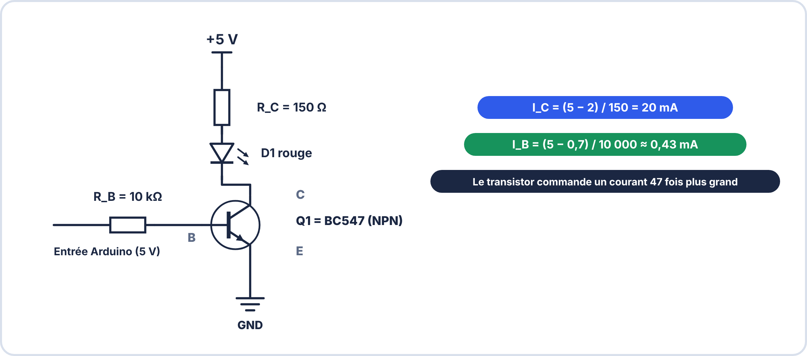
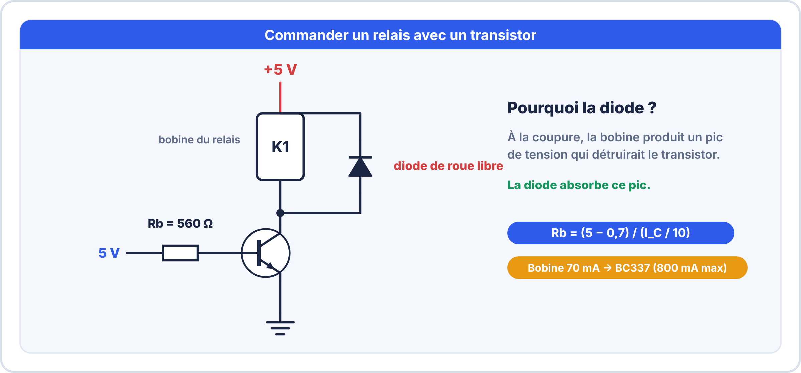
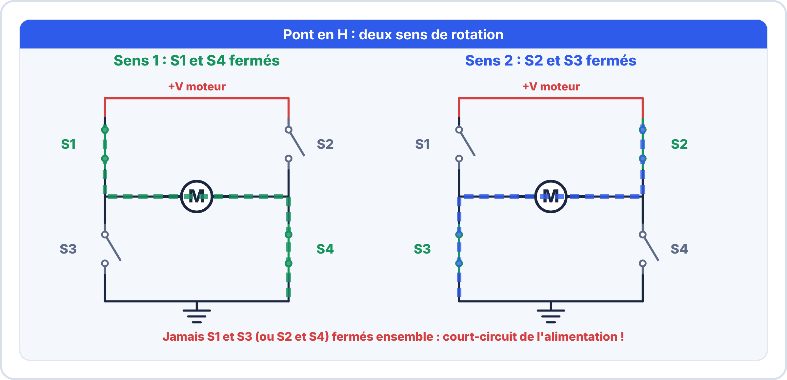

# Semaine 7 : Commander des charges

> **Durée** : 4 h · **Compétences E2** : C07, C11

## 🎯 À la fin de la semaine, je sais…

- **commander une charge** avec un transistor bipolaire, un MOSFET ou un relais ;
- calculer la **résistance de base** d'un transistor saturé ;
- protéger une charge inductive avec une **diode de roue libre** ;
- **isoler** une commande avec un optocoupleur ;
- **piloter un moteur** à courant continu (vitesse par PWM, sens par pont en H) ;
- **dépanner** une platine de commande.

## 🗓️ Déroulé

| Durée | Activité |
|---|---|
| 1 h 30 | TP virtuels ElectroLab (transistor, relais, MOSFET, optocoupleur) |
| 1 h | Cours : transistor, relais, MOSFET, isolation |
| 45 min | Cours : moteur, PWM, pont en H |
| 45 min | Atelier réel et auto-test |

## 🖥️ TP virtuel dans ElectroLab : à faire avant le TP réel

Ouvre [ElectroLab](https://yahnlp.github.io/ElectroLab/), menu **TP ▾** :

- **Transistor bipolaire en commutation** (1 h 30)
- **Relais commandé par transistor : la diode de roue libre** (1 h 30)
- **MOSFET de puissance : commande d'une lampe 12 V par une sortie logique** (1 h 15)
- **Optocoupleur : isoler une commande 5 V d'une charge 12 V** (1 h 15)
- **Dépannage d'une platine transistor + LED (6 pannes)** (1 h 30), pour consolider

---

## 📖 Le cours

**🤔 À ton avis ?** Une sortie de microcontrôleur peut fournir environ 20 mA. Comment allumer une lampe de 1 A ?

??? question "Réponse"
    Avec un **interrupteur commandé** : un transistor (ou un relais) laisse passer le gros courant de la lampe, **commandé par le petit courant** du microcontrôleur.

### 1. Le transistor bipolaire en interrupteur

Une sortie de microcontrôleur fournit environ **20 mA**. Une charge plus gourmande se commande avec un **transistor** : un petit courant de **base** autorise un grand courant de **collecteur** à l'**émetteur**.

- **Bloqué** : pas de courant de base → interrupteur **ouvert**.
- **Saturé** : courant de base suffisant → interrupteur **fermé** ($V_{CE} \approx 0{,}2\,\mathrm{V}$).

$$I_B = \frac{I_C}{10} \qquad R_b = \frac{V_{commande} - 0{,}7}{I_B}$$

On prend $I_C/10$ (et non $I_C/h_{FE}$) pour être **sûr de saturer**.

**Exemple** : charge de 50 mA, commande à 5 V : $I_B = 5\,\mathrm{mA}$ ; $R_b = \dfrac{4{,}3}{0{,}005} = 860\,\Omega$ → **820 Ω**.

**Vérifier la puissance** dans le transistor saturé : $P = V_{CE(sat)} \times I_C = 0{,}2 \times 0{,}05 = 10\,\mathrm{mW}$, négligeable.

### 2. Le relais et la diode de roue libre

Un **relais** est un interrupteur à **bobine** : il isole la commande de la charge. Sa bobine consomme environ 70 mA : on la commande par un **transistor** (BC337 : 800 mA maximum). À la coupure, la bobine produit un **pic de tension** : une **diode de roue libre** (1N4007) en parallèle inverse l'absorbe.

> [!TIP] 💡 Pourquoi un pic ?
> Une bobine **s'oppose à toute variation de courant**. Quand on coupe, elle continue à « pousser » le courant et fait monter la tension jusqu'à plusieurs dizaines de volts, ce qui **détruit le transistor**. La diode lui offre un chemin pour **décharger son énergie**.

### 3. Le MOSFET

Un MOSFET « logic level » se commande par la **tension** de grille (sans courant de commande notable). Une fois passant, il se comporte comme une petite résistance $R_{DS(on)}$ (quelques dizaines de mΩ).

$$P = R_{DS(on)} \times I^2$$

**Exemple** : 22 mΩ et 3 A : $P = 0{,}022 \times 9 \approx 0{,}2\,\mathrm{W}$ : pas de radiateur. On ajoute une **résistance de rappel** (10 kΩ) entre grille et masse pour éviter un état indéterminé.

| | Bipolaire | MOSFET |
|---|---|---|
| Commande | **courant** de base | **tension** de grille |
| Pertes à l'état passant | $V_{CE(sat)} \times I$ | $R_{DS(on)} \times I^2$ |
| Courants forts | limités | **très bien** |
| Choix typique | petite charge, simplicité | fort courant, PWM |

### 4. L'isolation par optocoupleur

Un **optocoupleur** relie deux circuits par la **lumière** : une LED à l'entrée, un phototransistor à la sortie. Il n'y a **aucun fil** entre les deux : on protège le microcontrôleur des parasites et des tensions dangereuses de la charge.

### 5. Piloter un moteur à courant continu

Un moteur est une charge **inductive** : on le commande par un MOSFET ou un driver, avec une **diode de roue libre**.

- **Vitesse** : par **PWM** (la tension moyenne est proportionnelle au rapport cyclique) : $U_{moy} = DC \times U_{alim}$.
- **Sens** : par un **pont en H** (quatre interrupteurs). Selon les interrupteurs fermés, le courant traverse le moteur dans un sens ou dans l'autre.

Un driver comme le **L293D** intègre le pont en H et les diodes de roue libre (alimentation moteur de 4,5 à 36 V, 600 mA par canal). Au **démarrage**, un moteur consomme **plusieurs fois** son courant nominal : on dimensionne l'alimentation sur ce courant.

> [!WARNING] ⚠️ Erreurs fréquentes
> - Oublier la **diode** sur une bobine ou un moteur : le transistor est détruit.
> - Calculer $R_b$ avec le gain maximal : le transistor ne sature pas.
> - Alimenter le moteur par la **sortie 5 V** de la carte : elle ne fournit pas assez de courant.
> - Fermer **deux interrupteurs du même côté** du pont en H : court-circuit.
> - Oublier de relier **les masses** (commande et puissance).

---

## 🛠️ Atelier réel

**Matériel** : alimentation 5 V, transistor BC337 ou BC547, relais 5 V, diode 1N4007, résistances, LED, multimètre.

1. **LED commandée par transistor** : charge de 20 mA (LED + résistance), commande à 5 V. Calcule $R_b$, monte le circuit, mesure $V_{CE}$ saturé.
2. **Relais** : bobine 5 V / 70 mA commandée à 5 V. Choisis le transistor et calcule $R_b$. Monte avec la diode de roue libre.
3. **Test** : retire la diode, que se passe-t-il à l'oscilloscope quand on coupe la commande ? (Si disponible)
4. Calcule la **puissance** dissipée par le transistor saturé dans le cas du relais.

??? success "Résultats attendus"
    1. $I_B = 2\,\mathrm{mA}$ ; $R_b = \dfrac{4{,}3}{0{,}002} = 2{,}15\,\mathrm{kΩ}$ → **1,8 kΩ** (valeur normalisée inférieure). $V_{CE}$ saturé : environ **0,1 à 0,2 V**.
    2. **BC337** ; $I_B = 7\,\mathrm{mA}$ ; $R_b = \dfrac{4{,}3}{0{,}007} \approx 614\,\Omega$ → **560 Ω**.
    3. Sans diode, un **pic de tension** de plusieurs dizaines de volts apparaît sur le collecteur à la coupure.
    4. $P = 0{,}2 \times 0{,}07 = 14\,\mathrm{mW}$ : négligeable.

## ✍️ Exercices

1. Charge de 30 mA, commande à 5 V : valeur de $R_b$ (règle $I_C/10$) ?
2. Un MOSFET de 40 mΩ commande 5 A. Quelle puissance dissipe-t-il ?
3. Pourquoi ne peut-on pas brancher directement un relais sur une sortie de microcontrôleur ?
4. Un moteur 12 V est commandé en PWM à 50 % : quelle tension moyenne ?
5. Dans un pont en H, quels interrupteurs ne doivent **jamais** être fermés en même temps ?
6. Un moteur consomme 400 mA en rotation et 1,6 A au démarrage. Quelle source choisis-tu (marge de 25 %) ?

??? success "Corrigés"
    1. $I_B = 3\,\mathrm{mA}$ ; $R_b = \dfrac{4{,}3}{0{,}003} \approx 1{,}4\,\mathrm{kΩ}$ → **1,2 kΩ** (E12 inférieure).
    2. $P = 0{,}04 \times 25 = 1\,\mathrm{W}$ : un petit **radiateur** est conseillé.
    3. Parce que la bobine demande **environ 70 mA**, bien plus que les 20 mA d'une sortie, et que le **pic** à la coupure détruirait la sortie.
    4. $U_{moy} = 0{,}5 \times 12 = 6\,\mathrm{V}$.
    5. Les **deux interrupteurs d'un même côté** (haut et bas de la même branche) : ce serait un **court-circuit** de l'alimentation.
    6. $1{,}6 \times 1{,}25 = 2\,\mathrm{A}$ au minimum.

## ✅ Auto-test

1. Pourquoi une diode en parallèle sur la bobine d'un relais ?
2. Quelle règle prend-on pour être sûr de saturer un transistor ?
3. Quel composant isole un microcontrôleur d'une charge sans fil entre les deux ?
4. Comment règle-t-on la vitesse d'un moteur ?

??? success "Réponses"
    1. Elle absorbe le **pic de tension** à la coupure.
    2. $I_B = I_C / 10$.
    3. Un **optocoupleur**.
    4. Par **PWM** (rapport cyclique).

## 📦 Livrable

Schéma commenté d'une commande de relais (valeurs calculées) et relevé de $V_{CE}$ transistor saturé et bloqué.

> [!NOTE] 📚 Pour approfondir (facultatif)
> Ce parcours se suffit à lui-même. Pour aller plus loin : Première S12 (transistor, MOSFET, relais) et Seconde S10 (moteur, PWM, pont en H).
