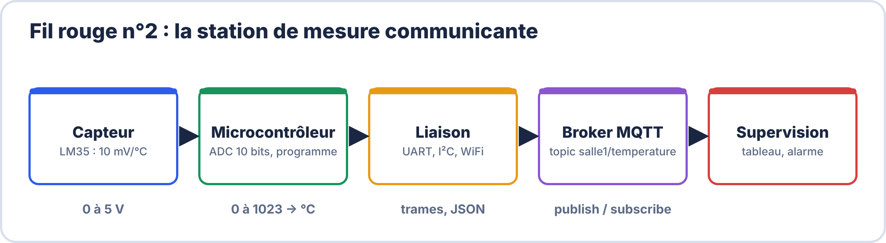
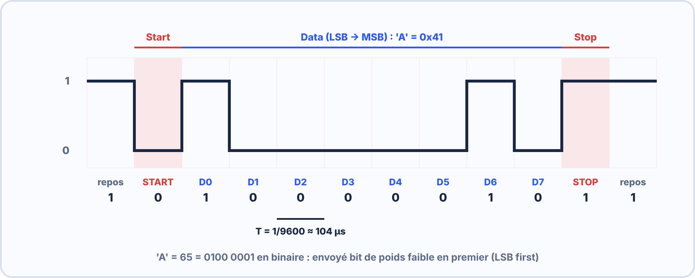
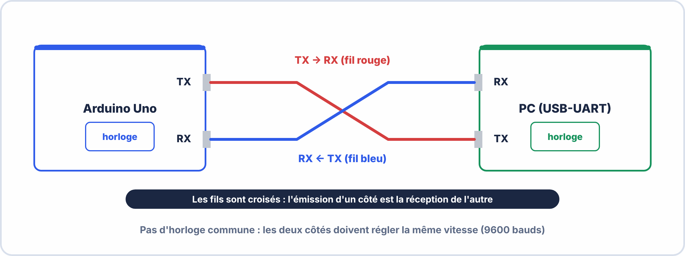
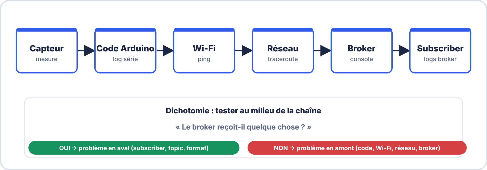

# Semaine 7 : Communication et supervision

> **Durée** : 4 h · **Compétences E2** : C07, C11

## 🎯 À la fin de la semaine, je sais…

- expliquer la chaîne **capteur → microcontrôleur → réseau → supervision** ;
- **lire une trame UART** et calculer sa durée ;
- reconnaître un **bus I²C** et son adresse ;
- décrire un échange **MQTT** (broker, topic, JSON) ;
- **superviser** une mesure (moyenne mobile, seuil avec hystérésis) ;
- **diagnostiquer** une liaison qui ne fonctionne pas.

## 🗓️ Déroulé

| Durée | Activité |
|---|---|
| 1 h | TP virtuels ElectroLab (analyseur logique, UART, I²C) |
| 1 h 15 | Cours : UART, I²C |
| 1 h | Cours : WiFi, MQTT, supervision |
| 45 min | Atelier, exercices et auto-test |

## 🖥️ TP virtuel dans ElectroLab : à faire avant le TP réel

Ouvre [ElectroLab](https://yahnlp.github.io/ElectroLab/), menu **TP ▾** :

- **Prise en main de l'analyseur logique (chronogrammes d'un compteur)** (45 min)
- **Analyse d'une liaison série UART / RS-232 (5 variantes)** (1 h 30)
- **Analyse d'un bus I²C : adresse, ACK, résistances de rappel (4 cas)** (1 h 45)

---

## 📖 Le cours

**🤔 À ton avis ?** Ton capteur de température est dans une salle, ton écran de contrôle dans un bureau. Comment la valeur voyage-t-elle jusqu'à lui ?

??? question "Réponse"
    Par une **liaison** (série, I²C, WiFi) qui suit un **protocole** : des règles communes de format et de vitesse. On étudie les plus courantes.

### 1. La chaîne de communication

Chaque maillon doit **parler la même langue** que le suivant : c'est le rôle des **protocoles**.

### 2. La liaison série UART

Les bits partent **un par un** sur un fil, à une vitesse commune : le **baud rate** (par exemple 9600). Une trame **8N1** contient **10 bits** : 1 bit de départ (0), 8 bits de données (le moins significatif d'abord), 1 bit d'arrêt (1).

$$T_{bit} = \frac{1}{\text{baud}} \qquad \text{à 9600 bauds : } T_{bit} \approx 104\,\mathrm{\mu s}\ ;\ \text{un octet} \approx 1{,}04\,\mathrm{ms}$$

**Câblage** : TX d'un côté vers **RX** de l'autre (et inversement) + **masse commune**. Même vitesse des deux côtés, sinon : caractères absurdes.

### 3. Le bus I²C

Deux fils seulement : **SDA** (données) et **SCL** (horloge), partagés par plusieurs appareils. Chacun a une **adresse** (par exemple `0x27` pour un écran LCD). Les deux lignes ont des **résistances de rappel** (≈ 4,7 kΩ) vers le +V.

### 4. WiFi et MQTT avec l'ESP32

L'**ESP32** se connecte au WiFi (mode **station**) ou crée son propre réseau (mode **point d'accès**, adresse 192.168.4.1). Ses broches fonctionnent en **3,3 V** : ne jamais y appliquer 5 V (on abaisse avec un diviseur).

**MQTT** : un **broker** (serveur) reçoit les messages d'un **publisher** et les redistribue aux **subscribers** abonnés au même **topic**.

- Exemple de topic : `salle1/temperature`. Les topics sont **sensibles à la casse**.
- Jokers : `+` (un niveau) et `#` (tous les niveaux suivants).
- Port **1883** (8883 avec TLS). Contenu souvent en **JSON** : `{"temp": 23.5}`.

### 5. Superviser : moyenne, seuil, hystérésis

- **Moyenne mobile** des N dernières mesures : elle lisse le bruit (20, 22, 21, 25 → 22).
- **Seuil avec hystérésis** : l'alarme se **déclenche** à 30 °C mais ne se **coupe** qu'en dessous de 28 °C : on évite le battement autour d'un seul seuil.

### 6. Diagnostiquer une liaison

Dans l'ordre : **alimentation** ; **câblage** (TX ↔ RX croisés, masse commune) ; **vitesse** identique ; **niveaux** de tension (3,3 V / 5 V) ; **adresse** I²C ; **IP du broker** et **topic** (casse !) pour MQTT. Outils : le **moniteur série** et l'**analyseur logique**.

> [!WARNING] ⚠️ Erreurs fréquentes
> - Deux vitesses différentes : caractères illisibles.
> - TX relié à TX (au lieu de RX).
> - Un signal de 5 V sur une broche de l'ESP32 (3,3 V maximum).
> - `Salle1/temp` et `salle1/temp` : deux topics **différents**.

---

## 🛠️ Atelier : trames, topics et supervision

1. **Trame UART** : écris la trame de la lettre `A` (code `0x41`) en 8N1.
2. **Durées** : durée d'un octet à 9600 bauds, puis à 115 200 bauds.
3. **Topics MQTT** : propose les topics de 3 salles et le topic qui permet de s'abonner aux 3.
4. **Hystérésis** : seuils 30 °C (déclenchement) et 28 °C (retour) ; mesures 29,5 ; 30,5 ; 29,5 ; 28,5 ; 27,9. État de l'alarme pour chaque mesure ?
5. **Niveaux** : un signal de 5 V doit entrer dans l'ESP32 : propose un diviseur 1 kΩ / 2 kΩ et calcule la tension.

??? success "Résultats attendus"
    1. `0x41` = 01000001 ; bits envoyés : **0** (départ), **1 0 0 0 0 0 1 0**, **1** (arrêt).
    2. 9600 bauds : environ **1,04 ms** ; 115 200 bauds : environ **87 µs**.
    3. `salle/1/temperature`, `salle/2/temperature`, `salle/3/temperature` ; abonnement `salle/+/temperature`.
    4. OK, **ALARME**, ALARME, ALARME, **OK**.
    5. $5 \times \dfrac{2}{1 + 2} \approx 3{,}33\,\mathrm{V}$.

## ✍️ Exercices

1. Combien de bits dans une trame 8N1 ?
2. Quelle différence entre UART et I²C ?
3. Moyenne mobile de 18, 20, 22, 24 ?
4. Quel port utilise MQTT sans chiffrement ?
5. Un ESP32 reçoit 5 V sur une broche : quel risque ?

??? success "Corrigés"
    1. **10 bits**.
    2. L'**UART** relie **deux** appareils (TX/RX, vitesse commune) ; l'**I²C** relie **plusieurs** appareils sur 2 fils grâce aux **adresses**.
    3. $\dfrac{84}{4} = 21$.
    4. **1883**.
    5. Les broches sont en **3,3 V** : la puce peut être **détruite**.

## ✅ Auto-test

1. Que signifie « baud rate » ?
2. À quoi sert l'adresse I²C ?
3. Quels sont les trois acteurs de MQTT ?
4. Pourquoi une hystérésis ?

??? success "Réponses"
    1. La **vitesse** de transmission (symboles par seconde).
    2. À **repérer** chaque appareil sur le bus.
    3. **Broker**, **publisher**, **subscriber**.
    4. Pour éviter que l'alarme **batte** autour d'un seul seuil.

## 📦 Livrable

Schéma de la chaîne de ta station (capteur, microcontrôleur, protocole, topic MQTT) avec les valeurs choisies.

> [!NOTE] 📚 Pour approfondir (facultatif)
> Ce parcours se suffit à lui-même. Pour aller plus loin : Seconde S13 et S15 (UART, I²C), Première S06 et S07 (ESP32, MQTT), Terminale S04 (KPI et alarmes).
