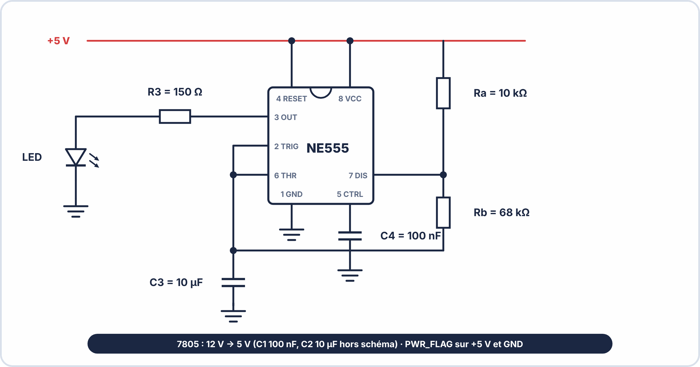
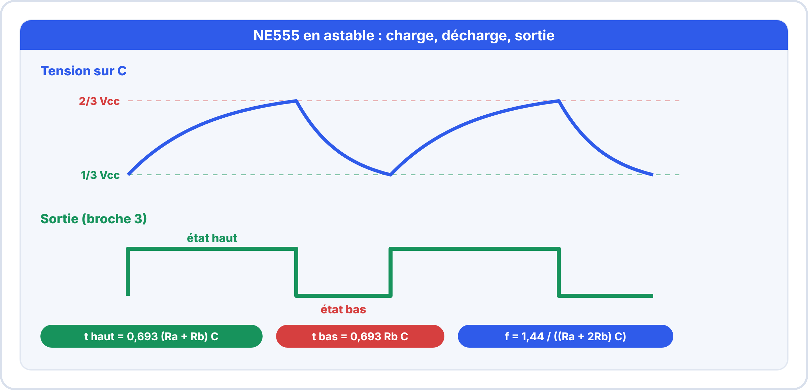
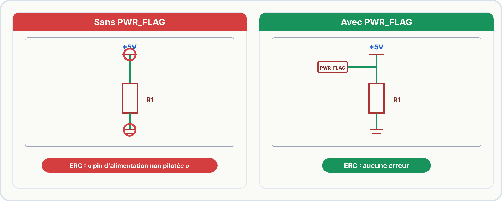
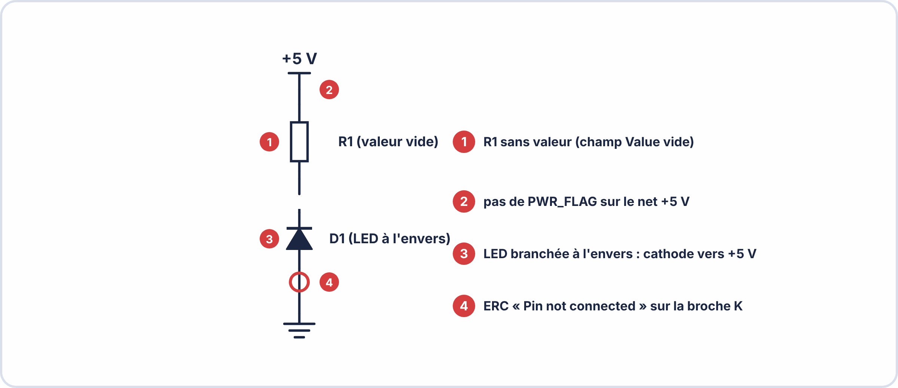

# Semaine 8 : De l'idée au schéma et au circuit imprimé

> **Durée** : 4 h · **Compétence E2** : C07

## 🎯 À la fin de la semaine, je sais…

- décrire le **flux de conception** d'une carte, de l'idée au circuit imprimé ;
- **saisir un schéma** dans KiCad et le contrôler avec l'**ERC** ;
- associer une **empreinte** à chaque composant ;
- **placer** les composants et **router** un circuit imprimé avec des règles de conception.

## 🗓️ Déroulé

| Durée | Activité |
|---|---|
| 45 min | TP virtuel ElectroLab : valider le clignoteur avant de le dessiner |
| 1 h | Cours : flux, schéma, ERC, empreintes |
| 1 h 15 | Atelier réel : schéma du clignoteur dans KiCad |
| 1 h | Cours et atelier : règles, placement, routage |

## 🖥️ TP virtuel dans ElectroLab : à faire avant le TP réel

Ouvre [ElectroLab](https://yahnlp.github.io/ElectroLab/), menu **TP ▾** : **NE555 en multivibrateur astable (4 fréquences)** (1 h 30).

Puis ouvre le sujet [`clignoteur.json`](tp/clignoteur.json) (bouton **Ouvrir**) : le clignoteur complet (alimentation 5 V, fusible, NE555, LED, oscilloscope). Relève la période $T$ (attendu environ **1,01 s**), la fréquence (environ **0,99 Hz**), le rapport cyclique (environ **55 %**) et la tension de sortie à l'état haut (environ **3,1 V**).

---

## 📖 Le cours

**🤔 À ton avis ?** Pourquoi dessiner le schéma **dans un logiciel** plutôt que sur papier, alors qu'on va ensuite faire le circuit imprimé ?

??? question "Réponse"
    Parce que le logiciel (KiCad) **garde en mémoire les liaisons** et les transmet au circuit imprimé (c'est la **netlist**). Une erreur de schéma se répercute partout : on la contrôle donc **avant**.

### 1. Le flux de conception

**Schéma → ERC → empreintes → PCB → DRC → fichiers de fabrication.** Chaque étape se **vérifie** avant la suivante.

### 2. Le fil rouge : le clignoteur NE555

Le NE555 charge puis décharge le condensateur $C$ entre **1/3 et 2/3 de $V_{cc}$**. La sortie est à l'état haut pendant la charge, à l'état bas pendant la décharge.

$$t_{haut} = 0{,}693\,(R_a + R_b)\,C \qquad t_{bas} = 0{,}693\,R_b\,C \qquad f = \frac{1{,}44}{(R_a + 2R_b)\,C}$$

Avec $R_a = 10\,\mathrm{kΩ}$, $R_b = 68\,\mathrm{kΩ}$, $C = 10\,\mathrm{\mu F}$ : $f \approx 0{,}99\,\mathrm{Hz}$.

### 3. Saisir le schéma dans KiCad

| Touche | Action |
|---|---|
| **A** | ajouter un composant (cherche par nom : `R`, `LED`, `NE555`, `BC547`) |
| **P** | ajouter une alimentation (+5 V, GND) |
| **W** | tracer un fil |
| **L** | poser une étiquette de réseau |
| **Q** | marquer une broche « non connectée » |

Ensuite : **annoter** (R1, R2…), **saisir les valeurs**, lancer l'**ERC**.

### 4. L'ERC : le contrôle électrique

| Erreur | Cause | Solution |
|---|---|---|
| `power_pin_not_driven` | KiCad ne sait pas qu'une source alimente le rail | poser un **PWR_FLAG** |
| `pin_not_connected` | broche en l'air | la relier, ou poser un **No Connect** |
| `duplicate_reference` | deux composants au même repère | annoter à nouveau |

### 5. Les empreintes

L'**empreinte** est le dessin des **pastilles** sur le circuit imprimé : elle doit correspondre au **boîtier réel** (THT ou CMS, dimensions de la datasheet).

> [!WARNING] ⚠️ Erreur fréquente
> Choisir une empreinte **sans vérifier la datasheet** : le composant ne rentre pas sur la carte fabriquée.

### 6. Les règles de conception

| Règle | Valeur courante | Pourquoi |
|---|---|---|
| **Clearance** (espace entre deux pistes) | 0,2 à 0,25 mm | éviter les courts-circuits |
| Piste de **signal** | 0,25 à 0,35 mm | faible courant |
| Piste d'**alimentation** | 0,5 à 0,8 mm | plus de courant |
| **Via** | Ø 0,8 mm, perçage 0,4 mm | passer d'une face à l'autre |

### 7. Placement et routage

1. **Contour** de la carte (couche *Edge.Cuts*).
2. Placer les **connecteurs au bord**, puis l'**alimentation**, puis le circuit principal, puis les passifs **près des circuits** qu'ils servent.
3. Le **condensateur de découplage** (100 nF) se place **au plus près** des broches d'alimentation du circuit intégré.
4. **Router l'alimentation en premier**, puis les signaux. Une masse **continue** limite les perturbations.

---

## 🛠️ Atelier réel : le schéma du clignoteur

1. Crée le projet `clignoteur`.
2. Place : connecteur 2 broches (+12 V / GND), **7805** avec ses condensateurs (100 nF entrée, 10 µF sortie), **NE555**, $R_a$, $R_b$, $C_3$ (10 µF), **100 nF** sur la broche 5, $R_3$ (150 Ω), LED.
3. Câble : broches 4 et 8 au +5 V, 1 à la masse, 2 et 6 reliées entre elles et à $C_3$, 7 entre $R_a$ et $R_b$, sortie 3 vers $R_3$ puis LED vers la masse.
4. Ajoute 2 **PWR_FLAG**, **annote**, saisis les **valeurs**. Lance l'**ERC** : **0 erreur**.
5. Associe les **empreintes**. Mets à jour le PCB, trace le contour **60 × 40 mm**, règle les contraintes, place, **route**.

??? success "Résultats attendus"
    - ERC : **0 erreur**.
    - Empreintes : R → `Resistor_THT:R_Axial_DIN0207_L6.3mm_D2.5mm_P10.16mm_Horizontal` ; LED → `LED_THT:LED_D5.0mm` ; NE555 → `Package_DIP:DIP-8_W7.62mm` ; 7805 → `Package_TO_SOT_THT:TO-220-3_Vertical` ; condensateur chimique → `Capacitor_THT:CP_Radial_D5.0mm_P2.50mm` ; connecteur → `Connector_PinHeader_2.54mm:PinHeader_1x02_P2.54mm_Vertical`.
    - Piste d'alimentation visiblement plus large que les pistes de signal.

## ✍️ Exercices

1. L'ERC affiche `power_pin_not_driven` sur +5 V. Que faire ?
2. Deux composants portent le repère R1. Quelle erreur et quelle action ?
3. Deux pistes sont à 0,18 mm l'une de l'autre, la règle est de 0,25 mm. Violation de combien ?
4. Où place-t-on le condensateur de découplage du NE555 ?
5. NE555 : $R_a = 10\,\mathrm{kΩ}$, $R_b = 68\,\mathrm{kΩ}$, $C = 10\,\mathrm{\mu F}$ : calcule $t_{haut}$ et $t_{bas}$.

??? success "Corrigés"
    1. Poser un **PWR_FLAG** sur le net +5 V.
    2. `duplicate_reference` : **annoter à nouveau** le schéma.
    3. $0{,}25 - 0{,}18 = 0{,}07\,\mathrm{mm}$ : le DRC signale une erreur.
    4. **Au plus près** des broches 8 (VCC) et 1 (GND).
    5. $t_{haut} = 0{,}693 \times 78\,000 \times 10^{-5} \approx 0{,}54\,\mathrm{s}$ ; $t_{bas} = 0{,}693 \times 68\,000 \times 10^{-5} \approx 0{,}47\,\mathrm{s}$ ; $T \approx 1{,}01\,\mathrm{s}$.

## ✅ Auto-test

1. Que contrôle l'ERC ? Que contrôle le DRC ?
2. À quoi sert un PWR_FLAG ?
3. Dans quel ordre route-t-on ?
4. Pourquoi corriger l'ERC avant de passer au PCB ?

??? success "Réponses"
    1. L'ERC contrôle les **règles électriques du schéma** ; le DRC, les **règles géométriques du PCB**.
    2. À indiquer à KiCad qu'un rail est **bien alimenté**.
    3. **Alimentation** d'abord, puis les signaux.
    4. Une erreur de schéma se répercute sur **tout le PCB**.

## 📦 Livrable

Schéma complet du clignoteur (ERC à 0 erreur), empreintes associées et PCB routé.

> [!NOTE] 📚 Pour approfondir (facultatif)
> Ce parcours se suffit à lui-même. Pour aller plus loin : Première S01 à S03 (KiCad, schéma, PCB) et Terminale S06 (flux KiCad complet).
