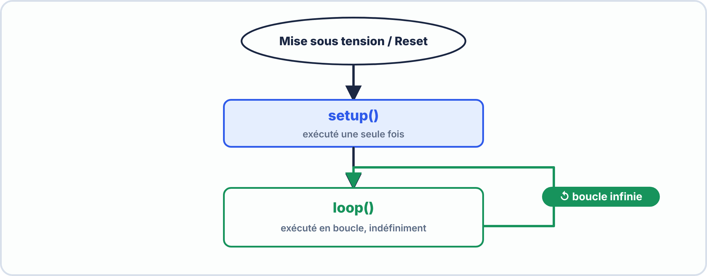
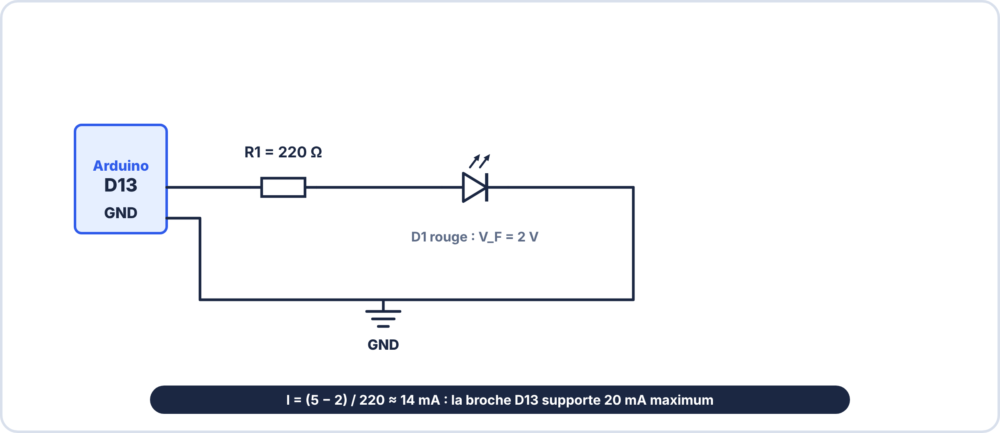
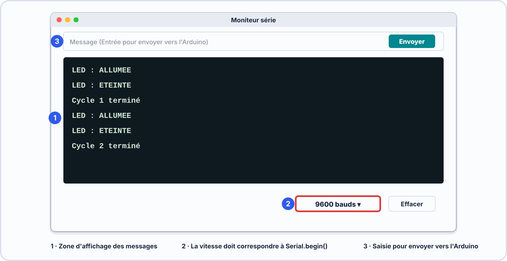
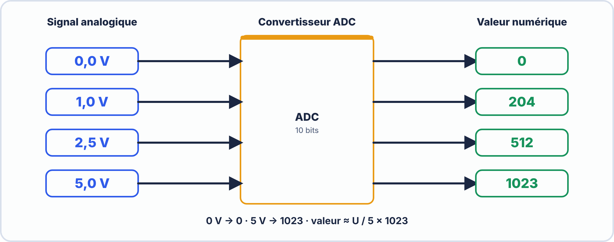
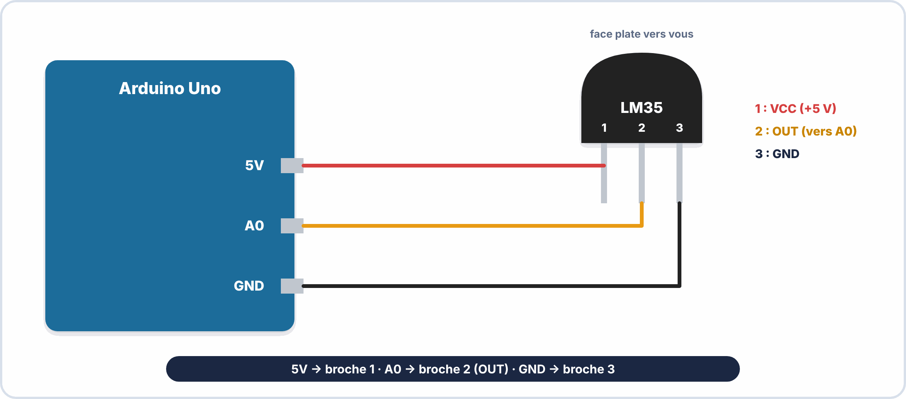

# Semaine 8 : Microcontrôleur et capteurs

> **Durée** : 4 h · **Compétences E2** : C07, C11

## 🎯 À la fin de la semaine, je sais…

- écrire et lire un **programme Arduino** simple (entrées, sorties, conditions, moniteur série) ;
- **lire un capteur analogique** (LM35, capteur résistif) et convertir la valeur en grandeur physique ;
- **lire un capteur numérique** et un bouton, en évitant les rebonds ;
- produire un signal **PWM** ;
- connaître la **résolution** et les limites d'une mesure.

## 🗓️ Déroulé

| Durée | Activité |
|---|---|
| 45 min | TP virtuel ElectroLab (diviseur de tension) |
| 1 h 15 | Cours : programme Arduino, entrées et sorties |
| 1 h | Cours : conversion analogique-numérique, capteurs |
| 1 h | Atelier réel : la station de mesure |

## 🖥️ TP virtuel dans ElectroLab : à faire avant le TP réel

Ouvre [ElectroLab](https://yahnlp.github.io/ElectroLab/), menu **TP ▾** :

- **Diviseur de tension et influence du voltmètre** (1 h) : base de **tous** les capteurs résistifs.
- **LED : calcul de la résistance de limitation** (1 h), pour réviser.

---

## 📖 Le cours

**🤔 À ton avis ?** Un capteur délivre une tension de 0,25 V. Comment l'Arduino peut-il en faire « 25 °C » sur un écran ?

??? question "Réponse"
    Il **convertit** la tension en un nombre (convertisseur ADC), puis le programme applique une **formule**. On apprend chaque étape.

### 1. Un microcontrôleur, c'est quoi ?

Un **microcontrôleur** est un petit ordinateur sur une puce : il lit des **entrées**, exécute un **programme** et pilote des **sorties**. Les cartes **Arduino Uno** (5 V) ou **ESP32** (3,3 V) en sont équipées.


### 2. Le programme : `setup()` et `loop()`



```cpp
void setup() {            // exécuté UNE fois au démarrage
  pinMode(13, OUTPUT);    // broche 13 = sortie
  Serial.begin(9600);     // moniteur série à 9600 bauds
}
void loop() {             // répété en boucle
  digitalWrite(13, HIGH); // sortie à 5 V
  delay(500);             // attendre 500 ms
  digitalWrite(13, LOW);
  delay(500);
}
```

| Instruction | Rôle |
|---|---|
| `pinMode(p, OUTPUT / INPUT / INPUT_PULLUP)` | choisir le rôle d'une broche |
| `digitalWrite(p, HIGH / LOW)` | mettre une sortie à 5 V / 0 V |
| `digitalRead(p)` | lire une entrée (HIGH ou LOW) |
| `analogRead(A0)` | lire une tension de 0 à 5 V : nombre de **0 à 1023** |
| `analogWrite(p, 0…255)` | signal **PWM** |
| `Serial.println(x)` | afficher x sur le moniteur série |





### 3. Prendre une décision : `if`

```cpp
float t = lireTemperature();
if (t > 30.0) {
  digitalWrite(8, HIGH);   // alarme
} else {
  digitalWrite(8, LOW);
}
```

Les opérateurs de comparaison : `==` (égal), `!=` (différent), `<`, `>`, `<=`, `>=`. **Attention** : `=` **affecte** une valeur, `==` **compare**.

### 4. Le bouton poussoir

Avec `INPUT_PULLUP`, une résistance interne tire l'entrée à 5 V. Le bouton relié à la masse donne **LOW quand on appuie**.


> [!TIP] 💡 Les rebonds
> À l'appui, le contact **rebondit** pendant quelques millisecondes : l'Arduino peut compter plusieurs appuis. Solution simple : attendre **20 à 50 ms** (`delay(30)`) après une détection, puis relire.

### 5. Lire un capteur : la conversion analogique-numérique

Le convertisseur **ADC** de l'Arduino a **10 bits** : $2^{10} = 1\,024$ valeurs (0 à 1023) pour 0 à 5 V. Un pas vaut $\dfrac{5}{1023} \approx 4{,}9\,\mathrm{mV}$.



$$U = \text{valeur} \times \frac{5}{1023}$$

> [!NOTE] 🔎 Et l'ESP32 ?
> Son ADC a **12 bits** ($2^{12} = 4096$ valeurs, 0 à 4095) pour 0 à **3,3 V** : un pas de $\dfrac{3{,}3}{4095} \approx 0{,}8\,\mathrm{mV}$. Le calcul devient $U = \text{valeur} \times \dfrac{3{,}3}{4095}$.

**Capteur de température LM35** : **10 mV par °C**, donc $T = U \times 100$.




```cpp
void loop() {
  int brut = analogRead(A0);
  float tension = brut * 5.0 / 1023.0;
  float temperature = tension * 100.0;
  Serial.println(temperature);
  delay(1000);
}
```

**Exemple** : `brut = 51` → $U \approx 0{,}249\,\mathrm{V}$ → $T \approx 24{,}9\,°\mathrm{C}$. Un pas de l'ADC correspond à environ 0,5 °C : c'est la **résolution** de la mesure.

### 6. Les capteurs résistifs et le diviseur de tension

Une **photorésistance** (LDR) ou une **thermistance** change de résistance. Pour la lire, on la place dans un **diviseur de tension** avec une résistance fixe :

$$U_{mesure} = V_{CC} \times \frac{R_{fixe}}{R_{fixe} + R_{capteur}}$$

**Exemple** : $V_{CC} = 5\,\mathrm{V}$, $R_{fixe} = 10\,\mathrm{kΩ}$, LDR à 2 kΩ (éclairée) : $U = 5 \times \dfrac{10}{12} \approx 4{,}17\,\mathrm{V}$ ; LDR à 50 kΩ (sombre) : $U = 5 \times \dfrac{10}{60} \approx 0{,}83\,\mathrm{V}$.

### 7. Les capteurs numériques

Un capteur comme le **DHT22** (température et humidité) envoie directement un **nombre** par une liaison numérique : on utilise une **bibliothèque** qui s'occupe du protocole. Il impose un délai d'**au moins 2 s** entre deux lectures.

### 8. Le signal PWM

`analogWrite(9, 64)` donne un rapport cyclique de $\dfrac{64}{255} \approx 25\,\%$ à environ 490 Hz. La **tension moyenne** est $DC \times V_{CC}$ : on l'utilise pour **dimmer une LED** ou piloter un moteur.

> [!WARNING] ⚠️ Erreurs fréquentes
> - Oublier `Serial.begin(9600)` ou régler le moniteur sur une autre vitesse : texte illisible.
> - Diviser des entiers (`brut / 1023`) : le résultat est tronqué. Écrire `1023.0`.
> - Brancher un capteur analogique sur une broche **numérique** au lieu de A0…
> - Écrire `if (x = 5)` au lieu de `if (x == 5)`.
> - Appliquer 5 V sur l'entrée d'un **ESP32** (3,3 V) : risque de destruction.

---

## 🛠️ Atelier réel : la station de mesure

**Fil rouge 2.** Matériel : Arduino (ou ESP32), LM35, LED, bouton, résistance 220 Ω, LDR, résistance 10 kΩ.

1. Câble la **LED** sur la broche 13 avec 220 Ω. Téléverse le programme de clignotement (500 ms).
2. Câble le **bouton** entre la broche 2 et la masse (`INPUT_PULLUP`) : la LED s'allume tant qu'on appuie.
3. Câble le **LM35** (+5 V, A0, GND). Écris le programme de lecture et affiche la température sur le moniteur série (9600 bauds).
4. Ajoute une **alarme** : la LED s'allume si $T > 28\,°\mathrm{C}$.
5. Câble la **LDR** en diviseur de tension (A1) : affiche la valeur brute à l'ombre et à la lumière.
6. Place la LED sur une broche PWM (9) et fais varier l'intensité avec `analogWrite`.

??? success "Résultats attendus"
    1. La LED clignote à **1 Hz**.
    2. LED allumée **quand on appuie** (bouton relié à la masse : LOW).
    3. La **température ambiante** (par exemple 22 à 25 °C), qui monte si on touche le capteur.
    4. En réchauffant le capteur avec les doigts, la LED s'allume vers 28 °C ; elle s'éteint quand le capteur refroidit (on verra l'hystérésis en semaine 9).
    5. **Valeur élevée** (plusieurs centaines) à la lumière, **faible** à l'ombre (ou l'inverse selon le sens du diviseur).
    6. Intensité proportionnelle au rapport cyclique ($64/255 \approx 25\,\%$ : faible ; 255 : maximale).

## ✍️ Exercices

1. Combien de valeurs distinctes peut renvoyer `analogRead` ?
2. `analogRead` renvoie 102 pour un LM35 : quelle température ?
3. Quel rapport cyclique donne `analogWrite(9, 128)` ?
4. Avec `INPUT_PULLUP`, que lit-on quand le bouton relié à la masse est appuyé ?
5. LDR de 20 kΩ avec $R_{fixe} = 10\,\mathrm{kΩ}$ et $V_{CC} = 5\,\mathrm{V}$ : quelle tension mesure-t-on ? Quelle valeur `analogRead` ?
6. ADC 12 bits sur 3,3 V : quelle tension correspond à la valeur 2048 ?

??? success "Corrigés"
    1. $2^{10} = 1\,024$ valeurs (0 à 1023).
    2. $U = 102 \times \dfrac{5}{1023} \approx 0{,}50\,\mathrm{V}$ ; $T \approx 49{,}9\,°\mathrm{C}$.
    3. $\dfrac{128}{255} \approx 50\,\%$.
    4. **LOW** (0).
    5. $U = 5 \times \dfrac{10}{30} \approx 1{,}67\,\mathrm{V}$ ; valeur $\approx 1{,}67 \times \dfrac{1023}{5} \approx 341$.
    6. $2048 \times \dfrac{3{,}3}{4095} \approx 1{,}65\,\mathrm{V}$ (la moitié de l'échelle).

## ✅ Auto-test

1. Que fait `analogRead(A0)` ?
2. Pourquoi écrire `5.0 / 1023.0` ?
3. Que signifie « résolution » pour un ADC ?
4. Quelle différence entre `=` et `==` ?

??? success "Réponses"
    1. Il lit une tension de 0 à 5 V et renvoie un nombre de **0 à 1023**.
    2. Pour forcer un calcul **décimal**.
    3. La **plus petite variation** de tension que l'ADC distingue (ici 4,9 mV).
    4. `=` **affecte** une valeur ; `==` **compare**.

## 📦 Livrable

Programme commenté qui lit un capteur de température et affiche la valeur en °C sur le moniteur série, avec une alarme.

> [!NOTE] 📚 Pour approfondir (facultatif)
> Ce parcours se suffit à lui-même. Pour aller plus loin : Seconde S07 à S09 (Arduino, entrées numériques, LM35).
