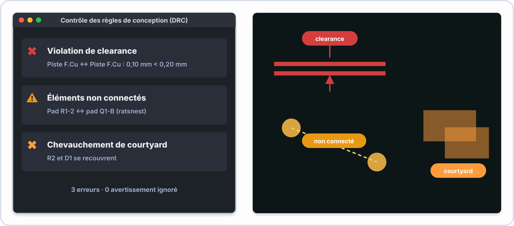
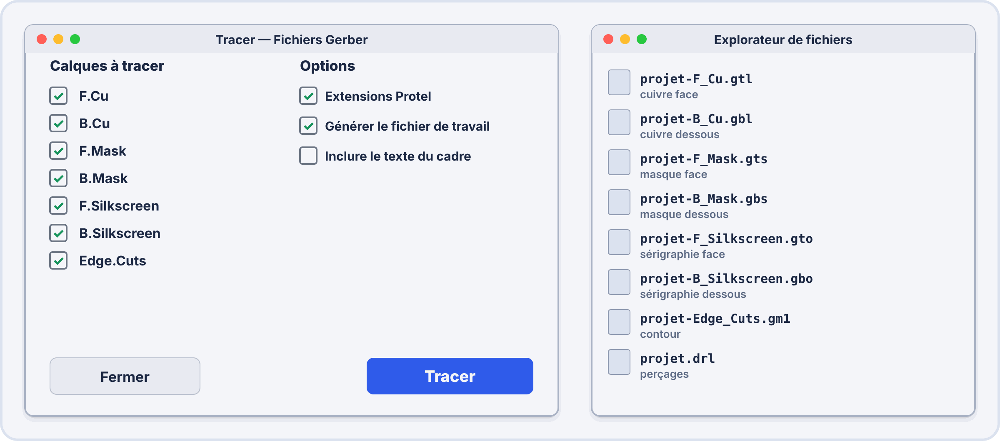
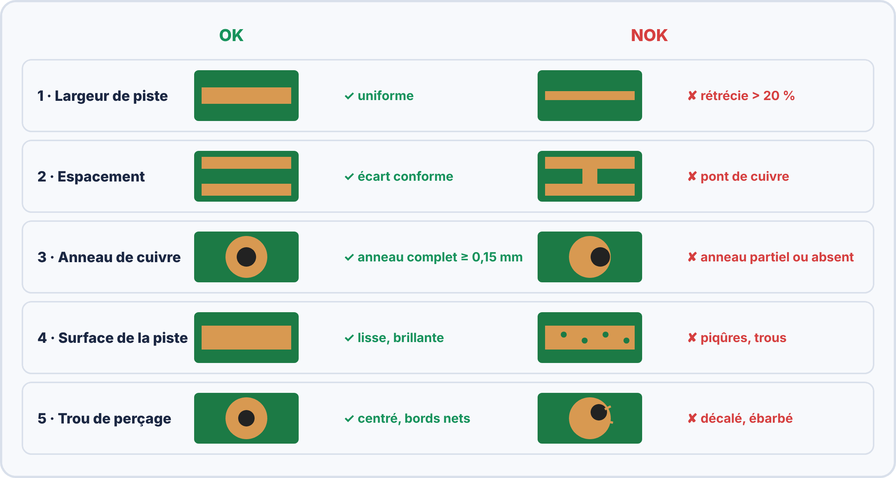

# Semaine 9 : Des fichiers de fabrication à la carte soudée

> **Durée** : 4 h · **Compétence E2** : C07

## 🎯 À la fin de la semaine, je sais…

- passer le **DRC** et corriger les erreurs ;
- exporter les **fichiers Gerber**, le **perçage** et la **BOM**, et les **vérifier** ;
- comprendre comment une carte est **fabriquée** ;
- **souder** la carte dans le bon ordre et la **contrôler** selon IPC-A-610 ;
- **mettre sous tension** en sécurité.

## 🗓️ Déroulé

| Durée | Activité |
|---|---|
| 45 min | TP virtuel ElectroLab : tester des composants hors tension |
| 1 h 15 | Cours : DRC, Gerber, fabrication du PCB |
| 1 h | Atelier : export, vérification dans un visualiseur |
| 1 h | Atelier : soudure, contrôle et mise sous tension |

## 🖥️ TP virtuel dans ElectroLab : à faire avant le TP réel

Ouvre [ElectroLab](https://yahnlp.github.io/ElectroLab/), menu **TP ▾** : **Tester les composants hors tension (ohmmètre, diode, continuité)** (1 h). Tu t'entraînes à contrôler les composants **avant** de les souder.

---

## 📖 Le cours

**🤔 À ton avis ?** Tu envoies ta carte à un fabricant. Comment est-il sûr de faire **exactement** ce que tu as dessiné ?

??? question "Réponse"
    Il reçoit des **fichiers normalisés** (Gerber) : un fichier par couche (cuivre, vernis, sérigraphie, contour), plus le fichier de perçage. Tu les **vérifies** avant de les envoyer : c'est ce qui sera réellement fabriqué.

### 1. Le contrôle des règles : le DRC

Le **DRC** vérifie que **rien ne viole les règles** (pistes trop proches, trop fines, pastilles qui se touchent). Objectif : **0 erreur** avant d'exporter.

### 2. Les couches et les fichiers Gerber

Un circuit imprimé est un **sandwich** de couches.

Le fabricant reçoit :

- les **Gerber** : un fichier par couche (cuivre, masque de soudure, sérigraphie, contour *Edge.Cuts*) ;
- le fichier de **perçage** (`.drl`) ;
- la **BOM** (liste des composants) pour l'assemblage.

> [!TIP] 💡 Toujours vérifier
> Un fichier Gerber est une **image vectorielle** d'une couche. On l'ouvre dans un **visualiseur** pour voir **exactement** ce qui sera fabriqué : pistes, contour, trous.

### 3. Comment est fabriqué un circuit imprimé ?

On part d'une plaque **recouverte de cuivre**, on **protège** les pistes à garder, puis un produit **dissout** le cuivre inutile (gravure), on **perce** les trous et on applique un vernis.

### 4. Les critères de qualité (IPC)

L'**anneau de cuivre** est la couronne de cuivre qui reste autour d'un trou :

$$\text{anneau} = \frac{\varnothing_{pastille} - \varnothing_{trou}}{2}$$

### 5. Souder la carte

**Ordre de soudure** : de la **plus basse** à la **plus haute** pièce : résistances, support de circuit intégré, condensateurs, régulateur, connecteur, LED. On soude **côté cuivre**, on coupe les pattes.

Critères (classe 2) : brasure **brillante**, en **cône**, trou rempli à **75 % au moins** ; **aucun pont** ni soudure froide.

### 6. Mise sous tension

> [!TIP] 💡 Avant d'alimenter
> 1. **Inspecter** visuellement (ponts, composants à l'envers). 2. **Mesurer la continuité** entre +5 V et GND : **aucun bip** (pas de court-circuit). 3. Alimentation de labo : **limite de courant réglée**. 4. Mettre sous tension et **observer le courant**.

> [!WARNING] ⚠️ Erreurs fréquentes
> - Ne pas ouvrir les Gerber avant l'envoi.
> - Oublier le fichier de **perçage**.
> - Souder un composant polarisé (LED, condensateur chimique) **à l'envers**.
> - Alimenter sans avoir testé l'absence de court-circuit.

---

## 🛠️ Atelier réel

1. Lance le **DRC** : 0 erreur. Si besoin, corrige (écarter les pistes, élargir).
2. **Exporte** les Gerber (cuivre, masque, sérigraphie, contour), le perçage et la BOM.
3. **Ouvre-les** dans un visualiseur : tout est-il présent ?
4. **Soude** la carte dans l'ordre. **Contrôle** chaque brasure.
5. Mesure la **continuité** entre +5 V et GND (hors tension), puis **alimente** avec une limite de 100 mA.

??? success "Résultats attendus"
    1. DRC : **0 erreur**.
    2. Fichiers : couche cuivre (F.Cu ou B.Cu), masque, sérigraphie, `Edge.Cuts`, `.drl`, BOM `.csv`.
    3. Le contour et tous les trous apparaissent.
    4. Brasures brillantes en cône, trous remplis à 75 % au moins.
    5. **Aucun bip** entre +5 V et GND ; consommation faible (quelques dizaines de mA) ; la LED clignote.

## ✍️ Exercices

1. Une pastille de 1,8 mm est percée à 1,0 mm. Quelle est la largeur de l'anneau ?
2. Un remplissage de 70 % est-il conforme en classe 2 ?
3. Quels fichiers envoie-t-on au fabricant ?
4. Pourquoi ouvrir les Gerber dans un visualiseur ?
5. Pourquoi soude-t-on les composants du plus bas au plus haut ?

??? success "Corrigés"
    1. $\dfrac{1{,}8 - 1{,}0}{2} = 0{,}4\,\mathrm{mm}$.
    2. **Non** : il faut au moins 75 %.
    3. Les **Gerber**, le fichier de **perçage** et la **BOM**.
    4. Pour **voir ce qui sera réellement fabriqué** et détecter une erreur avant la commande.
    5. Pour que la carte **reste posée à plat** sur la table pendant qu'on soude les composants plus hauts.

## ✅ Auto-test

1. Que contient un fichier Gerber ?
2. Que signifie « classe 2 » en IPC ?
3. Comment vérifie-t-on l'absence de court-circuit avant l'alimentation ?
4. Quel défaut caractérise une soudure froide ?

??? success "Réponses"
    1. Le dessin d'**une couche** (cuivre, masque, sérigraphie, contour…).
    2. Un niveau de qualité pour les produits **professionnels** (classe 3 : haute fiabilité).
    3. Par la **continuité** entre +5 V et GND : **aucun bip**.
    4. Elle est **terne et craquelée**.

## 📦 Livrable

Dossier de fabrication (Gerber, perçage, BOM) et carte clignoteur soudée et contrôlée.

> [!NOTE] 📚 Pour approfondir (facultatif)
> Ce parcours se suffit à lui-même. Pour aller plus loin : Première S03 et S04 (PCB, double face, export Gerber), Seconde S11 (PCB simple face) et S04 (soudure, IPC).
