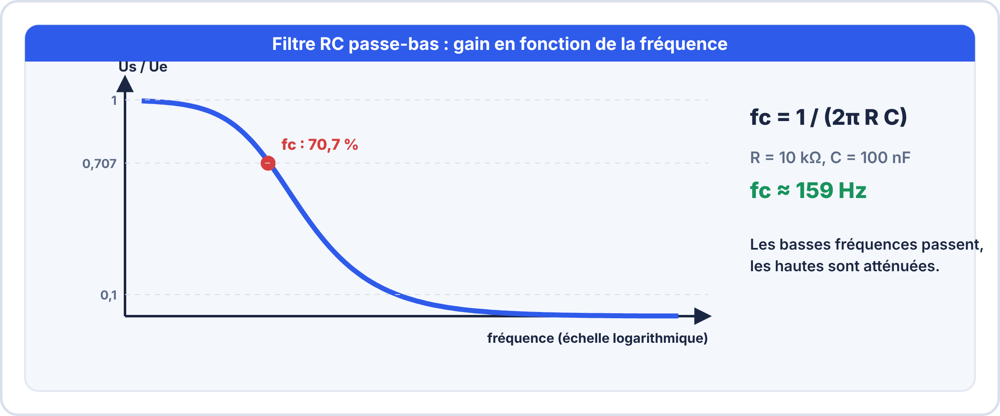
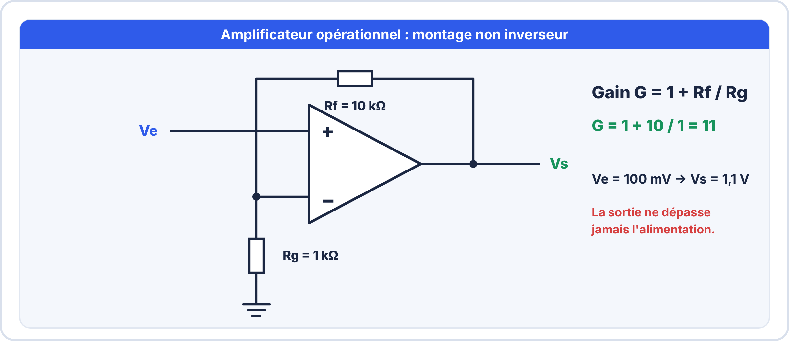
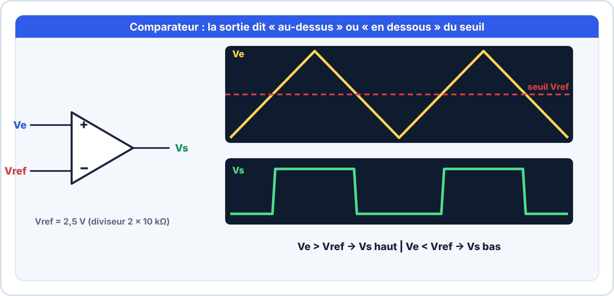
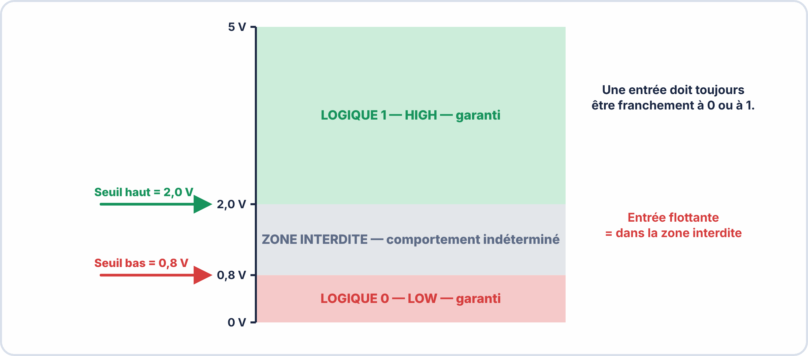

# Semaine 9 : Filtrer, amplifier et décider

> **Durée** : 4 h · **Compétences E2** : C07, C11

## 🎯 À la fin de la semaine, je sais…

- calculer la **constante de temps** d'un circuit RC et la **fréquence de coupure** d'un filtre ;
- **choisir et calculer** un montage à amplificateur opérationnel (inverseur, non inverseur, suiveur) ;
- utiliser un **comparateur** (avec ou sans hystérésis) pour prendre une décision ;
- lire une **table de vérité** et reconnaître les portes logiques de base.

## 🗓️ Déroulé

| Durée | Activité |
|---|---|
| 1 h 30 | TP virtuels ElectroLab (circuit RC, filtre, AOP) |
| 1 h | Cours : RC et filtres, AOP |
| 45 min | Cours : comparateur, hystérésis, logique |
| 45 min | Atelier réel, exercices et auto-test |

## 🖥️ TP virtuel dans ElectroLab : à faire avant le TP réel

Ouvre [ElectroLab](https://yahnlp.github.io/ElectroLab/), menu **TP ▾** :

- **Charge et décharge d'un condensateur (circuit RC)** (1 h 30)
- **Filtre RC passe-bas : gain et fréquence de coupure** (1 h 30)
- **Deux voies : gain et déphasage d'un filtre RC (4 fréquences)** (1 h)
- **Amplificateur inverseur à AOP : gain et saturation** (1 h 30)
- **Interrupteur crépusculaire : comparateur à AOP et LDR** (1 h 30)
- **Portes logiques : tables de vérité, alimentation, CMOS / TTL** (1 h 15)
- **Dépannage d'un amplificateur inverseur à AOP** et **d'une platine logique** (pour consolider)

---

## 📖 Le cours

**🤔 À ton avis ?** Un capteur de température délivre 10 mV par degré : un signal très faible, pollué par du bruit. Comment l'exploiter ?

??? question "Réponse"
    On **filtre** le bruit (filtre RC), on **amplifie** le signal (AOP), puis on **décide** (comparateur, ou conversion numérique). Cette semaine, tu apprends ces trois opérations.

### 1. Le circuit RC : charge d'un condensateur

Un condensateur s'oppose aux variations de tension. À travers une résistance, il se charge **progressivement** :

$$\tau = R \times C \qquad u_C(t) = U\left(1 - e^{-t/\tau}\right)$$

- À $t = \tau$ : 63 % de la tension finale.
- À $t = 3\tau$ : 95 %. À $t = 5\tau$ : **99 %**, on considère la charge **terminée**.

**Exemple** : $R = 10\,\mathrm{kΩ}$, $C = 100\,\mathrm{\mu F}$ : $\tau = 1\,\mathrm{s}$ ; la charge dure environ **5 s**.

### 2. Le filtre RC passe-bas

**Le filtre RC passe-bas** laisse passer les basses fréquences et atténue les hautes :

$$f_c = \frac{1}{2\pi R C}$$

À $f_c$, le gain vaut $\dfrac{1}{\sqrt{2}} \approx 0{,}71$ soit **−3 dB**. Au-delà, il chute de **20 dB par décade** (÷10 en amplitude quand la fréquence est multipliée par 10).

**Usages** : supprimer le bruit d'une mesure, filtrer un signal PWM pour obtenir une tension continue, antirebond d'un bouton.

**Passe-haut** : on échange R et C ; il laisse passer les hautes fréquences et bloque le continu (couplage entre deux étages).

### 3. L'amplificateur opérationnel

Un **AOP** possède deux entrées (+ et −) et une sortie. En **régime linéaire** (avec contre-réaction), il impose $V_+ = V_-$. Trois montages à connaître :

| Montage | Gain | Particularité |
|---|---|---|
| **Suiveur** | 1 | forte impédance d'entrée : isole une source fragile |
| **Non inverseur** | $G = 1 + \dfrac{R_f}{R_g}$ | sortie en phase avec l'entrée |
| **Inverseur** | $G = -\dfrac{R_f}{R_e}$ | sortie en opposition de phase |

**Exemple** : un capteur à 10 mV/°C doit donner 100 mV/°C. Gain 10 : non inverseur avec $R_f = 9\,\mathrm{kΩ}$ et $R_g = 1\,\mathrm{kΩ}$.

> [!WARNING] ⚠️ La saturation
> La sortie ne peut pas dépasser la **tension d'alimentation** (moins une petite marge). Si le calcul demande 8 V avec une alimentation de 5 V, la sortie **sature** vers 4 V : le signal est **écrêté**.

### 4. Le comparateur

Sans contre-réaction, l'AOP **compare** ses deux entrées : sa sortie passe à l'état haut si $V_+ > V_-$, à l'état bas sinon. C'est un **détecteur de seuil**.

**Exemple** : interrupteur crépusculaire. Une LDR dans un diviseur fournit une tension qui baisse la nuit ; un comparateur la compare à un seuil réglé : la lampe s'allume quand la lumière passe sous le seuil.

**Problème** : si le signal flotte autour du seuil (bruit), la sortie **bascule sans arrêt**. Solution : l'**hystérésis**, deux seuils (un pour monter, un pour redescendre), comme l'alarme de température vue en semaine 8.

### 5. La logique

Les circuits numériques ne connaissent que **0** (≈ 0 V) et **1** (≈ 5 V ou 3,3 V).

| A | B | ET | OU | NON-ET | OU exclusif |
|---|---|---|---|---|---|
| 0 | 0 | 0 | 0 | 1 | 0 |
| 0 | 1 | 0 | 1 | 1 | 1 |
| 1 | 0 | 0 | 1 | 1 | 1 |
| 1 | 1 | 1 | 1 | 0 | 0 |

**Exemple** : une machine démarre si le bouton **ET** le capot fermé sont actifs : $S = A \cdot B$.

> [!WARNING] ⚠️ Erreurs fréquentes
> - Confondre **fréquence de coupure** et fréquence à **−20 dB**.
> - Calculer le gain d'un inverseur sans le **signe**.
> - Alimenter un AOP en 5 V en attendant une sortie de 8 V.
> - Laisser une entrée logique **flottante** : l'état est imprévisible (mettre une résistance de rappel).
> - Mélanger des composants **TTL (5 V)** et **3,3 V** sans adaptation.

---

## 🛠️ Atelier réel

**Matériel** : plaque d'essai, AOP LM358, résistances, condensateurs, GBF, oscilloscope, alimentation 5 V.

1. **Filtre RC** : $R = 10\,\mathrm{kΩ}$, $C = 100\,\mathrm{nF}$. Calcule $f_c$. Applique un signal sinusoïdal de 1 V crête et mesure le gain à 16 Hz, 160 Hz et 1,6 kHz.
2. **Amplificateur** : monte un non inverseur de gain 11 ($R_f = 10\,\mathrm{kΩ}$, $R_g = 1\,\mathrm{kΩ}$) alimenté en 5 V. Applique 100 mV : mesure la sortie.
3. Augmente l'entrée jusqu'à **500 mV** : que se passe-t-il ?
4. **Comparateur** : seuil de 2,5 V (diviseur 2 × 10 kΩ), signal triangulaire de 0 à 5 V : observe la sortie.

??? success "Résultats attendus"
    1. $f_c = \dfrac{1}{2\pi \times 10^{4} \times 10^{-7}} \approx 159\,\mathrm{Hz}$. À 16 Hz : gain ≈ **1** ; à 160 Hz : gain ≈ **0,71** (−3 dB) ; à 1,6 kHz : gain ≈ **0,1**.
    2. Sortie ≈ **1,1 V** (gain 11).
    3. À 500 mV, le calcul donnerait 5,5 V : la sortie **sature** à environ 3,5 à 4 V (l'AOP ne dépasse pas l'alimentation).
    4. La sortie bascule **haut** quand le signal dépasse 2,5 V et **bas** en dessous : un signal **carré**.

## ✍️ Exercices

1. Fréquence de coupure d'un filtre RC avec $R = 1\,\mathrm{kΩ}$ et $C = 1\,\mathrm{\mu F}$ ?
2. Gain d'un non inverseur avec $R_f = 10\,\mathrm{kΩ}$ et $R_g = 1\,\mathrm{kΩ}$ ?
3. Gain d'un inverseur avec $R_f = 47\,\mathrm{kΩ}$ et $R_e = 10\,\mathrm{kΩ}$ ?
4. Un RC a $\tau = 2\,\mathrm{ms}$. Au bout de quel temps la charge est-elle terminée ?
5. Sortie d'une porte NON-ET avec A = 1 et B = 1 ?
6. Pourquoi ajoute-t-on une hystérésis à un comparateur ?

??? success "Corrigés"
    1. $f_c = \dfrac{1}{2\pi \times 1000 \times 10^{-6}} \approx 159\,\mathrm{Hz}$.
    2. $G = 1 + 10 = 11$.
    3. $G = -\dfrac{47}{10} = -4{,}7$.
    4. $5\tau = 10\,\mathrm{ms}$.
    5. **0**.
    6. Pour éviter que la sortie **bascule en continu** quand le signal flotte autour du seuil (bruit).

## ✅ Auto-test

1. Que vaut le gain d'un filtre RC à sa fréquence de coupure ?
2. Que fait un comparateur ?
3. Quelle est la différence entre un inverseur et un non inverseur ?
4. Quel est le résultat de A ET B si A = 1 et B = 0 ?

??? success "Réponses"
    1. $\dfrac{1}{\sqrt{2}} \approx 0{,}71$ (−3 dB).
    2. Il **compare** deux tensions et sort un niveau **haut ou bas**.
    3. L'inverseur **inverse le signe** (gain négatif) ; le non inverseur le garde (gain ≥ 1).
    4. **0**.

## 📦 Livrable

Relevé du gain du filtre RC aux trois fréquences (tableau et courbe), et schéma commenté du montage amplificateur avec le résultat de la saturation.

> [!NOTE] 📚 Pour approfondir (facultatif)
> Ce parcours se suffit à lui-même. Pour aller plus loin : Première S12 (AOP, filtre RC, portes logiques) et Seconde S02 (diodes, circuits).
