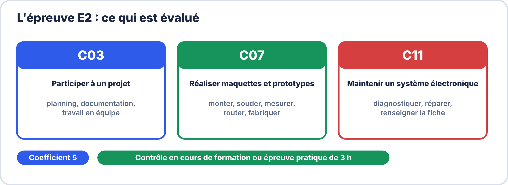
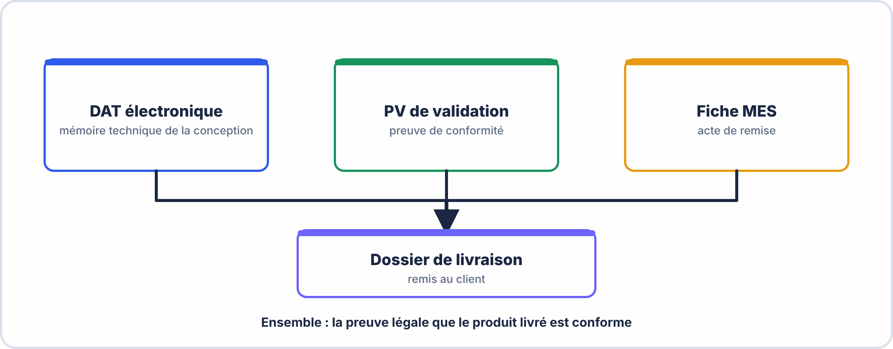

# Semaine 11 : L'épreuve E2, comprendre et réussir

> **Durée** : 4 h · **Compétences E2** : C03, C07, C11

## 🎯 À la fin de la semaine, je sais…

- **expliquer** ce qu'est l'épreuve E2 et comment elle est évaluée ;
- **organiser** mon travail dans le temps ;
- **éviter** les erreurs qui coûtent le plus de points ;
- réussir une **épreuve blanche** complète.

## 🗓️ Déroulé

| Durée | Activité |
|---|---|
| 45 min | Comprendre l'épreuve : format, compétences, grille |
| 45 min | Méthode : plan de travail et liste de contrôle |
| 2 h | Épreuve blanche |
| 30 min | Correction, bilan et plan de révision |

---

## 📖 Comprendre l'épreuve

**L'épreuve E2** s'intitule **« Réalisation et maintenance de produits électroniques »** (unité U2, **coefficient 5**). Elle évalue :

- **C03 – Participer à un projet** : respecter le planning, documenter, travailler en équipe ;
- **C07 – Réaliser des maquettes et prototypes** : monter, souder, mesurer, router, fabriquer ;
- **C11 – Maintenir un système électronique** : diagnostiquer, réparer, renseigner la fiche d'intervention.

### Deux formes possibles

| | Contrôle en cours de formation | Épreuve ponctuelle |
|---|---|---|
| Principe | plusieurs activités pendant la formation, en centre et/ou en entreprise | une épreuve **pratique de 3 heures** sur un plateau technique |
| Évaluation | suivi des compétences dans un **livret individuel**, bilans intermédiaires, puis **commission d'évaluation** au dernier trimestre | commission d'enseignants du domaine professionnel |
| Résultat | positionnement sur la **grille nationale d'évaluation** | positionnement sur la **grille nationale** |

> [!TIP] 💡 Ce qu'on attend de toi
> **Tests et mesures** d'une carte ou d'un système communicant, **mise en place** d'un protocole de tests, **diagnostic** d'un dysfonctionnement, **réparation**, **vérification** de la conformité, **fiche d'intervention**, **communication** claire (au client ou à la hiérarchie). Tu disposes des **moyens et ressources** du plateau : dossier technique, appareils de mesure, valeurs attendues et tolérances.

### Le dossier de compétences

Le **livret de suivi** rassemble tes **preuves** : schémas, fichiers de fabrication, PV, fiches d'intervention, mesures. Chaque livrable de ce parcours en est une.

## 🧭 Le plan de travail pour une épreuve de 3 heures

| Phase | Durée | Je fais |
|---|---|---|
| **Lire** | 15 min | tout le sujet, les documents, les consignes |
| **Préparer** | 30 min | calculs préalables : valeurs attendues et plages de tolérance |
| **Mesurer** | 1 h 15 | mesures **dans l'ordre du sujet**, en notant attendu / mesuré |
| **Analyser** | 30 min | verdicts, marges, comparaison aux tolérances |
| **Rédiger** | 30 min | PV propre, conclusion argumentée |

### La liste de contrôle avant de rendre

- [ ] Toutes les valeurs ont leur **unité**.
- [ ] Chaque mesure est comparée à une **tolérance** chiffrée.
- [ ] Chaque verdict (**conforme / non conforme / non garanti**) est **justifié**.
- [ ] Les **instruments** et leur étalonnage sont indiqués.
- [ ] Le PV est **daté, signé**, propre.
- [ ] Les **calculs** sont montrés (formule, application numérique, résultat).

### Les erreurs qui coûtent le plus de points

1. **Oublier l'unité** ou la tolérance.
2. Conclure « conforme » en comparant **la valeur seule** et pas la plage avec sa marge.
3. **Changer plusieurs composants** à la fois pendant un dépannage.
4. Mesurer une résistance **sous tension**.
5. Laisser une partie **vide** : mieux vaut un raisonnement incomplet que rien.

### En cas de blocage

- Une mesure **incohérente** : vérifie le **branchement**, le **calibre**, l'**instrument** (sonde ×10 ?), puis **refais**.
- Un calcul **bloqué** : passe à la suite et reviens-y.
- Un doute sur une **formule** : elle est dans les documents autorisés.

---

## 🛠️ L'épreuve blanche (2 h)

**Sujet** : une carte **clignoteur NE555** identique à celle du parcours, mais avec d'autres valeurs : $R_a = 4{,}7\,\mathrm{kΩ}$, $R_b = 33\,\mathrm{kΩ}$, $C = 10\,\mathrm{\mu F}$, alimentation 9 V → 7805. **Cahier des charges** : sortie 5 V ± 5 %, fréquence 2 Hz ± 10 %.

| Phase | Durée | Travail |
|---|---|---|
| 1 | 30 min | **Calculs préalables** : fréquence théorique, plages de tolérance, puissance dissipée par le 7805 |
| 2 | 45 min | **Mesures** : tension de sortie du 7805, fréquence, rapport cyclique |
| 3 | 30 min | **Dépannage** d'une panne injectée (tableau de tensions) |
| 4 | 15 min | **PV** : tableau, verdicts, conclusion, signature |

**Barème (20 points)** : calculs (5) · mesures et réglages des instruments (5) · dépannage (5) · PV (5).

??? success "Éléments de correction"
    - **Fréquence théorique** : $f = \dfrac{1{,}44}{(4{,}7 + 2 \times 33) \times 10^{3} \times 10^{-5}} = \dfrac{1{,}44}{0{,}707} \approx 2{,}04\,\mathrm{Hz}$ : conforme à 2 Hz ± 10 % (1,8 à 2,2 Hz).
    - **Plage de la sortie** : 4,75 V à 5,25 V.
    - **Puissance du 7805** : $P = (9 - 5) \times I$ ; avec $I = 30\,\mathrm{mA}$ : 0,12 W, donc $T_j = 25 + 0{,}12 \times 65 \approx 33\,°\mathrm{C}$ : pas de radiateur.
    - **Critères de réussite** : unités partout ; tolérances chiffrées ; verdicts justifiés ; instruments bien réglés (sonde ×10, déclenchement) ; panne trouvée **par la mesure** puis réparée par **un seul** changement ; PV daté et signé.

## ✅ Bilan personnel

Après l'épreuve blanche, classe tes erreurs : **oublis** (unités, tolérance), **calculs**, **manipulations**, **rédaction**. Révise **d'abord** la catégorie où tu perds le plus de points.

## ✍️ Questions de révision

1. Quelles sont les trois compétences évaluées à l'E2 ?
2. Quelle est la durée de l'épreuve ponctuelle ?
3. Quel est le coefficient de l'E2 ?
4. Que fais-tu si une mesure te paraît aberrante ?

??? success "Réponses"
    1. **C03** participer à un projet ; **C07** réaliser maquettes et prototypes ; **C11** maintenir un système électronique.
    2. **3 heures** (épreuve pratique).
    3. **5**.
    4. Je vérifie le **branchement**, le **calibre**, la **sonde**, puis je **refais** la mesure.

> [!NOTE] 📚 Pour approfondir (facultatif)
> Ce parcours se suffit à lui-même. Pour t'entraîner davantage : Terminale S13, S15 et S17 (TP complets, examen complet, contrainte de temps) et S18 (dossier de compétences).
