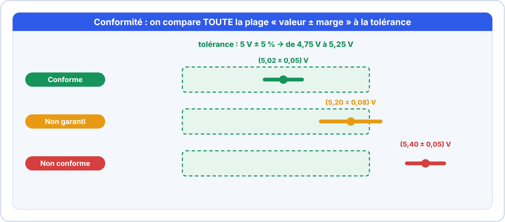
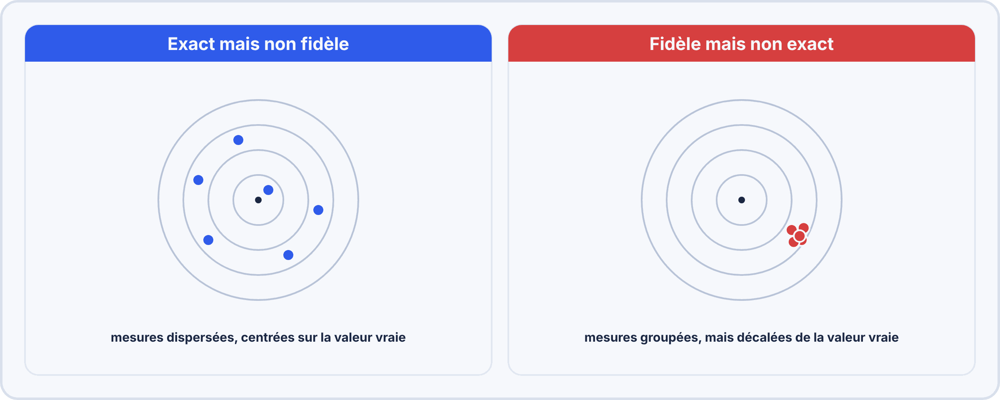
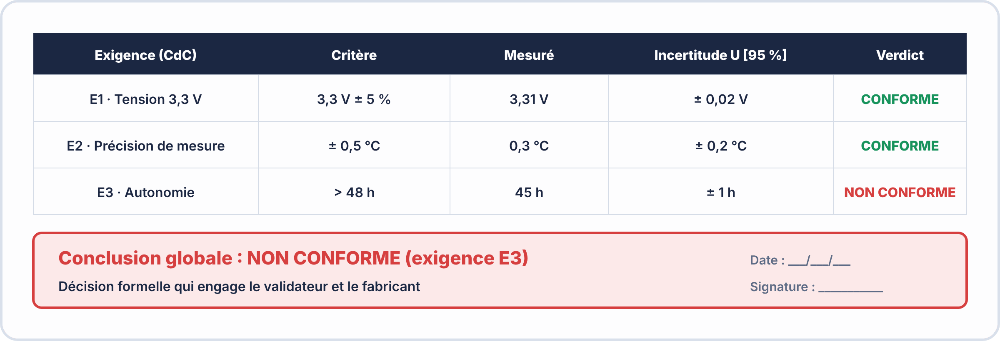
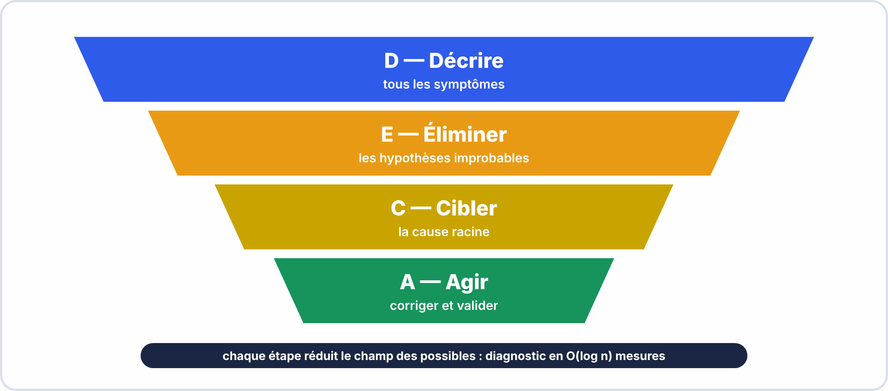
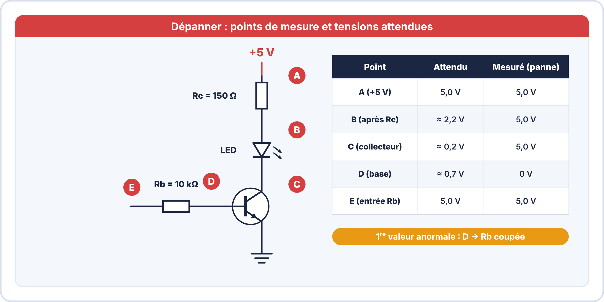
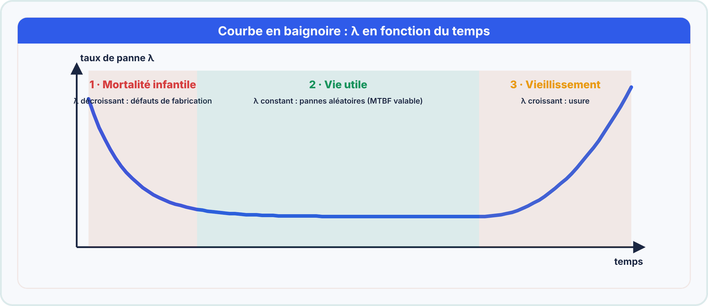
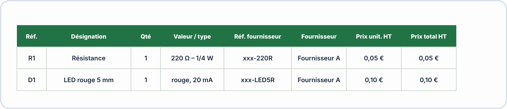
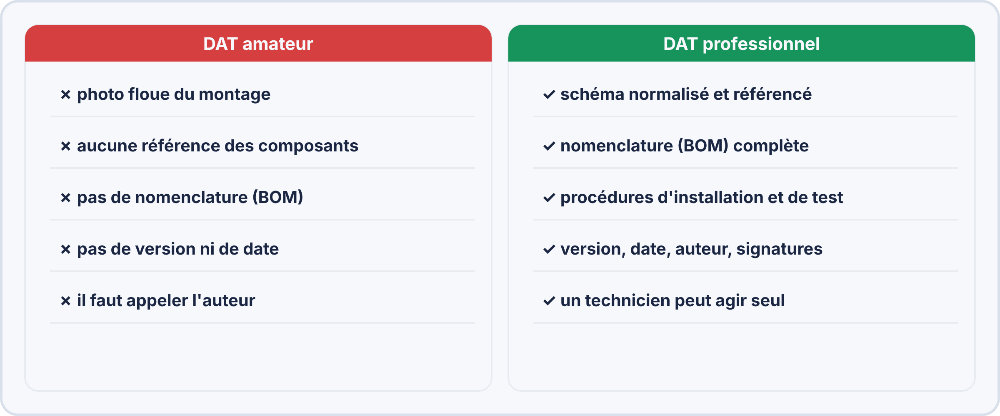

# Semaine 13 : Mesurer, valider, dépanner et documenter

> **Durée** : 4 h · **Compétences E2** : C11, C03

## 🎯 À la fin de la semaine, je sais…

- comparer une mesure à une **tolérance** en tenant compte de sa **marge** ;
- calculer l'**incertitude** d'une mesure répétée et exprimer un résultat « valeur ± U » ;
- rédiger un **procès-verbal (PV)** de validation ;
- appliquer une **méthode de dépannage** et trouver une panne avec un **tableau de tensions** ;
- remplir une **fiche d'intervention** ;
- calculer la **disponibilité** d'un système et la fiabilité d'un montage **série** ou **parallèle** ;
- **documenter** un produit : nomenclature (BOM), dossier technique (DAT), procédure ;
- appliquer les règles de **sécurité** pendant un dépannage.

## 🗓️ Déroulé

| Durée | Activité |
|---|---|
| 1 h | TP virtuels ElectroLab : dépannage |
| 1 h | Cours : tolérance, marge, incertitude, PV, traçabilité |
| 1 h | Cours : méthode de dépannage, tableau de tensions, maintenance |
| 45 min | Cours : fiabilité, documentation (BOM, DAT, procédure) |
| 1 h 15 | Atelier réel : valider puis dépanner la carte clignoteur, rédiger le dossier |

## 🖥️ TP virtuel dans ElectroLab : à faire avant le TP réel

Ouvre [ElectroLab](https://yahnlp.github.io/ElectroLab/), menu **TP ▾** :

- **Dépannage d'une platine transistor + LED (6 pannes)** (1 h 30)
- **Dépannage d'une alimentation 5 V (7 pannes)** (2 h)
- **Dépannage d'un amplificateur inverseur à AOP (4 pannes)** (1 h 30)
- **Dépannage d'une platine logique NAND + inverseur (5 pannes)** (1 h 30)

Puis, pour ta carte, ouvre ces sujets (bouton **Ouvrir**) :

- [`clignoteur.json`](tp/clignoteur.json) : la carte saine de référence ;
- [`clignoteur-panne-A.json`](tp/clignoteur-panne-A.json) : panne A, rien ne s'allume ;
- [`clignoteur-panne-B.json`](tp/clignoteur-panne-B.json) : panne B, LED toujours allumée ;
- [`clignoteur-panne-C.json`](tp/clignoteur-panne-C.json) : panne C, même symptôme que B, autre cause.

---

## 📖 Le cours

**🤔 À ton avis ?** Tu mesures 4,80 V sur une sortie censée être 5 V ± 5 %. Est-ce conforme ?

??? question "Réponse"
    Oui : 4,80 V est dans la plage de 4,75 V à 5,25 V. **Mais** si ta mesure a une marge de ± 0,1 V, la vraie valeur pourrait être 4,70 V : **hors tolérance**. On doit donc tenir compte de la **marge de mesure**.

### 1. La tolérance et la plage

« 5 V ± 5 % » signifie de $5 \times 0{,}95 = 4{,}75\,\mathrm{V}$ à $5 \times 1{,}05 = 5{,}25\,\mathrm{V}$. Tout ce qui est dans cette plage est **conforme**.

### 2. La marge de mesure et la conclusion

La marge se calcule avec la **précision du constructeur** (voir semaine 2) : $(5{,}02 \pm 0{,}05)\,\mathrm{V}$. On compare **toute la plage** « valeur ± marge » à la tolérance :

- toute la plage dedans → **conforme** ;
- une partie dehors → **non garanti** (à justifier ou à refaire avec un meilleur instrument) ;
- toute la plage dehors → **non conforme**.

### 3. L'incertitude de mesure

Un résultat n'a de valeur que s'il s'accompagne de son **incertitude**. On répète la mesure (au moins 5 fois) et on calcule :

1. la **moyenne** $\bar{x}$ ;
2. l'**écart-type** $s$ (dispersion des mesures) ;
3. l'**incertitude de répétabilité** $u_A = \dfrac{s}{\sqrt{n}}$ ;
4. l'**incertitude de l'instrument** $u_B = \dfrac{\text{précision}}{\sqrt{3}}$ (donnée par le constructeur) ;
5. l'**incertitude composée** $u_c = \sqrt{u_A^2 + u_B^2}$ ;
6. l'**incertitude élargie** $U = 2\,u_c$ (environ 95 % de confiance).

**Exemple** : un DHT22 (précision ± 0,5 °C) mesure 5 fois : 23,1 · 23,4 · 23,3 · 23,5 · 23,2 °C.

- $\bar{x} = 23{,}3\,°\mathrm{C}$ ; $s \approx 0{,}16\,°\mathrm{C}$ ; $u_A = \dfrac{0{,}16}{\sqrt{5}} \approx 0{,}07\,°\mathrm{C}$.
- $u_B = \dfrac{0{,}5}{\sqrt{3}} \approx 0{,}29\,°\mathrm{C}$ ; $u_c = \sqrt{0{,}07^2 + 0{,}29^2} \approx 0{,}30\,°\mathrm{C}$.
- $U = 2 \times 0{,}30 = 0{,}6\,°\mathrm{C}$ : **résultat** $(23{,}3 \pm 0{,}6)\,°\mathrm{C}$ (95 %).

> [!TIP] 💡 Exactitude et fidélité
> **Exactitude** : les mesures sont **centrées** sur la valeur vraie (pas de biais). **Fidélité** : les mesures sont **groupées** entre elles. Un capteur peut être fidèle sans être exact : on corrige alors le **biais**.

### 4. Le procès-verbal (PV)

Un PV est la **preuve écrite** d'un contrôle.

Il contient : **identification** (carte, date, opérateur) ; **instruments** (modèle, numéro de série, **étalonnage valide**) ; **méthode** ; **résultats** (attendu, mesuré, marge, verdict) ; **conclusion** avec le critère ; **signature**.

> [!TIP] 💡 La traçabilité
> Un instrument est **comparé régulièrement** à une référence (étalonnage). Si son étalonnage est **périmé**, ses mesures ne sont plus valables dans un PV.

### 5. La méthode de dépannage

1. **Décrire** le symptôme : ce qui marche, ce qui ne marche pas.
2. **Sécuriser** : tension, chaleur, odeur de brûlé.
3. **Vérifier l'alimentation** sur la carte.
4. **Dresser un tableau de tensions** : point de mesure, valeur attendue, valeur mesurée, verdict.
5. **Isoler** : couper le circuit en deux pour savoir de quel côté est la panne (dichotomie).
6. **Réparer** (un seul changement), **retester**, **tracer** (fiche d'intervention).

### 6. Trouver la panne avec les tensions

La panne est à la **première valeur** qui ne correspond pas à l'attendu, en partant de l'alimentation.

| Symptôme mesuré | Cause probable |
|---|---|
| entrée de $R_b$ à 5 V, base à 0 V | résistance de base coupée |
| signal d'entrée à 0 V | problème **en amont** du circuit |
| collecteur à 0 V même sans commande | transistor en court-circuit |
| base normale mais collecteur à 1,8 V | transistor qui ne sature pas ($R_b$ trop grande) |

**Hors tension** : mesurer les résistances **retirées du circuit** ; tester les transistors et diodes avec le **test diode** (≈ 0,6 V dans un sens, rien dans l'autre) ; vérifier les pistes à la **continuité**.

### 7. Maintenance et fiche d'intervention

La **maintenance corrective** répare une panne ; la **préventive** l'évite. On trace l'intervention sur une **fiche** : équipement, date, intervenant · symptôme · mesures (attendu / mesuré) · cause · action · test après réparation · préconisation.

> [!WARNING] ⚠️ Erreurs fréquentes
> - Mesurer une résistance **sous tension**.
> - Changer **plusieurs** composants à la fois.
> - Oublier de **retester** (la panne a-t-elle disparu ? autre chose est-il en panne ?).
> - Intervenir seul sur une installation **au-dessus de 50 V AC / 120 V DC** sans habilitation.

### 8. La fiabilité en bref

Pour juger si un système est **fiable** et **disponible**, on utilise trois grandeurs :

| Grandeur | Sens | Formule |
|---|---|---|
| **MTBF** | temps moyen entre deux pannes | $\dfrac{\text{temps de fonctionnement}}{\text{nombre de pannes}}$ |
| **MTTR** | temps moyen de réparation | $\dfrac{\text{temps d'arrêt}}{\text{nombre de pannes}}$ |
| **Disponibilité** | part du temps où ça marche | $D = \dfrac{\mathrm{MTBF}}{\mathrm{MTBF} + \mathrm{MTTR}}$ |

**Exemple** : MTBF = 2 000 h, MTTR = 4 h : $D = \dfrac{2000}{2004} \approx 99{,}8\,\%$.

**Courbe en baignoire** : les pannes sont nombreuses à la **jeunesse** (défauts de fabrication), rares pendant la **vie utile**, puis augmentent avec l'**usure**.

Pendant la vie utile, la probabilité de **fonctionner encore** décroît selon la loi exponentielle $R(t) = e^{-\lambda t}$ avec $\lambda = \dfrac{1}{\mathrm{MTBF}}$ :

**Exemple** : MTBF = 50 000 h, au bout d'un an (8 760 h) : $R = e^{-8760/50000} = e^{-0{,}175} \approx 0{,}84$ : **84 %** de chances de fonctionner encore.

**Assemblage de composants** :

- **En série** : si **un seul** tombe en panne, **tout** s'arrête. $R_s = R_1 \times R_2 \times \dots$ (le système est **moins fiable** que son maillon le plus faible).
- **En parallèle** (redondance) : le système marche si **un seul** fonctionne. $R_p = 1 - (1 - R_1)(1 - R_2)$.

**Exemple** : deux composants de fiabilité 0,9 : en série $0{,}9 \times 0{,}9 = 0{,}81$ ; en parallèle $1 - 0{,}1 \times 0{,}1 = 0{,}99$.

### 9. Documenter : BOM, DAT, procédure

Un produit sans documentation est un produit que **personne d'autre ne peut maintenir**.

- **BOM** (*Bill Of Materials*) : la **liste de courses exacte** du produit. Chaque ligne : repère, désignation, **référence précise**, quantité, fournisseur, prix. Le **total** doit être vérifié.

- **DAT** (dossier d'architecture technique) : décrit le système (schéma de principe, schémas, BOM, configuration, procédures, limites).
- **Procédure** : une **action par étape**, un **verbe d'action**, le **résultat attendu** après chaque étape, un **test de validation** à la fin.

> [!WARNING] ⚠️ Erreurs fréquentes en documentation
> - « Voir le code » à la place d'une procédure.
> - BOM sans **référence fournisseur** : non commandable.
> - Schéma sans repères ni légende : illisible par un tiers.
> - Aucune **date**, aucune **version**.

---

## 🛠️ Atelier réel : valider puis dépanner le clignoteur

1. **Valide** ta carte : tension d'alimentation (5 V ± 5 %), fréquence (1 Hz ± 10 %), rapport cyclique, courant dans la LED. Rédige le **PV** (attendu / mesuré / marge / verdict).
2. Dans **ElectroLab**, ouvre `clignoteur.json` puis les trois pannes. Pour chacune : **décris**, **mesure** (tensions, puis résistances hors tension), **conclus**.
3. Remplis une **fiche d'intervention** pour chaque panne.
4. **Incertitude** : mesure 6 fois la fréquence (au chronomètre ou à l'oscilloscope) et exprime-la sous la forme $(f \pm U)$.
5. **Fiabilité** : le clignoteur a une MTBF estimée à 20 000 h et un MTTR de 2 h : calcule sa disponibilité.
6. **Documentation** : rédige la **BOM** du clignoteur (au moins 8 lignes avec références, quantités, total).

??? success "Résultats attendus"
    - **Carte saine** : $V_{CC} \approx 5\,\mathrm{V}$ ; période ≈ 1,01 s ($f \approx 0{,}99\,\mathrm{Hz}$, conforme à 0,9–1,1 Hz) ; rapport cyclique ≈ 55 %. La sortie du NE555 bipolaire n'atteint qu'environ **3,1 V** à l'état haut : le courant LED est d'environ **9 mA** avec 150 Ω (pour 20 mA, il faudrait environ 56 Ω).
    - **Panne A** : aucune tension sur la carte : le **fusible F1** est grillé (mesure de la tension avant et après le fusible).
    - **Incertitude** : avec un chronomètre manuel, la dispersion est de l'ordre de quelques centièmes de seconde ; $U$ vaut typiquement **0,02 à 0,05 Hz**.
    - **Fiabilité** : $D = \dfrac{20000}{20002} \approx 99{,}99\,\%$.
    - **BOM** : NE555, 3 résistances, 1 condensateur, 1 LED, 1 résistance de LED, connecteur, support DIP-8 ; chaque ligne avec une référence **précise** et le total vérifié.
    - **Pannes B et C** : LED **toujours allumée**, broches 2 et 6 à environ 0 V : le condensateur **ne peut plus se charger**. Même symptôme, deux causes : on **départage hors tension** en mesurant la résistance. **B** : $R_b$ coupée ; **C** : $R_a$ coupée.

## ✍️ Exercices

1. Mesure $(5{,}20 \pm 0{,}08)\,\mathrm{V}$ pour 5 V ± 5 % : verdict ?
2. Mesure $(0{,}93 \pm 0{,}02)\,\mathrm{Hz}$ pour 1 Hz ± 10 % : verdict ?
3. Citez trois éléments obligatoires d'un PV.
4. La sortie d'un 7805 est à 0 V alors que l'entrée est à 12 V. Hypothèses ?
5. Une panne disparaît quand on touche la carte : quelle famille de défauts ?
6. Quatre mesures de tension : 4,98 · 5,02 · 5,00 · 5,04 V (voltmètre de précision ± 0,05 V). Calcule $U$ et conclus pour 5 V ± 2 %.
7. Un système a un MTBF de 1 000 h et un MTTR de 10 h : disponibilité ?
8. Deux capteurs de fiabilité 0,95 en parallèle : fiabilité du système ?

??? success "Corrigés"
    1. Plage 5,12 à 5,28 V, qui **dépasse** 5,25 V : **non garanti**.
    2. Plage 0,91 à 0,95 Hz, dans [0,90 ; 1,10] : **conforme**.
    3. Par exemple : **identification**, **instruments avec étalonnage**, **résultats avec verdict**, **conclusion**, **signature**.
    4. Régulateur défectueux, court-circuit en aval, ou masse du régulateur coupée.
    5. Un défaut **intermittent** : soudure froide ou mauvais contact.
    6. $\bar{x} = 5{,}01\,\mathrm{V}$ ; $s \approx 0{,}026\,\mathrm{V}$ ; $u_A = \dfrac{0{,}026}{2} = 0{,}013\,\mathrm{V}$ ; $u_B = \dfrac{0{,}05}{\sqrt{3}} \approx 0{,}029\,\mathrm{V}$ ; $u_c \approx 0{,}032\,\mathrm{V}$ ; $U \approx 0{,}064\,\mathrm{V}$. Plage de la mesure : de 4,95 à 5,07 V, dans [4,90 ; 5,10] : **conforme**.
    7. $D = \dfrac{1000}{1010} \approx 99{,}0\,\%$.
    8. $1 - 0{,}05 \times 0{,}05 = 0{,}9975$.

## ✅ Auto-test

1. Que veut dire « non garanti » dans un verdict ?
2. Quelle est la première étape d'un dépannage ?
3. Combien de composants change-t-on à la fois ?
4. Pourquoi un instrument hors étalonnage invalide-t-il un PV ?
5. Que représente $U$ dans « $(5{,}01 \pm 0{,}06)\,\mathrm{V}$ » ?
6. Un système en série de deux composants est-il plus ou moins fiable que chacun ?

??? success "Réponses"
    1. La plage « valeur ± marge » **dépasse en partie** la tolérance.
    2. **Décrire** le symptôme (puis vérifier l'alimentation).
    3. **Un seul**, puis on reteste.
    4. Sa mesure n'est plus **garantie** ni **traçable**.
    5. L'**incertitude élargie** (95 % de confiance).
    6. **Moins** fiable : il suffit d'une seule panne pour l'arrêter.

## 📦 Livrable

PV complet de la carte clignoteur (avec incertitude), fiche d'intervention d'une panne diagnostiquée et BOM du produit.

> [!NOTE] 📚 Pour approfondir (facultatif)
> Ce parcours se suffit à lui-même. Pour aller plus loin : Terminale S02, S07, S08 (PV, validation, métrologie), Première S11 (fiabilité), S14 (maintenance corrective) et S18 (documentation).
