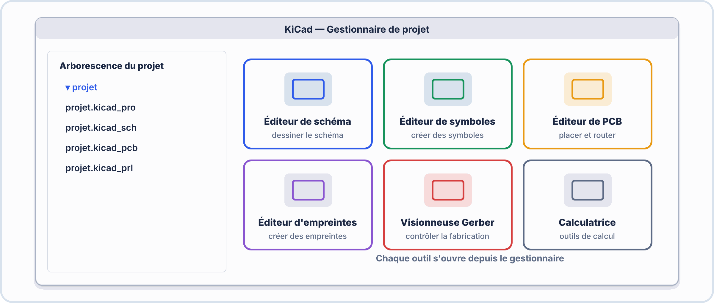
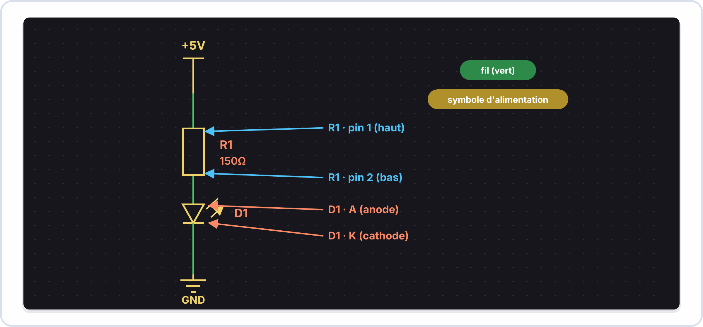

# 📘 INTRODUCTION À KICAD — S1 · 2ᵉ ANNÉE · E2
## Interface · Bibliothèques · Schémas · Premiers pas en CAO électronique

---

> **Nom** : \_\_\_\_\_\_\_\_\_\_\_\_\_\_\_\_\_\_\_\_\_\_\_\_\_\_\_
> **Date** : \_\_\_\_\_\_\_\_\_\_\_\_\_\_\_\_\_\_\_\_\_\_\_\_\_\_\_
> **Compétences** : S3.3 · C4.1

---

## 🔑 Vocabulaire clé

| Terme | Définition |
|---|---|
| **KiCad** | Suite logicielle open source de CAO électronique (EDA) — gratuit, professionnel, utilisé dans l'industrie |
| **EDA** | Electronic Design Automation — logiciel de conception électronique assistée par ordinateur |
| **Schématique (Schematic)** | Vue logique du circuit : symboles + connexions (ce que vous avez fait sur papier en 1A) |
| **Empreinte (Footprint)** | Vue physique d'un composant : dimensions exactes sur le circuit imprimé (PCB) |
| **Netlist** | Liste des connexions électriques — passerelle entre schéma et PCB |
| **PCB** | Printed Circuit Board — circuit imprimé · le KiCad PCB Editor design le PCB final |
| **BOM** | Bill Of Materials — nomenclature : liste de tous les composants du projet |
| **ERC** | Electrical Rules Check — vérification automatique des erreurs de schéma |
| **Bibliothèque de symboles** | Collection de symboles de composants (comme une liste de formes) |
| **Annotation** | Numérotation automatique des composants (R1, R2, C1, D1...) |
| **Net** | Connexion électrique nommée entre composants |
| **PWR_FLAG** | Symbole spécial indiquant au KiCad qu'un net d'alimentation est bien connecté à une source |

---

## 1️⃣ — Pourquoi KiCad ?

### Du papier au logiciel

```
1ère ANNÉE (dessin manuel) :
  ✓ Apprendre les symboles et les règles de schéma
  ✗ Difficile à modifier, pas de vérification automatique
  ✗ Impossible de générer un PCB directement

2ᵉ ANNÉE (KiCad) :
  ✓ Modification facile et rapide
  ✓ Vérification automatique des erreurs (ERC)
  ✓ Génération de la liste de composants (BOM)
  ✓ Passage direct au PCB pour fabrication
  ✓ Même outil que les ingénieurs en entreprise
```

### KiCad dans le monde réel

```
Projets open source conçus avec KiCad :
  Arduino Uno (depuis la version R3)
  Raspberry Pi Compute Module
  De nombreuses cartes de développement ESP32
  Équipements médicaux open source (OpenEEG, etc.)

Alternatives commerciales (pour info) :
  Altium Designer (> 8 000 €/an)
  Cadence OrCAD (> 5 000 €/an)
  Eagle (racheté par Autodesk)
  KiCad → 100% GRATUIT, même qualité professionnelle
```


> [!TIP] 💡 En clair : que fait un logiciel de CAO électronique ?
> Un schéma dessiné sur papier est une **image** : l'ordinateur ne « comprend » pas qu'un fil relie deux broches. Dans KiCad, chaque symbole est un **objet** qui connaît ses broches, et chaque fil est une **connexion électrique**. Le logiciel peut donc **vérifier** le schéma (ERC), produire la **liste des connexions** (netlist) et la transmettre au **circuit imprimé**. Le fil rouge : **schéma → vérification → PCB → fichiers de fabrication**.

> [!NOTE] 🔎 Schéma et circuit imprimé : deux documents, un seul circuit
> Le **schéma** dit **ce qui est relié à quoi** (la logique). Le **PCB** dit **où** sont placés les composants et **comment** les pistes passent (la géométrie). Les deux doivent toujours rester **cohérents**.

### ✅ Vérifie que tu as compris

**Q1.** Quelle différence entre un schéma et un PCB ?

??? success "Réponse"
    Le schéma décrit les **connexions** (logique) ; le PCB décrit la **position** des composants et le **tracé** des pistes (géométrie).

**Q2.** Pourquoi vérifier le schéma avant de passer au PCB ?

??? success "Réponse"
    Une erreur de connexion non corrigée se **retrouve sur la carte fabriquée** : elle coûte du temps et de l'argent.

---

## 2️⃣ — Interface KiCad : vue d'ensemble

### Le gestionnaire de projet (Project Manager)



### Le Schematic Editor — zones clés


---

---

## 3️⃣ — Les bibliothèques de symboles

### Accéder à la bibliothèque

```
Méthode 1 — Touche A (ou menu Place → Add Symbol) :
  → Ouvre le dialogue "Choose Symbol"
  → Barre de recherche en haut
  → Liste des bibliothèques à gauche
  → Aperçu du symbole à droite

Méthode 2 — Clic droit → Add Symbol
```

### Les bibliothèques principales

```
Device/        → Composants génériques (R, C, L, D, Q, LED...)
  Device:R            Résistance générique
  Device:C            Condensateur non polarisé
  Device:C_Polarized  Condensateur polarisé (électrolytique)
  Device:L            Inductance
  Device:LED          Diode LED
  Device:D            Diode standard
  Device:D_Zener      Diode Zener
  Device:Q_NPN_BCE    Transistor NPN
  Device:Q_PNP_BCE    Transistor PNP
  Device:Battery_Cell Pile
  Device:Conn_01x02   Connecteur 2 broches
  
power/         → Symboles d'alimentation
  power:+5V           Net +5V
  power:+3V3          Net +3,3V
  power:+12V          Net +12V
  power:GND           Masse
  power:VCC           Alimentation générique
  power:PWR_FLAG      Marqueur d'alimentation

Timer/         → Circuits intégrés de timing
  Timer:NE555         NE555

Amplifier/     → Amplificateurs
  Amplifier:LM741     Ampli op LM741

Regulator_Linear/ → Régulateurs de tension
  Regulator_Linear:LM7805 Régulateur 5V
```

### Chercher un composant efficacement

```
Dans la barre de recherche :
  "R"         → Affiche toutes les résistances
  "LED"       → Affiche toutes les LED
  "NPN"       → Tous les transistors NPN
  "555"       → Tous les circuits timers 555
  "LM74"      → LM741, LM747...

Astuce : utiliser le nom générique (Device:R) pour les composants courants
         plutôt que le modèle exact — l'empreinte sera associée plus tard
```


> [!TIP] 💡 En clair : symbole, empreinte, valeur
> Un composant a **trois identités** : son **symbole** (le dessin du schéma, par ex. `Device:R`), sa **valeur** (`150 Ω`, ce que **toi** tu choisis) et son **empreinte** (la forme des pastilles sur le PCB, choisie à l'étape suivante). La **bibliothèque** est le catalogue qui contient les symboles ; chercher dans le catalogue = touche **A** pour ajouter, puis taper le nom (`R`, `LED`, `GND`).

### ✅ Vérifie que tu as compris

**Q1.** Quelle est la différence entre le symbole et la valeur d'une résistance ?

??? success "Réponse"
    Le **symbole** est le dessin normalisé « résistance » ; la **valeur** est la grandeur choisie (150 Ω).

**Q2.** Où ira l'information « boîtier traversant ou CMS » ?

??? success "Réponse"
    Dans l'**empreinte**, associée plus tard au composant.

---

## 4️⃣ — Créer un schéma pas à pas

### Les 5 règles d'or du schéma KiCad

```
RÈGLE 1 : Toujours nommer et annoter les composants
  → Clic droit → Annotate Schematic → OK
  → R? devient R1, R2... · C? devient C1... automatiquement

RÈGLE 2 : Toujours connecter les fils jusqu'au bout des broches
  → Un fil qui s'arrête à 1 mm d'une broche = ERREUR
  → Le petit carré vert au bout d'une broche = broche libre = ERREUR potentielle

RÈGLE 3 : Ajouter PWR_FLAG sur chaque net d'alimentation
  → Sans PWR_FLAG → ERC signale "pin non connectée à une source"
  → Place → Add Power Port → PWR_FLAG

RÈGLE 4 : Nommer les signaux importants avec des labels nets
  → Menu Place → Net Label → nommer ex: "SIGNAL_A"
  → Deux broches avec le même label = connexion électrique (même fil)

RÈGLE 5 : Sauvegarder souvent (Ctrl+S)
  → KiCad peut crasher sur les vieux PC
```

### Exemple : circuit LED basique

```
OBJECTIF : LED rouge alimentée en 5V avec résistance de limitation

COMPOSANTS :
  R1 = Device:R, valeur "150Ω"
  D1 = Device:LED, valeur "LED rouge"
  +5V = power:+5V
  GND = power:GND
  2× PWR_FLAG

CÂBLAGE :
  +5V → fil → Pin 1 de R1 → fil → Pin 2 de R1 → fil → Anode (pin K+) de D1 → fil → Cathode → GND

VÉRIFICATION :
  1. Annotate Schematic (R? → R1, D? → D1)
  2. Run ERC (Electric Rules Check) → 0 erreur
  3. Ctrl+S pour sauvegarder
```


> [!TIP] 💡 En clair : pourquoi PWR_FLAG ?
> Dans KiCad, un symbole d'alimentation comme `+5V` **utilise** le net +5V mais ne dit pas qu'une **source** l'alimente. L'ERC suppose donc qu'il peut y avoir un oubli. Le symbole **PWR_FLAG** dit simplement : « ici, une alimentation **externe** est branchée ». Il n'ajoute **aucun composant** sur la carte réelle.
>
> **Net label** : donner le **même nom** à deux bouts de fil revient à les **relier**, sans tracer le fil entre eux (pratique pour un schéma lisible).

> [!WARNING] ⚠️ Erreurs fréquentes
> - Un fil qui **s'arrête à côté** d'une broche (il a l'air connecté mais ne l'est pas) : on repère un **point vert** à l'extrémité du fil quand il est bien connecté.
> - **Oublier d'annoter** (les composants restent `R?` et créent des doublons).
> - Croiser deux fils et croire qu'ils sont reliés : sans **jonction** (point), ils **ne sont pas** connectés.

### ✅ Vérifie que tu as compris

**Q1.** Deux fils se croisent sans point de jonction. Sont-ils reliés ?

??? success "Réponse"
    **Non** : sans point de jonction, ils se croisent simplement.

**Q2.** Que signifie annoter le schéma ?

??? success "Réponse"
    Donner à chaque composant une **référence unique** (`R1`, `R2`, `D1`…).

**Q3.** Deux labels `LED_OUT` placés à deux endroits différents : que se passe-t-il ?

??? success "Réponse"
    Les deux points sont **reliés électriquement** (même net).

---



---

## 5️⃣ — L'ERC : trouver et corriger les erreurs

### Ce que l'ERC détecte

```
ERREURS FRÉQUENTES EN DÉBUTANT :

Erreur "Pin not connected" :
  → Une broche de composant n'est connectée à rien
  → Solution : connecter la broche, ou marquer comme "no connect" (X)

Erreur "Net has no driver" :
  → Un net d'alimentation n'a pas de source (pas de PWR_FLAG)
  → Solution : ajouter PWR_FLAG sur le net VCC et GND

Erreur "Duplicate reference" :
  → Deux composants ont le même numéro (ex: deux R1)
  → Solution : Annotate Schematic pour renommer automatiquement

Erreur "Wire not connected" :
  → Un fil se termine dans le vide sans se connecter à une broche
  → Solution : étirer le fil jusqu'à la broche exacte

Avertissement "Simulation model issue" :
  → Composant sans modèle de simulation (ignorable en 2A)
```

### Lancer l'ERC

```
Menu : Inspect → Electrical Rules Checker (ERC)
Ou   : Touche I (Inspect)
Résultat :   0 erreurs, 0 avertissements = PARFAIT ✓
             Erreurs présentes = cliquer sur chaque pour voir l'emplacement
```


> [!TIP] 💡 En clair : l'ERC
> L'**ERC** (*Electrical Rules Check*) est le **correcteur orthographique** du schéma : il repère ce qui est **suspect** (broche en l'air, deux sorties reliées, référence en double). Il ne sait **pas** si ton circuit **fonctionne** : un schéma peut avoir 0 erreur et être faux (mauvaise valeur de résistance). **0 erreur ERC est nécessaire, pas suffisant.**
>
> **Méthode** : lire le message → cliquer dessus (KiCad montre l'emplacement) → corriger → relancer, jusqu'à 0 erreur.

### ✅ Vérifie que tu as compris

**Q1.** Un schéma passe l'ERC sans erreur. Est-il forcément juste ?

??? success "Réponse"
    **Non** : l'ERC vérifie les règles électriques, pas la **fonction** (valeurs, choix de composants).

**Q2.** Que fais-tu face à 12 erreurs ERC ?

??? success "Réponse"
    Je les traite **une par une** (en commençant par la première), puis je **relance** l'ERC.

---

## 📌 Raccourcis KiCad à maîtriser en priorité

| Raccourci | Action | Usage |
|---|---|---|
| **A** | Ajouter un symbole | Placer une résistance, LED... |
| **P** | Ajouter un symbole d'alimentation | Ajouter +5V, GND... |
| **W** | Tracer un fil | Connecter les composants |
| **E** | Éditer les propriétés | Changer la valeur d'une résistance |
| **R** | Rotation | Orienter un composant |
| **G** | Drag (déplacer avec les fils) | Déplacer sans déconnecter |
| **M** | Move (déplacer sans les fils) | Attention : peut déconnecter |
| **DEL** | Supprimer | Effacer un composant ou un fil |
| **Ctrl+Z** | Annuler | Revenir en arrière |
| **Ctrl+S** | Sauvegarder | SOUVENT ! |
| **I** ou **F9** | ERC | Vérifier les erreurs |
| **Molette** | Zoom | Navigation |

---

## 📌 À retenir pour la suite

> ✅ KiCad = **gratuit** + **professionnel** + **utilisé dans l'industrie**
> ✅ Workflow : Schéma → Empreintes → PCB → Gerber (fabrication)
> ✅ En S1, on se concentre sur le **Schematic Editor**
> ✅ Raccourcis clés : A (symbole), P (alim.), W (fil), E (éditer), R (rotation)
> ✅ PWR_FLAG obligatoire sur chaque net d'alimentation
> ✅ Toujours finir par Annotate + ERC avant de sauvegarder

---

*Introduction KiCad — BAC PRO CIEL | E2 Systèmes Électroniques | 2ᵉ année S1*
*Compétences : S3.3 · C4.1*
