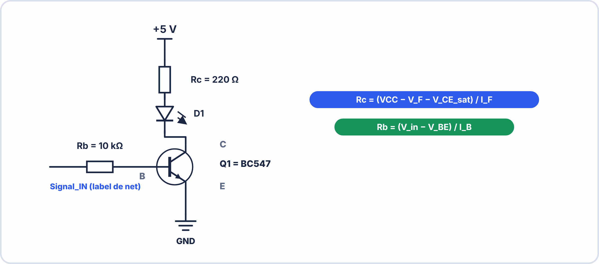

# 🔬 TRAVAUX PRATIQUES — S1 · 2ᵉ ANNÉE · E2
## Premiers Schémas KiCad : LED · Résistances · Alimentation · Transistor

---

> **Nom** : ___________________________ **Binôme** : ___________________________
> **Date** : ___________________________
> **Durée** : 90 minutes · **Cours KiCad autorisé**
> **Logiciel** : KiCad 7.x (installé sur le poste)
> **Épreuve ciblée** : **E2** – Systèmes électroniques embarqués

---

## 📌 Compétences travaillées

| Code | Compétence |
|---|---|
| **S3.3** | Utiliser un logiciel de CAO électronique (KiCad) |
| **C4.1** | Réaliser un schéma électronique numérique |
| **S3.1** | Identifier les composants et leurs symboles |

---

## 🟢 NIVEAU 1 — Créer un projet KiCad (10 min)

**1.1** — Lance KiCad. Dans le gestionnaire de projets :

```
File → New Project → choisir un dossier → nommer : "TP_KiCad_S1_[TonNom]"
```

**1.2** — Ouvre le Schematic Editor en double-cliquant sur le fichier `.kicad_sch` créé.

**1.3** — Identifie dans l'interface :

```
☐ La barre d'outils de droite (outils de schéma)
☐ La zone de dessin centrale (fond noir avec grille)
☐ La barre de coordonnées en bas (X, Y)
☐ Le menu Place et le menu Inspect
```

**1.4** — Teste la navigation :

```
→ Molette vers l'avant = _____________ (zoom avant / zoom arrière ?)
→ Clic molette + déplacer = déplacer la vue
→ Ctrl+Home = revenir à la vue globale
```

---

## 🟡 NIVEAU 2 — Premier schéma : LED avec résistance (25 min)

> **Objectif** : Réaliser le schéma d'une LED rouge alimentée en 5V avec sa résistance de limitation.
> Avant de commencer, calcule la résistance nécessaire :

VCC = 5 V · Vf (LED rouge) = 2 V · If = 20 mA  

$$R = \dfrac{V_{cc} - V_{\mathrm{F}}}{I_{\mathrm{F}}} = (\underline{\hspace{2.5em}} - \underline{\hspace{2.5em}}) / \underline{\hspace{2.5em}} = \underline{\hspace{2.5em}} \Omega$$

Valeur commerciale la plus proche : _____ Ω  

### Placer les composants

**2.1** — Appuie sur **A** pour ouvrir la bibliothèque. Cherche et place :

| Composant | Bibliothèque | Référence | Valeur à saisir |
|---|---|---|---|
| Résistance | Device:R | R1 | [ta valeur calculée] Ω |
| LED | Device:LED | D1 | LED rouge |

**2.2** — Appuie sur **P** (Power). Cherche et place :

```
☐ power:+5V    → Au-dessus du circuit
☐ power:GND    → En dessous du circuit
☐ power:PWR_FLAG × 2  → Un sur le net +5V, un sur le net GND
```

### Connecter les composants

**2.3** — Appuie sur **W** pour tracer les fils. Connecte :

```
+5V → Pin 1 de R1 → Pin 2 de R1 → Anode de D1 → Cathode de D1 → GND
```

> ⚠️ Vérifier : chaque connexion se termine par un petit carré vert **qui disparaît** quand le fil est bien connecté.

### Annoter et vérifier

**2.4** — Menu Tools → Annotate Schematic → Annotate :

```
Résultat attendu :
  R? → R1 : ☐ OK ☐ Toujours R? (erreur d'annotation)
  D? → D1 : ☐ OK ☐ Toujours D?
```

**2.5** — Menu Inspect → Electrical Rules Checker (ERC) → Run ERC :

```
Nombre d'erreurs : _______
Si erreurs → décrire :
  Erreur 1 : _________________________________________________________________
  Comment corrigée : _________________________________________________________

Résultat final : ☐ 0 erreur ☐ 0 avertissement
```

**2.6** — Ctrl+S pour sauvegarder. Fais une capture d'écran du schéma.

---

## 🟠 NIVEAU 3 — Schéma pont diviseur de tension (15 min)

> **Objectif** : Réaliser un pont diviseur R1/R2 entre +12V et GND avec une sortie nommée.

**3.1** — Calcule les valeurs pour obtenir une tension de 5V en sortie depuis 12V :

Si R2 = 10 kΩ :  

$$Vm = V_{cc} \times \dfrac{R_{2}}{R_{1} + R_{2}}$$

$$5 = 12 \times \dfrac{10}{R_{1} + 10}$$

$$R_{1} + 10 = \underline{\hspace{2.5em}} \to R_{1} = \underline{\hspace{2.5em}} k\Omega$$

Valeur commerciale la plus proche : _____ kΩ  

**3.2** — Place et connecte les composants :

```
Composants :
  R1 = Device:R, valeur [calculée]
  R2 = Device:R, valeur 10kΩ
  power:+12V, power:GND, 2× PWR_FLAG

Câblage :
  +12V → R1 → nœud milieu → R2 → GND

Sur le nœud milieu :
  Menu Place → Net Label → nommer "Vm_5V"
```

**3.3** — ERC → 0 erreur. Capture d'écran.

---

## 🔵 NIVEAU 4 — Commande LED par transistor NPN (25 min)

> **Objectif** : Schéma complet d'une LED commandée par un transistor NPN (BC547).
> Une résistance de base Rb limite le courant de base.
> Une résistance de collecteur Rc limite le courant dans la LED.



CALCULS PRÉALABLES :  
Si VCC=5V, Vf_LED=2V, Vce_sat=0.2V, If=20mA :  

$$Rc = \dfrac{V_{cc} - Vf_LED - Vce_sat}{I_{\mathrm{F}}} = \underline{\hspace{2.5em}} \Omega$$

Si gain hFE = 200, Ib = Ic/hFE :  

$$Ib = \dfrac{20\,\mathrm{mA}}{200} = \underline{\hspace{2.5em}} \mu A$$

$$Rb = \dfrac{V_{in} - Vbe}{Ib} = \dfrac{5 - 0.7}{Ib} = \underline{\hspace{2.5em}} k\Omega$$

**4.1** — Ouvre la bibliothèque et cherche `Q_NPN_BCE` :

```
Bibliothèque : Device:Q_NPN_BCE
Référence : Q1
Valeur : BC547
```

**4.2** — Place et connecte tous les composants selon le schéma ci-dessus.

> ⚠️ Attention : les broches du transistor dans KiCad sont B (Base), C (Collecteur), E (Émetteur). Vérifier l'orientation du symbole.

**4.3** — Ajoute un label net "Signal_IN" sur l'entrée de Rb.

**4.4** — ERC → 0 erreur · Annotation complète · Ctrl+S.

```
Mon schéma contient :
  R1 (Rb) = _____ kΩ  ☐ Annoté ☐ Valeur saisie
  R2 (Rc) = _____ Ω   ☐ Annoté ☐ Valeur saisie
  D1 (LED)            ☐ Annoté ☐ Sens correct (A→K de haut en bas)
  Q1 (BC547)          ☐ Annoté ☐ Valeur saisie
  Labels : Signal_IN  ☐ Présent sur la broche Base via Rb
  Alimentation        ☐ +5V · GND · 2× PWR_FLAG
```

---

## 🔴 NIVEAU 5 — Explorer les propriétés avancées (15 min)

**5.1** — Sur le schéma transistor (niveau 4), double-clique sur Q1. Explore les propriétés :

```
Champ "Reference" : _________    Champ "Value" : _________
Champ "Footprint" : (vide pour l'instant — sera complété en S2)
Champ "Datasheet" : (peut contenir l'URL de la fiche technique)
```

**5.2** — Génère la nomenclature (BOM) : Tools → Generate BOM :

```
☐ La BOM liste tous les composants avec leur référence et valeur
☐ Format CSV (tableur)

Mon schéma contient : _____ composants différents
```

**5.3** — Ajoute un **titre** et un **cartouche** au schéma :

```
Menu File → Page Settings :
  Title : "TP Transistor NPN - Commande LED"
  Company : "BAC PRO CIEL - [Ton établissement]"
  Date : [date du jour]
  Revision : "1.0"
```

---

## ✅ Auto-évaluation

| Compétence | Maîtrisé | En cours | À revoir |
|---|---|---|---|
| Créer un projet KiCad | ☐ | ☐ | ☐ |
| Placer un composant depuis la bibliothèque | ☐ | ☐ | ☐ |
| Tracer des fils et connecter les composants | ☐ | ☐ | ☐ |
| Ajouter les symboles d'alimentation (+5V, GND, PWR_FLAG) | ☐ | ☐ | ☐ |
| Annoter automatiquement le schéma | ☐ | ☐ | ☐ |
| Lancer l'ERC et corriger les erreurs | ☐ | ☐ | ☐ |
| Ajouter un label net | ☐ | ☐ | ☐ |
| Calculer la résistance de limitation LED | ☐ | ☐ | ☐ |

---

## ✍️ Validation enseignant

| Critère | /pts |
|---|---|
| Niv.1-2 — Projet créé + schéma LED correct + ERC 0 erreur | /8 |
| Niv.3 — Pont diviseur + calcul correct + label net | /6 |
| Niv.4 — Transistor NPN complet + calculs + ERC 0 erreur | /8 |
| Niv.5 — BOM générée + cartouche complété | /3 |
| **TOTAL** | **/25** |

---

---
