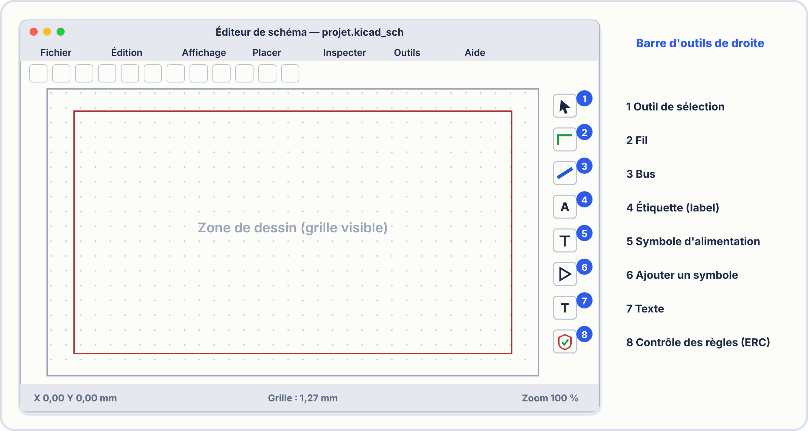
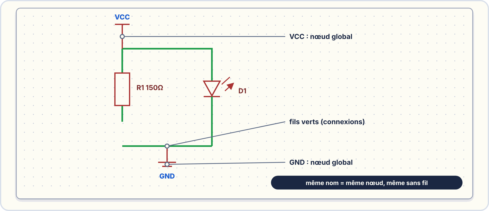

# 📖 FICHE COURS – S2 ANNÉE 2 – E2
## KiCad : Saisie de Schéma, Bibliothèques, ERC, Netlist

---

## 🎯 OBJECTIFS

- ✅ Naviguer dans KiCad et Eeschema
- ✅ Placer des composants depuis les bibliothèques
- ✅ Câbler un schéma (fils, labels, alimentations)
- ✅ Exécuter et corriger l'ERC
- ✅ Générer et lire une netlist

---

## 1️⃣ KICAD — PRÉSENTATION GÉNÉRALE

### Un logiciel EDA open-source

> **KiCad** (prononcé "ki-cad") est un logiciel EDA (**E**lectronic **D**esign **A**utomation) libre et gratuit, utilisé dans l'industrie et l'enseignement pour concevoir des cartes électroniques, de la capture du schéma jusqu'aux fichiers de fabrication (Gerber).

### Architecture de KiCad


> **Dans cette séance, nous travaillons uniquement dans Eeschema.**

### Flot de conception KiCad

```
1. Saisie du schéma (Eeschema)
        ↓
2. ERC — vérification électrique
        ↓
3. Génération netlist
        ↓
4. Association symboles → empreintes PCB
        ↓
5. Routage PCB (PCBnew)
        ↓
6. Génération fichiers Gerber (fabrication)
```

---

## 2️⃣ INTERFACE EESCHEMA

### Zones de l'interface



### Navigation de base

| **Action** | **Geste / Raccourci** |
|---|---|
| Zoom + | Molette vers l'avant |
| Zoom − | Molette vers l'arrière |
| Déplacer la vue | Clic milieu + glisser |
| Tout afficher | `Ctrl+Shift+H` |
| Annuler | `Ctrl+Z` |

> **La grille :** KiCad travaille sur une grille de **50 mil** (mil = 1/1000 de pouce ≈ 0,025 mm). Tous les composants et fils doivent être alignés sur cette grille pour que les connexions soient reconnues. Ne pas désactiver la grille.

---

## 3️⃣ SYMBOLES ET BIBLIOTHÈQUES

### Vocabulaire fondamental

> ⚠️ **Ne pas confondre :**
>
> **Symbole** = représentation graphique schématique d'un composant (rectangle + broches + nom). Utilisé dans Eeschema.
>
> **Empreinte (Footprint)** = dessin physique des pastilles de soudure sur le PCB. Utilisée dans PCBnew.
>
> *Analogie : le symbole, c'est l'icône d'une application sur votre bureau. L'empreinte, c'est la taille réelle que prend cette application sur votre disque dur.*

### Placer un symbole

**Raccourci : `A`** (ou Place → Add Symbol)

```
1. Appuyer sur A → fenêtre "Choose Symbol"
2. Taper le nom du composant dans la barre de recherche
   Ex: "R" pour résistance, "NE555" pour le timer, "LED"
3. Sélectionner le symbole dans la liste
4. Cliquer pour placer dans le schéma
5. Appuyer sur Echap pour terminer
```

### Bibliothèques standard KiCad

| **Bibliothèque** | **Contient** | **Exemples** |
|---|---|---|
| `Device` | Composants passifs génériques | R, C, L, LED, Diode, Transistor |
| `power` | Symboles d'alimentation | VCC, GND, +5V, +3.3V, PWR_FLAG |
| `Timer` | Circuits temporisateurs | NE555, LM555, ICM7555 |
| `Amplifier_Operational` | Amplificateurs opérationnels | LM741, TL071, LM358 |
| `MCU_Microchip_ATmega` | Microcontrôleurs ATmega | ATmega328P, ATmega2560 |
| `Connector` | Connecteurs | Conn_01x02, USB, RJ45 |

### Propriétés d'un composant

**Double-clic sur un composant (ou `E`)** ouvre la fenêtre de propriétés :

| **Champ** | **Contenu** | **Exemple** |
|---|---|---|
| **Référence** | Identifiant unique sur le schéma | `R1`, `C3`, `U1`, `LED2` |
| **Valeur** | Valeur nominale | `4k7`, `100nF`, `NE555` |
| **Empreinte** | Lien vers le footprint PCB | `Device:R_0805` |
| **Feuille de données** | URL ou lien vers le datasheet | *(optionnel)* |

> **Convention de référence :**
> - R = Résistance ; C = Condensateur ; L = Inductance ; D = Diode ; LED = LED ;
> - Q = Transistor ; U = Circuit intégré ; J = Connecteur ; SW = Interrupteur

---



---

## 4️⃣ CÂBLAGE DU SCHÉMA

### Les 3 moyens de créer des connexions

**1. Le fil (Wire) — Raccourci : `W`**

> Connexion physique visible entre deux broches proches. Cliquer sur la broche de départ, tracer, cliquer sur la broche d'arrivée.

```
[Broche_A]────────────[Broche_B]
            fil (vert)
```

> ⚠️ Le fil doit se terminer exactement sur une broche ou rejoindre un autre fil. Un bout de fil "dans le vide" crée une erreur ERC.

**2. L'étiquette de réseau (Net Label) — Raccourci : `L`**

> Nom logique attribué à un nœud. Deux étiquettes portant le même nom sont électriquement connectées, même si elles sont loin l'une de l'autre sur le schéma.

```
[Broche_A]── NET_SIGNAL ───    ... ailleurs sur le schéma ...    ─── NET_SIGNAL ──[Broche_B]
```

> **Utilisation typique :** relier la sortie d'un CI à l'entrée d'un autre sans faire traverser un fil à tout le schéma.

**3. Le symbole d'alimentation (Power Symbol) — Raccourci : `P`**

> Symboles spéciaux pour les rails d'alimentation. Tous les composants raccordés au même symbole (ex: GND) sont reliés ensemble globalement.

```
     +5V          GND
      │             │
  [R1 haut]    [R1 bas]
```

---

### Le PWR_FLAG — Souvent oublié, toujours nécessaire

> **Problème :** KiCad ne sait pas qu'un nœud d'alimentation comme `+5V` ou `GND` est réellement alimenté par une source de tension — il voit juste un symbole placé dans le schéma. Sans information supplémentaire, l'ERC signale une erreur "power pin not driven".
>
> **Solution :** Placer un **PWR_FLAG** (dans la bibliothèque `power`) sur chaque rail d'alimentation. Ce symbole dit à l'ERC : "Ce nœud est piloté par une source externe (connecteur, régulateur…)".

```
Règle :  1 PWR_FLAG sur le nœud +5V (ou VCC)
         1 PWR_FLAG sur le nœud GND
```

---


---

## 5️⃣ ERC — ELECTRICAL RULES CHECK

### Accéder à l'ERC

> **Inspect → Electrical Rules Checker** (ou icône dans la barre d'outils)

### Types d'erreurs courantes

| **Message ERC** | **Cause** | **Solution** |
|---|---|---|
| `Pin not connected` | Une broche n'est raccordée à rien | Brancher la broche OU ajouter le flag `No Connect` (touche `Q`) si intentionnel |
| `Wire not connected` | Un bout de fil flottant dans le schéma | Supprimer le fil orphelin (zoom + Del) |
| `Power pin not driven` | Pas de PWR_FLAG sur un rail d'alimentation | Ajouter un PWR_FLAG sur VCC et GND |
| `Pin connected to other pin but no wire between them` | Deux composants collés l'un à l'autre sans fil | Séparer les composants et câbler |
| `Conflicting nets` | Deux signaux de noms différents fusionnent | Vérifier les labels, séparer les fils |
| `Reference ... not uniquely identified` | Deux composants ont la même référence (ex: deux R1) | Réannoter : Tools → Annotate Schematic |

### Procédure de correction ERC

```
1. Lancer l'ERC : Inspect → Electrical Rules Checker → Run ERC
2. Lire la liste des erreurs
3. Double-cliquer sur une erreur → KiCad zoom sur le marqueur rouge ▸
4. Comprendre la cause (voir tableau ci-dessus)
5. Corriger dans le schéma
6. Relancer l'ERC
7. Répéter jusqu'à 0 erreur (ou seulement des erreurs justifiées ignorées)
```

> **Indicateur de réussite :** `ERC: 0 errors, 0 warnings` ✅

---

## 6️⃣ NETLIST — PASSERELLE VERS LE PCB

### Qu'est-ce qu'une netlist ?

> Une **netlist** est un fichier texte généré par Eeschema qui liste :
> 1. Tous les **composants** du schéma avec leurs propriétés (référence, valeur, empreinte)
> 2. Toutes les **connexions** (nets) entre les broches

### Générer la netlist

> **File → Export → Netlist**
> Format conseillé : **KiCad format (.net)**

### Extraits d'une netlist KiCad

```
(net_list
  (components
    (comp (ref R1) (value 4k7) (footprint Device:R_0805))
    (comp (ref LED1) (value LED) (footprint LED_THT:LED_D5.0mm))
    (comp (ref U1) (value NE555) (footprint DIP-8_W7.62mm))
  )
  (nets
    (net (name +5V)
      (node (ref R1) (pin 1))
      (node (ref U1) (pin 8))
    )
    (net (name GND)
      (node (ref R1) (pin 2) wait ... )
    )
  )
)
```

### Lire une netlist

| **Bloc** | **Signification** |
|---|---|
| `(comp (ref R1) ...)` | Le composant R1 avec sa valeur et son empreinte |
| `(net (name +5V) ...)` | Le nœud électrique nommé "+5V" |
| `(node (ref R1) (pin 1))` | La broche 1 de R1 est connectée à ce nœud |

> **À quoi sert-elle ?** La netlist est importée dans PCBnew qui l'utilise pour placer les empreintes et dessiner les ratsnest (lignes qui indiquent les connexions à router).

---

## ✅ AUTO-ÉVALUATION

- [ ] Je sais créer un nouveau projet KiCad et ouvrir Eeschema
- [ ] Je sais chercher et placer un composant (`A`)
- [ ] Je sais renseigner référence, valeur et empreinte d'un composant
- [ ] Je sais tracer un fil (`W`) et une étiquette de réseau (`L`)
- [ ] Je sais placer des symboles d'alimentation (`P`) et comprendre leur rôle
- [ ] Je sais ce qu'est un PWR_FLAG et pourquoi il est nécessaire
- [ ] Je sais lancer l'ERC et interpréter les 3 erreurs les plus courantes
- [ ] Je sais générer une netlist et identifier ce qu'elle contient

---

## 📚 VOCABULAIRE CLEF

| **Terme** | **Définition** |
|---|---|
| **EDA** | Electronic Design Automation — logiciels de conception électronique |
| **Eeschema** | Éditeur de schéma de KiCad |
| **Symbole** | Représentation graphique schématique d'un composant |
| **Bibliothèque** | Collection de symboles organisée par famille |
| **Fil (Wire)** | Connexion électrique visible entre deux broches |
| **Net Label** | Étiquette de réseau — relie deux points sans fil visible |
| **Référence** | Identifiant unique (R1, C1, U1…) |
| **Valeur** | Valeur nominale du composant (4k7, 100nF…) |
| **Empreinte (Footprint)** | Dessin des pastilles PCB associé à un composant |
| **PWR_FLAG** | Symbole indiquant que le rail d'alim est piloté (évite l'ERC) |
| **ERC** | Electrical Rules Check — vérificateur de cohérence électrique |
| **Netlist** | Fichier texte : liste des composants + leurs connexions |
| **Mil** | Unité de mesure KiCad : 1 mil = 1/1000 pouce ≈ 25,4 µm |
| **Grille 50 mil** | Grille de travail par défaut dans Eeschema |

---

## 📌 POINTS-CLÉS À RETENIR

1. KiCad est divisé en sous-outils : **Eeschema** pour le schéma, **PCBnew** pour le PCB
2. **Symbole ≠ Empreinte** : le symbole est pour le schéma, l'empreinte pour le PCB physique
3. Raccourcis essentiels : `A` (composant), `W` (fil), `L` (label), `P` (alimentation), `E` (propriétés)
4. **PWR_FLAG** = obligatoire sur chaque rail d'alimentation pour éviter l'ERC
5. **ERC → 0 erreur** avant de générer la netlist — c'est la condition sine qua non
6. La **netlist** = pont entre le schéma et le routage PCB — elle liste composants + connexions

---

**Document – BAC PRO CIEL – A2 – E2/U21 – Version 1.0 – 2026**
