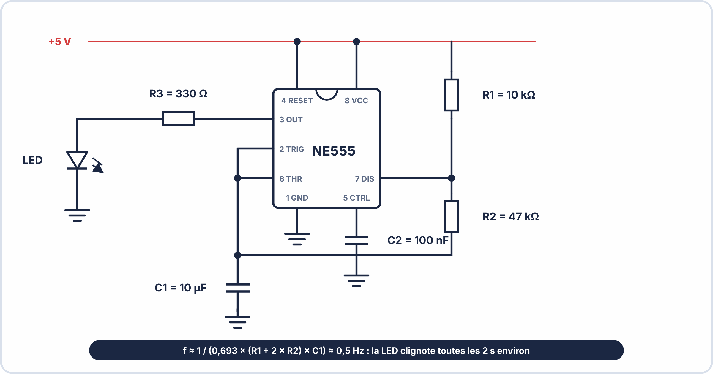

# 🔬 TP KICAD – S2 ANNÉE 2 – E2
## Saisie du Schéma d'une Minuterie NE555 Clignotante

---

## 🎯 OBJECTIFS DU TP

- ✅ Créer un projet KiCad et ouvrir Eeschema
- ✅ Placer tous les composants du circuit NE555 depuis les bibliothèques
- ✅ Câbler le schéma complet (fils + labels + alimentations)
- ✅ Corriger toutes les erreurs ERC
- ✅ Générer la netlist et lire son contenu

---

## ⏱️ DURÉE : 70 min

---

## 📋 PRÉSENTATION DU CIRCUIT CIBLE

> Le **NE555** est un circuit intégré temporisateur très populaire. En mode **astable**, il génère un signal carré périodique — c'est-à-dire qu'il fait clignoter une LED automatiquement.

### Schéma du circuit NE555 astable à réaliser



```
Fréquence approximative : f ≈ 1 / (0,693 × (R1+2×R2) × C1)
                           f ≈ 0,5 Hz → LED clignote toutes les ~2 s
```

### Liste des composants (BOM simplifiée)

| **Référence** | **Valeur** | **Description** | **Empreinte** |
|---|---|---|---|
| U1 | NE555 | Timer IC | `Package_DIP:DIP-8_W7.62mm` |
| R1 | 10k | Résistance 1/4W | `Device:R_0805` |
| R2 | 47k | Résistance 1/4W | `Device:R_0805` |
| R3 | 330 | Résistance limitation LED | `Device:R_0805` |
| C1 | 10µF | Condensateur électrolytique | `Device:CP_Radial_D5.0mm_P2.50mm` |
| C2 | 100nF | Condensateur céramique découplage | `Device:C_0805` |
| LED1 | LED | LED rouge 5mm | `LED_THT:LED_D5.0mm` |

---

## 🧪 PARTIE 1 — Création du Projet (5 min)

### 1.1 — Créer un nouveau projet KiCad

```
1. Ouvrir KiCad 8.x
2. File → New Project
3. Nommer le projet : "minuterie_NE555_[VotreNom]"
4. Choisir le dossier : Bureau ou dossier de travail partagé
5. Cliquer sur Save
```

### 1.2 — Ouvrir Eeschema

```
Dans le gestionnaire KiCad :
  → Double-clic sur l'icône "Schematic Editor" (Eeschema)
  → La feuille A4 blanche s'ouvre
```

**Q1.** Quelle est l'extension du fichier schéma créé par KiCad 8 ?

\_\_\_\_\_\_\_\_\_

**Q2.** Notez les dimensions de la feuille affichée (visible dans le cartouche en bas à droite) :

\_\_\_\_\_\_\_\_\_


??? tip "💡 Aides pour la partie 1"
    - **Q1** : le fichier du schéma porte l'extension **`.kicad_sch`** ; le projet, **`.kicad_pro`** ; le circuit imprimé, **`.kicad_pcb`**. Regarde l'explorateur de fichiers du projet.
    - **Q2** : le format de feuille (A4, A3…) est écrit dans le **cartouche**, en bas à droite.

---

## 🧪 PARTIE 2 — Placement des Composants (20 min)

### 2.1 — Placer le NE555 (U1)

```
1. Appuyer sur A (Add Symbol)
2. Taper "NE555" dans la barre de recherche
3. Sélectionner : Timer:NE555
4. Cliquer au centre de la feuille pour placer
5. Appuyer sur Echap pour terminer
```

**Double-clic sur U1** pour ouvrir ses propriétés et renseigner :

```
Référence : U1
Valeur    : NE555
Empreinte : Package_DIP:DIP-8_W7.62mm   (cliquer sur l'icône dossier pour naviguer)
```

**Q3.** Combien de broches (pins) le symbole NE555 possède-t-il ? Nommez-les.

\_\_\_\_\_\_\_\_\_\_\_\_\_\_\_\_\_\_\_\_\_\_\_\_\_\_\_\_\_\_\_\_\_\_\_\_\_\_\_\_\_\_\_\_\_\_\_\_\_\_\_\_\_\_\_\_\_\_\_\_\_\_\_\_\_\_\_\_\_\_\_\_\_

### 2.2 — Placer les résistances (R1, R2, R3)

```
1. Appuyer sur A → taper "R" → sélectionner Device:R
2. Placer R1 au-dessus de U1
3. Placer R2 entre R1 et U1 (à droite)
4. Placer R3 à droite de la sortie (Pin 3)

Pour chaque résistance, ouvrir les propriétés (E) et renseigner :
  R1 : Référence=R1, Valeur=10k,  Empreinte=Device:R_0805
  R2 : Référence=R2, Valeur=47k,  Empreinte=Device:R_0805
  R3 : Référence=R3, Valeur=330,  Empreinte=Device:R_0805
```

### 2.3 — Placer les condensateurs (C1, C2)

```
1. A → taper "C" → sélectionner Device:C (pour C2 céramique)
   C2 : Valeur=100nF, Empreinte=Device:C_0805

2. A → taper "CP" → sélectionner Device:CP (condensateur polarisé pour C1)
   C1 : Valeur=10µF, Empreinte=Device:CP_Radial_D5.0mm_P2.50mm
```

**Q4.** Pourquoi C1 et C2 utilisent-ils deux symboles différents (`C` et `CP`) ?

\_\_\_\_\_\_\_\_\_\_\_\_\_\_\_\_\_\_\_\_\_\_\_\_\_\_\_\_\_\_\_\_\_\_\_\_\_\_\_\_\_\_\_\_\_\_\_\_\_\_\_\_\_\_\_\_\_\_\_\_\_\_\_\_\_\_\_\_\_\_\_\_\_

### 2.4 — Placer la LED (LED1)

```
1. A → taper "LED" → sélectionner Device:LED
2. Placer à droite de R3
3. Propriétés : Référence=LED1, Valeur=LED, Empreinte=LED_THT:LED_D5.0mm
```

**Q5.** La LED est un composant polarisé. Comment identifiez-vous son anode (A) et sa cathode (K) sur le symbole KiCad ?

\_\_\_\_\_\_\_\_\_\_\_\_\_\_\_\_\_\_\_\_\_\_\_\_\_\_\_\_\_\_\_\_\_\_\_\_\_\_\_\_\_\_\_\_\_\_\_\_\_\_\_\_\_\_\_\_\_\_\_\_\_\_\_\_\_\_\_\_\_\_\_\_\_


??? tip "💡 Aides pour la partie 2"
    - **Placer un composant** : touche **A**, tape le nom (`NE555`, `R`, `C`, `LED`), valide, puis clique pour le poser. **R** fait pivoter, **M** déplace, **E** ouvre les propriétés.
    - **Q3** : compte les broches **sur le symbole** et vérifie avec la **datasheet** ; le boîtier DIP du NE555 en possède **huit**.
    - **Q4** : l'un des symboles représente un condensateur **non polarisé**, l'autre un condensateur **polarisé** (électrolytique, avec un signe **+**). Pense à ce qui se passe si on **inverse** un électrolytique.
    - **Q5** : l'**anode** est du côté du **triangle** (la flèche), la **cathode** du côté de la **barre**. Courant : du triangle vers la barre.

---

## 🧪 PARTIE 3 — Câblage du Schéma (25 min)

### 3.1 — Ajouter les symboles d'alimentation

```
1. Appuyer sur P (Add Power Symbol)
2. Taper "+5V" → placer au-dessus du schéma (plusieurs fois)
3. Taper "GND" → placer en bas de chaque branche de masse
```

Positionnez les symboles d'alimentation aux endroits suivants :

- `+5V` : en haut de R1, sur Pin 8 de U1, sur Pin 4 de U1
- `GND` : sous C1, sous C2, sous la cathode de LED1, sur Pin 1 de U1

### 3.2 — Ajouter les PWR_FLAG

```
1. P → taper "PWR_FLAG" → placer un PWR_FLAG sur le nœud +5V
2. P → taper "PWR_FLAG" → placer un deuxième PWR_FLAG sur le nœud GND
```

### 3.3 — Tracer les fils

> **Rappel :** Touche `W` pour tracer, cliquer sur broche de départ → broche d'arrivée.

Câblez dans cet ordre :

```
Connexions à réaliser :

1. +5V → Pin haut de R1
2. Pin bas de R1 → Pin 7 de U1 (DISCHARGE)     ← jonction T
3. Pin 7 de U1 → Pin haut de R2
4. Pin bas de R2 → Pin 6 de U1 (THRESHOLD)      ← jonction T
5. Pin 6 de U1 → Pin 2 de U1 (TRIGGER)
6. Nœud Pin6/Pin2 → Pin haut de C1
7. Pin bas de C1 → GND
8. Pin 4 de U1 (RESET) → +5V    (ou fil vers +5V)
9. Pin 5 de U1 (CTRL) → Pin haut de C2
10. Pin bas de C2 → GND
11. Pin 3 de U1 (OUTPUT) → Pin gauche de R3
12. Pin droit de R3 → Anode de LED1
13. Cathode de LED1 → GND
14. Pin 8 de U1 (+5V) → +5V
15. Pin 1 de U1 (GND) → GND
```

> **Astuce :** Pour créer un nœud de jonction (connexion en T), placez simplement un point de jonction en appuyant sur `J` à l'intersection.


??? tip "💡 Aides pour la partie 3"
    - **Un fil** se trace avec la touche **W** : clique sur la **broche de départ**, puis sur la **broche d'arrivée**. Un point vert à l'extrémité indique une **vraie connexion**.
    - **PWR_FLAG** : à poser sur le net **+9 V** et sur le **GND** (là où l'alimentation arrive), pour que l'ERC sache qu'une source alimente ces nets.
    - Les broches **2 et 6** du NE555 sont reliées ensemble ; la broche **4** (RESET) va au **+** ; la broche **5** (CONTROL) reçoit en général un **petit condensateur** vers la masse.
    - **Méthode** : câble **un bloc à la fois** (alimentation, oscillateur, sortie) et lance l'ERC à la fin de chaque bloc.

---

## 🧪 PARTIE 4 — Annotation et ERC (10 min)

### 4.1 — Annoter automatiquement

> Si certains composants affichent encore `R?` ou `C?`, il faut les annoter :

```
Tools → Annotate Schematic → Annotate All → OK
```

**Q6.** Après l'annotation, toutes les références ont-elles un numéro (R1, R2, etc.) ?

\_\_\_\_\_\_\_\_\_

### 4.2 — Exécuter l'ERC

```
Inspect → Electrical Rules Checker → Run ERC
```

**Relevez les erreurs :**

| **Erreur** | **Composant / Pin** | **Cause identifiée** | **Correction** |
|---|---|---|---|
| | | | |
| | | | |
| | | | |

**Q7.** Combien d'erreurs ERC obtenez-vous après la première exécution ?

\_\_\_\_\_\_\_\_\_

**Q8.** Après correction de toutes les erreurs, quelle est la ligne finale affichée par l'ERC ?

\_\_\_\_\_\_\_\_\_


??? tip "💡 Aides pour la partie 4"
    - **Q6** : si des références restent en `R?`, relance **Annotate** (Tools → Annotate Schematic).
    - **Q7** : au premier passage, il y a **souvent plusieurs erreurs** (broches non connectées, PWR_FLAG manquant). Un nombre de **zéro** est possible mais rare : relis ton schéma avant d'être sûr.
    - **Q8** : le message final de succès indique **zéro erreur** (et éventuellement des avertissements).
    - **Méthode** : traite les erreurs **une par une**, **relance** après chaque correction : elles peuvent s'enchaîner.

---

## 🧪 PARTIE 5 — Génération de la Netlist (10 min)

### 5.1 — Générer la netlist

```
File → Export → Netlist
Format : KiCad
Enregistrer sous : "minuterie_NE555.net" dans le dossier du projet
```

### 5.2 — Lire la netlist

Ouvrez le fichier `.net` avec le Bloc-notes (ou Notepad++) et répondez :

**Q9.** Combien de composants apparaissent dans la section `(components ...)` ?

\_\_\_\_\_\_\_\_\_

**Q10.** Trouvez le bloc correspondant au nœud qui relie Pin 3 de U1, R3 et LED1. Quel nom ce nœud a-t-il (s'il a un label) ou comment est-il identifié ?

\_\_\_\_\_\_\_\_\_\_\_\_\_\_\_\_\_\_\_\_\_\_\_\_\_\_\_\_\_\_\_\_\_\_\_\_\_\_\_\_\_\_\_\_\_\_\_\_\_\_\_\_\_\_\_\_\_\_\_\_\_\_\_\_\_\_\_\_\_\_\_\_\_

**Q11.** Le composant C1 a l'empreinte `Device:CP_Radial_D5.0mm_P2.50mm`. Que signifie "P2.50mm" dans ce nom d'empreinte ?

\_\_\_\_\_\_\_\_\_\_\_\_\_\_\_\_\_\_\_\_\_\_\_\_\_\_\_\_\_\_\_\_\_\_\_\_\_\_\_\_\_\_\_\_\_\_\_\_\_\_\_\_\_\_\_\_\_\_\_\_\_\_\_\_\_\_\_\_\_\_\_\_\_


??? tip "💡 Aides pour la partie 5"
    - **Q9** : compte les composants du **BOM** (sans les symboles d'alimentation). Le nombre doit correspondre à ton **tableau de composants**.
    - **Q10** : cherche un **net** dont la liste contient la broche 3 de U1, une broche de R3 et l'anode de LED1. S'il n'a pas de label, KiCad lui donne un nom du type **`Net-(...)`**.
    - **Q11** : dans le nom d'une empreinte, **D** est le **diamètre** et **P** l'**écartement** (pitch) entre les broches, en millimètres.

---

## 📊 BARÈME DU TP

| **Section** | **Critère** | **Points** |
|---|---|---|
| Partie 1 | Projet créé, Eeschema ouvert, Q1+Q2 | /2 |
| Partie 2 | 7 composants placés avec propriétés correctes | /6 |
| Partie 3 | Schéma câblé (fils + alimentations + PWR_FLAG) | /6 |
| Partie 4 | ERC 0 erreur + tableau corrections | /4 |
| Partie 5 | Netlist générée + Q9 à Q11 | /3 |
| Présentation schéma (lisible, bien organisé) | | /2 |
| Rendu du fichier `.kicad_sch` | | /2 |
| **TOTAL** | | **/25** |

> *Ramené à /20 : score × 0,8*

---

**Document – BAC PRO CIEL – A2 – E2/U21 – Version 1.0 – 2026**
