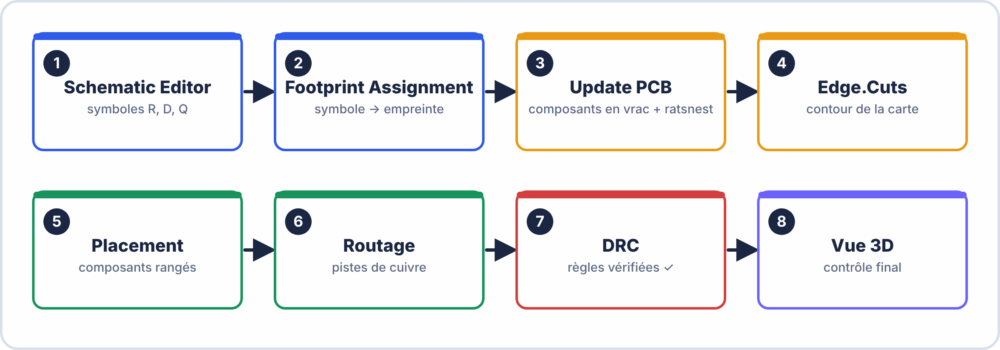
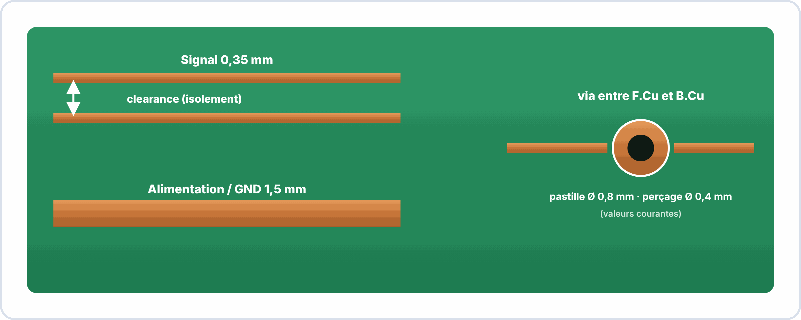
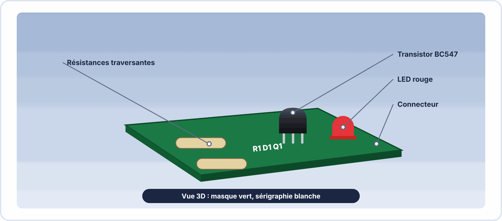

# 📘 FICHE DE COURS — S3 · 2ᵉ ANNÉE · E2
## KiCad PCB Editor : Routage · Pistes & Vias · Clearance · DRC · Visualisation 3D

---

> **Nom** : \_\_\_\_\_\_\_\_\_\_\_\_\_\_\_\_\_\_\_\_\_\_\_\_\_\_\_
> **Date** : \_\_\_\_\_\_\_\_\_\_\_\_\_\_\_\_\_\_\_\_\_\_\_\_\_\_\_
> **Compétences travaillées** : S3.3 · C4.1 · C4.2 · C3.1

---

## 🔑 Vocabulaire clé

| Terme | Définition |
|---|---|
| **PCB** | Printed Circuit Board — circuit imprimé · support physique du circuit électronique |
| **Piste (Track)** | Ligne de cuivre qui relie deux composants sur le PCB |
| **Via** | Trou métallisé reliant deux calques de cuivre (ex: F.Cu ↔ B.Cu) |
| **Pad** | Zone de cuivre sur laquelle se soude un composant |
| **Clearance** | Espace minimum entre deux éléments conducteurs (pistes, pads, vias) |
| **Ratsnest** | Lignes de connexion non encore routées (fils fantômes reliant les pads) |
| **DRC** | Design Rule Check — vérification automatique des règles de conception |
| **Empreinte (Footprint)** | Représentation physique d'un composant : forme des pads + silkscreen |
| **Calque (Layer)** | Niveau du PCB (F.Cu = face avant cuivre, B.Cu = face arrière, Edge.Cuts = contour...) |
| **Gerber** | Format de fichiers industriels pour la fabrication du PCB |
| **THT** | Through-Hole Technology — composants traversants (pattes dans les trous) |
| **SMD** | Surface Mount Device — composants en surface (soudés sur les pads) |
| **Plan de masse** | Zone de cuivre GND couvrant une large partie du PCB |
| **DRC Violation** | Erreur détectée par le DRC : clearance trop petite, piste non connectée... |

---

## 1️⃣ — Le flux de conception KiCad : du schéma au PCB

### Les 6 étapes de la conception PCB

```
ÉTAPE 1 — Schéma électronique (KiCad Schematic Editor)
  → Dessiner les composants et leurs connexions
  → Vérifier avec l'ERC (0 erreur)

ÉTAPE 2 — Associer les empreintes (Footprint Assignment)
  → Chaque symbole schéma → une empreinte physique
  → Exemple : Device:R (symbole) → Resistor_THT:R_Axial_DIN0204... (empreinte)
  → Via : Tools → Assign Footprints (dans le Schematic Editor)

ÉTAPE 3 — Mettre à jour le PCB (Update PCB)
  → Schematic Editor : Tools → Update PCB from Schematic
  → Les composants apparaissent en tas dans le PCB Editor (ratsnest visible)

ÉTAPE 4 — Tracer le contour du PCB (Edge.Cuts)
  → Sélectionner le calque Edge.Cuts
  → Dessiner un rectangle ou autre forme = taille de la carte

ÉTAPE 5 — Placer les composants
  → Déplacer, orienter chaque composant à l'intérieur du contour
  → Optimiser pour minimiser la longueur des pistes

ÉTAPE 6 — Router les pistes
  → Tracer les pistes de cuivre (F.Cu ou B.Cu)
  → Respecter les règles de clearance et de largeur
  → Le ratsnest disparaît quand une connexion est routée

ÉTAPE 7 — Vérifier avec le DRC
  → Inspect → Design Rules Checker → Run DRC
  → Corriger toutes les erreurs

ÉTAPE 8 — Visualiser en 3D + Exporter
  → View → 3D Viewer
  → File → Fabrication Outputs → Gerbers
```

---



---

## 2️⃣ — Les calques du PCB

### Organisation en calques

```
CALQUES DE CUIVRE (conducteurs) :
  F.Cu  → Face avant (là où sont généralement les composants)
  B.Cu  → Face arrière

CALQUES DE SÉRIGRAPHIE (texte et contours) :
  F.Silkscreen → Texte face avant (références composants, logos)
  B.Silkscreen → Texte face arrière

CALQUES DE MASQUE SOUDURE (vernis) :
  F.Mask → Vernis épargne face avant (expose les pads, couvre le reste)
  B.Mask → Vernis épargne face arrière

CALQUE DE CONTOUR :
  Edge.Cuts → Forme de découpe du PCB (rectangle, cercle, forme complexe)

CALQUES TECHNIQUES :
  F.Fab  → Documentation fabrication avant
  B.Fab  → Documentation fabrication arrière
  F.Courtyard → Zone de réservation espace composant (éviter les chevauchements)
```

### Navigation entre les calques dans KiCad PCB

```
Menu déroulant calque (en haut à droite) ou panneau de gauche
Raccourcis :
  +      → Calque suivant
  -      → Calque précédent
  Barre d'espace → Basculer calque actif
```

---

## 3️⃣ — Empreintes : associer composants et PCB

### Qu'est-ce qu'une empreinte ?

```
L'empreinte = la "recette physique" d'un composant sur le PCB :
  Positions et tailles des pads (pour la soudure)
  Tailles des perçages pour les composants THT
  Silkscreen (contour du composant, numéro de pin)
  Courtyard (espace réservé autour du composant)

Un même composant (ex: résistance) peut avoir des dizaines d'empreintes :
  Resistor_THT:R_Axial_DIN0204_L3.6mm_D1.6mm_P7.62mm_Horizontal
    → Résistance traversante, longueur 3,6mm, diamètre 1,6mm, pas 7,62mm, horizontale
  Resistor_SMD:R_0805_2012Metric
    → Résistance CMS (SMD) format 0805 = 2mm × 1,25mm
```

### Comment assigner une empreinte dans KiCad

```
Méthode 1 — Dans le Schematic Editor, avant le PCB :
  Clic droit sur le composant → Properties → Footprint
  → Cliquer sur l'icône bibliothèque pour chercher
  → Taper "R_Axial" pour les résistances traversantes

Méthode 2 — Tools → Assign Footprints (Schematic Editor)
  → Interface dédiée : liste des symboles à gauche, empreintes à droite
  → Glisser-déposer pour associer

Méthode 3 — Dans le PCB Editor, après import
  → Double-clic sur le composant → Changer l'empreinte
```

---

## 4️⃣ — Placement des composants

### Règles de placement professionnel

```
RÈGLES GÉNÉRALES :
  1. Composants polarisés (condensateurs élec., diodes) → même orientation si possible
  2. Les composants de même type → alignés (plus facile à souder)
  3. Les composants de puissance (dissipateurs) → bord de carte pour ventilation
  4. Connecteurs → bord de carte (accessibles de l'extérieur)
  5. Composants côte à côte → minimum d'espace de courtyard requis
     (les courtyards ne doivent pas se chevaucher → DRC courtyard violation)

PROCESSUS DE PLACEMENT :
  1. Importer depuis le schéma (les composants arrivent en tas)
  2. Séparer les composants (les écarter)
  3. Placer les connecteurs aux bords en premier
  4. Grouper les composants par fonction (ex: section alimentation ensemble)
  5. Placer les composants les plus contraignants (gros CI) en premier
  6. Ajuster l'orientation (R pour rotation)
```

### Raccourcis de placement

```
G → Grab (déplacer avec les ratsnest qui suivent)
R → Rotation (90° par défaut, configurable)
F → Flip (passer de F.Cu à B.Cu)
E → Éditer les propriétés
Ctrl+D → Dupliquer
X → Sélectionner une piste à tracer
```

---

## 5️⃣ — Pistes, vias et règles de clearance

### Les pistes : largeurs recommandées

```
TABLEAU DES LARGEURS DE PISTES (PCB double face, fabrication standard) :

Usage               | Largeur min | Largeur recommandée | Courant max
--------------------|-------------|---------------------|------------
Signal faible       | 0,15 mm     | 0,30 mm             | < 0,5 A
Signal numérique    | 0,20 mm     | 0,35 mm             | < 1 A
Alimentation (5V)   | 0,50 mm     | 0,80 mm             | < 2 A
Alimentation (12V+) | 0,80 mm     | 1,50 mm             | < 4 A
GND (plan)          | Plan de masse (Fill Zone) recommandé

Formule approchée : largeur (mm) ≈ courant (A) / 2 (pour épaisseur cuivre 35µm)
```

### Le via : changer de calque

```
Rôle : connecter F.Cu à B.Cu
  → Créer un via : en cours de routage, appuyer sur V
  → Un via = un pad sur F.Cu + un pad sur B.Cu + un trou métallisé

Paramètres standard :
  Diamètre extérieur : 0,8 mm (minimum fabrication standard)
  Diamètre perçage   : 0,4 mm
  Anneau de cuivre   : (0,8 - 0,4) / 2 = 0,2 mm → correct pour la fiabilité

Types de vias :
  Through-hole via   : traverse tout le PCB (standard)
  Blind via          : de la surface vers une couche interne (PCB multicouches)
  Buried via         : entre deux couches internes (PCB multicouches avancé)
```

### Les règles de clearance

```
Clearance = espace minimum entre deux conducteurs

Exemple avec clearance = 0,2 mm :
  Piste 1  ←→  Piste 2  : minimum 0,2 mm
  Piste    ←→  Pad      : minimum 0,2 mm
  Via      ←→  Via      : minimum 0,2 mm

Configurer dans KiCad :
  File → Board Setup → Design Rules → Net Classes
  → Modifier "Default" netclass :
    Clearance : 0.2 mm
    Track Width : 0.35 mm
    Via Diameter : 0.8 mm
    Via Drill : 0.4 mm

⚠️ Les violations de clearance = erreurs DRC
   Un PCB avec des violations de clearance ne peut pas être fabriqué correctement.
```

---



---

## 6️⃣ — Router les pistes dans KiCad

### Démarrer le routage

```
Outil de routage : X (Route Track) ou clic sur l'icône piste
  1. Cliquer sur un pad ou une extrémité de piste
  2. KiCad trace automatiquement en gardant les angles à 45° ou 90°
  3. Cliquer sur le pad destination pour terminer la connexion
  4. Le ratsnest de ce net disparaît → connexion établie ✓

Pendant le routage :
  / → Alterner 45°/90°/courbe
  V → Insérer un via (changer de calque)
  Échap → Annuler la piste en cours
```

### Techniques de routage

```
ROUTAGE MANUEL (recommandé pour apprendre) :
  → L'utilisateur trace chaque piste à la main
  → Permet de comprendre les contraintes de placement
  → Meilleur contrôle de la qualité

ROUTAGE INTERACTIF (KiCad "Push & Shove") :
  → KiCad évite les obstacles automatiquement
  → Activer dans les paramètres de routage
  → Utile pour les PCB denses

ROUTEUR AUTOMATIQUE (FreeRouting) :
  → KiCad peut se connecter à FreeRouting (logiciel externe)
  → Route automatiquement toutes les connexions
  → Résultat souvent passable, à utiliser avec prudence
```

### Stratégie de routage

```
ORDRE RECOMMANDÉ :
  1. Router en premier les pistes d'alimentation (VCC, GND) — larges
  2. Router les signaux les plus contraints (longueurs critiques) ensuite
  3. Router les signaux ordinaires en dernier
  4. Ajouter un plan de masse GND (Fill Zone sur B.Cu) pour finir
```

---

## 7️⃣ — Le DRC : vérifier les règles de conception

### Ce que le DRC vérifie

```
ERREURS TYPIQUES DRC :

"Clearance violation" :
  Deux pistes ou pads trop proches
  Solution : déplacer une piste, redresser le tracé

"Track not connected (dangling end)" :
  Une piste se termine dans le vide
  Solution : la prolonger jusqu'au bon pad

"Unconnected items" :
  Des ratsnest existent encore (connexions non routées)
  Solution : router ces connexions

"Courtyard overlap" :
  Deux empreintes dont les courtyards se chevauchent
  Solution : éloigner les composants

"Pad in copper zone" :
  Un pad n'est pas connecté au bon net dans une fill zone
  Solution : vérifier la fill zone et ses connexions
```

### Lancer et interpréter le DRC

```
Menu : Inspect → Design Rules Checker → Run DRC

Résultat :
  ✓ 0 errors, 0 warnings → PCB prêt pour fabrication
  ✗ Errors → cliquer sur chaque erreur pour la localiser
    → KiCad zoom sur le problème + flèches indicatrices

Astuce : lancer le DRC régulièrement pendant le routage,
         pas seulement à la fin → corriger au fur et à mesure
```

---


---

## 8️⃣ — Visualisation 3D

### Ouvrir la vue 3D

```
Menu : View → 3D Viewer    ou    raccourci Alt+3

Contrôles de navigation 3D :
  Clic gauche + déplacer  → Rotation
  Clic droit + déplacer   → Translation
  Molette                  → Zoom
  Ctrl+Home                → Vue par défaut (perspective)

Vues prédéfinies :
  Numpad 1  → Face avant
  Numpad 3  → Face latérale
  Numpad 7  → Vue de dessus
  Numpad 9  → Vue de dessous
```

### Ce qu'on voit dans la vue 3D

```
Couleurs des éléments :
  Vert/Bleu  → Masque de soudure (FR4, vernis)
  Doré       → Finition cuivre (ENIG = Or immersion)
  Argenté    → Finition cuivre (HASL = soudure étain)
  Gris/Blanc → Sérigraphie
  Corps des composants → Modèles 3D (si disponibles dans la bibliothèque)

Utilité de la vue 3D :
  ✓ Vérifier l'encombrement des composants
  ✓ Détecter les composants trop proches ou qui se chevauchent
  ✓ Impression pour la documentation
  ✓ Communication client / présentation
  ✓ Validation visuelle avant fabrication
```

---



---

## 📌 Les essentiels à retenir

> ✅ Flux KiCad : Schéma (ERC) → Empreintes → PCB Import → Contour → Placement → Routage → DRC → 3D
> ✅ **Edge.Cuts** = contour de découpe du PCB
> ✅ **F.Cu / B.Cu** = calques de cuivre avant/arrière
> ✅ **Ratsnest** = fils fantômes des connexions non routées
> ✅ Largeur piste : signal = **0,35 mm** · alimentation = **0,8-1,5 mm**
> ✅ **Clearance** minimum = 0,2 mm (sinon violation DRC → PCB non fabricable)
> ✅ **Via** = trou métallisé F.Cu ↔ B.Cu · D extérieur 0,8 mm · perçage 0,4 mm
> ✅ DRC : 0 erreur = obligatoire avant export Gerber
> ✅ Vue 3D : Alt+3 · rotation clic gauche · molette zoom
> ✅ Raccourcis PCB : **X** (piste), **V** (via), **R** (rotation), **G** (grab), **F** (flip)

---

*Fiche de Cours PCB KiCad — BAC PRO CIEL | E2 Systèmes Électroniques | 2ᵉ année S3*
*Compétences : S3.3 · C4.1 · C4.2 · C3.1*
