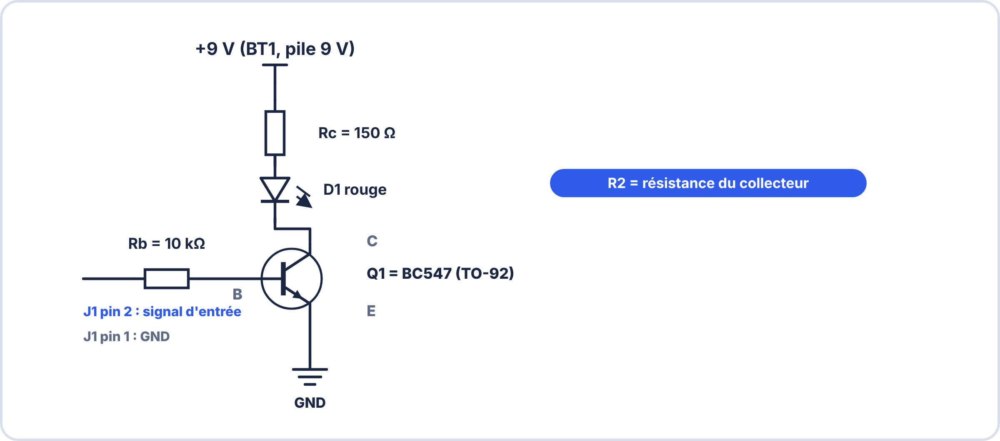

# 🔬 TRAVAUX PRATIQUES — S3 · 2ᵉ ANNÉE · E2
## PCB KiCad : Placement · Routage · Clearance · DRC · Vue 3D

---

> **Nom** : \_\_\_\_\_\_\_\_\_\_\_\_\_\_\_\_\_\_\_\_\_\_\_\_\_\_\_ **Binôme** : \_\_\_\_\_\_\_\_\_\_\_\_\_\_\_\_\_\_\_\_\_\_\_\_\_\_\_
> **Date** : \_\_\_\_\_\_\_\_\_\_\_\_\_\_\_\_\_\_\_\_\_\_\_\_\_\_\_ **Groupe** : \_\_\_\_\_\_\_\_\_\_\_\_\_\_\_\_\_\_\_\_\_\_\_\_\_\_\_
> **Durée** : 110 minutes · **Fiche de cours autorisée** · **KiCad 7.x**
> **Fichier de départ** : `S3_E2_PCB_DEPART.kicad_pro` (fourni par l'enseignant)
> **Épreuve ciblée** : **E2** – Systèmes électroniques embarqués

---

## 📌 Compétences travaillées

| Code | Compétence |
|---|---|
| **S3.3** | Utiliser le PCB Editor de KiCad |
| **C4.1** | Réaliser un PCB routé |
| **C4.2** | Appliquer les règles de clearance et de largeur de piste |
| **C3.1** | Capturer et documenter la vue 3D |

---

## 🗺️ Schéma de départ — Circuit transistor NPN commande LED



```
Composants et empreintes attendues :
  R1 = 10kΩ → Resistor_THT:R_Axial_DIN0204_L3.6mm_D1.6mm_P7.62mm_Horizontal
  R2 = 150Ω → même empreinte
  D1 (LED)  → LED_THT:LED_D5.0mm
  Q1 (BC547)→ Package_TO_SOT_THT:TO-92_Inline
  BT1 (9V)  → Battery:BatteryHolder_Keystone_1042_1x9V (ou similaire)
  J1 (2pin) → Connector_PinHeader_2.54mm:PinHeader_1x02_P2.54mm_Vertical
```

---

## 🟢 NIVEAU 1 — Importer le schéma dans le PCB Editor (15 min)

**1.1** — Dans le KiCad Schematic Editor, vérifie que les empreintes sont assignées :

```
Menu : Tools → Assign Footprints
```

```
R1 (10kΩ) : empreinte = ___________________________________________________
R2 (150Ω) : empreinte = ___________________________________________________
D1 (LED)  : empreinte = ___________________________________________________
Q1 (BC547): empreinte = ___________________________________________________
```

**1.2** — Lance la mise à jour du PCB :

```
Menu : Tools → Update PCB from Schematic → Update PCB
```

**1.3** — Dans le PCB Editor qui s'ouvre (ou s'est mis à jour) :

```
☐ Les 6 composants sont visibles (en tas) → ☐ Oui ☐ Non
☐ Des lignes en pointillés (ratsnest) sont visibles entre les pads → ☐ Oui ☐ Non
Nombre de connexions (ratsnest) visibles : _______
```

??? success "Valeurs attendues"
    **1.1** — Empreintes usuelles : R1, R2 : `Resistor_THT:R_Axial_DIN0207_L6.3mm_D2.5mm_P10.16mm_Horizontal` ; D1 : `LED_THT:LED_D5.0mm` ; Q1 : `Package_TO_SOT_THT:TO-92_Inline`.  
    **1.3** — Les 6 composants (R1, R2, D1, Q1, BT1, J1) sont visibles : oui ; ratsnest visible : oui ; connexions à relier : **7** (réseau minimal : 2 pour GND, 5 pour les autres liaisons).

---

## 🟡 NIVEAU 2 — Configurer les règles et tracer le contour (15 min)

### Configurer les règles de conception

**2.1** — Ouvre les règles de conception :

```
Menu : File → Board Setup → Design Rules → Net Classes
```

Configurer la classe "Default" avec :

```
Clearance         : _______ mm (minimum 0,2 mm recommandé)
Track Width       : _______ mm (signal standard : 0,35 mm)
Via Diameter      : _______ mm (minimum : 0,8 mm)
Via Drill         : _______ mm (minimum : 0,4 mm)
```

**2.2** — Règle spécifique pour les pistes d'alimentation :

```
Ajouter une nouvelle Net Class "POWER" :
  Ajouter les nets : +9V, GND
  Track Width : _______ mm (alimentation : 0,8 mm minimum)
  Clearance   : 0,3 mm
```

### Tracer le contour du PCB

**2.3** — Sélectionner le calque **Edge.Cuts** dans le menu déroulant.

**2.4** — Tracer un rectangle de **60 mm × 50 mm** :

```
Menu : Place → Rectangle (ou raccourci Ctrl+Shift+R)
→ Cliquer coin 1 · entrer les dimensions · cliquer coin 2

Vérification :
☐ Le contour est bien en jaune (couleur Edge.Cuts)
☐ Les dimensions sont correctes (utiliser Inspect → Board Statistics)
```

??? success "Valeurs attendues"
    Clearance : **0,2 mm** ; largeur de piste signal : **0,35 mm** ; via : **0,8 mm** de diamètre et **0,4 mm** de perçage ; largeur de piste d'alimentation : **0,8 mm**. Contour : rectangle de 60 × 50 mm sur Edge.Cuts.

---

## 🟠 NIVEAU 3 — Placer les composants (20 min)

**3.1** — Déplace et place chaque composant à l'intérieur du contour.
Utilise la stratégie suivante :

```
Étape 1 : J1 (connecteur) → bord de carte (gauche ou bas)
Étape 2 : BT1 (pile) → bord de carte accessible
Étape 3 : Q1 (transistor) → zone centrale
Étape 4 : R1, R2, D1 → autour du transistor
```

**3.2** — Oriente chaque composant (touche **R**) pour minimiser les croisements de ratsnest.

**3.3** — Vérifie l'absence de chevauchement des courtyards :

```
Menu : Inspect → Board Statistics (ou DRC préliminaire)
☐ Aucun "Courtyard overlap" → ☐ Oui (bon) ☐ Non → reculer les composants concernés
```

**3.4** — Dessine ton placement dans cet espace :

> [!NOTE] [60 × 50 mm]

---

## 🔵 NIVEAU 4 — Router les pistes (40 min)

### Démarrer le routage

**4.1** — Sélectionner le calque **F.Cu** (face avant).

**4.2** — Appuie sur **X** pour activer l'outil de routage.

**4.3** — Route les connexions dans cet ordre :

```
ÉTAPE 1 — Pistes GND (largeur 0,8 mm) :
  ☐ BT1 (-) → GND · J1-pin1 → GND · Q1 Émetteur → GND

ÉTAPE 2 — Piste +9V (largeur 0,8 mm) :
  ☐ BT1 (+) → pad R2 (entrée alimentation)

ÉTAPE 3 — Pistes signal (largeur 0,35 mm) :
  ☐ R2 → D1 (anode LED)
  ☐ D1 (cathode) → Q1 (Collecteur)
  ☐ Q1 (Base) → R1
  ☐ R1 → J1-pin2 (entrée signal)

Total : _______ pistes à router
Ratsnest restant après routage : _______ (doit être 0)
```

**4.4** — Si deux pistes se croisent sur le même calque, utilise un via :

```
Pendant le routage : appuie sur V pour insérer un via
→ KiCad passe automatiquement sur B.Cu
→ Continuer la piste sur B.Cu jusqu'au pad
```

### Vérification visuelle

**4.5** — Réponds aux questions suivantes en observant ton PCB routé :

```
Les pistes d'alimentation sont-elles visiblement plus larges ? ☐ Oui ☐ Non
Le ratsnest a-t-il disparu complètement ? ☐ Oui ☐ Non
As-tu dû utiliser des vias ? ☐ Oui (combien : ___) ☐ Non
```

??? success "Valeurs attendues"
    Pistes à router : **7** (réseau minimal). Ratsnest restant après routage : **0**. Pistes d'alimentation visiblement plus larges : **oui** (0,8 mm). Via nécessaires sur un circuit aussi simple : en général **aucun** (tout se route en simple face).

---

## 🔴 NIVEAU 5 — DRC et vue 3D (20 min)

### Lancer le DRC

**5.1** — Menu : Inspect → Design Rules Checker → Run DRC

```
Nombre d'erreurs    : _______
Nombre d'avertissements : _______
```

**5.2** — Pour chaque erreur, identifie la cause et corrige :

| Erreur | Type | Action corrective |
|---|---|---|
| 1 | | |
| 2 (si applicable) | | |
| 3 (si applicable) | | |

**5.3** — Après corrections, relance le DRC :

```
Résultat final : _______ erreurs · _______ avertissements
Objectif : 0 erreur ← Obligatoire pour fabrication
```

### Vue 3D

**5.4** — Ouvre la vue 3D : **Alt+3** ou menu View → 3D Viewer

```
☐ La carte est visible en 3D avec le masque vert
☐ Les composants ont des boîtiers 3D (ou gris génériques)
☐ Les pistes de cuivre sont visibles (dorées/argentées)
```

**5.5** — Navigue dans la vue 3D :

```
Vue de dessus (Numpad 7) : fais une capture d'écran → ___________________
Vue de face (Numpad 1)   : fais une capture d'écran
Vue 3/4 (position libre) : fais une capture d'écran

Ces captures seront intégrées dans le dossier technique E2.
```

**5.6** — Réponds aux questions de synthèse :

```
Q1 — Quel élément du PCB ne serait PAS visible en vue 3D si tu n'avais pas
     ajouté le masque de soudure (Solder Mask) ?
     _____________________________________________________________________________

Q2 — En regardant la vue 3D, vois-tu des composants qui semblent se toucher
     ou être trop proches ? ☐ Oui → lesquels : __________ ☐ Non

Q3 — Quelle différence vois-tu entre les pads de la résistance (THT) et
     ceux d'un composant CMS (SMD) si tu en avais un ?
     _____________________________________________________________________________
```

??? success "Valeurs attendues"
    DRC final attendu : **0 erreur** (des avertissements de sérigraphie peuvent subsister et se règlent en déplaçant les textes). Causes d'erreurs fréquentes : clearance insuffisante entre deux pistes, piste trop proche du bord, pads qui se touchent, courtyards qui se recouvrent.

---

## ✅ Auto-évaluation

| Compétence | Maîtrisé | En cours | À revoir |
|---|---|---|---|
| Importer un schéma dans le PCB Editor | ☐ | ☐ | ☐ |
| Tracer le contour (Edge.Cuts) | ☐ | ☐ | ☐ |
| Configurer les règles de clearance | ☐ | ☐ | ☐ |
| Placer les composants sans chevauchement | ☐ | ☐ | ☐ |
| Router les pistes (signal et alimentation) | ☐ | ☐ | ☐ |
| Utiliser un via pour changer de calque | ☐ | ☐ | ☐ |
| Lancer et corriger les erreurs DRC | ☐ | ☐ | ☐ |
| Visualiser le PCB en 3D | ☐ | ☐ | ☐ |

---

## ✍️ Validation enseignant

| Critère | /pts |
|---|---|
| Niv.1-2 — Import + contour + règles configurées | /5 |
| Niv.3 — Placement sans courtyard overlap | /5 |
| Niv.4 — Toutes pistes routées + largeurs correctes | /8 |
| Niv.5 — DRC 0 erreur + 3 captures vue 3D | /7 |
| **TOTAL** | **/25** |

---
