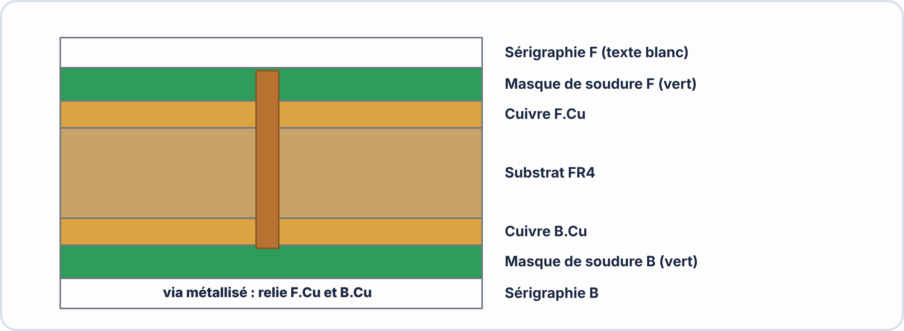
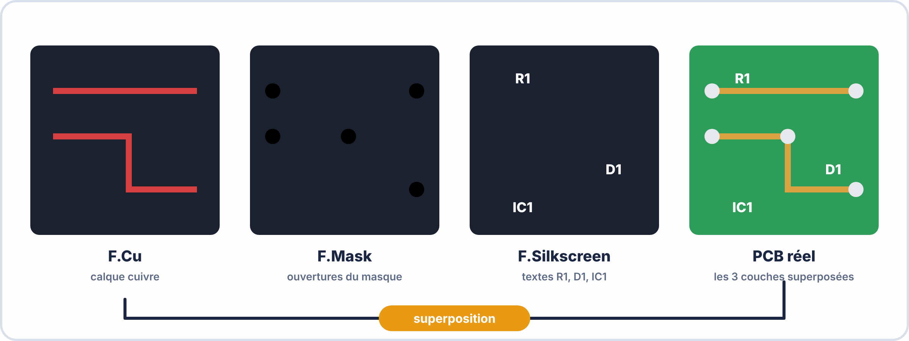

# 📘 FICHE DE COURS — S4 · 2ᵉ ANNÉE · E2
## PCB Double Face : Métallisation · Sérigraphie · THT/SMD Mixte · Gerber

---

> **Nom** : ___________________________
> **Date** : ___________________________
> **Compétences travaillées** : S3.3 · C4.1 · C4.2 · C4.3 · C3.1

---

## 🔑 Vocabulaire clé

| Terme | Définition |
|---|---|
| **PCB double face** | Circuit imprimé avec cuivre sur les deux faces (F.Cu + B.Cu) |
| **Métallisation (barrel plating)** | Dépôt de cuivre à l'intérieur des vias par bain galvanique — relie les deux faces |
| **Sérigraphie (Silkscreen)** | Couche d'encre (blanc ou jaune) imprimée sur le masque : références composants, logos, textes |
| **Masque de soudure (Solder Mask)** | Vernis (vert, rouge, bleu...) qui couvre tout le cuivre sauf les pads — protection + isolation |
| **Via traversant (Through-Hole Via)** | Trou métallisé reliant F.Cu à B.Cu, traversant toute l'épaisseur du PCB |
| **Via borgne (Blind Via)** | Via qui ne traverse qu'une partie du PCB (surface → couche interne) |
| **Via enterré (Buried Via)** | Via entre deux couches internes (PCB multicouches uniquement) |
| **SMD (Surface Mount Device)** | Composant monté en surface — soudé directement sur les pads sans perçage |
| **THT (Through-Hole Technology)** | Composant traversant — pattes passent dans des trous percés et soudées en dessous |
| **Gerber** | Format de fichier industriel pour la fabrication PCB (RS-274X) |
| **Drill file (.drl)** | Fichier de perçage contenant les positions et diamètres de tous les trous |
| **DFM** | Design for Manufacturing — règles qui garantissent la fabricabilité du PCB |
| **ENIG** | Electroless Nickel Immersion Gold — finition dorée des pads (durée de vie, planéité) |
| **HASL** | Hot Air Solder Leveling — finition étain (économique, moins plane) |
| **Stitching via** | Vias multiples reliant les plans de masse des deux faces pour un meilleur blindage |

---

## 1️⃣ — PCB simple face vs double face

### Limites du simple face

```
PCB SIMPLE FACE (F.Cu uniquement) :
  ✓ Simple à concevoir et comprendre
  ✓ Moins cher à fabriquer (1 seule couche de cuivre)
  ✗ Les pistes ne peuvent pas se croiser (impossible sur 1 seul calque)
  ✗ Routing difficile pour les circuits denses
  ✗ Composants obligatoirement d'un seul côté

PCB DOUBLE FACE (F.Cu + B.Cu) :
  ✓ Pistes sur les deux faces → les croisements sont résolus par les vias
  ✓ Densité de composants plus élevée (SMD face arrière possible)
  ✓ Meilleure gestion de la masse (plan GND sur B.Cu)
  ✓ Incontournable pour les circuits de complexité moyenne+
  Prix : quasi identique au simple face chez les fabricants modernes
```

### Le via : le pont entre les deux faces

```
Un via traversant permet :
  → Le signal passe de F.Cu à B.Cu
  → Une piste peut "enjamber" une autre en changeant de face

Comment le créer dans KiCad :
  Pendant le routage (X activé), appuyer sur V
  → KiCad crée automatiquement le via et bascule sur B.Cu
  → Continuer à router sur B.Cu
  → Appuyer à nouveau sur V pour revenir sur F.Cu si besoin
```

---



---

## 2️⃣ — La sérigraphie et le masque de soudure

### Le masque de soudure (Solder Mask)

```
RÔLE :
  → Protéger les pistes de cuivre contre l'oxydation
  → Isoler les pistes les unes des autres (évite les courts-circuits lors du brasage)
  → Identifier visuellement le PCB (couleur caractéristique)

FONCTIONNEMENT :
  Le masque recouvre TOUT le cuivre SAUF les zones de soudure (pads)
  → Les pads sont "exposés" pour permettre la soudure
  → Dans KiCad : le calque F.Mask définit les zones WITHOUT masque
    (zone noircies = ouvertures dans le masque = pads exposés)

COULEURS DISPONIBLES :
  Vert (standard · le plus courant)
  Rouge (premium · visible immédiatement)
  Bleu (Arduino · populaire)
  Noir (haut de gamme · contraste pads dorés)
  Blanc (rare · traces visibles)
  Jaune (peu courant)
```

### La sérigraphie (Silkscreen)

```
RÔLE :
  → Identifier les composants (R1, C1, D1...)
  → Indiquer la polarité (+/−, pin 1 d'un CI)
  → Afficher le logo, le numéro de version, la date
  → Documentation "sur la carte" elle-même

RÈGLES DE BONNE PRATIQUE :
  → Toujours indiquer la référence (R1, D1...) sur la silkscreen
  → La valeur peut être ajoutée si l'espace le permet
  → Ne jamais superposer la sérigraphie sur un pad (le DRC le signale)
  → Orientation cohérente (tous les composants dans le même sens si possible)
  → Police suffisamment grande pour être lisible (≥ 0,8mm de hauteur)

Dans KiCad :
  Les textes de référence et valeur des composants sont sur F.Silkscreen par défaut
  Modifier : E → propriétés → calque → F.Silkscreen ou B.Silkscreen
```

---

## 3️⃣ — Composants THT et SMD : différences

### Tableau comparatif

```
                    THT                         SMD
Montage         Traversant (trous)          Surface (pads plats)
Taille          Grande (mm)                 Très petite (µm à mm)
Soudure         Manuel facile               Refusion four ou pâte à souder
Réparation      Facile (fer à souder)        Difficile (micro-soudure)
Résistance méca Très bonne (pattes ancrées)  Moins bonne
Coût            Composant cher, PCB simple   Composant moins cher, PCB complexe
Usage E2 A2     Résistances, condensateurs   Résistances 0805, CI, petits condensateurs
                 grands, LEDs, connecteurs   de découplage, régulateurs
```

### Formats SMD courants

```
Format    Taille (mm)     Usage typique
0402      1,0 × 0,5       Découplage, petits composants
0603      1,6 × 0,8       Résistances, condensateurs courants
0805      2,0 × 1,25      ← RECOMMANDÉ DÉBUTANTS (soudable à la main)
1206      3,2 × 1,6       Composants puissants SMD
SOT-23    2,9 × 1,3       Transistors, régulateurs simples
SOIC-8    ~5 × 4          NE555 SMD, AO, mémoires
```

---


---

## 4️⃣ — Conception double face dans KiCad

### Activer le routage double face

```
Dans KiCad PCB Editor, le routage double face est natif — les deux calques
F.Cu et B.Cu sont toujours disponibles. Il suffit de :

  1. Passer sur B.Cu avant de router les pistes de la face arrière
     → Menu déroulant calque (en haut à droite) → B.Cu
     → Ou : raccourci - pour calque précédent

  2. Utiliser V pendant le routage pour créer un via et changer de face

  3. Placer des composants sur B.Cu :
     → Sélectionner le composant → F (Flip)
     → Le composant passe sur B.Cu avec son empreinte miroir
```

### Plan de masse (Fill Zone)

```
Un plan de masse = zone de cuivre GND couvrant toute une face

Avantages :
  → Connexion GND de faible impédance (meilleure pour l'électronique HF)
  → Blindage électromagnétique (EMI)
  → Dissipation thermique
  → Économise de nombreuses pistes GND individuelles
  → Aspect professionnel

Créer un plan de masse dans KiCad :
  1. Sélectionner calque B.Cu
  2. Place → Add Rule Area (ou raccourci Ctrl+Shift+K)
     OU : clic droit → Zone → Add Filled Zone
  3. Dessiner un rectangle couvrant tout le PCB
  4. Dans la boîte de dialogue :
     - Layer : B.Cu
     - Net : GND
     - Fill type : Solid
     - Clearance : 0,3 mm
  5. Confirmer → Appuyer sur B pour remplir
  6. Ctrl+B pour vider · B pour remplir à nouveau après modifications

Stitching vias (avancé) :
  Ajouter des vias GND supplémentaires entre F.Cu et le plan de masse B.Cu
  → Améliore la connexion entre les deux faces
  → Réduit les boucles de masse
```

---

## 5️⃣ — Générer les fichiers Gerber

### Pourquoi le format Gerber ?

```
Gerber (RS-274X) = format industriel universel pour la fabrication PCB
  → Chaque calque = 1 fichier Gerber séparé
  → Machine CNC de gravure lit ces fichiers pour graver le cuivre
  → Perceuse lit le fichier Drill pour les trous
  → Imprimante sérigraphie lit le fichier Silkscreen

Analogie : comme les fichiers STL pour l'impression 3D
```

### Générer les Gerber depuis KiCad

```
Menu : File → Fabrication Outputs → Gerbers (.gbr)...

Configuration recommandée pour JLCPCB :
  Output folder : créer un sous-dossier "gerber/"
  Layers à cocher :
    ✓ F.Cu          (cuivre face avant)
    ✓ B.Cu          (cuivre face arrière)
    ✓ F.Silkscreen  (sérigraphie avant)
    ✓ B.Silkscreen  (sérigraphie arrière, si textes dessous)
    ✓ F.Mask        (masque soudure avant)
    ✓ B.Mask        (masque soudure arrière)
    ✓ Edge.Cuts     (contour découpe)
    ✓ F.Courtyard   (pour vérification, non utilisé en fab)

Options :
  ✓ Use Protel filename extensions (.GBL, .GTL...)
  ✓ Generate gerber job file
  ✓ Use drill/place file origin → Auxiliary axis origin

Ensuite : Run → fermer

Fichier Drill :
  File → Fabrication Outputs → Drill Files (.drl)...
  ✓ Excellon format
  ✓ PTH and NPTH in single file (ou séparés selon fab)

Enfin : créer un ZIP de tous les fichiers du dossier "gerber/"
```

---


---

## 6️⃣ — Vérifier les Gerber avec GerbView

### Pourquoi vérifier ?

```
UN PCB MAL CONÇU = PERTE D'ARGENT
  → Un PCB fabriqué non fonctionnel coûte le même prix qu'un bon
  → Les fabricants ne vérifient pas votre conception — ils fabriquent ce que vous envoyez
  → Toujours vérifier les Gerber AVANT d'envoyer

CE QU'ON VÉRIFIE :
  ✓ Tous les calques sont présents (F.Cu, B.Cu, Edge.Cuts...)
  ✓ Le contour est fermé (rectangle sans gaps)
  ✓ Les pads sont bien exposés (absents du masque soudure)
  ✓ La sérigraphie n'est pas sur les pads
  ✓ Les pistes sont continues (pas de gap)
```

### GerbView (intégré dans KiCad)

```
Ouvrir GerbView : Applications → KiCad → GerbView
  Ou depuis KiCad Manager : File → Open Gerber files

Dans GerbView :
  File → Open Gerber File → sélectionner TOUS les .gbr
  File → Open Drill File → sélectionner le .drl

Navigation :
  Cocher/décocher les calques dans le panneau gauche
  Observer chaque calque séparément

À vérifier systématiquement :
  1. F.Cu seul → toutes les pistes visibles sur la face avant ?
  2. B.Cu seul → toutes les pistes de la face arrière ?
  3. Edge.Cuts → contour fermé ?
  4. F.Mask seul → seuls les pads sont ABSENTS (zones noires = ouvertures)
  5. F.Cu + F.Mask ensemble → les pads "traversent" le masque ?
  6. Drill file → tous les vias et trous THT présents ?
```

### Vérificateurs en ligne (alternative)

```
Gerber viewer en ligne (sans inscription) :
  https://www.gerber-viewer.com/
  https://mayhewlabs.com/webGerber
  https://tracespace.io/view/

Uploader le ZIP directement sur JLCPCB pour voir le rendu :
  → Prix calculé automatiquement
  → Aperçu 2D du PCB
  → Vérification des règles DFM
```

---



---

## 7️⃣ — Règles DFM : concevoir pour la fabrication

### Les règles DFM de base

```
DFM = Design for Manufacturing
Ces règles garantissent que votre PCB peut être fabriqué correctement.

RÈGLES MINIMALES JLCPCB (2024) :
  Piste / Space minimum    : 0,127 mm / 0,127 mm
  Via diamètre minimum     : 0,6 mm (perçage 0,3 mm)
  Taille minimum anneau    : 0,15 mm
  Taille pad SMD min       : 0,2 mm
  Épaisseur texte sérigr.  : min 0,15 mm
  Taille texte sérigr.     : min 0,8 mm hauteur
  
  Recommandé pour débutants (marges confortables) :
  Piste min  : 0,2 mm
  Espace min : 0,2 mm
  Via        : 0,8 mm (perçage 0,4 mm)
  Piste alim : 0,8 mm+

BONNE PRATIQUE SÉRIGRAPHIE :
  → Ne pas superposer la sérigraphie sur les pads
  → Composants > leur courtyard de sérigraphie (pas de chevauchement)
  → Le DRC de KiCad vérifie cela automatiquement
```

---

## 📌 Les essentiels à retenir

> ✅ PCB **double face** = F.Cu + B.Cu + vias pour relier les deux
> ✅ **Via traversant** = trou métallisé · F.Cu ↔ B.Cu · 0,8mm ext / 0,4mm perçage
> ✅ **Masque soudure** = vernis sur tout le cuivre SAUF les pads
> ✅ **Sérigraphie** = texte/logos imprimés sur le masque (références des composants)
> ✅ **SMD** = surface, sans perçage · **THT** = traversant, avec perçage
> ✅ SMD format **0805** = recommandé pour débuter (soudable à la main)
> ✅ **Plan de masse GND** sur B.Cu = bonne pratique professionnelle
> ✅ Gerber = format industriel · 1 fichier par calque + 1 fichier drill
> ✅ Toujours vérifier les Gerber dans GerbView AVANT d'envoyer au fabricant
> ✅ JLCPCB : 5 PCB 100×100mm pour environ **5-6 €** (+ port)

---

*Fiche de Cours PCB Double Face — BAC PRO CIEL | E2 Systèmes Électroniques | 2ᵉ année S4*
*Compétences : S3.3 · C4.1 · C4.2 · C4.3 · C3.1*
