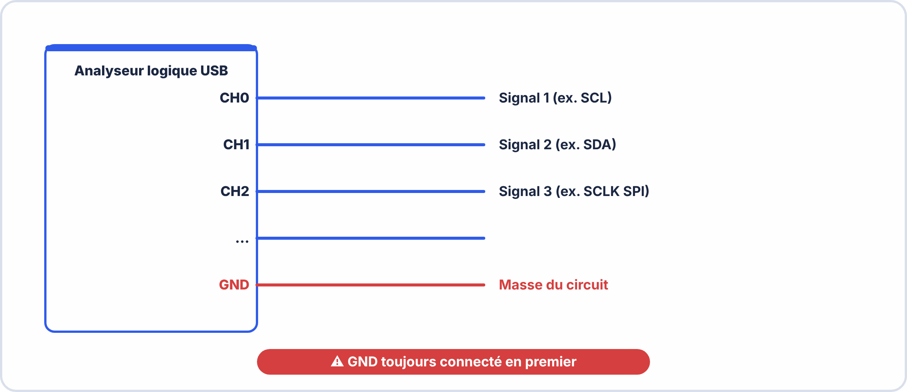
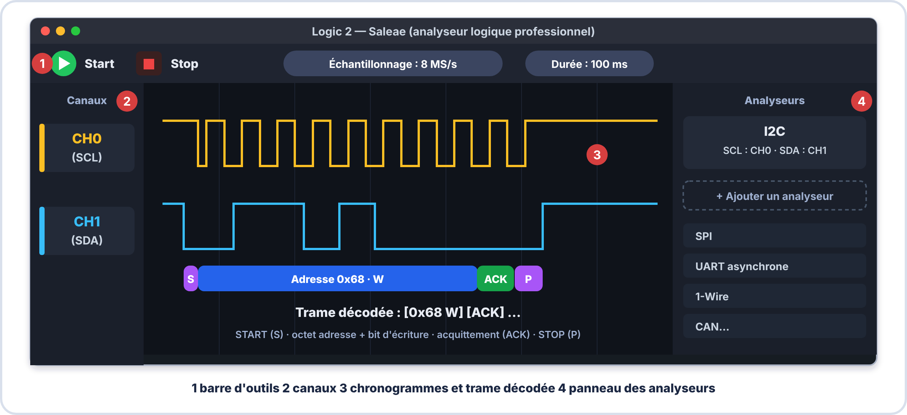
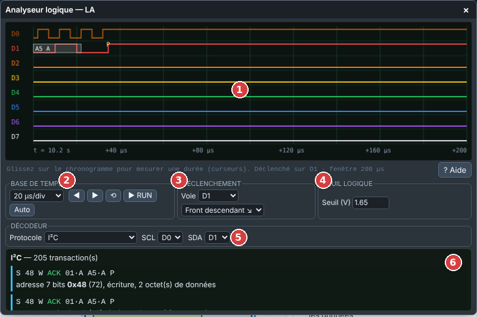
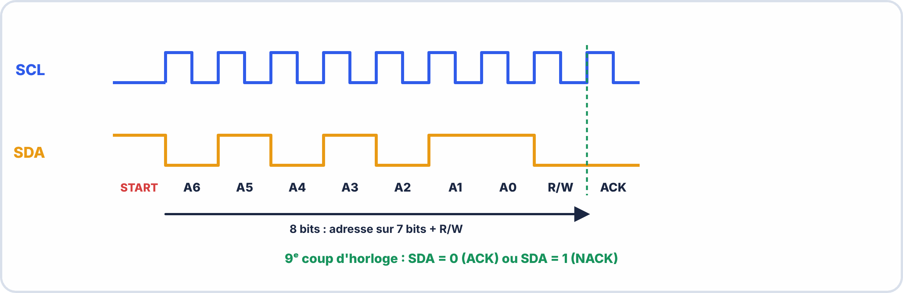
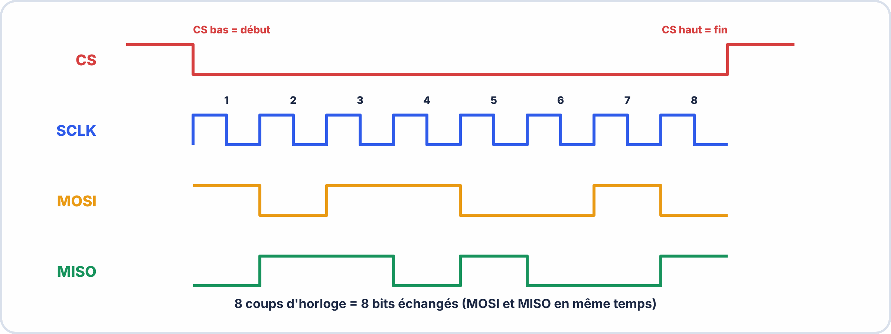
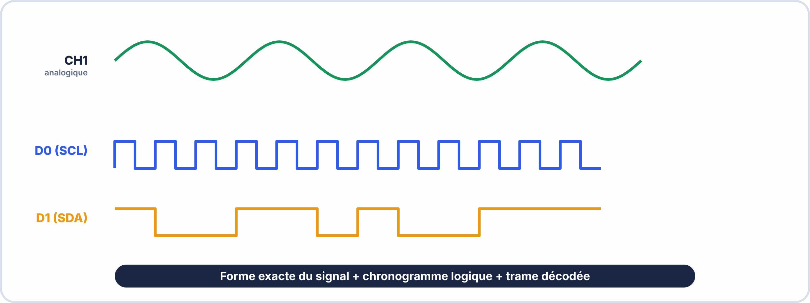

# 📖 FICHE COURS – S5 ANNÉE 2 – E2

> [!TIP] 🔬 OscilloLab : le simulateur de ton oscilloscope (pour t'entraîner)
> Ouvre [OscilloLab](https://yahnlp.github.io/OscilloLab/) (choisis OWON ou RIGOL) puis les TP : **6** déclenchement · **7** mesures automatiques · **8** curseurs · **9** NE555 · **10** pont de diodes · **11** charge d'un condensateur (τ) · **12** déphasage · **13** mode XY · **14** capture unique (rebonds) · **15** réduire le bruit (moyenne) · **17** le bruit : le reconnaître et l'atténuer · **18** décoder une liaison UART · **19** décoder un bus I²C · **20** décoder un bus SPI (RIGOL, décodeur série). Pas à pas touche par touche et **👆 Montre-moi** inclus. Mode d'emploi : [Utiliser OscilloLab](../../ressources/oscillolab.md).

> [!TIP] 🖥️ TP virtuel ElectroLab : pour t'entraîner
> Ouvre [ElectroLab](https://yahnlp.github.io/ElectroLab/), menu **TP ▾**, puis choisis :
> - **Lire un signal à l'oscilloscope : régler, mesurer T, f, Umax, Upp… (6 signaux)** (1 h 15, seconde / première)
> - **Signaux périodiques : GBF, oscilloscope et multimètre** (1 h 15, première)
> - **Signal rectangulaire : rapport cyclique, temps haut, valeur moyenne (5 signaux)** (1 h 15, première / terminale)
> - **Prise en main de l'analyseur logique (chronogrammes d'un compteur)** (45 min, première)
> - **Analyse d'un bus I²C : adresse, ACK, résistances de rappel (4 cas)** (1 h 45, terminale)
> - **Analyse d'un bus SPI : retrouver le mode (CPOL / CPHA) (4 cas)** (1 h 30, terminale)
> 
> Le simulateur corrige automatiquement et ne risque pas d'abîmer le matériel : **réussis d'abord le TP virtuel, puis refais la manipulation sur le matériel réel.** Mode d'emploi : [Utiliser ElectroLab](../../ressources/electrolab.md).

## Tests & Mesures Avancés : Oscilloscope Mixte, Analyseur Logique, I2C / SPI

---

## 🎯 OBJECTIFS

- ✅ Configurer un oscilloscope mixte (MSO) pour des signaux numériques + analogiques
- ✅ Connecter et utiliser un analyseur logique USB
- ✅ Décoder une trame I2C et identifier ses champs
- ✅ Décoder une trame SPI et identifier MOSI, MISO, SCLK, CS
- ✅ Diagnostiquer un problème de bus à partir de la capture

---

## 1️⃣ OSCILLOSCOPE : DSO VS MSO

### 🧱 Ce qu'il faut savoir avant de commencer

| Notion | En simple |
|---|---|
| **Signal analogique** | Une tension qui prend **toutes les valeurs** possibles (par exemple 0 à 3,3 V, de façon continue). |
| **Signal numérique** | Une tension qui ne prend que **deux états** : bas (0) ou haut (1). |
| **Bus** | Des **fils partagés** par plusieurs composants qui échangent des données selon un **protocole** (des règles). |
| **Trame** | Une **séquence de bits** qui forme un message (adresse + données). |
| **Chronogramme** | Un **graphique** montrant l'état d'un ou plusieurs signaux **dans le temps**. |

> [!TIP] 💡 En clair : pourquoi un MSO ou un analyseur logique ?
> Un oscilloscope classique **montre la forme** d'un signal. Mais pour un **bus** (I²C, SPI) on veut savoir **quel message** circule. L'analyseur logique (ou les voies numériques d'un MSO) enregistre les **0 et 1** puis les **décode** : « adresse 0x68, écriture, donnée 0x6B ».


### Types d'oscilloscopes numériques

| **Type** | **Voies** | **Usage** | **Exemple** |
|---|---|---|---|
| **DSO** (Digital Storage Oscilloscope) | 2–4 voies analogiques | Signaux analogiques, formes d'ondes | Rigol DS1054Z |
| **MSO** (Mixed Signal Oscilloscope) | 2–4 voies analogiques **+ 8–16 voies numériques** | Signaux mixtes : analogique + bus numériques | Rigol MSO5072, Keysight MSOX3024T |

### Ce que les voies numériques du MSO apportent

```
Voies analogiques (CH1, CH2…) :
  → Tension réelle (mV à kV), forme d'onde précise
  → Mesures : amplitude, fréquence, phase, overshoot

Voies numériques (D0–D15) :
  → Seulement HIGH (1) ou LOW (0) — pas de valeur précise
  → Affichage en chronogramme sous les voies analogiques
  → Décodage de protocoles intégré (I2C, SPI, UART, CAN…)
```

### Quand utiliser MSO vs Analyseur logique ?

| **Situation** | **Outil recommandé** |
|---|---|
| Mesurer la tension exacte d'un signal I2C | MSO (voie analogique) |
| Décoder un bus I2C avec 16 esclaves | Analyseur logique (plus de voies, meilleure résolution temporelle) |
| Observer un glitch analogique sur SCL + décoder la trame | MSO (les deux en même temps) |
| Débogguer un protocole dans un PC en labo USB | Analyseur logique USB (Saleae, économique) |

---

## 2️⃣ ANALYSEUR LOGIQUE USB

### Principe

> Un **analyseur logique** est un instrument qui capture des signaux numériques (HIGH/LOW) sur plusieurs voies simultanément à très haute fréquence d'échantillonnage, les enregistre dans sa mémoire, et les affiche comme un chronogramme. Les décodeurs de protocoles intégrés permettent de passer automatiquement du niveau binaire au niveau "message" (adresse I2C, données SPI…).

### Connexion physique



### Un exemple d'analyseur professionnel : Saleae Logic 2

> [!NOTE] Saleae, c'est quoi ?
> **Saleae** est une société qui fabrique des **analyseurs logiques USB** (gamme *Logic 8*, *Logic Pro 8 / 16*) et leur logiciel **Logic 2**, gratuit. C'est une **référence du marché** : on la rencontre en bureau d'études et en laboratoire. Si votre établissement n'en possède pas, **ce n'est pas un obstacle** : l'analyseur logique d'**ElectroLab** reproduit les mêmes fonctions (déclenchement, seuil, décodeur I²C / SPI / UART) et sert pour tous les exercices.



### Dans ElectroLab : l'analyseur logique



| N° | Zone ElectroLab | Équivalent dans Saleae Logic 2 | Rôle |
|---|---|---|---|
| 1 | **Chronogrammes** D0 à D7 | Voies *Channels* | Niveau logique de chaque voie dans le temps |
| 2 | **Base de temps** (µs/div, ms/div), **RUN / STOP**, **Auto** | Fréquence d'échantillonnage, **Start / Stop** | Régler la durée affichée et figer la capture |
| 3 | **Déclenchement** : voie + front ↘ ou ↗ | *Trigger* | Caler l'affichage sur le début de la trame |
| 4 | **Seuil logique** (1,65 V) | *Threshold* du matériel | Tension au-dessus de laquelle on lit « 1 » |
| 5 | **Décodeur** : protocole + voies (SCL, SDA…) | *Analyzers* → **+** → I2C | Transformer les bits en trames lisibles |
| 6 | **Trames décodées** | Annotations sur les voies | Lire adresse, R/W, ACK, données |

> [!TIP] 💡 En clair
> Sur la capture, la ligne décodée `S 48 W ACK 01·A A5·A P` se lit : **S** = START · **48** = adresse de l'esclave (hexadécimal) · **W** = écriture · **ACK** = l'esclave répond · **01** et **A5** = deux octets de données, chacun suivi de **A** (acquittement) · **P** = STOP.


### Fréquence d'échantillonnage — Règle de Nyquist

$$\boxed{f_{éch} \geq 10 \times f_{bus}}$$

| **Protocole** | **Fréquence bus typique** | **Fréquence échantillonnage minimale** |
|---|---|---|
| I2C standard | 100 kHz | 1 MHz |
| I2C fast mode | 400 kHz | 4 MHz (recommandé : 8 MHz) |
| SPI courant | 1–10 MHz | 10–100 MHz |
| UART 115200 baud | 115,2 kHz | 1 MHz |


> [!NOTE] 🔎 Précision sur « Nyquist »
> La **vraie** limite de Nyquist est **2 × la fréquence du signal**, pour reconstruire une **sinusoïde**. Pour un signal **numérique**, on veut **voir les fronts** : la règle pratique est **échantillonner au moins 10 fois plus vite** que la fréquence du bus (la formule du cours). Trop lent : les fronts sont **faux** ou **manquants**, et le décodage devient **absurde**.

### ✅ Vérifie que tu as compris

**Q1.** Un bus I²C à 400 kHz : à quelle fréquence d'échantillonnage minimale capturer ?

??? success "Réponse"
    Au moins **4 MHz** (10 × 400 kHz), idéalement **8 MHz**.

**Q2.** Pourquoi un échantillonnage trop lent donne-t-il un décodage faux ?

??? success "Réponse"
    Parce que les **fronts** sont mal vus : des bits sont **perdus** ou **déformés**.

---

## 3️⃣ DÉCODAGE I2C

### Rappel du protocole I2C

> I2C (Inter-Integrated Circuit) utilise **2 fils** : SCL (horloge) et SDA (données). Toutes les lignes sont en **collecteur ouvert** avec des résistances de pull-up.

### Structure d'une trame I2C



### Champs d'une trame I2C lus dans Saleae

| **Champ** | **Contenu** | **Exemple** |
|---|---|---|
| **START** | Front descendant SDA quand SCL=HIGH | Carré vert `S` dans Saleae |
| **ADRESSE** | 7 bits — identifie l'esclave | `0x68` (MPU-6050) |
| **R/W** | 0 = Write (maître → esclave) ; 1 = Read (esclave → maître) | `W` ou `R` |
| **ACK** | Bit 9 bas (esclave répond) | ✅ ACK |
| **NACK** | Bit 9 haut (pas de réponse) | ❌ NACK = esclave absent ou erreur |
| **DATA** | Octets de données | `0x6B, 0x00` |
| **STOP** | Front montant SDA quand SCL=HIGH | Carré rouge `P` dans Saleae |


> [!TIP] 💡 En clair : I²C en 5 lignes
> - **Deux fils** : **SCL** (l'horloge, qui rythme) et **SDA** (les données).
> - Un **maître** (l'ESP32) parle à des **esclaves** (capteurs), chacun a une **adresse** unique de 7 bits.
> - Le maître envoie **START**, l'**adresse** + le bit **R/W**, puis le capteur répond **ACK** (« présent ! ») ou **NACK** (« personne ici »).
> - Les lignes sont **ouvertes au niveau bas** : une résistance de **pull-up** (souvent 4,7 kΩ) les ramène à 3,3 V quand personne ne tire.
> - **Pas de pull-up** = signal toujours bas ou instable.

> [!WARNING] ⚠️ Diagnostic rapide
> **NACK sur l'adresse** : mauvaise adresse, capteur non alimenté ou débranché. **SDA reste bas** : un esclave est resté bloqué en pleine transaction.

### ✅ Vérifie que tu as compris

**Q1.** Que signifie un NACK sur la phase d'adresse ?

??? success "Réponse"
    Aucun esclave **n'a répondu** à cette adresse (absent, non alimenté, mauvaise adresse).

**Q2.** Pourquoi faut-il des résistances de pull-up sur un bus I²C ?

??? success "Réponse"
    Les lignes sont à **collecteur ouvert** : seules elles **ramènent le niveau haut**.

**Q3.** Quel fil donne le rythme sur l'I²C ?

??? success "Réponse"
    **SCL** (l'horloge).

---

### Configurer le décodeur I²C (Saleae et ElectroLab)

1. **Ouvrir l'analyseur** : logiciel Saleae Logic 2, ou, dans ElectroLab, **double-clic** sur l'analyseur logique.
2. **Brancher** : CH0 (ElectroLab : D0) → SCL ; CH1 (D1) → SDA ; GND de l'analyseur → GND du circuit.
3. **Régler l'échantillonnage** : 8 MHz pour un bus I²C à 400 kHz (ElectroLab : une base de temps de l'ordre de 20 µs/div).
4. **Ajouter le décodeur** : Saleae : panneau *Analyzers* → **+** → I2C ; ElectroLab : zone *Décodeur* → Protocole **I²C**.
5. **Affecter les voies** : **SCL = CH0 (D0)** et **SDA = CH1 (D1)**.
6. **Lancer une capture** : Start et exécuter le code Arduino (ElectroLab : RUN, avec un déclenchement sur D1, front descendant).
7. **Zoomer** sur la capture : les trames s'affichent décodées.

> [!NOTE] Si le décodeur affiche des erreurs
> Tant que les voies ou le seuil sont mal réglés, le décodeur affiche des **erreurs** : c'est normal, c'est un **indice**. Vérifiez d'abord que SCL et SDA ne sont pas inversées, puis la base de temps.

### Diagnostic I2C — Les problèmes courants

| **Symptôme sur la capture** | **Cause probable** | **Solution** |
|---|---|---|
| Pas de START — SDA et SCL toujours HIGH | Code non lancé ou bus bloqué | Vérifier le code Arduino ; reset du bus |
| NACK sur l'adresse | Mauvaise adresse ou esclave absent/non alimenté | Vérifier l'adresse dans le datasheet (souvent configurable via pin AD0) |
| Signal déformé, bords arrondis lents | Pull-up trop élevée ou fréquence trop haute | Diminuer la valeur des pull-up (4,7kΩ → 2,2kΩ) ou réduire la fréquence du bus |
| SDA reste LOW en permanence | Bus bloqué (esclave coincé mi-transaction après reset) | Envoyer 9 coups d'horloge sur SCL pour libérer le bus |

---

## 4️⃣ DÉCODAGE SPI

### Rappel du protocole SPI

> SPI (Serial Peripheral Interface) utilise **4 fils** minimum :
> - **MOSI** : Master Out Slave In — données maître → esclave
> - **MISO** : Master In Slave Out — données esclave → maître
> - **SCLK** : horloge générée par le maître
> - **CS/SS** : Chip Select (actif BAS) — sélectionne un esclave

### Les 4 modes SPI (CPOL / CPHA)

| **Mode** | **CPOL** | **CPHA** | **SCLK repos** | **Capture sur** |
|---|---|---|---|---|
| **Mode 0** | 0 | 0 | Bas | Front montant |
| **Mode 1** | 0 | 1 | Bas | Front descendant |
| **Mode 2** | 1 | 0 | Haut | Front descendant |
| **Mode 3** | 1 | 1 | Haut | Front montant |

> **Mode 0** est le plus courant (Arduino par défaut).

> Pour identifier le mode : regarder l'état de SCLK quand CS est HIGH (repos) → CPOL. Puis voir sur quel front les données changent → CPHA.

### Structure d'une transaction SPI



### Champs d'une trame SPI lus dans Saleae

| **Champ** | **Valeur dans le décodeur (Saleae, ElectroLab)** | **Interprétation** |
|---|---|---|
| CS LOW | Flèche descendante | Début de transaction |
| MOSI | Valeur hex en rectangle | Commande ou données envoyées |
| MISO | Valeur hex en rectangle | Réponse de l'esclave |
| CS HIGH | Flèche montante | Fin de transaction |

### Configurer le décodeur SPI (Saleae et ElectroLab)

```
1. Analyser → Add Analyzer → SPI
2. Assigner les voies :
   MOSI = CH0, MISO = CH1, SCLK = CH2, CS = CH3 (si disponible)
3. Configurer le mode (CPOL=0, CPHA=0 pour Mode 0)
4. Bits per word = 8 (standard)
5. CS active: LOW
```


> [!TIP] 💡 En clair : SPI en 5 lignes
> - **Quatre fils** : **SCK** (horloge), **MOSI** (maître → esclave), **MISO** (esclave → maître), **CS** (chip select : « c'est à toi de parler »).
> - Plus **rapide** que l'I²C, mais **un fil CS par esclave**.
> - Pas d'adresse : on **sélectionne** l'esclave en mettant son CS à 0.
> - Les 4 **modes** (CPOL/CPHA) fixent **sur quel front** on lit les données : **maître et esclave doivent utiliser le même**, sinon les données sont décalées.

### ✅ Vérifie que tu as compris

**Q1.** Quelle différence d'adressage entre I²C et SPI ?

??? success "Réponse"
    I²C : **adresse** dans la trame ; SPI : on **sélectionne** l'esclave par sa ligne **CS**.

**Q2.** Les octets décodés en SPI sont décalés ou faux. Quelle cause fréquente ?

??? success "Réponse"
    Un **mauvais mode SPI** (CPOL/CPHA) dans le décodeur ou le composant.

---

---

## 5️⃣ MSO — UTILISATION DES VOIES NUMÉRIQUES

### Configurer un MSO (ex: Rigol MSO5000)

```
1. Connecter les sondes numériques (D0–D15) et le GND commun
2. Activer les voies numériques : bouton "Digital" ou "D0-D7"
3. Régler le seuil logique : Menu Threshold
   → 3,3V system : seuil = 1,65V (VCC/2)
   → 5V system : seuil = 2,5V
4. Activer le décodage : Menu Decode → I2C / SPI / UART
5. Assigner les voies aux signaux (ex: D0=SCL, D1=SDA)
6. La trame décodée s'affiche en bas de l'écran
```

### Avantage du MSO : corrélation analogique + logique



---

## 6️⃣ RÉCAPITULATIF COMPARATIF

| **Critère** | **Oscillo seul** | **MSO** | **Analyseur logique** |
|---|---|---|---|
| Mesure tension exacte | ✅ | ✅ | ❌ (seulement HIGH/LOW) |
| Nombre de voies logiques | ❌ | 8–16 | 8–32+ |
| Décodage protocoles | ❌ | ✅ (intégré) | ✅ (logiciel PC) |
| Corrélation analogique + logique | ❌ | ✅ | ❌ |
| Coût | 300–1000€ | 800–3000€ | 10–500€ |
| Usage portable / terrain | Difficile | Difficile | ✅ (USB sur laptop) |


> [!TIP] 💡 En clair : méthode de mesure d'un bus
> 1. **Brancher** les sondes (SCL, SDA, **GND commun**). 2. Régler l'**échantillonnage** (≥ 10 × fréquence du bus). 3. **Déclencher** sur le START ou sur un front. 4. **Capturer**, puis **décoder**. 5. **Lire** les champs : adresse, R/W, ACK/NACK, données. Si le décodage est absurde, vérifier d'abord le **GND**, la **fréquence d'échantillonnage** et la **configuration** du décodeur.

---

## ✅ AUTO-ÉVALUATION

- [ ] Je sais distinguer DSO et MSO — les voies supplémentaires du MSO sont numériques
- [ ] Je sais connecter un analyseur logique (GND en premier, puis les voies)
- [ ] Je sais choisir la bonne fréquence d'échantillonnage (≥ 10 × fbus)
- [ ] Je sais identifier les champs d'une trame I2C : START, ADDR, R/W, ACK/NACK, DATA, STOP
- [ ] Je comprends que ACK = SDA bas au 9ème bit = l'esclave répond ✅
- [ ] Je sais identifier les 4 signaux SPI : MOSI, MISO, SCLK, CS
- [ ] Je sais configurer le mode SPI (CPOL/CPHA) en regardant l'état de SCLK au repos
- [ ] Je sais diagnostiquer un NACK (esclave absent ou mauvaise adresse)

---

## 📚 VOCABULAIRE CLEF

| **Terme** | **Définition** |
|---|---|
| **MSO** | Mixed Signal Oscilloscope — oscillo avec voies analogiques + numériques |
| **DSO** | Digital Storage Oscilloscope — oscillo numérique sans voies logiques |
| **Analyseur logique** | Instrument capturant des signaux numériques et décodant les protocoles |
| **Saleae Logic 2** | Logiciel d'analyse pour analyseurs logiques USB Saleae |
| **PulseView** | Logiciel open-source (sigrok) pour analyseurs logiques génériques |
| **Fréquence d'échantillonnage** | Nombre de mesures par seconde : doit être ≥ 10 × fbus |
| **START condition** | Front descendant SDA quand SCL=HIGH → début trame I2C |
| **STOP condition** | Front montant SDA quand SCL=HIGH → fin trame I2C |
| **ACK** | Acknowledgment — SDA bas au 9ème bit I2C → l'esclave confirme |
| **NACK** | No ACK — SDA haut au 9ème bit → esclave absent ou erreur |
| **MOSI** | Master Out Slave In — données du maître vers l'esclave (SPI) |
| **MISO** | Master In Slave Out — données de l'esclave vers le maître (SPI) |
| **CPOL** | Clock Polarity — niveau de SCLK au repos (0=bas, 1=haut) |
| **CPHA** | Clock Phase — front sur lequel les données sont capturées |
| **Pull-up** | Résistance reliant SCL/SDA au VCC — obligatoire pour I2C |

---

**Document – BAC PRO CIEL – A2 – E2/U21 – Version 1.0 – 2026**
