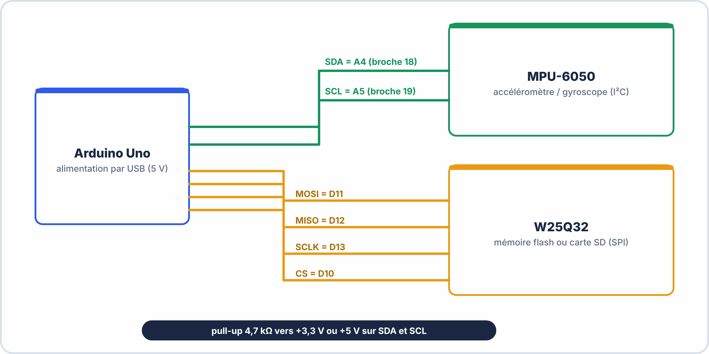

# 🔬 TP – S5 ANNÉE 2 – E2

> [!TIP] 🔬 OscilloLab : le simulateur de ton oscilloscope (à faire avant le TP réel)
> Ouvre [OscilloLab](https://yahnlp.github.io/OscilloLab/) (choisis OWON ou RIGOL) puis les TP : **6** déclenchement · **7** mesures automatiques · **8** curseurs · **9** NE555 · **10** pont de diodes · **11** charge d'un condensateur (τ) · **12** déphasage · **13** mode XY · **14** capture unique (rebonds) · **15** réduire le bruit. Pas à pas touche par touche et **👆 Montre-moi** inclus. Mode d'emploi : [Utiliser OscilloLab](../../ressources/oscillolab.md).

> [!TIP] 🖥️ TP virtuel ElectroLab : à faire avant le TP réel
> Ouvre [ElectroLab](https://yahnlp.github.io/ElectroLab/), menu **TP ▾**, puis choisis :
> - **Lire un signal à l'oscilloscope : régler, mesurer T, f, Umax, Upp… (6 signaux)** (1 h 15, seconde / première)
> - **Signaux périodiques : GBF, oscilloscope et multimètre** (1 h 15, première)
> - **Signal rectangulaire : rapport cyclique, temps haut, valeur moyenne (5 signaux)** (1 h 15, première / terminale)
> - **Prise en main de l'analyseur logique (chronogrammes d'un compteur)** (45 min, première)
> - **Analyse d'un bus I²C : adresse, ACK, résistances de rappel (4 cas)** (1 h 45, terminale)
> - **Analyse d'un bus SPI : retrouver le mode (CPOL / CPHA) (4 cas)** (1 h 30, terminale)
> 
> **Pas d'analyseur logique physique ?** Les parties « analyseur logique » de ce TP se font dans ElectroLab (fiche de cours : *Dans ElectroLab : l'analyseur logique*).
>
> Le simulateur corrige automatiquement et ne risque pas d'abîmer le matériel : **réussis d'abord le TP virtuel, puis refais la manipulation sur le matériel réel.** Mode d'emploi : [Utiliser ElectroLab](../../ressources/electrolab.md).

## Mesure sur Bus I2C et SPI avec Analyseur Logique + Oscilloscope

---

> [!TIP] 📘 Fiches de ton oscilloscope
> Réglages, mesures, curseurs, modes d'acquisition et capture : [🔭 Fiche OWON SDS5032E(V)](../../ressources/oscilloscopes/owon-sds5032e.md) · [🔭 Fiche RIGOL DS1054Z](../../ressources/oscilloscopes/rigol-ds1104z.md) (les modèles à voies logiques sont signalés dans la fiche RIGOL). Missions 7 à 13 du [TP Passeport oscilloscope](../../ressources/oscilloscopes/tp-passeport-oscilloscope.md).

## 🎯 OBJECTIFS DU TP

- ✅ Connecter et configurer l'analyseur logique sur un bus I2C
- ✅ Décoder et interpréter une trame I2C complète
- ✅ Connecter et configurer sur un bus SPI
- ✅ Décoder et interpréter une trame SPI
- ✅ Diagnostiquer une anomalie de bus à partir d'une capture
- ✅ Mesurer les signaux analogiques au MSO (si disponible)

---

## ⏱️ DURÉE : 90 min

---

## 📋 MONTAGE DE LA CARTE ARDUINO

### Matériel disponible sur votre poste



```
Alimentation : USB (5V)
```

### Code Arduino déjà chargé

> Le code sur la carte effectue en boucle toutes les 2 secondes :
> 1. Initialisation MPU-6050 via I2C (écriture registre 0x6B)
> 2. Lecture température MPU-6050 via I2C (2 octets depuis registre 0x41)
> 3. Lecture de l'ID JEDEC de la flash SPI (commande 0x9F)

```arduino
// Extrait du code — pour référence uniquement

// I2C — Initialisation MPU-6050
Wire.beginTransmission(0x68);  // Adresse MPU-6050
Wire.write(0x6B);               // Registre PWR_MGMT_1
Wire.write(0x00);               // Wake up (désactiver sleep)
Wire.endTransmission();

// SPI — Lecture JEDEC ID
digitalWrite(CS_PIN, LOW);
SPI.transfer(0x9F);             // Commande READ JEDEC ID
byte mfr = SPI.transfer(0x00); // Manufacturer ID
byte dev = SPI.transfer(0x00); // Device ID
digitalWrite(CS_PIN, HIGH);
```

---

## 🧪 PARTIE 1 — Prise en Main de l'Analyseur Logique (10 min)

### 1.1 — Connexion de l'analyseur

```
Brancher dans l'ordre OBLIGATOIRE :
  1. GND de l'analyseur → GND de la carte Arduino
  2. CH0 → SCL (Arduino A5)
  3. CH1 → SDA (Arduino A4)
  4. Connecter l'USB au PC
  5. Ouvrir Saleae Logic 2 (ou PulseView)
```

**Q1.** Pourquoi doit-on connecter le GND de l'analyseur **en premier** ?

\_\_\_\_\_\_\_\_\_\_\_\_\_\_\_\_\_\_\_\_\_\_\_\_\_\_\_\_\_\_\_\_\_\_\_\_\_\_\_\_\_\_\_\_\_\_\_\_\_\_\_\_\_\_\_\_\_\_\_\_\_\_\_\_\_\_\_\_\_\_\_\_\_

### 1.2 — Configuration de la capture

```
Dans Saleae Logic 2 :
  - Fréquence d'échantillonnage : 8 MHz
  - Durée : 1 seconde
  - Cliquer "Start" puis observer la capture
```

**Q2.** Sans décodeur activé, décrivez ce que vous voyez sur CH0 (SCL) et CH1 (SDA) :

CH0 : \_\_\_\_\_\_\_\_\_\_\_\_\_\_\_\_\_\_\_\_\_\_\_\_\_\_\_\_\_\_\_\_\_\_\_\_\_\_\_\_\_\_\_\_\_\_\_\_\_\_\_\_\_\_\_\_\_\_\_\_\_\_\_\_\_\_\_\_

CH1 : \_\_\_\_\_\_\_\_\_\_\_\_\_\_\_\_\_\_\_\_\_\_\_\_\_\_\_\_\_\_\_\_\_\_\_\_\_\_\_\_\_\_\_\_\_\_\_\_\_\_\_\_\_\_\_\_\_\_\_\_\_\_\_\_\_\_\_\_


??? tip "💡 Aides pour la partie 1"
    - **Q1** : sans **masse commune**, les tensions mesurées n'ont pas de **référence** : les niveaux sont faux ou instables, et la capture n'a aucun sens.
    - **Q2** : sans décodeur, tu vois des **signaux numériques bruts** : deux lignes qui passent de bas à haut ; l'**horloge** (SCL) alterne régulièrement pendant une transaction.
    - **Fréquence d'échantillonnage** : applique la règle du cours (**au moins 10 fois** la fréquence du bus).

---

## 🧪 PARTIE 2 — Décodage I2C (30 min)

### 2.1 — Activer le décodeur I2C

1. Ajouter le décodeur **I²C** (Saleae : panneau *Analyzers* → **+** → I2C ; ElectroLab : *Décodeur* → Protocole **I²C**).
2. Affecter les voies : **SCL = CH0 (D0)** et **SDA = CH1 (D1)**.
3. Valider.

**Q3.** Après activation du décodeur, qu'apparaît-il sous les voies CH0/CH1 ?

\_\_\_\_\_\_\_\_\_\_\_\_\_\_\_\_\_\_\_\_\_\_\_\_\_\_\_\_\_\_\_\_\_\_\_\_\_\_\_\_\_\_\_\_\_\_\_\_\_\_\_\_\_\_\_\_\_\_\_\_\_\_\_\_\_\_\_\_\_\_\_\_\_

### 2.2 — Analyser la transaction d'initialisation MPU-6050

> Identifiez la transaction d'écriture vers l'adresse 0x68. Dans Saleae, elle apparaît comme :
> `[0x68 W] [ACK] [0x6B] [ACK] [0x00] [ACK]`

**Remplissez le tableau de décodage :**

| **Champ** | **Valeur observée** | **Signification** |
|---|---|---|
| Adresse esclave | | |
| Direction | W / R | |
| ACK/NACK sur adresse | | |
| Registre accédé (1er octet data) | | Registre ? (nom) |
| Valeur écrite | | Que fait-on ? |
| ACK final | | |

**Q4.** L'ACK sur l'adresse est-il présent ? Que cela signifie-t-il sur l'état du MPU-6050 ?

\_\_\_\_\_\_\_\_\_\_\_\_\_\_\_\_\_\_\_\_\_\_\_\_\_\_\_\_\_\_\_\_\_\_\_\_\_\_\_\_\_\_\_\_\_\_\_\_\_\_\_\_\_\_\_\_\_\_\_\_\_\_\_\_\_\_\_\_\_\_\_\_\_

### 2.3 — Analyser la transaction de lecture de température

> La lecture de la température implique :
> 1. Une écriture (W) pour sélectionner le registre 0x41
> 2. Un REPEATED START
> 3. Une lecture (R) de 2 octets (TEMP_H et TEMP_L)

**Q5.** Identifiez les deux transactions successives dans la capture et remplissez :

Transaction 1 (écriture adresse registre) :
```
[_______ _] [_____] [_____]   Direction : ___
```

Transaction 2 (lecture 2 octets) :
```
[_______ _] [_____] [_____] [_____] [_____]   Direction : ___
```

**Q6.** Les deux octets lus (TEMP_H et TEMP_L) forment un entier 16 bits. La formule de conversion est :

$$T(°C) = \frac{TEMP_{H} \times 256 + TEMP_{L}}{340} + 36,53$$

Calculez la température si TEMP_H = 0x0A et TEMP_L = 0x20 :

Valeur 16 bits = 0x0A × 256 + 0x20 = \_\_\_\_\_ × 256 + \_\_\_\_\_ = \_\_\_\_\_  

$\displaystyle T = \underline{\hspace{2.5em}} / 340 + 36{,}53 = \underline{\hspace{2.5em}} °C$

### 2.4 — Mesure à l'oscilloscope analogique

> Brancher CH1 de l'oscillo sur la ligne SDA et mesurer :

```
Régler : Base de temps 100 µs/div, Couplage DC, Trigger sur front montant
```

**Q7.** Relevez le niveau HIGH et le niveau LOW de la ligne SDA :

Niveau HIGH : \_\_\_\_\_ V     Niveau LOW : \_\_\_\_\_ V

**Q8.** Le niveau HIGH est-il bien à la valeur attendue pour une logique 5V (ou 3.3V selon votre montage) ?

\_\_\_\_\_\_\_\_\_\_\_\_\_\_\_\_\_\_\_\_\_\_\_\_\_\_\_\_\_\_\_\_\_\_\_\_\_\_\_\_\_\_\_\_\_\_\_\_\_\_\_\_\_\_\_\_\_\_\_\_\_\_\_\_\_\_\_\_\_\_\_\_\_


??? tip "💡 Aides pour la partie 2"
    - **Q3** : le décodeur ajoute des **bulles** annotées (START, adresse, R/W, ACK, données, STOP) au-dessus des signaux.
    - **Q4** : un **ACK** signifie que l'esclave a **répondu** : il est **présent et alimenté**. Un **NACK** indiquerait le contraire.
    - **Q5 et Q6** : une lecture I²C se fait en **deux transactions** : une **écriture** (pour choisir le registre) puis une **lecture**. Les deux octets forment un nombre de 16 bits : octet haut × 256 + octet bas ; applique ensuite la **formule fournie**.
    - **Q7 et Q8** : le niveau haut doit se situer **proche de la tension d'alimentation du bus** (3,3 V ou 5 V) ; le niveau bas **proche de 0 V** (quelques dizaines à une centaine de mV).

---

## 🧪 PARTIE 3 — Décodage SPI (25 min)

### 3.1 — Recâbler l'analyseur pour le bus SPI

```
CH0 → MOSI (Arduino D11)
CH1 → MISO (Arduino D12)
CH2 → SCLK (Arduino D13)
CH3 → CS   (Arduino D10)
GND → GND Arduino (déjà connecté)
```

### 3.2 — Activer le décodeur SPI

1. Ajouter le décodeur **SPI** (Saleae : panneau *Analyzers* → **+** → SPI ; ElectroLab : *Décodeur* → Protocole **SPI**).
2. Affecter les voies : **MOSI = CH0**, **MISO = CH1**, **SCLK = CH2**, **CS = CH3**.
3. Régler le mode et le CS :

Mode : CPOL=0, CPHA=0 (Mode 0 — Arduino défaut)  
CS actif : Low  

**Q9.** Observez l'état de SCLK (CH2) quand CS est HIGH (entre les transactions). Quel est cet état ? Quel mode SPI cela confirme-t-il (CPOL = ?) ?

\_\_\_\_\_\_\_\_\_\_\_\_\_\_\_\_\_\_\_\_\_\_\_\_\_\_\_\_\_\_\_\_\_\_\_\_\_\_\_\_\_\_\_\_\_\_\_\_\_\_\_\_\_\_\_\_\_\_\_\_\_\_\_\_\_\_\_\_\_\_\_\_\_

### 3.3 — Analyser la transaction JEDEC ID

> La capture doit montrer une transaction de 3 octets :
> CS LOW → 3 coups d'horloge de 8 bits → CS HIGH

**Remplissez le tableau :**

| **Octet** | **MOSI** | **MISO** | **Signification** |
|---|---|---|---|
| 1 | | — | Commande envoyée |
| 2 | 0x00 | | Manufacturer ID |
| 3 | 0x00 | | Device/Memory ID |

**Q10.** Vérifiez dans le tableau ci-dessous l'identité du composant :

| **Manufacturer ID** | **Fabricant** |
|---|---|
| 0xEF | Winbond |
| 0xC2 | Macronix |
| 0x20 | Micron / ST |
| 0x01 | Spansion / Cypress |

Fabricant identifié : \_\_\_\_\_\_\_\_\_\_\_\_\_\_\_\_\_

**Q11.** Combien de coups d'horloge (pulses SCLK) avez-vous comptés pendant cette transaction de 3 octets ? Est-ce cohérent ?

\_\_\_\_\_\_\_\_\_\_\_\_\_\_\_\_\_\_\_\_\_\_\_\_\_\_\_\_\_\_\_\_\_\_\_\_\_\_\_\_\_\_\_\_\_\_\_\_\_\_\_\_\_\_\_\_\_\_\_\_\_\_\_\_\_\_\_\_\_\_\_\_\_


??? tip "💡 Aides pour la partie 3"
    - **Q9** : l'état de l'horloge **au repos** (CS à l'état haut) donne la **polarité** (CPOL) du mode SPI : horloge basse au repos = CPOL 0.
    - **Q10** : l'identifiant JEDEC se compose de **trois octets** (fabricant, type, capacité) ; compare-les au tableau.
    - **Q11** : un octet = **8 coups d'horloge** ; trois octets = **24 coups** si la transaction est complète. Compte sur le zoom du chronogramme.

---

## 🧪 PARTIE 4 — Diagnostic : Panne Simulée (15 min)

> Le formateur a débranché la résistance de pull-up de SDA sur votre carte. Réalisez une capture I2C et analysez.

**Q12.** Décrivez la différence visuelle sur CH1 (SDA) par rapport à la Partie 2 :

\_\_\_\_\_\_\_\_\_\_\_\_\_\_\_\_\_\_\_\_\_\_\_\_\_\_\_\_\_\_\_\_\_\_\_\_\_\_\_\_\_\_\_\_\_\_\_\_\_\_\_\_\_\_\_\_\_\_\_\_\_\_\_\_\_\_\_\_\_\_\_\_\_

**Q13.** Quel type d'erreur l'ERC ou le décodeur signale-t-il maintenant ?

\_\_\_\_\_\_\_\_\_\_\_\_\_\_\_\_\_\_\_\_\_\_\_\_\_\_\_\_\_\_\_\_\_\_\_\_\_\_\_\_\_\_\_\_\_\_\_\_\_\_\_\_\_\_\_\_\_\_\_\_\_\_\_\_\_\_\_\_\_\_\_\_\_

**Q14.** Comment expliquer physiquement l'effet de la suppression de la résistance de pull-up sur une ligne I2C en collecteur ouvert ?

\_\_\_\_\_\_\_\_\_\_\_\_\_\_\_\_\_\_\_\_\_\_\_\_\_\_\_\_\_\_\_\_\_\_\_\_\_\_\_\_\_\_\_\_\_\_\_\_\_\_\_\_\_\_\_\_\_\_\_\_\_\_\_\_\_\_\_\_\_\_\_\_\_
\_\_\_\_\_\_\_\_\_\_\_\_\_\_\_\_\_\_\_\_\_\_\_\_\_\_\_\_\_\_\_\_\_\_\_\_\_\_\_\_\_\_\_\_\_\_\_\_\_\_\_\_\_\_\_\_\_\_\_\_\_\_\_\_\_\_\_\_\_\_\_\_\_

**Q15.** Quelle valeur de résistance de pull-up utiliseriez-vous pour un bus I2C 400 kHz alimenté en 3,3V ? (Indication : la résistance doit permettre un temps de montée tR < 300 ns avec une capacité de bus Cbus ≈ 50 pF)

tR = 0,8473 × R × Cbus   → R = tR / (0,8473 × Cbus)  

$\displaystyle R = \dfrac{300\,\mathrm{ns}}{0{,}8473 \times 50\,\mathrm{pF}} = \underline{\hspace{2.5em}}$

Valeur E12 la plus proche inférieure : \_\_\_\_\_ Ω


??? tip "💡 Aides pour la partie 4"
    - **Q12** : sans pull-up, la ligne **ne remonte plus** correctement : les fronts montants sont **mous** ou absents.
    - **Q13** : le décodeur peut signaler des **NACK**, des **octets incohérents** ou **aucune trame** détectée.
    - **Q14** : les lignes I²C sont à **collecteur ouvert** : un composant ne sait que **tirer vers le bas**. Sans résistance, **rien ne ramène** la ligne au niveau haut.
    - **Q15** : la valeur est généralement comprise **entre 2 kΩ et 10 kΩ** ; pour un bus **rapide** (400 kHz), prends une valeur **plutôt basse** (de l'ordre de **2 à 4,7 kΩ**), car la résistance et la capacité du câble limitent la vitesse des fronts.

---

## 📊 BARÈME DU TP

| **Section** | **Points** |
|---|---|
| Partie 1 — connexion + Q1+Q2 | /3 |
| Partie 2 — décodage I2C + tableau + Q4 à Q8 | /8 |
| Partie 3 — décodage SPI + tableau + Q9 à Q11 | /6 |
| Partie 4 — diagnostic + Q12 à Q15 | /5 |
| Qualité des captures exportées / Rendu | /3 |
| **TOTAL** | **/25** |

> *Ramené à /20 : score × 0,8*

---

**Document – BAC PRO CIEL – A2 – E2/U21 – Version 1.0 – 2026**
