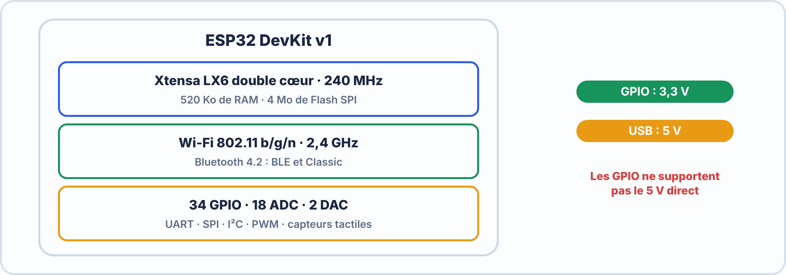
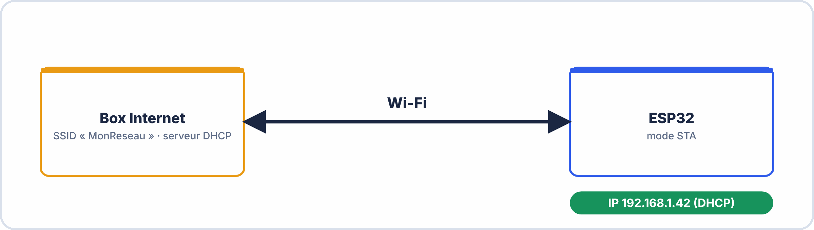
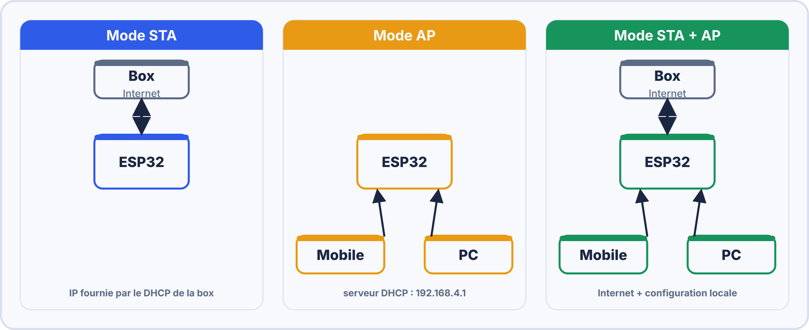
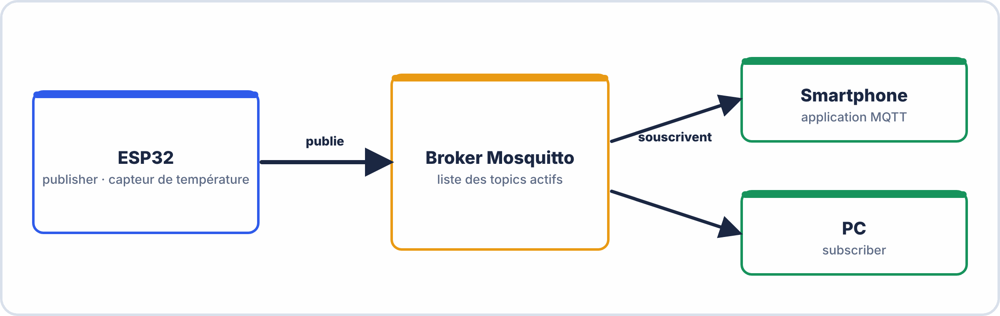

# 📘 FICHE DE COURS — S6 · 2ᵉ ANNÉE · E2
## ESP32 WiFi : Modes Station & AP · WebServer Embarqué · MQTT Client Basique

---

> **Nom** : \_\_\_\_\_\_\_\_\_\_\_\_\_\_\_\_\_\_\_\_\_\_\_\_\_\_\_
> **Date** : \_\_\_\_\_\_\_\_\_\_\_\_\_\_\_\_\_\_\_\_\_\_\_\_\_\_\_
> **Compétences travaillées** : S5.1 · S5.2 · S5.3 · C5.1 · C5.2

---

## 🔑 Vocabulaire clé

| Terme | Définition |
|---|---|
| **ESP32** | Microcontrôleur Espressif avec WiFi + BT intégrés · cœur de l'IoT moderne |
| **Mode STA** | Station Mode — l'ESP32 se connecte à un réseau WiFi existant (comme un smartphone) |
| **Mode AP** | Access Point Mode — l'ESP32 crée son propre réseau WiFi (comme une box Internet) |
| **Mode STA+AP** | Les deux simultanément — connecté à une box ET diffuse son propre réseau |
| **WebServer** | Serveur HTTP embarqué dans l'ESP32 — répond à des requêtes de navigateurs |
| **HTTP GET** | Requête pour demander une ressource (une page, un état de capteur) |
| **HTTP POST** | Requête pour envoyer des données (formulaire, commande) |
| **MQTT** | Message Queuing Telemetry Transport — protocole léger pub/sub pour l'IoT |
| **Broker MQTT** | Serveur intermédiaire qui reçoit et redistribue les messages MQTT |
| **Publisher** | Client MQTT qui envoie des messages sur un topic |
| **Subscriber** | Client MQTT qui s'abonne à un topic pour recevoir ses messages |
| **Topic** | Chemin hiérarchique identifiant un flux de messages (ex: "maison/salon/temp") |
| **QoS** | Quality of Service — niveau de fiabilité de livraison d'un message MQTT (0, 1, 2) |
| **WiFi.begin()** | Fonction Arduino ESP32 pour se connecter à un réseau WiFi |
| **PubSubClient** | Bibliothèque Arduino pour le protocole MQTT |

---

## 1️⃣ — L'ESP32 : microcontrôleur IoT de référence

### Architecture et capacités



```
Alimentation : 3,3 V (GPIO) — 5 V (USB)
⚠️ Les GPIO ESP32 sont en 3,3 V — incompatibles 5 V direct !
```

### Structure d'un programme Arduino ESP32

```cpp
// Inclure les bibliothèques nécessaires
#include <WiFi.h>
#include <WebServer.h>

// Variables globales
const char* ssid = "MonReseau";
const char* password = "MonMotDePasse";

void setup() {
  Serial.begin(115200);    // Moniteur série
  // Initialisation unique au démarrage
}

void loop() {
  // Répété en boucle indéfiniment
  // Gérer les requêtes, lire capteurs, publier MQTT...
}
```

---

## 2️⃣ — Mode Station (STA) : se connecter au WiFi

### Connexion à un réseau existant

```cpp
#include <WiFi.h>

const char* ssid     = "NomDuReseau";
const char* password = "MotDePasse";

void setup() {
  Serial.begin(115200);
  
  // Démarrer la connexion WiFi en mode Station
  WiFi.begin(ssid, password);
  
  // Attendre la connexion (avec timeout)
  Serial.print("Connexion WiFi");
  while (WiFi.status() != WL_CONNECTED) {
    delay(500);
    Serial.print(".");
  }
  
  // Connexion établie
  Serial.println("\n✓ Connecté !");
  Serial.print("Adresse IP : ");
  Serial.println(WiFi.localIP());   // Afficher l'IP obtenue par DHCP
}

void loop() {
  // Rien ici pour l'instant
}
```

### États WiFi courants

```
WiFi.status() peut retourner :
  WL_CONNECTED      = 3  ← Connecté ✓
  WL_IDLE_STATUS    = 0  ← En attente
  WL_NO_SSID_AVAIL  = 1  ← SSID introuvable
  WL_CONNECT_FAILED = 4  ← Mauvais mot de passe ou autre erreur
  WL_DISCONNECTED   = 6  ← Déconnecté

Informations utiles une fois connecté :
  WiFi.localIP()     → IP de l'ESP32 (ex: 192.168.1.42)
  WiFi.RSSI()        → Force du signal en dBm (ex: -65 dBm)
  WiFi.SSID()        → Nom du réseau connecté
  WiFi.macAddress()  → Adresse MAC de l'ESP32
```

---



---

## 3️⃣ — WebServer embarqué

### Créer un serveur HTTP sur l'ESP32

```cpp
#include <WiFi.h>
#include <WebServer.h>

const char* ssid     = "NomDuReseau";
const char* password = "MotDePasse";

WebServer server(80);   // Serveur HTTP sur le port 80

// ─── Handler : page d'accueil ──────────────────────────────────────────────
void handleRoot() {
  String html = "<!DOCTYPE html><html><head>";
  html += "<meta charset='UTF-8'>";
  html += "<title>ESP32 WebServer</title></head><body>";
  html += "<h1>🔌 ESP32 en ligne !</h1>";
  html += "<p>Température fictive : <b>23.5°C</b></p>";
  html += "</body></html>";
  
  server.send(200, "text/html", html);  // Code 200 = OK
}

// ─── Handler : LED on ──────────────────────────────────────────────────────
void handleLedOn() {
  digitalWrite(2, HIGH);               // Allumer LED GPIO 2
  server.send(200, "text/plain", "LED allumée");
}

// ─── Handler : LED off ─────────────────────────────────────────────────────
void handleLedOff() {
  digitalWrite(2, LOW);
  server.send(200, "text/plain", "LED éteinte");
}

// ─── Handler : 404 Not Found ───────────────────────────────────────────────
void handleNotFound() {
  server.send(404, "text/plain", "404 : Page introuvable");
}

void setup() {
  Serial.begin(115200);
  pinMode(2, OUTPUT);
  
  // Connexion WiFi
  WiFi.begin(ssid, password);
  while (WiFi.status() != WL_CONNECTED) {
    delay(500); Serial.print(".");
  }
  Serial.println("\nIP : " + WiFi.localIP().toString());
  
  // Enregistrer les routes (URL → fonction handler)
  server.on("/",        handleRoot);      // GET /
  server.on("/led/on",  handleLedOn);     // GET /led/on
  server.on("/led/off", handleLedOff);    // GET /led/off
  server.onNotFound(handleNotFound);      // Toute autre URL
  
  server.begin();   // Démarrer le serveur
  Serial.println("Serveur HTTP démarré !");
}

void loop() {
  server.handleClient();   // ← OBLIGATOIRE en loop() pour traiter les requêtes
}
```

### Utilisation depuis un navigateur

```
L'ESP32 a obtenu l'IP 192.168.1.42

URL                           Action
http://192.168.1.42/          → Page d'accueil HTML
http://192.168.1.42/led/on    → Allume la LED
http://192.168.1.42/led/off   → Éteint la LED

⚠️ server.handleClient() dans loop() est CRITIQUE
   Sans lui, le serveur ne répond à aucune requête
```

---

## 4️⃣ — Mode Access Point (AP)

### L'ESP32 crée son propre réseau WiFi

```cpp
#include <WiFi.h>
#include <WebServer.h>

// Paramètres du réseau AP créé par l'ESP32
const char* ap_ssid     = "ESP32_Config";
const char* ap_password = "monmdp123";  // min 8 caractères, ou "" pour ouvert

WebServer server(80);

void setup() {
  Serial.begin(115200);
  
  // Démarrer en mode Access Point
  WiFi.mode(WIFI_AP);
  WiFi.softAP(ap_ssid, ap_password);
  
  // L'ESP32 a l'IP 192.168.4.1 par défaut en mode AP
  Serial.print("Réseau WiFi créé : ");
  Serial.println(ap_ssid);
  Serial.print("IP du portail : http://");
  Serial.println(WiFi.softAPIP());   // Affiche 192.168.4.1
  
  server.on("/", []() {
    server.send(200, "text/html",
      "<h1>Portail de configuration ESP32</h1>"
      "<p>Connecté au réseau ESP32_Config</p>");
  });
  
  server.begin();
}

void loop() {
  server.handleClient();
}
```

### Caractéristiques du mode AP

```
IP par défaut de l'ESP32 en mode AP : 192.168.4.1
DHCP intégré : attribue 192.168.4.2, 192.168.4.3... aux clients
Clients max simultanés : 4 (par défaut, configurable jusqu'à 10)
Portée : ~50-100m en espace ouvert

Mode STA + AP simultané :
  WiFi.mode(WIFI_AP_STA);   // Les deux modes en même temps
  WiFi.softAP(ap_ssid, ap_password);
  WiFi.begin(sta_ssid, sta_password);
  → L'ESP32 est connecté à Internet (STA) ET diffuse son propre réseau (AP)
  → Cas typique : portail de configuration initial
```

---



---

## 5️⃣ — MQTT : messagerie IoT pub/sub

### Architecture MQTT

```
MQTT = Message Queuing Telemetry Transport
  → Protocole léger (quelques centaines d'octets)
  → Conçu pour les appareils IoT avec connexion instable
  → Port TCP 1883 (non chiffré) · 8883 (TLS)
  → Modèle Publish/Subscribe (pub/sub) via un Broker central

TROIS ACTEURS :
  Publisher  → Envoie un message sur un topic
  Subscriber → Reçoit les messages d'un topic (abonnement)
  Broker     → Intermédiaire central (Mosquitto, HiveMQ, EMQX...)
```

### Topics MQTT : convention de nommage

```
Format hiérarchique séparé par des /
  "bâtiment/salle/capteur/mesure"
  
Exemples :
  "ecole/labo_e2/esp32_1/temperature"
  "ecole/labo_e2/esp32_1/led/etat"
  "ecole/labo_e2/esp32_1/led/commande"

Wildcards :
  "ecole/+/esp32_1/temperature"  → "+" remplace UN niveau
  "ecole/#"                       → "#" remplace TOUT le reste
```

### QoS — Niveaux de qualité de service

```
QoS 0 → "Fire and forget" : message envoyé une fois, pas d'accusé de réception
         Le plus rapide, peut être perdu si déconnexion
         
QoS 1 → "At least once" : message envoyé jusqu'à réception d'un ACK
         Peut être reçu plusieurs fois (dédupliqué par le broker)
         
QoS 2 → "Exactly once" : garantit la réception exactement 1 fois
         Le plus fiable, mais plus lent (4 échanges)
         
Pour l'IoT basique : QoS 0 ou QoS 1 est suffisant
```

### Code ESP32 : client MQTT avec PubSubClient

```cpp
#include <WiFi.h>
#include <PubSubClient.h>

// ─── Configuration ──────────────────────────────────────────────────────────
const char* ssid        = "NomDuReseau";
const char* password    = "MotDePasse";
const char* mqtt_server = "broker.hivemq.com";  // ou IP du Mosquitto local
const int   mqtt_port   = 1883;
const char* client_id   = "ESP32_CIEL_001";     // Unique par appareil !

// ─── Topics ─────────────────────────────────────────────────────────────────
const char* topic_pub   = "ecole/labo/esp32/temperature";
const char* topic_sub   = "ecole/labo/esp32/led/commande";

// ─── Objets globaux ─────────────────────────────────────────────────────────
WiFiClient   espClient;
PubSubClient mqtt(espClient);

// ─── Callback : appelée à la réception d'un message MQTT ───────────────────
void messageRecu(char* topic, byte* payload, unsigned int length) {
  // Convertir payload (bytes) en String
  String message = "";
  for (int i = 0; i < length; i++) {
    message += (char)payload[i];
  }
  
  Serial.println("Message reçu sur [" + String(topic) + "] : " + message);
  
  // Réagir au message
  if (String(topic) == topic_sub) {
    if (message == "ON")  { digitalWrite(2, HIGH); }
    if (message == "OFF") { digitalWrite(2, LOW);  }
  }
}

// ─── Connexion WiFi ─────────────────────────────────────────────────────────
void connectWiFi() {
  WiFi.begin(ssid, password);
  while (WiFi.status() != WL_CONNECTED) {
    delay(500); Serial.print(".");
  }
  Serial.println("\n✓ WiFi connecté : " + WiFi.localIP().toString());
}

// ─── Connexion MQTT ─────────────────────────────────────────────────────────
void connectMQTT() {
  mqtt.setServer(mqtt_server, mqtt_port);
  mqtt.setCallback(messageRecu);
  
  while (!mqtt.connected()) {
    Serial.print("Connexion MQTT...");
    if (mqtt.connect(client_id)) {
      Serial.println(" ✓ Connecté au broker !");
      mqtt.subscribe(topic_sub);   // S'abonner au topic commande
      Serial.println("Abonné au topic : " + String(topic_sub));
    } else {
      Serial.print(" Échec (rc=");
      Serial.print(mqtt.state());
      Serial.println(") → Nouvelle tentative dans 5s");
      delay(5000);
    }
  }
}

// ─── Setup ──────────────────────────────────────────────────────────────────
void setup() {
  Serial.begin(115200);
  pinMode(2, OUTPUT);
  
  connectWiFi();
  connectMQTT();
}

// ─── Loop ───────────────────────────────────────────────────────────────────
void loop() {
  // Maintenir la connexion MQTT (reconnexion automatique si perdu)
  if (!mqtt.connected()) { connectMQTT(); }
  mqtt.loop();   // ← OBLIGATOIRE pour recevoir les messages
  
  // Publier la "température" toutes les 10 secondes
  static unsigned long lastMsg = 0;
  if (millis() - lastMsg > 10000) {
    lastMsg = millis();
    
    float temp = 23.5 + random(-10, 10) / 10.0;  // Valeur fictive
    String payload = String(temp, 1);             // "23.7"
    
    mqtt.publish(topic_pub, payload.c_str());
    Serial.println("Publié : " + String(topic_pub) + " → " + payload);
  }
}
```

---



---

## 6️⃣ — Comparatif HTTP WebServer vs MQTT

```
                    HTTP WebServer              MQTT
Architecture        Client-Serveur              Pub/Sub via Broker
Initiation          Client (navigateur)         N'importe qui (pub ou sub)
Connexion           Stateless (une requête à la fois) Persistante (TCP keep-alive)
Complexité          Simple (URL → réponse)      Plus élaboré (broker nécessaire)
Adapté pour         Contrôle local, affichage   IoT, temps réel, multi-devices
Consommation        Moyenne (parse HTTP)        Faible (messages binaires légers)
Perte de connexion  La requête échoue           Broker conserve le dernier message (retain)
Sécurité            HTTPS (TLS sur 443)         MQTT over TLS (port 8883)
Cas d'usage E2      Page web de contrôle locale Multi-capteurs, tableau de bord
```

---

## 📌 Les essentiels à retenir

> ✅ **Mode STA** : `WiFi.begin(ssid, pass)` → connecté au réseau → IP par DHCP
> ✅ **Mode AP** : `WiFi.softAP(ssid, pass)` → IP fixe **192.168.4.1**
> ✅ **WebServer** : `server.on("/route", handler)` → `server.handleClient()` dans **loop()**
> ✅ **MQTT** : 3 acteurs — **Publisher**, **Subscriber**, **Broker**
> ✅ **Topic** : chemin hiérarchique `"maison/salle/capteur"` · `+` = 1 niveau · `#` = tout
> ✅ **QoS 0** = "fire and forget" · **QoS 1** = au moins 1 fois · **QoS 2** = exactement 1 fois
> ✅ `mqtt.loop()` dans **loop()** est OBLIGATOIRE pour recevoir les messages
> ✅ Client ID MQTT = unique par appareil (sinon déconnexion en boucle !)
> ✅ PubSubClient : bibliothèque Arduino MQTT standard

---

*Fiche de Cours ESP32 WiFi — BAC PRO CIEL | E2 Systèmes Électroniques | 2ᵉ année S6*
*Compétences : S5.1 · S5.2 · S5.3 · C5.1 · C5.2*
