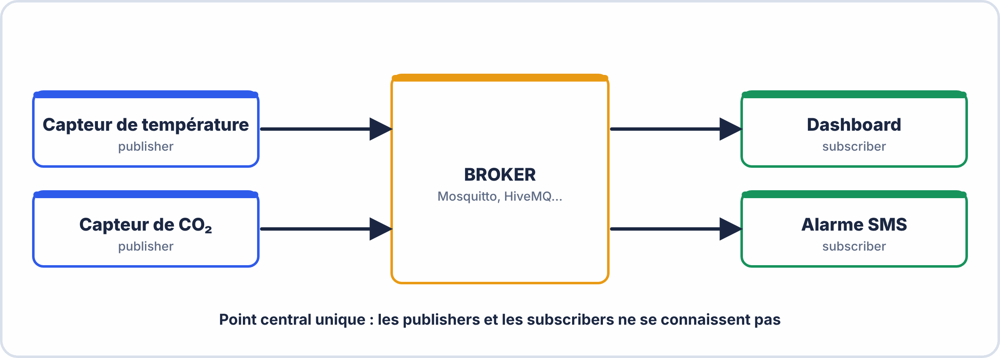
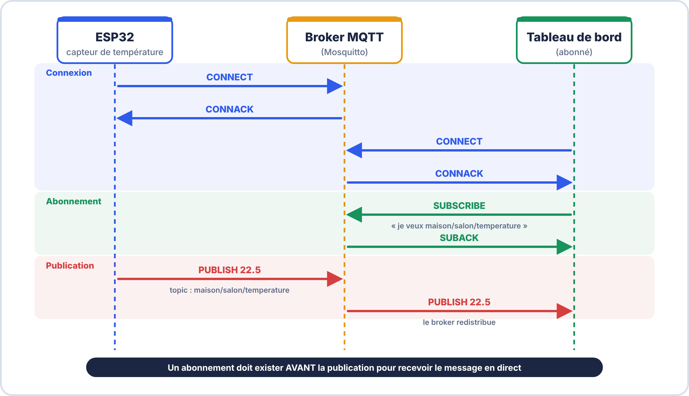
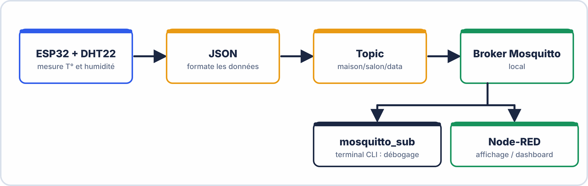

# 📖 FICHE COURS – S7 ANNÉE 2 – E2
## MQTT : Publish/Subscribe, Topics, QoS, Mosquitto, ESP32

---

## 🎯 OBJECTIFS

- ✅ Expliquer le modèle publish/subscribe et son avantage en IoT
- ✅ Utiliser correctement les topics et les wildcards
- ✅ Choisir le bon niveau de QoS selon le cas d'usage
- ✅ Configurer Mosquitto et tester avec la CLI
- ✅ Connecter un ESP32 à un broker MQTT

---

## 1️⃣ POURQUOI MQTT ? LE PROBLÈME DU HTTP EN IOT

### 🧱 Ce qu'il faut savoir avant de commencer

Si l'un de ces mots t'est inconnu, lis ce petit rappel : tout le reste du cours s'appuie dessus.

| Mot | Ce que ça veut dire, simplement |
|---|---|
| **Réseau local** | Les appareils (PC, ESP32, box) sont reliés entre eux, par câble ou Wi-Fi. |
| **Adresse IP** | Le « numéro de téléphone » d'un appareil sur le réseau, par exemple `192.168.1.50`. |
| **Port** | Le « numéro de bureau » d'un logiciel sur cet appareil. Un même PC peut faire tourner plusieurs logiciels réseau ; le port dit auquel on parle. MQTT utilise le port **1883**. |
| **Client / serveur** | Un **serveur** est un logiciel qui attend qu'on lui parle. Un **client** est un logiciel qui se connecte à un serveur pour lui parler. |
| **Connexion TCP** | Un « appel téléphonique » ouvert entre le client et le serveur : tant qu'on ne raccroche pas, ils peuvent s'échanger des messages dans les deux sens. |

> [!NOTE] 🔎 Un point qui prête à confusion
> Le mot **serveur** désigne un **logiciel**, pas forcément une grosse machine. Le broker Mosquitto est un logiciel qu'on installe sur un PC, un Raspberry Pi ou dans le cloud. Les capteurs (ESP32) sont, eux, des **clients** : **c'est toujours le client qui appelle le broker**, jamais l'inverse.


### HTTP : adapté aux navigateurs, pas aux capteurs

> HTTP (le protocole du Web) fonctionne en **request/response** : le client demande, le serveur répond. Ce modèle a plusieurs inconvénients pour l'IoT :

| **Problème HTTP** | **Impact en IoT** |
|---|---|
| En-têtes verbeux (~500 octets minimum) | Trop lourd pour un microcontrôleur à 80 MHz / pile TCP limitée |
| Le client doit demander (polling) | Gaspille la batterie ; latence élevée |
| Connexion à chaque échange | Coûteux en temps et en énergie |
| N capteurs × M apps = N×M connexions | Non scalable |

### MQTT : conçu pour les contraintes de l'IoT

> **MQTT** (Message Queuing Telemetry Transport) a été créé en 1999 par IBM pour relier des capteurs pétroliers via des liaisons satellite très limitées. Il est maintenant le standard de l'IoT.

| **Avantage MQTT** | **Chiffre** |
|---|---|
| En-tête minimum | **2 octets** seulement |
| Maintien de connexion | Connexion TCP persistante |
| Consommation batterie | Très faible (push, pas polling) |
| Scalabilité | Un broker → des millions de clients |

---

## 2️⃣ LE MODÈLE PUBLISH / SUBSCRIBE

### 🗞️ D'abord une image : le kiosque à journaux

Imagine que tu veux lire chaque jour le journal sportif.

- **Méthode « question / réponse » (HTTP)** : tu vas toutes les heures au kiosque demander « y a-t-il du nouveau ? ». La plupart du temps la réponse est non : tu as marché pour rien.
- **Méthode « abonnement » (MQTT)** : tu t'abonnes **une fois**. Dès qu'un journal paraît, **on te le livre**. Tu n'as plus rien à demander.

Dans les deux cas, le journaliste qui écrit l'article **ne connaît pas** ses lecteurs, et les lecteurs **ne connaissent pas** le journaliste. Entre eux : un **intermédiaire** (le kiosque, qui trie et distribue). En MQTT, cet intermédiaire s'appelle le **broker**.

| Dans l'image | En MQTT |
|---|---|
| Le journaliste qui écrit | le **publisher** (par exemple l'ESP32 avec son capteur) |
| Le kiosque qui distribue | le **broker** (Mosquitto) |
| La rubrique (« sport », « météo ») | le **topic** (`maison/salon/temperature`) |
| Le lecteur abonné à la rubrique | le **subscriber** (dashboard, Node-RED, autre ESP32) |
| L'article | le **message** (le *payload*) |


### Architecture



### Les acteurs

| **Acteur** | **Rôle** | **Exemple** |
|---|---|---|
| **Broker** | Serveur central qui reçoit, filtre et redistribue | Mosquitto, HiveMQ, AWS IoT Core |
| **Publisher** | Client qui envoie un message sur un topic | ESP32 avec capteur DHT22 |
| **Subscriber** | Client abonné à un ou plusieurs topics | Application dashboard, Node-RED |
| **Topic** | Chemin hiérarchique identifiant le "canal" | `maison/salon/temperature` |
| **Message (Payload)** | Contenu du message (texte, JSON, binaire) | `{"temp":22.5,"hum":65}` |


### 🪜 Le fonctionnement pas à pas

Prenons **trois appareils** : un ESP32 avec un capteur de température, un PC qui affiche un tableau de bord, et le PC où tourne le broker.

**Étape 0. Le broker attend.** Le logiciel Mosquitto tourne sur le PC `192.168.1.50` et écoute sur le port 1883. Personne n'est encore connecté.

**Étape 1. Chaque client se connecte au broker.** Le tableau de bord et l'ESP32 ouvrent chacun une connexion TCP vers `192.168.1.50:1883` et envoient un message `CONNECT`. Le broker répond `CONNACK` (« bien reçu, tu es connecté »).

**Étape 2. Le tableau de bord s'abonne.** Il envoie `SUBSCRIBE maison/salon/temperature`. Le broker répond `SUBACK` et **note dans sa liste** : « le tableau de bord veut les messages de ce topic ».

**Étape 3. L'ESP32 publie.** Il envoie `PUBLISH` avec le topic `maison/salon/temperature` et le message `22.5`. Il **ne sait pas** qui va le lire et ne s'en occupe pas.

**Étape 4. Le broker redistribue.** Il regarde sa liste : qui est abonné à ce topic ? Il **recopie** le message vers chacun des abonnés. Le tableau de bord reçoit `22.5`.



> [!TIP] 💡 À retenir sur l'ordre
> L'abonnement doit avoir lieu **avant** la publication pour recevoir le message en direct. Un abonné qui arrive après **rate** les messages déjà passés (sauf s'ils ont été « retenus », voir la partie 5).

#### Que se passe-t-il s'il y a plusieurs abonnés ? Aucun abonné ?

- **Deux abonnés** (le dashboard et une base de données) : le broker envoie **une copie à chacun**. L'ESP32, lui, n'a publié **qu'une seule fois**.
- **Aucun abonné** : le broker **jette** le message. Ce n'est pas une erreur : le publisher n'est pas prévenu.
- **Un client à la fois publisher et subscriber** : c'est normal. Notre ESP32 **publie** la température **et** s'abonne à `maison/salon/led` pour **recevoir** l'ordre d'allumer une LED. Publisher et subscriber sont des **rôles**, pas des types d'appareils.

### 🔗 Pourquoi ça change tout : le découplage

**Découplage** veut dire que les appareils sont **indépendants** les uns des autres. Il y en a trois sortes :

| Découplage | Signification | Exemple concret |
|---|---|---|
| **Dans l'espace** | Le publisher ne connaît ni l'adresse ni le nombre des abonnés | On ajoute un 2ᵉ dashboard sans toucher au code de l'ESP32 |
| **Dans le temps** | Publisher et abonné n'ont pas besoin d'être allumés **en même temps** (avec les options QoS et *retained*) | Le dashboard démarre après l'ESP32 et reçoit quand même la dernière valeur |
| **Dans la synchronisation** | Le publisher n'attend pas de réponse et continue son travail | L'ESP32 mesure et envoie, sans attendre qu'on ait lu |

**Comparaison avec HTTP sur un même besoin** : 10 capteurs et 3 applications veulent échanger des valeurs.

| | HTTP | MQTT |
|---|---|---|
| Qui initie ? | L'application doit **interroger** chaque capteur | Le capteur **pousse** quand il a une nouvelle valeur |
| Connexions | Chaque application connaît et interroge **chaque** capteur : 10 × 3 = **30** liens | Chacun ne parle qu'au broker : 10 + 3 = **13** liens |
| Ajouter un capteur | Il faut le déclarer dans **chaque** application | Il publie sur son topic, les applications abonnées le reçoivent |

> [!WARNING] ⚠️ Idées fausses fréquentes
> - « **Le broker est le capteur ou le tableau de bord.** » Non : c'est un **logiciel intermédiaire** qui ne mesure rien et n'affiche rien ; il ne fait que **recevoir et redistribuer**.
> - « **Le publisher envoie le message directement aux abonnés.** » Non : il l'envoie **au broker**, jamais aux abonnés.
> - « **S'abonner, c'est demander la valeur une fois.** » Non : l'abonnement reste **actif tant que le client est connecté** ; chaque nouveau message arrive tout seul.
> - « **Le broker garde tous les messages.** » Non : par défaut il les transmet puis les **oublie**. Seul le **dernier** message d'un topic est conservé, et **uniquement** si le publisher a demandé *retained*.
> - « **Un topic se crée dans le broker avant de l'utiliser.** » Non : il existe **dès qu'un client y publie ou s'y abonne**.

### ✅ Vérifie que tu as compris

**Q1.** Quel est le rôle du broker ? Quels appareils sont des clients ?

??? success "Réponse"
    Le broker **reçoit les messages et les redistribue** aux abonnés du bon topic. Les **clients** sont l'ESP32, le dashboard, Node-RED, etc. : ce sont eux qui se connectent au broker.

**Q2.** Un ESP32 envoie la température et reçoit un ordre « ON/OFF » pour une LED. Est-il publisher, subscriber ou les deux ?

??? success "Réponse"
    **Les deux** : il **publie** la température et il est **abonné** au topic de commande.

**Q3.** Personne n'est abonné au topic quand l'ESP32 publie. Que devient le message ?

??? success "Réponse"
    Le broker le **supprime** (sauf option *retained*). Le publisher n'est pas prévenu et continue.

**Q4.** Pourquoi dit-on que publisher et subscriber « ne se connaissent pas » ?

??? success "Réponse"
    Parce qu'ils ne communiquent **qu'avec le broker**, via un **topic** : aucun n'a l'adresse de l'autre.

**Q5.** Pour 6 capteurs et 4 applications, combien de liens en HTTP direct ? Avec un broker ?

??? success "Réponse"
    HTTP : 6 × 4 = **24** liens. MQTT : 6 + 4 = **10** liens (chacun vers le broker).

### 🧪 Mini-exercice : qui reçoit quoi ?

Le broker a trois clients connectés. **A** est abonné à `atelier/+/temperature`. **B** est abonné à `atelier/#`. **C** est abonné à `atelier/four/temperature`.

On publie ensuite un message sur `atelier/four/temperature`.

1. Qui le reçoit ?
2. Même question pour un message publié sur `atelier/four/pression`.
3. Même question pour `atelier/four/zone2/temperature`.

??? success "Corrigé"

    1. **A, B et C** : le topic correspond aux trois abonnements (`+` remplace `four`, `#` remplace tout, C est exact).
    2. **B seulement** : `+/temperature` ne correspond pas à `pression`, et C est un topic exact.
    3. **B seulement** : `+` ne couvre qu'**un seul niveau**, donc A ne reçoit pas ; C non plus ; `#` couvre tout ce qui suit.

---

## 3️⃣ LES TOPICS

> [!TIP] 💡 En clair
> Un **topic** est **l'adresse** d'une information, comme un chemin de dossiers : `maison/salon/temperature`. Le **publisher** choisit l'adresse où il dépose sa valeur ; le **subscriber** indique les adresses qui l'intéressent. Le broker ne fait que **faire correspondre** les deux.
>
> Les **majuscules comptent** : `Maison/Salon` et `maison/salon` sont **deux topics différents**.


### Structure hiérarchique

> Un topic est une chaîne UTF-8 avec des niveaux séparés par des `/`. Il n'y a pas de déclaration préalable — un topic existe dès qu'un message y est publié.

```
maison/salon/temperature          → température du salon
maison/salon/humidite             → humidité du salon
maison/cuisine/temperature        → température de la cuisine
usine/ligne1/machine3/vibration   → vibration machine 3, ligne 1
vehicule/bus42/GPS/latitude       → position GPS du bus 42
```

> **Bonnes pratiques de nommage :**
> - Tout en minuscules, sans espaces
> - Du général au spécifique (zone → pièce → grandeur)
> - Pas de `/` au début ou à la fin

### Wildcards (dans les souscriptions uniquement)

> Les wildcards permettent de s'abonner à plusieurs topics en une seule souscription. **Ils ne peuvent PAS être utilisés dans les publications.**

| **Wildcard** | **Signification** | **Exemple** | **Match** |
|---|---|---|---|
| `+` | Un niveau unique quelconque | `maison/+/temperature` | `maison/salon/temperature`, `maison/cuisine/temperature` — **pas** `maison/salon/haut/temperature` |
| `#` | Tout ce qui suit (doit être le dernier caractère) | `maison/#` | Tout ce qui commence par `maison/` |
| `#` seul | Tous les topics | `#` | **Tous** les messages du broker |

```
Souscription : maison/+/temperature
  ✅ maison/salon/temperature
  ✅ maison/cuisine/temperature
  ❌ maison/salon/haut/temperature    (+ couvre 1 seul niveau)

Souscription : maison/#
  ✅ maison/salon/temperature
  ✅ maison/cuisine/humidite
  ✅ maison/salon/haut/temperature    (# couvre tout ce qui suit)
  ❌ usine/ligne1/...                 (ne commence pas par maison/)
```


#### Comment lire un filtre avec `+` ou `#` : la méthode en 3 temps

1. **Découpe** le topic et le filtre à chaque `/`.
2. **Compare niveau par niveau** de gauche à droite : un niveau normal doit être **identique**, `+` accepte **n'importe quel** niveau, `#` accepte **tout le reste**.
3. Le **nombre de niveaux** doit être le même (sauf avec `#`).

| Filtre | Topic reçu | Résultat | Pourquoi |
|---|---|---|---|
| `maison/+/temperature` | `maison/salon/temperature` | ✅ | `+` remplace `salon` |
| `maison/+/temperature` | `maison/salon/haut/temperature` | ❌ | 4 niveaux au lieu de 3 |
| `maison/#` | `maison/salon/haut/temperature` | ✅ | `#` couvre tout le reste |
| `maison/#` | `maisons/salon` | ❌ | `maisons` ≠ `maison` |

> [!WARNING] ⚠️ À éviter
> Ne pas s'abonner à `#` sur un vrai système : on reçoit **tout**, y compris des messages qui ne nous concernent pas.
> Le mot **« wildcard »** (joker) se dit pour les **abonnements** seulement : on **publie** toujours sur un topic **précis**.

---


---

## 4️⃣ QoS — QUALITÉ DE SERVICE

> [!TIP] 💡 En clair : le QoS, c'est « avec ou sans accusé de réception »
> Le QoS (*Quality of Service*) règle **à quel point on s'assure qu'un message est bien arrivé**. Comme pour un courrier : **simple lettre** (QoS 0), **lettre avec accusé de réception** (QoS 1), **recommandé garanti sans doublon** (QoS 2).
>
> **Attention : le QoS s'applique sur chaque tronçon séparément** : d'abord publisher → broker, puis broker → subscriber. Le QoS **effectif** pour un abonné est **le plus faible** des deux : si le publisher publie en QoS 1 mais que l'abonné s'est abonné en QoS 0, il reçoit en QoS 0.


### Les 3 niveaux

$$\boxed{QoS 0 < QoS 1 < QoS 2}$$

$$\text{fiabilité croissante, overhead croissant}$$

---

### QoS 0 — At Most Once (Fire and Forget)

```
Publisher → PUBLISH → Broker → PUBLISH → Subscriber
           (pas de confirmation)
```

> Le message est envoyé **une fois maximum**, sans confirmation. Si le réseau coupe, le message est perdu. Aucun stockage en mémoire.

**Quand l'utiliser :** données haute fréquence peu critiques (température toutes les secondes — si un point est perdu, le suivant arrivera dans 1s)

---

### QoS 1 — At Least Once

```
Publisher → PUBLISH → Broker → PUBACK → Publisher
                              (confirmation reçue)
           Si pas de PUBACK dans le délai → retransmission
           → Le message peut arriver 2× chez le subscriber
```

> Le message est envoyé **au moins une fois**. En cas de doute (timeout), le publisher retransmet. Cela peut créer des **doublons** chez le subscriber.

**Quand l'utiliser :** données importantes mais où les doublons sont acceptables (alertes, commandes simples). **Le plus utilisé en IoT pratique.**

---

### QoS 2 — Exactly Once

```
Publisher → PUBLISH → Broker → PUBREC → Publisher
           → PUBREL → Broker → PUBCOMP
           (4 échanges pour garantir exactement 1 livraison)
```

> Le message est livré **exactement une fois**, sans perte ni doublon. Nécessite 4 échanges TCP → latence et overhead élevés.

**Quand l'utiliser :** commandes critiques où le doublon est dangereux (actionner une vanne 2× = catastrophe). Peu utilisé sur microcontrôleurs (trop lourd).

### Tableau de choix QoS

| **Cas d'usage** | **QoS recommandé** | **Raison** |
|---|---|---|
| Télémétrie haute fréquence (temp toutes les secondes) | **0** | Pas critique, doublon gênant |
| Alerte seuil dépassé | **1** | On veut la garantie de livraison |
| Commande d'ouverture de vanne | **2** | Doublon = incident industriel |
| Message de statut périodique | **1** | Bon compromis |
| Streaming audio/vidéo | **0** | Latence faible > fiabilité |

---

## 5️⃣ FONCTIONNALITÉS AVANCÉES

Deux fonctions de MQTT règlent le cas où un **client arrive en retard** ou **disparaît brutalement** : le **message retenu** et le **testament**.


### Retained Message (Message Retenu)

> Quand un publisher publie un message avec le flag **RETAIN = true**, le broker conserve **le dernier message** publié sur ce topic. Tout nouveau subscriber qui s'abonne reçoit immédiatement ce dernier message — même s'il n'était pas connecté lors de la publication originale.

```
Publish (RETAIN=true) : maison/salon/temperature → {"temp":22.5}
   ↓
[5 minutes plus tard, un nouvel abonné se connecte]
   ↓
Il reçoit immédiatement {"temp":22.5} sans attendre le prochain publish
```

**Cas d'usage :** état initial d'un actionneur (lampe ON/OFF), dernière valeur connue d'un capteur pour un dashboard qui vient de démarrer.


> [!TIP] 💡 En clair
> Sans *retained*, un abonné qui arrive en retard **ne reçoit rien** avant le prochain message : un dashboard peut rester vide pendant 10 minutes. Avec *retained*, le broker garde **une seule valeur par topic, la dernière**, et la donne **dès l'abonnement**.
>
> **Pour effacer** un message retenu, on publie un message **vide** sur le même topic avec *retained*.

> [!WARNING] ⚠️ Ne pas confondre
> - **Retained** : le broker garde le dernier message **d'un topic**, pour les **futurs abonnés**.
> - **QoS** : fiabilité de **l'acheminement** d'**un** message.
> - **LWT** : message **publié automatiquement par le broker** quand un client **disparaît**.

---

### Last Will and Testament (LWT)

> Quand un client se connecte au broker, il peut déclarer un **message de testament** : si la connexion est perdue brutalement (panne, coupure réseau), le broker publie automatiquement ce message.

```
ESP32 au démarrage : "Si je meurs, publie {'status':'offline'} sur esp32/status"
   ↓
[ESP32 perd le courant sans déconnexion propre]
   ↓
Broker publie automatiquement : esp32/status → {"status":"offline"}
```

**Cas d'usage :** supervision de la disponibilité des équipements IoT.


> [!TIP] 💡 En clair
> Le broker ne peut pas savoir qu'un ESP32 est tombé en panne : **personne ne le prévient**. On demande donc à l'ESP32, **à la connexion**, de confier au broker une lettre : « si je disparais sans dire au revoir, **publie ce message à ma place** ». Pour un **départ normal** (`disconnect()`), le testament n'est **pas** envoyé.
>
> On l'associe souvent à *retained* : le dernier état connu (`online` ou `offline`) est alors **toujours disponible**.

```
Connexion           : ESP32 → broker  « voici mon testament : esp32/status = offline (retained) »
Puis, tout va bien  : ESP32 publie     esp32/status = online (retained)
Coupure de courant  : le broker constate le silence → il publie lui-même esp32/status = offline
```

---

## 6️⃣ MOSQUITTO — BROKER LOCAL

> [!TIP] 💡 En clair : ce que font `mosquitto_pub` et `mosquitto_sub`
> Ce sont deux petits **clients** en ligne de commande, parfaits pour **tester sans écrire de code** : `mosquitto_sub` joue le **subscriber** (il reste ouvert et affiche ce qui arrive), `mosquitto_pub` joue le **publisher** (il envoie un message puis s'arrête).
>
> **Test minimal avec deux terminaux** :
> 1. Terminal 1 : `mosquitto_sub -h localhost -t "test/#" -v` (il attend)
> 2. Terminal 2 : `mosquitto_pub -h localhost -t "test/hello" -m "bonjour"`
> 3. Le terminal 1 affiche `test/hello bonjour` : le broker a bien redistribué.
>
> **Les options** : `-h` = adresse du broker · `-t` = topic · `-m` = message · `-q` = QoS · `-r` = retained · `-v` = afficher le topic avec le message.


### Installation (Linux)

```bash
sudo apt-get install mosquitto mosquitto-clients

# Fichier de configuration :
# /etc/mosquitto/mosquitto.conf
# ou /etc/mosquitto/conf.d/local.conf

# Configuration minimale pour le labo (accès anonyme local) :
listener 1883
allow_anonymous true

# Redémarrer :
sudo systemctl restart mosquitto

# Vérifier que le service tourne :
sudo systemctl status mosquitto
```

### Commandes CLI

```bash
# Publier un message
mosquitto_pub -h <IP_BROKER> -t <TOPIC> -m <MESSAGE> -q <QOS>

# Exemples :
mosquitto_pub -h localhost -t "maison/salon/temp" -m "22.5"
mosquitto_pub -h 192.168.1.50 -t "maison/salon/data" -m '{"temp":22.5,"hum":65}' -q 1

# S'abonner à un topic
mosquitto_sub -h <IP_BROKER> -t <TOPIC> -v

# Exemples :
mosquitto_sub -h localhost -t "maison/#" -v          # Tous les messages maison/
mosquitto_sub -h localhost -t "maison/+/temp" -v     # Toutes les températures

# Options utiles :
#  -r : retained message
#  -q 1 : QoS 1
#  -i <CLIENT_ID> : identifiant client personnalisé
```

---

## 7️⃣ ESP32 + PUBSUBCLIENT — CONNEXION MQTT

### 🔍 Le code, expliqué bloc par bloc

Le programme ci-dessous (plus bas) réalise exactement les étapes vues plus haut. On peut le lire en **cinq blocs** :

| Bloc | Que fait-il ? | Étape MQTT correspondante |
|---|---|---|
| **Configuration** | Stocke l'adresse du broker, le port, l'identifiant du client et les topics | – |
| **`connectWiFi()`** | Rejoint le réseau Wi-Fi (sans réseau, pas de MQTT) | – |
| **`connectMQTT()`** | `mqtt.connect(client_id)` ouvre la connexion au broker (**CONNECT / CONNACK**), puis `mqtt.subscribe(topic_sub)` **s'abonne** (**SUBSCRIBE**) | étapes 1 et 2 |
| **`mqtt.publish(...)`** dans `loop()` | Envoie une mesure toutes les 5 s (**PUBLISH**) | étape 3 |
| **`callback(...)`** | Fonction appelée **automatiquement** quand le broker transmet un message d'un topic auquel on est abonné | étape 4 |

**Points qui posent souvent problème :**

- **`client_id` doit être unique** sur le broker : deux ESP32 avec le même identifiant **se déconnectent mutuellement** en boucle.
- **`mqtt_server`** est l'**adresse IP du PC qui fait tourner Mosquitto**, pas celle de l'ESP32. Sur le réseau du lycée, elle peut changer : vérifie-la avec `hostname -I` ou `ip a`.
- **`mqtt.loop()`** doit tourner **à chaque tour de `loop()`** : c'est lui qui **lit** ce qui arrive du broker et **appelle `callback`**, et qui envoie les signaux de vie. Sans lui, l'ESP32 n'entend rien et le broker finit par le déconnecter.
- Dans **`callback`**, le message arrive sous forme d'**octets** (`payload`) : on le reconstruit caractère par caractère en `String` avant de le comparer à `"ON"` ou `"OFF"`.
- Pas de `delay()` long dans `loop()` : on utilise `millis()` pour que `mqtt.loop()` reste appelé régulièrement.

> [!NOTE] 🔎 Suivre un message de bout en bout
> Dans un terminal, on lance `mosquitto_pub -h <IP> -t maison/salon/led -m ON`. Le broker voit que l'ESP32 est abonné à `maison/salon/led` ; il lui transmet `ON` ; `mqtt.loop()` reçoit le message et appelle `callback` ; `message == "ON"` est vrai ; `digitalWrite(2, HIGH)` allume la LED.


### Bibliothèque à installer

> Dans Arduino IDE : Outils → Gérer les bibliothèques → rechercher **PubSubClient** (by Nick O'Leary) → Installer

### Code complet ESP32

```cpp
#include <WiFi.h>
#include <PubSubClient.h>

// ── Configuration ──────────────────────────────────────────────────
const char* ssid       = "NOM_WIFI";
const char* password   = "MOT_DE_PASSE_WIFI";
const char* mqtt_server = "192.168.1.X";  // IP du PC broker
const int   mqtt_port   = 1883;
const char* client_id   = "esp32-salon-001";

// Topics
const char* topic_pub = "maison/salon/data";     // où on publie
const char* topic_sub = "maison/salon/led";      // ce qu'on écoute

// ── Objets globaux ─────────────────────────────────────────────────
WiFiClient   wifiClient;
PubSubClient mqtt(wifiClient);

// ── Callback : appelée quand un message arrive ────────────────────
void callback(char* topic, byte* payload, unsigned int length) {
  String message = "";
  for (int i = 0; i < length; i++) {
    message += (char)payload[i];
  }
  Serial.print("Message reçu [");
  Serial.print(topic);
  Serial.print("] : ");
  Serial.println(message);

  if (message == "ON") {
    digitalWrite(2, HIGH);   // LED intégrée allumée
  } else if (message == "OFF") {
    digitalWrite(2, LOW);
  }
}

// ── Connexion Wi-Fi ────────────────────────────────────────────────
void connectWiFi() {
  WiFi.begin(ssid, password);
  Serial.print("Connexion WiFi");
  while (WiFi.status() != WL_CONNECTED) {
    delay(500);
    Serial.print(".");
  }
  Serial.println("\nWiFi connecté ! IP : " + WiFi.localIP().toString());
}

// ── Connexion / Reconnexion MQTT ───────────────────────────────────
void connectMQTT() {
  while (!mqtt.connected()) {
    Serial.print("Connexion MQTT...");
    if (mqtt.connect(client_id)) {
      Serial.println("Connecté !");
      mqtt.subscribe(topic_sub);   // S'abonner au topic de commande
    } else {
      Serial.print("Échec, rc=");
      Serial.print(mqtt.state());
      Serial.println(" → nouvel essai dans 5s");
      delay(5000);
    }
  }
}

// ── Setup ──────────────────────────────────────────────────────────
void setup() {
  Serial.begin(115200);
  pinMode(2, OUTPUT);           // LED intégrée ESP32
  connectWiFi();
  mqtt.setServer(mqtt_server, mqtt_port);
  mqtt.setCallback(callback);
}

// ── Loop ──────────────────────────────────────────────────────────
void loop() {
  if (!mqtt.connected()) {
    connectMQTT();              // Reconnexion si nécessaire
  }
  mqtt.loop();                  // Traiter les messages entrants

  // Publier toutes les 5 secondes
  static unsigned long lastMsg = 0;
  if (millis() - lastMsg > 5000) {
    lastMsg = millis();
    String payload = "{\"temp\":" + String(random(20,25)) +
                     ",\"hum\":"  + String(random(50,70)) + "}";
    mqtt.publish(topic_pub, payload.c_str(), false);  // false = pas retained
    Serial.println("Publié : " + payload);
  }
}
```

---



---

## ✅ AUTO-ÉVALUATION

- [ ] Je sais expliquer le rôle du broker et pourquoi les publishers/subscribers ne se connaissent pas
- [ ] Je sais construire un topic hiérarchique adapté à un contexte IoT
- [ ] Je sais utiliser les wildcards `+` et `#` dans une souscription
- [ ] Je distingue QoS 0, 1 et 2 et sais choisir le bon niveau selon le cas
- [ ] Je sais lancer Mosquitto et tester avec mosquitto_pub / mosquitto_sub
- [ ] Je comprends le rôle du LWT (message publié si l'ESP32 se déconnecte brutalement)
- [ ] Je comprends le Retained message (dernier message conservé pour les nouveaux subscribers)
- [ ] Je sais configurer PubSubClient sur un ESP32 : setServer, setCallback, publish, subscribe


### 🧠 Exercices de synthèse

1. **Vocabulaire.** Relie : *broker*, *publisher*, *subscriber*, *topic*, *payload* aux définitions : (a) le contenu du message ; (b) l'adresse de l'information ; (c) celui qui envoie ; (d) celui qui redistribue ; (e) celui qui reçoit.
2. **Topics.** Propose les topics pour : la température et l'humidité de la serre n°2, et la commande d'une pompe d'arrosage dans la même serre.
3. **Wildcards.** Quel filtre reçoit **toutes les températures** de **toutes les serres** (topics `serre/1/temperature`, `serre/2/temperature`, `serre/2/humidite`) ?
4. **QoS.** Quel QoS choisis-tu pour : (a) une mesure envoyée chaque seconde ; (b) l'ordre « ouvrir la vanne » ?
5. **Diagnostic.** L'ESP32 affiche « Connecté ! » mais le dashboard ne reçoit rien. Cite **trois** causes possibles à vérifier.

??? success "Corrigés"

    1. *broker* → d ; *publisher* → c ; *subscriber* → e ; *topic* → b ; *payload* → a.
    2. Par exemple `serre/2/temperature`, `serre/2/humidite` et `serre/2/pompe/commande` (du général au précis, minuscules, sans espace).
    3. `serre/+/temperature` (un niveau variable au milieu).
    4. (a) **QoS 0** : un point perdu n'est pas grave, le suivant arrive dans une seconde. (b) **QoS 1** ou **2** : la commande ne doit pas être perdue (2 si un doublon est dangereux).
    5. Topic de publication **différent** du topic d'abonnement (faute de frappe, majuscule) ; dashboard **abonné à un autre broker** ou à une autre adresse IP ; **dashboard abonné après** la publication et message non *retained* ; `mqtt.loop()` absent dans le code.

---

## 📚 VOCABULAIRE CLEF

| **Terme** | **Définition** |
|---|---|
| **MQTT** | Message Queuing Telemetry Transport — protocole léger publish/subscribe pour l'IoT |
| **Broker** | Serveur central MQTT qui redistribue les messages |
| **Mosquitto** | Broker MQTT open-source léger, référence pour les labs et productions légères |
| **Topic** | Chemin hiérarchique identifiant le canal de message (`maison/salon/temp`) |
| **Publisher** | Client qui envoie des messages sur un topic |
| **Subscriber** | Client abonné à un ou plusieurs topics pour recevoir les messages |
| **Wildcard `+`** | Remplace un seul niveau dans un topic de souscription |
| **Wildcard `#`** | Remplace tout ce qui suit — doit être le dernier caractère |
| **QoS 0** | At most once — message envoyé sans confirmation |
| **QoS 1** | At least once — confirmé par PUBACK, peut se dupliquer |
| **QoS 2** | Exactly once — 4-way handshake, garanti sans doublon |
| **Retained** | Flag qui fait conserver le dernier message par le broker |
| **LWT** | Last Will and Testament — message publié si déconnexion brutale |
| **PubSubClient** | Bibliothèque Arduino/ESP32 pour MQTT |
| **Port 1883** | Port MQTT standard non chiffré |
| **Port 8883** | Port MQTT avec TLS (production sécurisée) |

---

## 📌 POINTS-CLÉS À RETENIR

1. MQTT = **2 octets** d'en-tête min. vs ~500 pour HTTP → protocole IoT
2. **Broker** = seul intermédiaire ; publishers et subscribers ne communiquent **jamais directement**
3. Topic = chemin hiérarchique `/` → du **général au spécifique**
4. `+` = 1 niveau, `#` = tout le reste (uniquement dans les **souscriptions**)
5. **QoS 0** = rapide, peut perdre ; **QoS 1** = garanti, peut dupliquer ; **QoS 2** = parfait, lent
6. **LWT** = supervision automatique de la disponibilité d'un équipement
7. **Retained** = nouveau subscriber reçoit immédiatement la dernière valeur connue
8. Dans PubSubClient : **`mqtt.loop()`** doit être appelé dans chaque `loop()` pour traiter les messages entrants

---

**Document – BAC PRO CIEL – A2 – E2/U21 – Version 1.0 – 2026**
