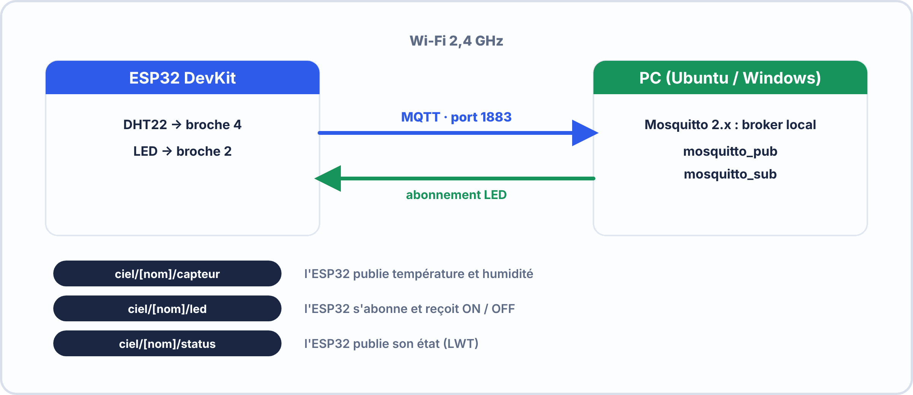

# 🔬 TP – S7 ANNÉE 2 – E2
## MQTT : ESP32 → Broker Mosquitto Local — Publish DHT22, Subscribe LED

---

## 🎯 OBJECTIFS DU TP

- ✅ Installer et vérifier le broker Mosquitto sur le PC de labo
- ✅ Tester le broker avec les outils CLI (mosquitto_pub, mosquitto_sub)
- ✅ Connecter un ESP32 au broker via Wi-Fi
- ✅ Publier des données capteur en JSON sur un topic structuré
- ✅ Contrôler une LED depuis le broker (subscribe à un topic de commande)
- ✅ Diagnostiquer une connexion MQTT qui échoue

---

## ⏱️ DURÉE : 75 min

---

## 📋 ARCHITECTURE DU TP



```
Topics utilisés :
  ciel/[votrenom]/capteur  → ESP32 publie température + humidité
  ciel/[votrenom]/led      → ESP32 s'abonne, reçoit "ON"/"OFF"
  ciel/[votrenom]/status   → ESP32 publie son état (LWT)
```


### 🧰 Avant de commencer : matériel et préparation

| Il te faut | Pourquoi |
|---|---|
| Un **PC** avec Mosquitto installé et lancé | C'est le **broker** : il redistribue les messages |
| Une carte **ESP32** + câble USB | Elle **publie** une mesure et **reçoit** les ordres de la LED |
| **Arduino IDE** avec la bibliothèque **PubSubClient** | Pour programmer l'ESP32 |
| Le **Wi-Fi de la salle** (nom + mot de passe) | **Le PC et l'ESP32 doivent être sur le même réseau** |

> [!NOTE] 🔎 Le schéma de principe
> L'ESP32 **n'envoie jamais** directement au PC : il parle au **broker** (qui tourne sur le PC), et c'est le broker qui retransmet à ceux qui écoutent. Dans ce TP, **ton PC joue deux rôles** : il héberge le broker **et** il sert de **subscriber** (avec `mosquitto_sub`) ou de **publisher** (avec `mosquitto_pub`) pour tester.
>
> **Rappel du cours** (Première S07) : *publisher* = celui qui envoie · *subscriber* = celui qui s'abonne · *topic* = l'adresse · *broker* = l'intermédiaire.

> [!WARNING] ⚠️ Les trois pièges de ce TP
> 1. **Le PC et l'ESP32 ne sont pas sur le même réseau** (ex. PC en câble sur un autre réseau que le Wi-Fi de la salle).
> 2. **Le pare-feu du PC bloque le port 1883** : l'ESP32 n'arrive pas à joindre le broker.
> 3. **Deux binômes utilisent le même `client_id`** : ils se déconnectent mutuellement. Mets **ton prénom** partout.

---

## 🧪 PARTIE 1 — Vérification du Broker Mosquitto (10 min)

### 1.1 — Vérifier que Mosquitto est actif

```bash
# Sur le PC Linux :
sudo systemctl status mosquitto
```

**Q1.** Le service affiche-t-il `active (running)` ? \_\_\_\_\_\_\_\_\_\_\_

Si non, démarrer avec : `sudo systemctl start mosquitto`

### 1.2 — Relever l'IP du PC broker

```bash
ip addr show   # Linux
# ou
ipconfig       # Windows
```

**Notez l'IP du PC :** \_\_\_\_\_\_\_\_\_\_\_\_\_\_\_\_\_\_\_\_\_ (interface Wi-Fi ou réseau local)

### 1.3 — Tester le broker en local avec 2 terminaux

**Terminal A — Subscriber :**

```bash
mosquitto_sub -h localhost -t "test/+/hello" -v
```

**Terminal B — Publisher :**

```bash
mosquitto_pub -h localhost -t "test/ciel/hello" -m "Bonjour le broker !"
```

**Q2.** Le terminal A affiche-t-il le message ? \_\_\_\_\_\_\_\_\_\_\_

**Q3.** Le topic `test/ciel/hello` correspond-il à la souscription `test/+/hello` ? Justifiez.

\_\_\_\_\_\_\_\_\_\_\_\_\_\_\_\_\_\_\_\_\_\_\_\_\_\_\_\_\_\_\_\_\_\_\_\_\_\_\_\_\_\_\_\_\_\_\_\_\_\_\_\_\_\_\_\_\_\_\_\_\_\_\_\_\_\_\_\_\_\_\_\_\_


??? success "Éléments de réponse"
    **Q1** — Oui : `active (running)` apparaît en vert. Sinon `sudo systemctl start mosquitto`, puis relire le statut.
    **Q2** — Oui : le terminal A affiche `test/ciel/hello Bonjour le broker !`. Le **broker** a bien reçu le message du publisher et l'a **redistribué** à l'abonné.
    **Q3** — **Oui** : `test/ciel/hello` a 3 niveaux et `test/+/hello` aussi ; `test` et `hello` sont identiques et `+` **remplace** `ciel`.

> [!TIP] 💡 En cas de problème
> | Symptôme | Que faire |
> |---|---|
> | `mosquitto_sub: command not found` | Installer les clients : `sudo apt-get install mosquitto-clients` |
> | `Connection refused` | Le broker n'est pas lancé : `sudo systemctl start mosquitto` |
> | Rien ne s'affiche en A | Les deux terminaux n'utilisent pas le **même topic** (majuscule, faute de frappe) |

---

## 🧪 PARTIE 2 — Configuration ESP32 (15 min)

### 2.1 — Installer la bibliothèque PubSubClient

```
Arduino IDE → Outils → Gérer les bibliothèques → 
  Rechercher : "PubSubClient"
  Auteur : Nick O'Leary
  → Installer
```

### 2.2 — Configurer le code (compléter les `___`)

> Ouvrez le fichier `TP_MQTT_ESP32.ino` fourni et complétez les sections manquantes :

```cpp
#include <WiFi.h>
#include <PubSubClient.h>

// ─── À COMPLÉTER ──────────────────────────────────────────────────
const char* ssid        = "_______________";     // Nom du Wi-Fi de labo
const char* password    = "_______________";     // Mot de passe Wi-Fi
const char* mqtt_server = "_______________";     // IP du PC broker (Partie 1.2)
const int   mqtt_port   = 1883;
const char* client_id   = "esp32-ciel-___";     // Votre prénom (unique !)

// Topics — remplacer [votrenom] par votre prénom
const char* topic_pub    = "ciel/___/capteur";
const char* topic_sub    = "ciel/___/led";
const char* topic_status = "ciel/___/status";
// ──────────────────────────────────────────────────────────────────

WiFiClient   wifiClient;
PubSubClient mqtt(wifiClient);

void callback(char* topic, byte* payload, unsigned int length) {
  String msg = "";
  for (unsigned int i = 0; i < length; i++) msg += (char)payload[i];
  Serial.println("Reçu [" + String(topic) + "] : " + msg);

  if (String(topic) == topic_sub) {
    if (msg == "ON")  digitalWrite(2, HIGH);
    if (msg == "OFF") digitalWrite(2, LOW);
  }
}

void connectWiFi() {
  WiFi.begin(ssid, password);
  while (WiFi.status() != WL_CONNECTED) { delay(500); Serial.print("."); }
  Serial.println("\nWiFi OK → " + WiFi.localIP().toString());
}

void connectMQTT() {
  while (!mqtt.connected()) {
    // LWT : publier "offline" si déconnexion brutale
    if (mqtt.connect(client_id, topic_status, 1, true, "offline")) {
      Serial.println("MQTT connecté !");
      mqtt.publish(topic_status, "online", true);  // retained = true
      mqtt.subscribe(topic_sub, 1);                 // QoS 1
    } else {
      Serial.print("Erreur MQTT : ");
      Serial.println(mqtt.state());
      delay(3000);
    }
  }
}

void setup() {
  Serial.begin(115200);
  pinMode(2, OUTPUT);
  connectWiFi();
  mqtt.setServer(mqtt_server, mqtt_port);
  mqtt.setCallback(callback);
  connectMQTT();
}

void loop() {
  if (!mqtt.connected()) connectMQTT();
  mqtt.loop();

  static unsigned long lastPublish = 0;
  if (millis() - lastPublish > 3000) {
    lastPublish = millis();
    // Simuler une température entre 20 et 30°C et humidité 40-80%
    float temp = 20.0 + (random(0, 100) / 10.0);
    float hum  = 40.0 + (random(0, 40));
    String payload = "{\"temp\":" + String(temp, 1) +
                     ",\"hum\":"  + String(hum, 0)  +
                     ",\"id\":\"" + String(client_id) + "\"}";
    bool ok = mqtt.publish(topic_pub, payload.c_str());
    Serial.println((ok ? "✓ Publié : " : "✗ Erreur : ") + payload);
  }
}
```


> [!TIP] 💡 Comment compléter le code
> - `ssid` et `password` : le nom et le mot de passe du **Wi-Fi de la salle**.
> - `mqtt_server` : l'**adresse IP du PC** relevée en 1.2, **pas** celle de l'ESP32.
> - `client_id` et les **topics** : remplace `___` par **ton prénom** (sans espace, sans accent, en **minuscules**).
> - **Ne change rien d'autre** à la première lecture : le reste du programme est celui du cours (connexion Wi-Fi, connexion MQTT avec testament, abonnement, publication toutes les 3 s).
>
> **Remarque** : la température et l'humidité sont **simulées** par des nombres aléatoires, pour tester la chaîne MQTT **sans capteur**. Brancher un vrai DHT22 serait une évolution possible.

??? success "Éléments de réponse (exemple pour un élève nommé « lea »)"
    ```cpp
    const char* client_id   = "esp32-ciel-lea";
    const char* topic_pub    = "ciel/lea/capteur";
    const char* topic_sub    = "ciel/lea/led";
    const char* topic_status = "ciel/lea/status";
    ```
    `mqtt_server` = IP du PC (par ex. `192.168.1.50`). La compilation réussit sans erreur ; en cas d'erreur « PubSubClient.h: No such file », la bibliothèque n'est pas installée.

---

## 🧪 PARTIE 3 — Test Publish et Subscribe (25 min)

### 3.1 — Téléverser et vérifier la connexion

```
Arduino IDE → Téléverser → Ouvrir le moniteur série (115200)
```

**Q4.** Notez les 3 premières lignes affichées dans le moniteur série :

```
Ligne 1 : _______________________________________________________
Ligne 2 : _______________________________________________________
Ligne 3 : _______________________________________________________
```

**Q5.** L'ESP32 est-il connecté au Wi-Fi et au broker MQTT ? Comment le voyez-vous ?

\_\_\_\_\_\_\_\_\_\_\_\_\_\_\_\_\_\_\_\_\_\_\_\_\_\_\_\_\_\_\_\_\_\_\_\_\_\_\_\_\_\_\_\_\_\_\_\_\_\_\_\_\_\_\_\_\_\_\_\_\_\_\_\_\_\_\_\_\_\_\_\_\_

### 3.2 — Observer les messages publiés par l'ESP32

**Sur le PC broker, ouvrir un terminal :**

```bash
mosquitto_sub -h localhost -t "ciel/#" -v
```

**Q6.** Copiez un message reçu complet (avec le topic) :

```
_________________________________________________________________________
```

**Q7.** À quelle fréquence les messages arrivent-ils approximativement ?

\_\_\_\_\_\_\_\_\_

**Q8.** La clé `"id"` dans le JSON contient le `client_id` de l'ESP32. À quoi sert cet identifiant si plusieurs ESP32 publient sur le même topic `ciel/+/capteur` ?

\_\_\_\_\_\_\_\_\_\_\_\_\_\_\_\_\_\_\_\_\_\_\_\_\_\_\_\_\_\_\_\_\_\_\_\_\_\_\_\_\_\_\_\_\_\_\_\_\_\_\_\_\_\_\_\_\_\_\_\_\_\_\_\_\_\_\_\_\_\_\_\_\_
\_\_\_\_\_\_\_\_\_\_\_\_\_\_\_\_\_\_\_\_\_\_\_\_\_\_\_\_\_\_\_\_\_\_\_\_\_\_\_\_\_\_\_\_\_\_\_\_\_\_\_\_\_\_\_\_\_\_\_\_\_\_\_\_\_\_\_\_\_\_\_\_\_

### 3.3 — Contrôler la LED depuis le broker

**Depuis un terminal PC :**

```bash
# Allumer la LED
mosquitto_pub -h localhost -t "ciel/[votrenom]/led" -m "ON"

# Éteindre la LED
mosquitto_pub -h localhost -t "ciel/[votrenom]/led" -m "OFF"
```

**Q9.** La LED de l'ESP32 répond-elle aux commandes ? \_\_\_\_\_\_\_\_\_\_\_

**Q10.** Dans le moniteur série, quelle ligne s'affiche quand vous envoyez "ON" ?

\_\_\_\_\_\_\_\_\_\_\_\_\_\_\_\_\_\_\_\_\_\_\_\_\_\_\_\_\_\_\_\_\_\_\_\_\_\_\_\_\_\_\_\_\_\_\_\_\_\_\_\_\_\_\_\_\_\_\_\_\_\_\_\_\_\_\_\_\_\_\_\_\_

### 3.4 — Tester le LWT (Last Will and Testament)

**Sur le PC :**

```bash
mosquitto_sub -h localhost -t "ciel/+/status" -v
```

**Q11.** Quel message s'affiche pour `ciel/[votrenom]/status` quand l'ESP32 démarre ? Pourquoi ce message est-il envoyé même si personne n'était abonné lors du démarrage ?

\_\_\_\_\_\_\_\_\_\_\_\_\_\_\_\_\_\_\_\_\_\_\_\_\_\_\_\_\_\_\_\_\_\_\_\_\_\_\_\_\_\_\_\_\_\_\_\_\_\_\_\_\_\_\_\_\_\_\_\_\_\_\_\_\_\_\_\_\_\_\_\_\_
\_\_\_\_\_\_\_\_\_\_\_\_\_\_\_\_\_\_\_\_\_\_\_\_\_\_\_\_\_\_\_\_\_\_\_\_\_\_\_\_\_\_\_\_\_\_\_\_\_\_\_\_\_\_\_\_\_\_\_\_\_\_\_\_\_\_\_\_\_\_\_\_\_

**Déconnectez l'alimentation de l'ESP32 brutalement (sans reset propre)**

**Q12.** Quel message Mosquitto publie-t-il automatiquement sur `ciel/[votrenom]/status` ?

\_\_\_\_\_\_\_\_\_

??? success "Éléments de réponse"
    **Q11** — `online`. Le message est publié avec l'option **retained** : le broker le **conserve** et le renvoie à tout abonné qui se connecte plus tard.  
    **Q12** — `offline` (le *Last Will*, publié automatiquement par le broker quand l'ESP32 disparaît sans se déconnecter proprement).


??? success "Éléments de réponse (Q4 à Q10)"
    **Q4** — Par exemple : `WiFi OK → 192.168.1.42` · `MQTT connecté !` · `✓ Publié : {"temp":24.7,"hum":61,"id":"esp32-ciel-lea"}`.
    **Q5** — **Oui** : le moniteur série affiche une **adresse IP** pour le Wi-Fi et le message `MQTT connecté !` pour le broker.
    **Q6** — Par exemple : `ciel/lea/capteur {"temp":24.7,"hum":61,"id":"esp32-ciel-lea"}`.
    **Q7** — Toutes les **3 secondes** environ (le `delay` du programme).
    **Q8** — Il **identifie** l'ESP32 qui a envoyé la mesure quand plusieurs publient sur le même broker : le subscriber sait **d'où vient** chaque message.
    **Q9** — **Oui** : `ON` allume la LED intégrée, `OFF` l'éteint.
    **Q10** — `Reçu [ciel/lea/led] : ON`.

> [!TIP] 💡 Comprendre ce que tu vois
> Dans cette partie, **trois messages différents** passent par le broker : la **mesure** (ESP32 → broker → ton terminal), la **commande** (ton terminal → broker → ESP32) et l'**état** (online/offline). Ton PC voit les uns avec `mosquitto_sub`, l'ESP32 reçoit les autres grâce à son **abonnement** et à sa fonction `callback`.

---

## 🧪 PARTIE 4 — Diagnostic et Troubleshooting (15 min)

### Scénario — L'ESP32 ne se connecte pas au broker

> Le moniteur série affiche en boucle :
> ```
> WiFi OK → 192.168.1.42
> Erreur MQTT : -2
> Erreur MQTT : -2
> Erreur MQTT : -2
> ```

**Q13.** Le code de retour `-2` de PubSubClient correspond à `MQTT_CONNECT_FAILED`. Listez **3 causes possibles** :

1. \_\_\_\_\_\_\_\_\_\_\_\_\_\_\_\_\_\_\_\_\_\_\_\_\_\_\_\_\_\_\_\_\_\_\_\_\_\_\_\_\_\_\_\_\_\_\_\_\_\_\_\_\_\_\_\_\_\_\_\_\_\_\_\_\_\_\_\_\_\_\_
2. \_\_\_\_\_\_\_\_\_\_\_\_\_\_\_\_\_\_\_\_\_\_\_\_\_\_\_\_\_\_\_\_\_\_\_\_\_\_\_\_\_\_\_\_\_\_\_\_\_\_\_\_\_\_\_\_\_\_\_\_\_\_\_\_\_\_\_\_\_\_\_
3. \_\_\_\_\_\_\_\_\_\_\_\_\_\_\_\_\_\_\_\_\_\_\_\_\_\_\_\_\_\_\_\_\_\_\_\_\_\_\_\_\_\_\_\_\_\_\_\_\_\_\_\_\_\_\_\_\_\_\_\_\_\_\_\_\_\_\_\_\_\_\_

**Q14.** Comment vérifier que le broker Mosquitto est bien joignable depuis le réseau Wi-Fi ? (Commande à exécuter sur le PC)

```bash
_______________________________________
```

**Q15.** Un apprenti publie sur le topic `Ciel/salon/temp` (avec C majuscule) et son subscriber écoute `ciel/salon/temp` (tout minuscule). Le subscriber reçoit-il les messages ? Justifiez.

\_\_\_\_\_\_\_\_\_\_\_\_\_\_\_\_\_\_\_\_\_\_\_\_\_\_\_\_\_\_\_\_\_\_\_\_\_\_\_\_\_\_\_\_\_\_\_\_\_\_\_\_\_\_\_\_\_\_\_\_\_\_\_\_\_\_\_\_\_\_\_\_\_

**Q16.** Vous devez superviser la disponibilité de 10 ESP32 dans un entrepôt. Proposez une architecture de topics et expliquez comment le LWT permet de détecter une panne d'équipement automatiquement.

```
Topics proposés :
  entrepot/esp32_[n]/capteur    → _____________________________________
  entrepot/esp32_[n]/status     → _____________________________________

Comportement LWT :
_________________________________________________________________________
_________________________________________________________________________
```

??? success "Éléments de réponse"
    **Q13** — Causes possibles : adresse IP du broker incorrecte ; Mosquitto non démarré ; port 1883 bloqué par le pare-feu ; ESP32 et PC sur des réseaux différents ; identifiant client déjà utilisé.  
    **Q14** — Par exemple depuis un autre appareil : `mosquitto_pub -h <IP_du_PC> -t test -m ok` ; ou sur le PC, vérifier que le port écoute : `netstat -an | findstr 1883` (Windows) / `ss -ltn | grep 1883` (Linux).  
    **Q15** — **Non** : les topics MQTT sont **sensibles à la casse**, `Ciel/salon/temp` et `ciel/salon/temp` sont deux topics différents.  
    **Q16** — `entrepot/esp32_[n]/capteur` : mesures publiées régulièrement ; `entrepot/esp32_[n]/status` : `online` (retained) à la connexion, `offline` en LWT. Une supervision s'abonne à `entrepot/+/status` : quand un ESP32 est coupé brutalement, le broker publie `offline` à sa place et la panne est détectée sans attendre.


> [!TIP] 💡 Méthode : démarche DECA appliquée
> **D**écrire : l'ESP32 est connecté au Wi-Fi mais n'arrive pas au broker (`rc = -2` : connexion **TCP** impossible). **É**liminer : le Wi-Fi marche (une IP s'affiche), le code est celui du cours. **C**ibler : la chaîne **ESP32 → réseau → broker** se coupe en deux avec un `ping` vers le PC puis un test de port. **A**gir : corriger **une seule chose** (IP du broker, démarrage de Mosquitto, pare-feu) et **retester**.

---

## 📊 BARÈME DU TP

| **Section** | **Points** |
|---|---|
| Partie 1 — Broker + Q1 à Q3 | /4 |
| Partie 2 — Code complété + compilation | /4 |
| Partie 3 — Publish/Subscribe + Q4 à Q12 | /9 |
| Partie 4 — Diagnostic + Q13 à Q16 | /5 |
| Qualité du code + commentaires | /3 |
| **TOTAL** | **/25** |

> *Ramené à /20 : score × 0,8*

---

**Document – BAC PRO CIEL – A2 – E2/U21 – Version 1.0 – 2026**
