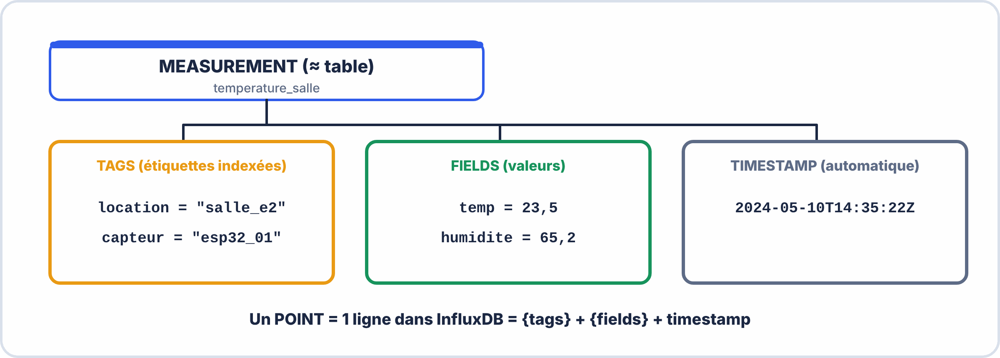
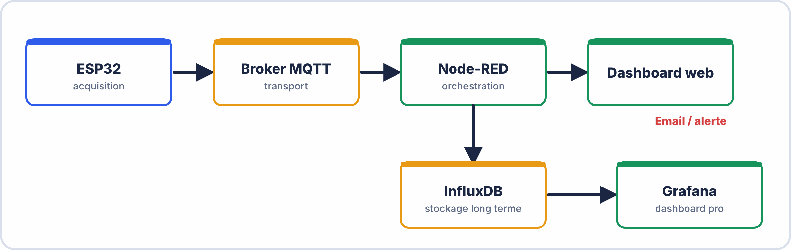

# 📘 FICHE DE COURS — S8 · 2ᵉ ANNÉE · E2
## Node-RED : Flows · Dashboard · Gauges · Graphes Temps Réel · InfluxDB

---

> **Nom** : ___________________________
> **Date** : ___________________________
> **Compétences travaillées** : S5.4 · S5.5 · S5.6 · C5.3 · C3.1

---

## 🔑 Vocabulaire clé

| Terme | Définition |
|---|---|
| **Node-RED** | Outil de programmation visuelle par flux (flows) orienté IoT · développé par IBM |
| **Flow** | Programme visuel composé de nœuds connectés par des fils |
| **Nœud (Node)** | Bloc élémentaire d'un flow — reçoit un message, le traite, le transmet |
| **Wire** | Connexion entre deux nœuds (transporte les messages) |
| **msg** | Objet JavaScript passé de nœud en nœud — `msg.payload` = la donnée principale |
| **msg.payload** | Contenu principal du message (nombre, string, JSON, booléen...) |
| **msg.topic** | Sujet/source du message (souvent le topic MQTT) |
| **Node-RED Dashboard** | Module qui génère une interface web avec gauges, graphes, boutons... |
| **Gauge** | Jauge (compteur de vitesse) — affiche une valeur instantanée |
| **Chart** | Graphe temporel — affiche l'historique d'une valeur dans le temps |
| **Tab / Group** | Organisateurs du dashboard (onglets et groupes de widgets) |
| **InfluxDB** | Base de données de séries temporelles — optimisée pour les mesures IoT |
| **Measurement** | Table de données dans InfluxDB (équivalent d'une table SQL) |
| **Field** | Valeur numérique stockée dans InfluxDB (ex: temperature=23.5) |
| **Tag** | Métadonnée de filtrage dans InfluxDB (ex: location="salle12") |
| **Bucket** | Conteneur de données dans InfluxDB 2.x (équivalent d'une base de données) |
| **Flux (InfluxDB)** | Langage de requête d'InfluxDB 2.x (remplace InfluxQL) |

---

## 1️⃣ — Node-RED : la plateforme d'orchestration IoT

### Pourquoi Node-RED ?

```
SANS NODE-RED (programmation classique) :
  → Écrire un programme Python/JS qui :
    - Se connecte au broker MQTT
    - Parse le JSON
    - Met à jour une base de données
    - Génère une page HTML dynamique
    - Gère les reconnexions
  → Centaines de lignes de code pour chaque nouvelle intégration

AVEC NODE-RED :
  → Glisser-déposer des nœuds, connecter avec des fils
  → La même chose en 10 minutes sans presque aucun code
  → Modifier en temps réel (hot reload)
  → Bibliothèque de 4 000+ nœuds communautaires
```

### Interface Node-RED

```
URL : http://localhost:1880

┌─────────────────────────────────────────────────────────────┐
│  Palette  │         Zone de flow              │  Info/Debug │
│  (nœuds   │                                   │             │
│  disponib)│    [inject]──[function]──[debug]  │  Logs ici   │
│           │                                   │             │
│  inject   │    [mqtt in]──[json]──[gauge]      │             │
│  debug    │                                   │             │
│  function │                                   │             │
│  mqtt in  │                                   │             │
│  mqtt out │                                   │             │
│  http in  ├───────────────────────────────────┤             │
│  ...      │   [Deploy] ← Valider les flows    │             │
└─────────────────────────────────────────────────────────────┘

Dashboard : http://localhost:1880/ui
```

---

## 2️⃣ — Les nœuds essentiels

### Nœuds d'entrée (input nodes)

```
inject      → Envoie un message manuellement ou à intervalles réguliers
mqtt in     → Reçoit les messages d'un topic MQTT
http in     → Reçoit des requêtes HTTP
timestamp   → Injecte l'heure courante (via inject)
```

### Nœuds de traitement

```
function    → Code JavaScript personnalisé pour transformer msg
json        → Convertit string JSON ↔ objet JavaScript
change      → Modifie ou crée des propriétés de msg sans code
switch      → Routage conditionnel selon la valeur de msg
rbe         → Report-By-Exception : ne laisse passer que les changements
delay       → Retarde ou limite le débit des messages
```

### Nœuds de sortie

```
debug       → Affiche msg dans le panneau de débogage
mqtt out    → Publie un message sur un topic MQTT
http request → Envoie une requête HTTP vers une API
influxdb out → Écrit un point dans InfluxDB
```

### Nœuds Dashboard (module séparé)

```
gauge       → Jauge (speedometer) pour valeur instantanée
chart       → Graphe linéaire/barre pour historique
text        → Affiche du texte
button      → Bouton d'action
switch      → Interrupteur marche/arrêt
slider      → Curseur de valeur
```

---


---

## 3️⃣ — Le nœud function : transformer les données

### Syntaxe de base

```javascript
// Tout ce qui est dans un nœud function est du JavaScript
// msg = l'objet message entrant
// return msg = renvoyer le message (modifié ou non)

// Exemple 1 : extraire un champ JSON
var data = msg.payload;          // msg.payload = "{\"temp\":23.5}"
// Si msg.payload est un objet JSON déjà parsé (après nœud json) :
msg.payload = data.temperature;  // Extraire seulement la température
return msg;

// Exemple 2 : convertir des unités
msg.payload = (msg.payload * 9/5) + 32;  // Celsius → Fahrenheit
return msg;

// Exemple 3 : enrichir le message
msg.payload = {
    valeur: msg.payload,
    unite: "°C",
    alerte: msg.payload > 30,   // Booléen : true si > 30°C
    horodatage: new Date().toISOString()
};
return msg;

// Exemple 4 : filtrer (ne rien renvoyer si condition)
if (msg.payload < 0 || msg.payload > 100) {
    return null;   // null = ne pas envoyer le message suivant
}
return msg;

// Exemple 5 : envoyer vers plusieurs sorties
// (nœud function configuré avec 2 outputs)
if (msg.payload > 30) {
    return [msg, null];    // Vers output 1 seulement (alerte)
} else {
    return [null, msg];    // Vers output 2 seulement (normal)
}
```

---

## 4️⃣ — Node-RED Dashboard

### Configurer le dashboard

```
Avant d'utiliser les nœuds dashboard, configurer :
  1. Un TAB (onglet de la page web) → ex: "Salle E2"
  2. Des GROUPS (sections dans l'onglet) → ex: "Capteurs", "Historique"
  
  Dans chaque nœud dashboard (gauge, chart...) → assigner à un groupe

URL du dashboard : http://localhost:1880/ui
```

### Nœud Gauge (Jauge)

```
Propriétés importantes :
  Group  : groupe du dashboard où afficher
  Label  : titre de la jauge ("Température")
  Units  : unité affichée ("°C")
  Range  : min/max de l'aiguille (ex: 0 à 50)
  Sectors : zones de couleur (vert/orange/rouge par plage)
  
Format de msg.payload attendu :
  msg.payload = 23.5          ← Nombre simple
  (si c'est une string "23.5" → le gauge l'accepte)
```

### Nœud Chart (Graphe temporel)

```
Propriétés importantes :
  Type  : Line chart / Bar chart / Pie chart
  X-axis : Points à conserver (ex: "Last 60 points")
  Label : Légende de la série
  
Format de msg.payload :
  msg.payload = 23.5          ← Valeur ajoutée avec timestamp automatique
  
Pour plusieurs séries sur le même graphe :
  msg.topic = "Capteur 1"     ← Chaque topic = une série distincte
  msg.payload = 23.5
```

---


---

## 5️⃣ — InfluxDB : base de données temporelle

### Pourquoi une BDD temporelle ?

```
PROBLÈME avec SQL (MySQL, PostgreSQL) pour l'IoT :
  → Une table avec 1 000 000 de lignes (mesures toutes les secondes = 11 jours)
  → Requête "température moyenne des 5 dernières minutes" → lente et complexe
  → Pas optimisé pour les données horodatées

SOLUTION InfluxDB :
  → Optimisé pour les séries temporelles (time series)
  → Index sur le timestamp automatiquement
  → Compression des données similaires (ex: 1000 valeurs ~= 1°C)
  → Requêtes temporelles naturelles ("last 5m", "mean over 1h")
  → Rétention configurable (ex: effacer les données > 30 jours)
```

### Structure des données InfluxDB



### Langage Flux (InfluxDB 2.x)

```javascript
// Requête Flux — lire les données des 10 dernières minutes
from(bucket: "iot_salle")
  |> range(start: -10m)                           // Période
  |> filter(fn: (r) => r._measurement == "sonde") // Filtrer la table
  |> filter(fn: (r) => r._field == "temperature") // Filtrer le champ
  |> mean()                                        // Calcul optionnel

// Requête pour le graphe historique (dernière heure, une valeur par minute)
from(bucket: "iot_salle")
  |> range(start: -1h)
  |> filter(fn: (r) => r._measurement == "sonde")
  |> aggregateWindow(every: 1m, fn: mean, createEmpty: false)
```

---

## 6️⃣ — Intégration Node-RED + InfluxDB

### Écriture dans InfluxDB (nœud influxdb out)

```javascript
// Configuration du nœud influxdb out :
//   Server : http://localhost:8086
//   Token  : [token API InfluxDB]
//   Org    : CIEL
//   Bucket : iot_salle

// Le nœud influxdb out attend msg.payload au format :
// Option 1 — format simplifié (pour 1 measurement) :
msg.payload = [
    {
        measurement: "sonde",
        tags: {
            location: "salle_e2",
            capteur: "esp32_01"
        },
        fields: {
            temperature: 23.5,
            humidite: 65.2
        }
        // timestamp est ajouté automatiquement
    }
];
return msg;

// Option 2 — format compact (1 seule valeur) :
// Configurer measurement dans le nœud, envoyer juste la valeur :
msg.payload = 23.5;
return msg;
```

### Lecture depuis InfluxDB (nœud influxdb in)

```javascript
// Configuration nœud influxdb in :
//   Même server/token/org que influxdb out
//   Query : écrire la requête Flux

// La requête peut utiliser des variables Mustache {{topic}} :
msg.query = `
from(bucket: "iot_salle")
  |> range(start: -1h)
  |> filter(fn: (r) => r._measurement == "sonde")
  |> filter(fn: (r) => r._field == "temperature")
`;
return msg;

// La sortie est un tableau de points :
// msg.payload = [
//   { _time: "2024-05-10T14:00:00Z", _value: 22.1 },
//   { _time: "2024-05-10T14:01:00Z", _value: 22.3 },
//   ...
// ]
```

---


---

## 7️⃣ — Architecture complète IoT



**Chaque brique :**

- **ESP32** : acquisition et communication (S6)
- **Broker MQTT** : transport de messages (S6)
- **Node-RED** : orchestration et dashboard simple (S8, *ici*)
- **InfluxDB** : stockage à long terme (S8, *ici*)
- **Grafana** : dashboard professionnel (bonus S8 / S10)

---

## 📌 Les essentiels à retenir

> ✅ **Node-RED** = programmation visuelle par flows · `msg.payload` = la donnée
> ✅ **Deploy** obligatoire pour valider les modifications du flow
> ✅ **Dashboard** : Tab → Group → Widget (gauge, chart, text...)
> ✅ **Gauge** = valeur instantanée · **Chart** = historique · `msg.topic` = nom de série
> ✅ **Function** : JavaScript · `return msg` ou `return null` pour bloquer
> ✅ **InfluxDB** = séries temporelles · measurement + tags + fields + timestamp
> ✅ **Bucket** = base de données InfluxDB 2.x
> ✅ **Flux** = langage de requête InfluxDB (`from → range → filter → mean`)
> ✅ `msg.payload` pour influxdb-out : tableau d'objets `{measurement, tags, fields}`
> ✅ Dashboard URL : **http://localhost:1880/ui**

---

*Fiche de Cours Node-RED + InfluxDB — BAC PRO CIEL | E2 Systèmes Électroniques | 2ᵉ année S8*
*Compétences : S5.4 · S5.5 · S5.6 · C5.3 · C3.1*
