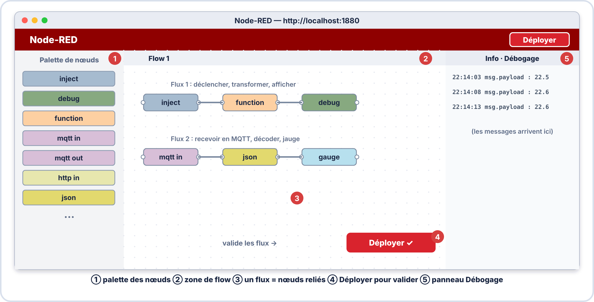
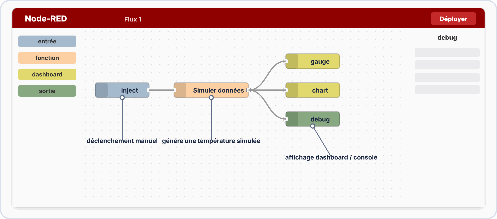
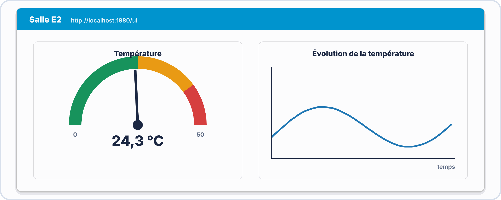
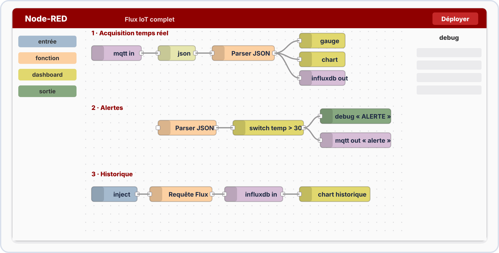

# 📘 FICHE DE COURS — S8 · 2ᵉ ANNÉE · E2
## Node-RED : Flows · Dashboard · Gauges · Graphes Temps Réel · InfluxDB

---

> **Nom** : \_\_\_\_\_\_\_\_\_\_\_\_\_\_\_\_\_\_\_\_\_\_\_\_\_\_\_
> **Date** : \_\_\_\_\_\_\_\_\_\_\_\_\_\_\_\_\_\_\_\_\_\_\_\_\_\_\_
> **Compétences travaillées** : S5.4 · S5.5 · S5.6 · C5.3 · C3.1

---

## 🔑 Vocabulaire clé

| Terme | Définition |
|---|---|
| **Node-RED** | Outil de programmation visuelle par flux (flows) orienté IoT · développé par IBM |
| **Flow** | Programme visuel composé de nœuds connectés par des fils |
| **Nœud (Node)** | Bloc élémentaire d'un flow — reçoit un message, le traite, le transmet |
| **Wire** | Connexion entre deux nœuds (transporte les messages) |
| **msg** | Objet JavaScript passé de nœud en nœud — `msg.payload` = la donnée principale |
| **msg.payload** | Contenu principal du message (nombre, string, JSON, booléen...) |
| **msg.topic** | Sujet/source du message (souvent le topic MQTT) |
| **Node-RED Dashboard** | Module qui génère une interface web avec gauges, graphes, boutons... |
| **Gauge** | Jauge (compteur de vitesse) — affiche une valeur instantanée |
| **Chart** | Graphe temporel — affiche l'historique d'une valeur dans le temps |
| **Tab / Group** | Organisateurs du dashboard (onglets et groupes de widgets) |
| **InfluxDB** | Base de données de séries temporelles — optimisée pour les mesures IoT |
| **Measurement** | Table de données dans InfluxDB (équivalent d'une table SQL) |
| **Field** | Valeur numérique stockée dans InfluxDB (ex: temperature=23.5) |
| **Tag** | Métadonnée de filtrage dans InfluxDB (ex: location="salle12") |
| **Bucket** | Conteneur de données dans InfluxDB 2.x (équivalent d'une base de données) |
| **Flux (InfluxDB)** | Langage de requête d'InfluxDB 2.x (remplace InfluxQL) |

---

## 1️⃣ — Node-RED : la plateforme d'orchestration IoT

### 🧱 Ce qu'il faut savoir avant de commencer

| Notion | En simple |
|---|---|
| **JSON** | Une façon d'écrire des données sous forme de **couples nom : valeur** entre accolades : `{"temp": 23.5, "hum": 65}`. L'ESP32 l'envoie sous forme de **texte**. |
| **Objet JavaScript** | La même donnée, mais **manipulable dans un programme** : on lit `data.temp` pour obtenir `23.5`. Passer du texte à l'objet s'appelle **parser**. |
| **`localhost`** | « Cet ordinateur-ci ». `http://localhost:1880` = le Node-RED qui tourne sur **mon** PC. Depuis un autre PC, on remplace `localhost` par l'**adresse IP** du PC qui l'héberge. |
| **Port** | Le numéro qui distingue les logiciels réseau d'une même machine : 1880 (Node-RED), 1883 (broker MQTT), 8086 (InfluxDB). |

> [!TIP] 💡 En clair : une chaîne de montage de données
> Un **flow** Node-RED ressemble à une **chaîne de montage** : chaque **nœud** est un poste de travail (recevoir, transformer, afficher) et chaque **fil** est le tapis roulant. Ce qui circule sur le tapis, c'est un **message** (`msg`), une petite boîte qui contient la donnée dans `msg.payload`.
>
> Exemple : `[mqtt in] → [json] → [function] → [gauge]` : le texte reçu du broker est converti en objet, on en extrait la température, puis la jauge l'affiche.

> [!WARNING] ⚠️ Deploy
> Après **chaque modification**, il faut cliquer sur **Deploy** (bouton rouge en haut à droite). Sans cela, **le flow en marche est l'ancien**.


### Pourquoi Node-RED ?

```
SANS NODE-RED (programmation classique) :
  → Écrire un programme Python/JS qui :
    - Se connecte au broker MQTT
    - Parse le JSON
    - Met à jour une base de données
    - Génère une page HTML dynamique
    - Gère les reconnexions
  → Centaines de lignes de code pour chaque nouvelle intégration

AVEC NODE-RED :
  → Glisser-déposer des nœuds, connecter avec des fils
  → La même chose en 10 minutes sans presque aucun code
  → Modifier en temps réel (hot reload)
  → Bibliothèque de 4 000+ nœuds communautaires
```

### Interface Node-RED



Éditeur : `http://localhost:1880` · Tableau de bord : `http://localhost:1880/ui`


#### Suivre un message pas à pas

On branche `[inject] → [function] → [debug]`. Le nœud *function* contient `msg.payload = msg.payload * 2; return msg;`.

1. On clique sur le bouton de l'*inject* configuré avec le nombre `10` : il crée `msg = { payload: 10 }`.
2. Le message suit le fil jusqu'au *function*, qui calcule `20` et **renvoie** le message.
3. Le *debug* affiche `msg.payload : 20` dans le panneau de droite.

### ✅ Vérifie que tu as compris

**Q1.** Que se passe-t-il si tu modifies un flow sans cliquer sur Deploy ?

??? success "Réponse"
    Rien : le flow en marche reste **l'ancienne version**.

**Q2.** Dans un message, où se trouve la donnée principale ?

??? success "Réponse"
    Dans **`msg.payload`**.

**Q3.** Quel nœud utilise-t-on pour **voir** ce qui circule dans un flow ?

??? success "Réponse"
    Le nœud **debug** (affichage dans le panneau de droite).

---

## 2️⃣ — Les nœuds essentiels

### Nœuds d'entrée (input nodes)

```
inject      → Envoie un message manuellement ou à intervalles réguliers
mqtt in     → Reçoit les messages d'un topic MQTT
http in     → Reçoit des requêtes HTTP
timestamp   → Injecte l'heure courante (via inject)
```

### Nœuds de traitement

```
function    → Code JavaScript personnalisé pour transformer msg
json        → Convertit string JSON ↔ objet JavaScript
change      → Modifie ou crée des propriétés de msg sans code
switch      → Routage conditionnel selon la valeur de msg
rbe         → Report-By-Exception : ne laisse passer que les changements
delay       → Retarde ou limite le débit des messages
```

### Nœuds de sortie

```
debug       → Affiche msg dans le panneau de débogage
mqtt out    → Publie un message sur un topic MQTT
http request → Envoie une requête HTTP vers une API
influxdb out → Écrit un point dans InfluxDB
```

### Nœuds Dashboard (module séparé)

```
gauge       → Jauge (speedometer) pour valeur instantanée
chart       → Graphe linéaire/barre pour historique
text        → Affiche du texte
button      → Bouton d'action
switch      → Interrupteur marche/arrêt
slider      → Curseur de valeur
```


> [!TIP] 💡 En clair : le montage type d'un flow IoT
> `[mqtt in]` **reçoit** le texte publié par l'ESP32 → `[json]` le **convertit** en objet → `[function]` ou `[change]` en **extrait** la valeur utile → `[gauge]`/`[chart]` l'**affichent**, `[influxdb out]` la **stocke**.
>
> **Le nœud `json` est indispensable** : sans lui, `msg.payload` est un **texte** (`"{\"temp\":23.5}"`) et on ne peut pas écrire `msg.payload.temp`.

> [!NOTE] 🔎 Quel nœud pour quel besoin ?
> **Voir ce qui arrive** → debug · **Recevoir de MQTT** → mqtt in · **Changer une valeur sans coder** → change · **Calculer ou tester une condition** → function · **Séparer selon la valeur** → switch · **Éviter de répéter la même valeur** → rbe

### ✅ Vérifie que tu as compris

**Q1.** Le gauge affiche NaN alors que le broker reçoit bien `{"temp":23.5}`. Quelle est la cause la plus probable ?

??? success "Réponse"
    Le message n'a pas été **converti** en objet (nœud `json` manquant) ou on n'a pas **extrait** `msg.payload.temp` : la jauge reçoit du texte.

**Q2.** Quel nœud te permet de n'envoyer une valeur au graphe que si elle a **changé** ?

??? success "Réponse"
    Le nœud **rbe** (Report By Exception).

---



---

## 3️⃣ — Le nœud function : transformer les données

### Syntaxe de base

```javascript
// Tout ce qui est dans un nœud function est du JavaScript
// msg = l'objet message entrant
// return msg = renvoyer le message (modifié ou non)

// Exemple 1 : extraire un champ JSON
var data = msg.payload;          // msg.payload = "{\"temperature\":23.5}"
// Si msg.payload est un objet JSON déjà parsé (après nœud json) :
msg.payload = data.temperature;  // Extraire seulement la température
return msg;

// Exemple 2 : convertir des unités
msg.payload = (msg.payload * 9/5) + 32;  // Celsius → Fahrenheit
return msg;

// Exemple 3 : enrichir le message
msg.payload = {
    valeur: msg.payload,
    unite: "°C",
    alerte: msg.payload > 30,   // Booléen : true si > 30°C
    horodatage: new Date().toISOString()
};
return msg;

// Exemple 4 : filtrer (ne rien renvoyer si condition)
if (msg.payload < 0 || msg.payload > 100) {
    return null;   // null = ne pas envoyer le message suivant
}
return msg;

// Exemple 5 : envoyer vers plusieurs sorties
// (nœud function configuré avec 2 outputs)
if (msg.payload > 30) {
    return [msg, null];    // Vers output 1 seulement (alerte)
} else {
    return [null, msg];    // Vers output 2 seulement (normal)
}
```


> [!TIP] 💡 En clair : lire un nœud function
> - `msg` est la **boîte** qui arrive ; on peut **modifier** son contenu (`msg.payload = ...`).
> - `return msg;` **renvoie la boîte** au nœud suivant ; `return null;` **la jette** (rien n'est transmis).
> - Une fonction avec **deux sorties** renvoie un **tableau** `[sortie1, sortie2]` : `null` signifie « rien sur cette sortie ».

> [!WARNING] ⚠️ Erreurs fréquentes
> - **Oublier `return msg`** : le flow s'arrête sans message d'erreur apparent.
> - **Mauvais nom de champ** : si l'ESP32 envoie `{"temp":23.5}`, il faut écrire `msg.payload.temp`, **pas** `msg.payload.temperature`.
> - Appliquer `msg.payload.temp` alors que `msg.payload` est encore du **texte** (oubli du nœud `json`).
> - Taper un guillemet français ou une faute dans un nom : JavaScript **distingue majuscules et minuscules**.

**Exemple complet commenté** : l'ESP32 publie `{"temp":31.2}` et on veut une alerte si la température dépasse 30 °C.

```javascript
var t = msg.payload.temp;        // 1. lire la valeur dans l'objet (31.2)
msg.payload = t;                 // 2. ne garder que le nombre
if (t > 30) {                    // 3. condition d'alerte
    return [msg, null];          //    alerte -> sortie 1
}
return [null, msg];              // 4. normal -> sortie 2
```

### ✅ Vérifie que tu as compris

**Q1.** Un nœud function ne renvoie plus rien. Quelle ligne a-t-on pu oublier ?

??? success "Réponse"
    `return msg;` (ou on a renvoyé `null`).

**Q2.** L'ESP32 publie `{"humidite": 60}`. Comment lire la valeur dans une function ?

??? success "Réponse"
    `msg.payload.humidite` (le nom doit être **identique**, accents et majuscules compris).

**Q3.** Que veut dire `return [null, msg];` dans une function à deux sorties ?

??? success "Réponse"
    Rien n'est envoyé sur la **sortie 1** ; le message part sur la **sortie 2**.

---

## 4️⃣ — Node-RED Dashboard

### Configurer le dashboard

```
Avant d'utiliser les nœuds dashboard, configurer :
  1. Un TAB (onglet de la page web) → ex: "Salle E2"
  2. Des GROUPS (sections dans l'onglet) → ex: "Capteurs", "Historique"
  
  Dans chaque nœud dashboard (gauge, chart...) → assigner à un groupe

URL du dashboard : http://localhost:1880/ui
```

### Nœud Gauge (Jauge)

```
Propriétés importantes :
  Group  : groupe du dashboard où afficher
  Label  : titre de la jauge ("Température")
  Units  : unité affichée ("°C")
  Range  : min/max de l'aiguille (ex: 0 à 50)
  Sectors : zones de couleur (vert/orange/rouge par plage)
  
Format de msg.payload attendu :
  msg.payload = 23.5          ← Nombre simple
  (si c'est une string "23.5" → le gauge l'accepte)
```

### Nœud Chart (Graphe temporel)

```
Propriétés importantes :
  Type  : Line chart / Bar chart / Pie chart
  X-axis : Points à conserver (ex: "Last 60 points")
  Label : Légende de la série
  
Format de msg.payload :
  msg.payload = 23.5          ← Valeur ajoutée avec timestamp automatique
  
Pour plusieurs séries sur le même graphe :
  msg.topic = "Capteur 1"     ← Chaque topic = une série distincte
  msg.payload = 23.5
```


> [!TIP] 💡 En clair : tab, group, widget
> Le dashboard est une **page web** : un **Tab** est un onglet, un **Group** est un cadre dans l'onglet, un **widget** (gauge, chart, bouton) est un élément dans le cadre. On ne peut pas placer un widget **sans group**.
>
> **Gauge** = *quelle est la valeur maintenant ?* ; **Chart** = *comment a-t-elle évolué ?* ; **Sectors** = zones de couleur pour repérer d'un coup d'œil une valeur anormale.

### ✅ Vérifie que tu as compris

**Q1.** Tu veux voir l'évolution de la température sur la dernière heure. Gauge ou chart ?

??? success "Réponse"
    Un **chart** : la jauge ne montre que la valeur **instantanée**.

**Q2.** Comment afficher deux courbes (salle 1 et salle 2) sur le même graphe ?

??? success "Réponse"
    Donner à chaque message un **`msg.topic` différent** : une série par topic.

---



---

## 5️⃣ — InfluxDB : base de données temporelle

### Pourquoi une BDD temporelle ?

```
PROBLÈME avec SQL (MySQL, PostgreSQL) pour l'IoT :
  → Une table avec 1 000 000 de lignes (mesures toutes les secondes = 11 jours)
  → Requête "température moyenne des 5 dernières minutes" → lente et complexe
  → Pas optimisé pour les données horodatées

SOLUTION InfluxDB :
  → Optimisé pour les séries temporelles (time series)
  → Index sur le timestamp automatiquement
  → Compression des données similaires (ex: 1000 valeurs ~= 1°C)
  → Requêtes temporelles naturelles ("last 5m", "mean over 1h")
  → Rétention configurable (ex: effacer les données > 30 jours)
```

### Structure des données InfluxDB


### Langage Flux (InfluxDB 2.x)

```javascript
// Requête Flux — lire les données des 10 dernières minutes
from(bucket: "iot_salle")
  |> range(start: -10m)                           // Période
  |> filter(fn: (r) => r._measurement == "sonde") // Filtrer la table
  |> filter(fn: (r) => r._field == "temperature") // Filtrer le champ
  |> mean()                                        // Calcul optionnel

// Requête pour le graphe historique (dernière heure, une valeur par minute)
from(bucket: "iot_salle")
  |> range(start: -1h)
  |> filter(fn: (r) => r._measurement == "sonde")
  |> aggregateWindow(every: 1m, fn: mean, createEmpty: false)
```


> [!TIP] 💡 En clair : un point InfluxDB, c'est une ligne de tableur horodatée
> | Élément | Rôle | Exemple |
> |---|---|---|
> | **Measurement** | le « nom du tableau » | `sonde` |
> | **Tags** | des **étiquettes** pour **filtrer** (texte, peu de valeurs différentes) | `location=salle_e2` |
> | **Fields** | les **valeurs mesurées** (nombres) | `temperature=23.5` |
> | **Timestamp** | l'**heure** de la mesure (ajoutée automatiquement) | `2026-10-30T14:00:00Z` |
>
> **Règle simple** : ce qu'on veut **filtrer** (où ? quel capteur ?) → **tag** ; ce qu'on veut **calculer ou tracer** (température, humidité) → **field**.
>
> **Comment lire une requête Flux** : on **enchaîne des étapes** avec `|>`, comme sur la chaîne de montage : prendre le bucket → garder les 10 dernières minutes → ne garder que la mesure `sonde` → ne garder que le champ `temperature` → calculer la moyenne.

### ✅ Vérifie que tu as compris

**Q1.** Dans `temperature=23.5,location=salle_e2`, qui est le tag et qui est le field ?

??? success "Réponse"
    `location` est le **tag** (étiquette de filtrage) ; `temperature` est le **field** (valeur mesurée).

**Q2.** Que signifie `range(start: -1h)` dans une requête Flux ?

??? success "Réponse"
    Ne garder que les données de la **dernière heure**.

**Q3.** Pourquoi une base temporelle plutôt qu'un fichier texte ?

??? success "Réponse"
    Elle **indexe l'heure**, **calcule vite** moyennes et fenêtres de temps, et sait **effacer** automatiquement les anciennes données.

---

## 6️⃣ — Intégration Node-RED + InfluxDB

### Écriture dans InfluxDB (nœud influxdb out)

```javascript
// Configuration du nœud influxdb out :
//   Server : http://localhost:8086
//   Token  : [token API InfluxDB]
//   Org    : CIEL
//   Bucket : iot_salle

// Le nœud influxdb out attend msg.payload au format :
// Option 1 — format simplifié (pour 1 measurement) :
msg.payload = [
    {
        measurement: "sonde",
        tags: {
            location: "salle_e2",
            capteur: "esp32_01"
        },
        fields: {
            temperature: 23.5,
            humidite: 65.2
        }
        // timestamp est ajouté automatiquement
    }
];
return msg;

// Option 2 — format compact (1 seule valeur) :
// Configurer measurement dans le nœud, envoyer juste la valeur :
msg.payload = 23.5;
return msg;
```

### Lecture depuis InfluxDB (nœud influxdb in)

```javascript
// Configuration nœud influxdb in :
//   Même server/token/org que influxdb out
//   Query : écrire la requête Flux

// La requête peut utiliser des variables Mustache {{topic}} :
msg.query = `
from(bucket: "iot_salle")
  |> range(start: -1h)
  |> filter(fn: (r) => r._measurement == "sonde")
  |> filter(fn: (r) => r._field == "temperature")
`;
return msg;

// La sortie est un tableau de points :
// msg.payload = [
//   { _time: "2024-05-10T14:00:00Z", _value: 22.1 },
//   { _time: "2024-05-10T14:01:00Z", _value: 22.3 },
//   ...
// ]
```


> [!NOTE] 🔎 Pour écrire dans InfluxDB, il faut trois informations de connexion
> L'**adresse** du serveur (`http://localhost:8086`), l'**organisation** et le **token** : une sorte de **mot de passe d'application** généré dans InfluxDB. Sans token valide, l'écriture est **refusée** (erreur 401).

### ✅ Vérifie que tu as compris

**Q1.** Où se configure le bucket dans lequel on écrit ?

??? success "Réponse"
    Dans le nœud **influxdb out** (serveur, organisation, bucket).

**Q2.** L'écriture est refusée avec une erreur 401. Que vérifier en premier ?

??? success "Réponse"
    Le **token** (valide, avec droit d'écriture sur ce bucket).

---



---

## 7️⃣ — Architecture complète IoT


**Chaque brique :**

- **ESP32** : acquisition et communication (S6)
- **Broker MQTT** : transport de messages (S6)
- **Node-RED** : orchestration et dashboard simple (S8, *ici*)
- **InfluxDB** : stockage à long terme (S8, *ici*)
- **Grafana** : dashboard professionnel (bonus S8 / S10)


#### 🔧 Diagnostic : « rien ne s'affiche sur le dashboard »

On suit la donnée **de la source vers l'affichage** et on s'arrête au premier maillon défaillant.

| # | Je vérifie | Comment | Si ça ne va pas |
|---|---|---|---|
| 1 | L'ESP32 publie | moniteur série : « Publié » | corriger Wi-Fi/MQTT |
| 2 | Le broker reçoit | `mosquitto_sub -h <IP> -t "#" -v` | topic ou adresse du broker faux |
| 3 | Node-RED reçoit | nœud `debug` branché sur `mqtt in` | topic abonné différent |
| 4 | La donnée est convertie | `debug` après `json` : objet et non texte | ajouter le nœud `json` |
| 5 | La valeur est extraite | `debug` après `function` : un **nombre** | nom du champ faux |
| 6 | Le widget affiche | gauge/chart dans un **group** | group manquant, pas de Deploy |
| 7 | InfluxDB enregistre | Data Explorer d'InfluxDB | token, bucket ou organisation faux |

> [!TIP] 💡 La méthode
> **Une vérification à la fois**, de gauche à droite, avec un **debug** à chaque étape : on **coupe le problème en deux** au lieu de modifier plusieurs choses à la fois.

---

## 📌 Les essentiels à retenir

> ✅ **Node-RED** = programmation visuelle par flows · `msg.payload` = la donnée
> ✅ **Deploy** obligatoire pour valider les modifications du flow
> ✅ **Dashboard** : Tab → Group → Widget (gauge, chart, text...)
> ✅ **Gauge** = valeur instantanée · **Chart** = historique · `msg.topic` = nom de série
> ✅ **Function** : JavaScript · `return msg` ou `return null` pour bloquer
> ✅ **InfluxDB** = séries temporelles · measurement + tags + fields + timestamp
> ✅ **Bucket** = base de données InfluxDB 2.x
> ✅ **Flux** = langage de requête InfluxDB (`from → range → filter → mean`)
> ✅ `msg.payload` pour influxdb-out : tableau d'objets `{measurement, tags, fields}`
> ✅ Dashboard URL : **http://localhost:1880/ui**

---

*Fiche de Cours Node-RED + InfluxDB — BAC PRO CIEL | E2 Systèmes Électroniques | 2ᵉ année S8*
*Compétences : S5.4 · S5.5 · S5.6 · C5.3 · C3.1*
