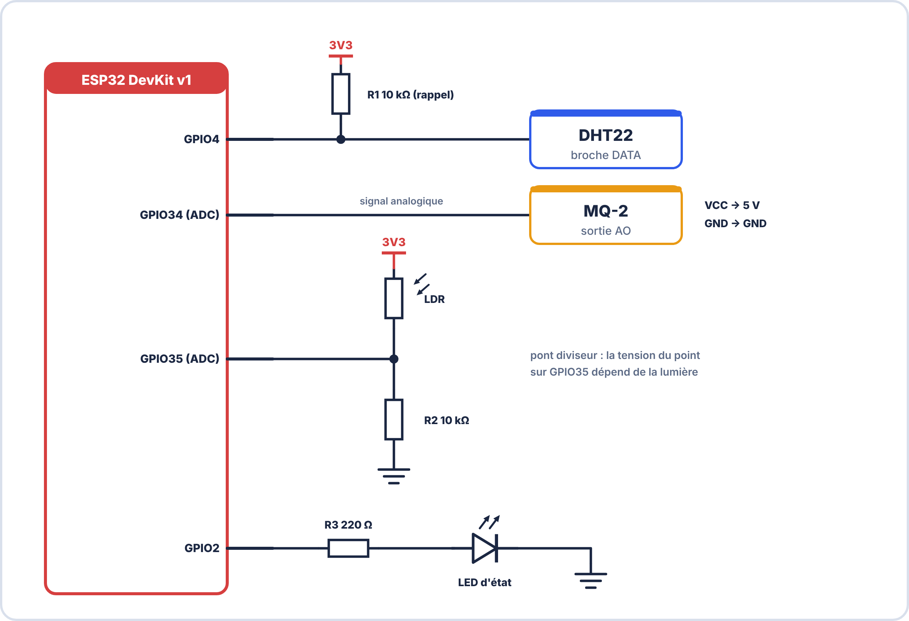
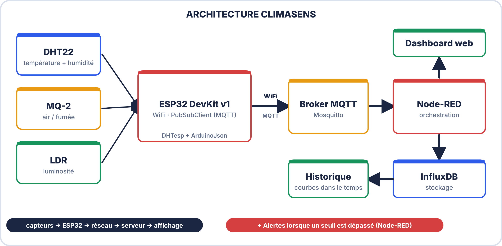

# 📄 DOSSIER TECHNIQUE — PROJET CLIMASENS
## Schéma · BOM · PV Mesure · S10 · 2ᵉ ANNÉE · E2

---

> **Nom / Groupe** : \_\_\_\_\_\_\_\_\_\_\_\_\_\_\_\_\_\_\_\_\_\_\_\_\_\_\_
> **Date** : \_\_\_\_\_\_\_\_\_\_\_\_\_\_\_\_\_\_\_\_\_\_\_\_\_\_\_
> **Version** : 1.0

---

## SECTION 1 — SCHÉMA ÉLECTRONIQUE (KiCad)

### 1.1 Instructions pour le schéma KiCad

```
Créer le schéma sous KiCad (Schematic Editor) avec :
  - Symbole ESP32 (ou représentation générique avec les GPIO annotés)
  - DHT22 avec résistance pull-up 10kΩ
  - MQ-2 avec circuit d'alimentation 5V
  - LDR avec pont diviseur 10kΩ
  - LED de statut avec résistance 220Ω
  - Connecteurs d'alimentation (VCC, GND)
  - Tous les nets nommés (GPIO4, GPIO34, GPIO35, GPIO2, VCC3V3, VCC5V, GND)

Exporter en PDF : File → Print → Save as PDF
```

### 1.2 Espace schéma



> [!NOTE] À joindre
> Insérer ici le **schéma KiCad exporté** (ERC = 0) en respectant les symboles normalisés. La figure ci-dessus donne les connexions attendues.

### 1.3 Vérification ERC

```
ERC exécuté : ☐ Oui ☐ Non
Erreurs ERC : _______ (objectif : 0 erreur)
Avertissements : _______
```

---

## SECTION 2 — NOMENCLATURE (BOM)

### 2.1 Extraction depuis KiCad

```
KiCad Schematic Editor : Tools → Generate BOM
Format : CSV
```

### 2.2 Tableau BOM

| Réf | Désignation | Valeur / Modèle | Boîtier | Qté | Fournisseur | Prix unit. (€) | Total (€) |
|---|---|---|---|---|---|---|---|
| R1 | Résistance | 10 kΩ ± 5% | THT Axiale | 1 | | 0,05 | |
| R2 | Résistance | 10 kΩ ± 5% | THT Axiale | 1 | | 0,05 | |
| R3 | Résistance | 220 Ω ± 5% | THT Axiale | 1 | | 0,05 | |
| D1 | LED rouge | 3mm | THT | 1 | | 0,10 | |
| U1 | Capteur T°/Hum | DHT22 (AM2302) | DIP4 | 1 | | 2,50 | |
| U2 | Capteur gaz | MQ-2 | Module | 1 | | 1,80 | |
| U3 | LDR | GL5528 | THT | 1 | | 0,15 | |
| U4 | Microcontrôleur | ESP32 DevKit v1 | Module | 1 | | 5,00 | |
| J1 | Connecteur USB | USB-B micro | SMD | 1 | inclus ESP32 | — | |
| — | Breadboard | 830 points | — | 1 | | 3,00 | |
| — | Fils Dupont | M-M, M-F, F-F | — | 20 | | 1,00 | |
| | | | | | **TOTAL** | | **€** |

**Coût total estimé du prototype** : \_\_\_\_\_\_\_ €

### 2.3 Commentaires BOM

```
Alternatives possibles :
  DHT22 → DHT11 (moins précis, mais moins cher : ~0,80€)
  MQ-2  → MQ-135 (qualité air générale, incluant CO₂)
  ESP32 DevKit → WEMOS D1 Mini (plus compact, si 1 ADC suffit)

Note sur l'alimentation :
  Le MQ-2 nécessite 5V pour son chauffage interne.
  L'ESP32 seul accepte 3,3V sur ses GPIO.
  → Utiliser la broche 5V (USB) de l'ESP32 pour alimenter le MQ-2.
```

---

## SECTION 3 — ARCHITECTURE DU SYSTÈME

### 3.1 Schéma blocs



### 3.2 Topics MQTT utilisés

| Topic | Direction | Contenu | QoS |
|---|---|---|---|
| `climasens/grpXX/data` | ESP32 → Broker | JSON {temp, hum, air, lum} | 0 |
| `climasens/grpXX/status` | ESP32 → Broker | "online" / "offline" (LWT) | 1 |
| `climasens/grpXX/alerte` | ESP32 → Broker | Message texte alerte | 1 |

---

## SECTION 4 — PROCÈS-VERBAL DE MESURE

### 4.1 Conditions de mesure

```
Date et heure de la mesure  : ___________________________
Lieu                        : ___________________________
Température ambiante de référence (autre thermomètre) : _______ °C
Humidité de référence (hygromètre) : _______ %
Opérateur                   : ___________________________
Logiciel d'acquisition      : Node-RED + InfluxDB
Fréquence d'acquisition     : 1 mesure toutes les _____ secondes
```

### 4.2 Tableau de mesures — Température et Humidité

| N° | Heure | T° ESP32 (°C) | T° Référence (°C) | Écart T° | Hum. ESP32 (%) | Hum. Réf. (%) | Écart Hum. | Alerte ? |
|---|---|---|---|---|---|---|---|---|
| 1 | | | | | | | | |
| 2 | | | | | | | | |
| 3 | | | | | | | | |
| 4 | | | | | | | | |
| 5 | | | | | | | | |
| 6 | | | | | | | | |
| 7 | | | | | | | | |
| 8 | | | | | | | | |
| 9 | | | | | | | | |
| 10 | | | | | | | | |
| | **Moyenne** | | | | | | | |
| | **Max** | | | | | | | |
| | **Min** | | | | | | | |

### 4.3 Tableau de mesures — Qualité de l'air et luminosité

| N° | Heure | MQ-2 (%) | Condition air | LDR (%) | Condition lumière |
|---|---|---|---|---|---|
| 1 | | | ☐ Normal ☐ Alerte | | |
| 2 | | | ☐ Normal ☐ Alerte | | |
| 3 | | | | | |
| 4 | | | | | |
| 5 | | | | | |
| Test alerte | | > 60 | ☐ Alerte déclenchée | — | |

### 4.4 Analyse des résultats

**Précision température :**

```
Erreur maximale observée : _______ °C
Erreur moyenne           : _______ °C
Spécification DHT22      : ± 0,5°C (datasheet)
La spécification est-elle respectée ? ☐ Oui ☐ Non
Explication si non respecté : _________________________________________________
```

**Précision humidité :**

```
Erreur maximale observée : _______ %HR
Spécification DHT22      : ± 2-5%HR (datasheet)
La spécification est-elle respectée ? ☐ Oui ☐ Non
```

**Qualité de l'air (MQ-2) :**

```
Valeur au repos (air normal) : _______ %
Valeur lors du test (briquet/fumée) : _______ %
Alerte bien déclenchée à ≥ 60% ? ☐ Oui ☐ Non
Temps de chauffe initial observé : _______ secondes
```

**Latence MQTT :**

```
Délai estimé entre mesure ESP32 et affichage dashboard : _______ secondes
Ce délai est acceptable pour l'application ? ☐ Oui ☐ Non
```

### 4.5 Conclusions

```
Points positifs du système CLIMASENS :
1. ____________________________________________________________________________
2. ____________________________________________________________________________
3. ____________________________________________________________________________

Points à améliorer :
1. ____________________________________________________________________________
2. ____________________________________________________________________________

Améliorations possibles pour une version v2 :
____________________________________________________________________________
____________________________________________________________________________
```

---

## SECTION 5 — CAPTURES DASHBOARD

### 5.1 Onglet "Temps Réel"

```
[INSÉRER CAPTURE SCREENSHOT du dashboard Node-RED — onglet Temps Réel]

Les éléments suivants doivent être visibles :
  ☐ Jauge température avec valeur actuelle
  ☐ Jauge humidité avec valeur actuelle
  ☐ Indicateur qualité air
  ☐ Statut de connexion (online/offline)
```

### 5.2 Onglet "Historique"

```
[INSÉRER CAPTURE SCREENSHOT du dashboard — onglet Historique]

Les éléments suivants doivent être visibles :
  ☐ Graphe température (courbe sur au moins 5 minutes)
  ☐ Graphe humidité
  ☐ Axe temporel lisible
```

### 5.3 Test d'alerte

```
[INSÉRER CAPTURE SCREENSHOT du dashboard lors d'une alerte]

L'alerte doit montrer :
  ☐ Notification visuelle rouge/orange
  ☐ Message d'alerte avec valeur et horodatage
```

---

## SECTION 6 — DÉCLARATION DE CONFORMITÉ

```
Je soussigné(e) _____________________________ certifie que :
  ☐ Le schéma KiCad a été réalisé par mes soins
  ☐ La BOM correspond aux composants réellement utilisés
  ☐ Les mesures du PV ont été effectuées réellement (ou simulées, préciser)
  ☐ Le code Arduino est fonctionnel et commenté
  ☐ Le dashboard Node-RED est opérationnel

Date : ___________________________
Signature : ___________________________
```

---

*Dossier Technique CLIMASENS — BAC PRO CIEL | E2 Systèmes Électroniques | 2ᵉ année S10*
*Portfolio E2 — Compétences C4.1 · C4.3 · S5.1-5.6 · C3.1*
