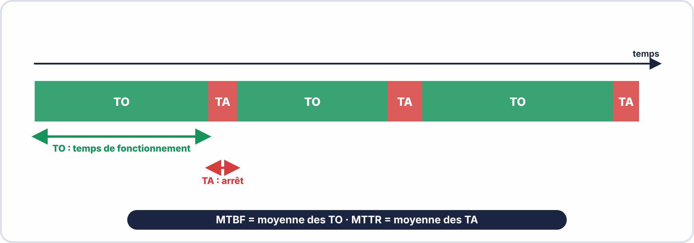
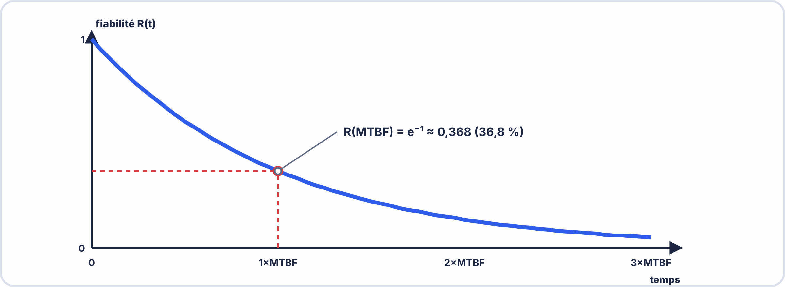
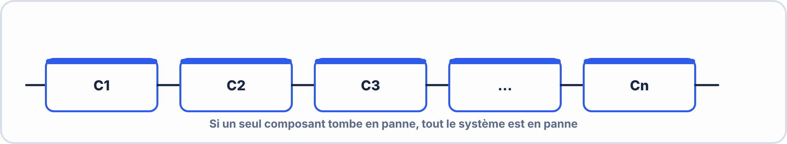
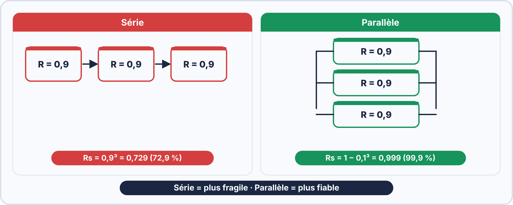

# 📘 FICHE DE COURS — S11 · 2ᵉ ANNÉE · E2
## Fiabilité des Composants : MTBF · MTTR · Loi Exponentielle · Systèmes Série/Parallèle

---

> **Nom** : ___________________________
> **Date** : ___________________________
> **Compétences travaillées** : S6.1 · S6.2 · S6.3 · S6.4 · S6.5 · C6.1

---

## 🔑 Vocabulaire clé

| Terme | Symbole | Définition | Unité |
|---|---|---|---|
| **Fiabilité** | R(t) | Probabilité qu'un composant fonctionne encore à l'instant t | Adimensionnel [0;1] |
| **Taux de panne** | λ (lambda) | Nombre moyen de pannes par unité de temps | pannes/heure |
| **MTBF** | — | Mean Time Between Failures — temps moyen entre deux pannes | heures |
| **MTTF** | — | Mean Time To Failure — temps moyen avant la 1ère panne (non réparable) | heures |
| **MTTR** | — | Mean Time To Repair — temps moyen de réparation | heures |
| **Disponibilité** | D | Fraction du temps où le système est opérationnel | % |
| **Indisponibilité** | Q | Fraction du temps où le système est en panne (Q = 1 − D) | % |
| **Durée de vie** | — | Durée pendant laquelle un composant est garanti fonctionnel | heures |
| **Redondance** | — | Duplication de composants pour améliorer la fiabilité | — |

---

## 1️⃣ — MTBF, MTTR et disponibilité

### MTBF : Mean Time Between Failures

$$\mathrm{MTBF} = \dfrac{T_O}{n}$$

avec $T_{O}$ le temps total de fonctionnement et $n$ le nombre de pannes.

**Exemple :** un disque dur fonctionne 87 600 heures (10 ans) et tombe en panne 3 fois.

$$\mathrm{MTBF} = \dfrac{87\,600}{3} = 29\,200\ \text{heures} \approx 3{,}3\ \text{ans entre deux pannes}$$

**Interprétation :**

- MTBF = 50 000 h → en fonctionnement 24 h/24, panne probable dans 5,7 ans
- MTBF = 500 000 h → panne probable dans 57 ans (quasi immortel !)

> [!WARNING] MTBF ≠ durée de vie garantie
> C'est un indicateur **statistique** : avec une loi exponentielle, environ **63 %** des composants ($1 - e^{-1}$) sont déjà en panne au bout d'un temps égal au MTBF, et seulement **37 %** ($e^{-1}$) le dépassent.

### MTTR : Mean Time To Repair

$$\mathrm{MTTR} = \dfrac{T_A}{n}$$

avec $T_{A}$ le temps total d'arrêt et $n$ le nombre de pannes.

**Le MTTR inclut :**

- le temps de détection de la panne
- le temps d'attente de l'intervention
- le temps de diagnostic
- le temps de réparation proprement dit
- le temps de test et de remise en service

**Pour réduire le MTTR :**

- ✓ avoir des pièces de rechange en stock (gestion de stock)
- ✓ former les techniciens aux procédures
- ✓ utiliser des systèmes de diagnostic automatique (alertes, logs)
- ✓ prévoir des modules facilement remplaçables (hot-swap)

### Disponibilité

$$D = \dfrac{\mathrm{MTBF}}{\mathrm{MTBF} + \mathrm{MTTR}} = \dfrac{T_O}{T_O + T_{A}}$$

**Exemple numérique :** MTBF = 2 500 h et MTTR = 3,6 h.

$$D = \dfrac{2\,500}{2\,500 + 3{,}6} = \dfrac{2\,500}{2\,503{,}6} = 0{,}9986 = 99{,}86\ \%$$

**Classes de disponibilité industrielle :**

| Disponibilité | Arrêt par an | Usage |
|---|---|---|
| 99 % | 3,65 jours | industrie non critique |
| 99,9 % | 8,76 heures | « three nines » |
| 99,99 % | 52,6 minutes | « four nines » |
| 99,999 % | 5,26 minutes | « five nines » (datacenter Tier IV) |

---



---

## 2️⃣ — Taux de panne λ et loi exponentielle

### Le taux de panne λ (lambda)

$\lambda$ (lambda) est le **taux de panne** : le nombre de pannes par unité de temps.

$$\lambda = \dfrac{1}{\mathrm{MTBF}}$$

**Exemples :**

- DHT22 (MTBF = 50 000 h) → $\lambda = \dfrac{1}{50\,000} = 2 \times 10^{-5}$ panne/heure
- Disque dur (MTBF = 300 000 h) → $\lambda = \dfrac{1}{300\,000} = 3{,}3 \times 10^{-6}$ panne/heure
- LED (MTBF = 25 000 h) → $\lambda = \dfrac{1}{25\,000} = 4 \times 10^{-5}$ panne/heure

**Unité alternative :** le FIT (*Failure In Time*), nombre de pannes pour $10^9$ heures.

$$\mathrm{FIT} = \lambda \times 10^{9} \qquad \text{ex. : } \lambda = 2 \times 10^{-5}\ /\mathrm{h} \;\Rightarrow\; 20\,000\ \mathrm{FIT}$$

### La loi exponentielle de fiabilité

```
Pour la période de vie utile (taux de panne constant) :

R(t) = e^(−λt)    ← Probabilité de fonctionner encore à l'instant t

F(t) = 1 − R(t) = 1 − e^(−λt)  ← Probabilité d'être tombé en panne avant t

Où :
  e ≈ 2,718 (base de l'exponentielle naturelle)
  λ = taux de panne (1/MTBF)
  t = durée de fonctionnement
```

### Calcul pratique avec la calculatrice

Pour calculer $e^{-\lambda t}$ :  
Méthode 1 : touche [$e^{x}$] → entrer (−λt)  
Méthode 2 : touche [e] × [x] → EXP puis le nombre  

Exemple :  
MTBF = 50 000 h · λ = 1/50 000 = $2\times 10^{-5}$ $\mathrm{h}^{-1}$  
Quelle est la fiabilité après 1 an (8 760 h) ?  

$$R(8760) = e^{-2 \times 10^{-5} \times 8760}$$

$$= e^{-0{,}1752}$$

$$= 0{,}839$$

$$= 83{,}9\,\mathrm{\%}$$

Probabilité de panne dans l'année : F = 1 − 0,839 = 16,1%  

### Vérification : à t = MTBF, R = ?

```
R(MTBF) = e^(−λ × MTBF) = e^(−1/MTBF × MTBF) = e^(−1) ≈ 0,368

À t = MTBF : il reste 36,8% de chances que le composant fonctionne encore.
Autrement dit : 63,2% des composants sont tombés en panne avant d'atteindre le MTBF.

C'est pourquoi MTBF ≠ durée de vie garantie !
```

---



---

## 3️⃣ — La courbe en baignoire


**Phase 1 — Mortalité infantile** ($\lambda$ décroissant) : pannes dues aux défauts de fabrication. Elles se manifestent lors du rodage ou des tests en usine, d'où le « burn-in » des constructeurs.

**Phase 2 — Vie utile** ($\lambda$ constant) : pannes aléatoires, indépendantes du temps. La loi exponentielle s'applique ici : c'est la phase normale de fonctionnement, où le MTBF est valable.

**Phase 3 — Vieillissement** ($\lambda$ croissant) : usure normale des matériaux. Les condensateurs électrolytiques vieillissent (l'ESR augmente), les LED perdent de la luminosité.

---

## 4️⃣ — Fiabilité des systèmes série

### Schéma série : tous les composants doivent fonctionner



$$R_{s} = R_{1} \times R_{2} \times R_{3} \times \dots \times R_{n}$$

$$\lambda_s = \lambda_1 + \lambda_2 + \lambda_3 + \dots + \lambda_n \quad\Rightarrow\quad \mathrm{MTBF}_s = \dfrac{1}{\lambda_s}$$

### Exemple : carte ESP32 avec 4 composants critiques

Composant       | MTBF (h)    | λ (pannes/h)  
ESP32 module    | 100 000     | $10^{-5}$  
DHT22           | 50 000      | $2\times 10^{-5}$  
Alimentation    | 80 000      | $1{,}25\times 10^{-5}$  
Condensateur    | 60 000      | $1{,}67\times 10^{-5}$  

λsystème = $10^{-5}$ + $2\times 10^{-5}$ + $1{,}25\times 10^{-5}$ + $1{,}67\times 10^{-5}$  

$$= (1 + 2 + 1{,}25 + 1{,}67) \times 10^{-5}$$

= $5{,}92\times 10^{-5}$ pannes/heure  

MTBFsystème = 1 / $5{,}92\times 10^{-5}$ = 16 892 heures ≈ 1,9 ans  

Vérification avec R(t) après 8 760 h (1 an) :  

$$R_{1}(8760) = e^{-10^{-5} \times 8760} = e^{-0{,}0876} = 0{,}916$$

$$R_{2}(8760) = e^{-2 \times 10^{-5} \times 8760} = e^{-0{,}1752} = 0{,}839$$

$$R_{3}(8760) = e^{-1{,}25 \times 10^{-5} \times 8760} = e^{-0{,}1095} = 0{,}896$$

$$R_{4}(8760) = e^{-1{,}67 \times 10^{-5} \times 8760} = e^{-0{,}1463} = 0{,}864$$

$$Rs(8760) = 0{,}916 \times 0{,}839 \times 0{,}896 \times 0{,}864 = 0{,}594$$

= 59,4% de chances de fonctionner encore après 1 an  

Observation : en série, plus on ajoute de composants, PLUS le système est fragile.  

---



---

## 5️⃣ — Fiabilité des systèmes parallèle

### Schéma parallèle : un seul composant suffit


Le système tombe en panne seulement si TOUS les composants tombent en panne  

Fiabilité du système parallèle :  

$$Rs = 1 - (1-R_{1}) \times (1-R_{2}) \times (1-R_{3}) \times ... \times (1-Rn)$$

MTBF approximatif pour 2 composants identiques (R1 = R2 = R) :  
MTBFs ≈ MTBF × (1 + 1/2) = 1,5 × MTBF  (approximation)  

### Exemple : deux alimentations redondantes

Alimentation A : MTBF = 80 000 h · R(8760) = $e^{-8760/80000}$ = $e^{-0,1095}$ = 0,896  
Alimentation B : MTBF = 80 000 h · même fiabilité  

$$Rs(8760) = 1 - (1 - 0{,}896) \times (1 - 0{,}896)$$

$$= 1 - 0{,}104 \times 0{,}104$$

$$= 1 - 0{,}0108$$

$$= 0{,}9892 = 98{,}92\,\mathrm{\%}$$

Comparaison :  
1 alimentation → R = 89,6%  
2 alimentations en parallèle → R = 98,9%  
Gain en fiabilité : +9,3 points !  

---

## 6️⃣ — Systèmes complexes (série + parallèle)

### Méthode de décomposition

```
ÉTAPE 1 : Identifier les blocs en parallèle → Calculer leur fiabilité équivalente
ÉTAPE 2 : Les remplacer par un seul bloc équivalent
ÉTAPE 3 : Calculer la fiabilité du système série résultant
```

### Exemple : système IoT industriel


**Étape 1 : fiabilité des 2 capteurs en parallèle**

$$R_{\text{capteurs}} = 1 - (1 - 0{,}90)(1 - 0{,}90) = 1 - 0{,}10 \times 0{,}10 = 1 - 0{,}01 = 0{,}99$$

**Étape 2 : système réduit (tout en série)** : 0,99 → 0,95 → 0,98 → 0,99

**Étape 3 : fiabilité totale**

$$R_{s} = 0{,}99 \times 0{,}95 \times 0{,}98 \times 0{,}99 \approx 0{,}912 = 91{,}2\ \%$$

---

## 📌 Récapitulatif des formules

$$D = \dfrac{\mathrm{MTBF}}{\mathrm{MTBF} + \mathrm{MTTR}} = \dfrac{T_O}{T_O + T_{A}}$$

**Exemple numérique :** MTBF = 2 500 h et MTTR = 3,6 h.

$$D = \dfrac{2\,500}{2\,500 + 3{,}6} = \dfrac{2\,500}{2\,503{,}6} = 0{,}9986 = 99{,}86\ \%$$

**Classes de disponibilité industrielle :**

| Disponibilité | Arrêt par an | Usage |
|---|---|---|
| 99 % | 3,65 jours | industrie non critique |
| 99,9 % | 8,76 heures | « three nines » |
| 99,99 % | 52,6 minutes | « four nines » |
| 99,999 % | 5,26 minutes | « five nines » (datacenter Tier IV) |

---

## 📌 Les essentiels à retenir pour l'examen

> ✅ **MTBF** = TO / n → temps MOYEN entre pannes (pas durée de vie garantie !)
> ✅ **MTTR** = TA / n → plus court = meilleure maintenabilité
> ✅ **D = MTBF / (MTBF + MTTR)** → proche de 1 = très disponible
> ✅ **λ = 1/MTBF** → plus λ est petit, plus le composant est fiable
> ✅ **R(t) = $e^{-\lambda t}$** → à t=MTBF : R = $e^{-1}$ ≈ **36,8%**
> ✅ **Série** : Rs = R1 × R2 → PLUS fragile (Rs < Rmin)
> ✅ **Parallèle** : Rs = 1−(1−R1)(1−R2) → PLUS fiable (Rs > Rmax)
> ✅ La **courbe en baignoire** montre les 3 phases : mortalité infantile, vie utile, usure
> ✅ FIT = λ × $10^{9}$ (unité industrielle du taux de panne)

---

*Fiche de Cours Fiabilité — BAC PRO CIEL | E2 Systèmes Électroniques | 2ᵉ année S11*
*Compétences : S6.1 · S6.2 · S6.3 · S6.4 · S6.5 · C6.1*
