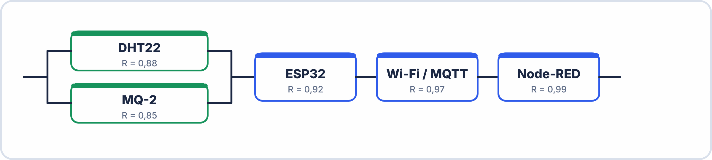

# 🔬 EXERCICES PROGRESSIFS — S11 · 2ᵉ ANNÉE · E2
## Fiabilité : MTBF · MTTR · R(t) · Systèmes Série/Parallèle/Complexes

---

> **Nom** : \_\_\_\_\_\_\_\_\_\_\_\_\_\_\_\_\_\_\_\_\_\_\_\_\_\_\_
> **Date** : \_\_\_\_\_\_\_\_\_\_\_\_\_\_\_\_\_\_\_\_\_\_\_\_\_\_\_
> **Durée** : 80 minutes · **Fiche de cours autorisée** · **Calculatrice obligatoire**

---

## 📌 Données utiles

$$e^{-0{,}1} = 0{,}905 e^{-0} \cdot ^2 = 0{,}819 e^{-0} \cdot ^3 = 0{,}741$$

$$e^{-0{,}4} = 0{,}670 e^{-0{,}5} = 0{,}607 e^{-1} = 0{,}368$$

$e^{-1{,}5}$ = 0,223    $e^{-2}$   = 0,135    $e^{-3}$   = 0,050  

1 an = 8 760 heures · 1 mois ≈ 730 heures · 1 semaine = 168 heures  

---

## 🟢 BLOC 1 — MTBF, MTTR, Disponibilité (30 min)

### Exercice 1.1 — Calculs fondamentaux

**Contexte** : Un serveur de supervision industrielle a fonctionné 3 ans en continu (24h/24).
Il a subi 4 arrêts pour maintenance corrective :

| Arrêt | Durée |
|---|---|
| 1 | 45 min |
| 2 | 3h 20 min |
| 3 | 1h 00 |
| 4 | 7h 15 min |

**Q1.1.a** — Convertis toutes les durées en heures décimales :

```
Arrêt 1 : 45 min = _______ h
Arrêt 2 : 3h 20 min = _______ h
Arrêt 3 : 1h 00 = _______ h
Arrêt 4 : 7h 15 min = _______ h
```

**Q1.1.b** — Calcule TA, TO, MTBF, MTTR et D :

```
TA (temps total arrêt) = _______ + _______ + _______ + _______ = _______ h
TO (temps de fonctionnement) = 3 × 8760 − TA = _______ − _______ = _______ h
MTBF = TO / n = _______ / _______ = _______ h
MTTR = TA / n = _______ / _______ = _______ h
D = MTBF / (MTBF + MTTR) = _______ / _______ = _______ = _______ %
```

**Q1.1.c** — Convertis le MTBF en mois :

```
MTBF = _______ heures / 730 h/mois ≈ _______ mois
Interprétation : une panne tous les _______ mois environ
```

**Q1.1.d** — La norme industrielle imposée est D ≥ 99,5%. Ce serveur la respecte-t-il ?

```
D calculé : _______ % · Norme : 99,5% · ☐ Conforme ☐ Non conforme
```

---

### Exercice 1.2 — Améliorer la disponibilité

**Contexte** : L'ingénieur veut atteindre D = 99,9% avec le même MTBF calculé en 1.1.
Quel MTTR maximum peut-il se permettre ?

```
D = MTBF / (MTBF + MTTR) ≥ 0,999

Résoudre pour MTTR :
0,999 × (MTBF + MTTR) = MTBF
0,999 × MTBF + 0,999 × MTTR = MTBF
0,999 × MTTR = MTBF − 0,999 × MTBF
0,999 × MTTR = MTBF × (1 − 0,999) = MTBF × 0,001

MTTR ≤ MTBF × 0,001 / 0,999 = _______ × 0,001 / 0,999 ≈ _______ h

Le MTTR actuel est de _______ h.
Pour atteindre 99,9%, il faudrait le réduire de _______ h.
Piste d'amélioration : ________________________________________________________
```

---

### Exercice 1.3 — Comparaison de technologies

**Contexte** : Choisir entre 3 solutions de stockage :

| Technologie | MTBF | MTTR moyen |
|---|---|---|
| HDD 7200 tr/min | 300 000 h | 4 h |
| SSD SATA | 1 500 000 h | 1 h |
| SSD NVMe | 2 000 000 h | 0,5 h |

**Q1.3.a** — Calcule la disponibilité de chaque solution :

```
HDD  : D = _______ / (_______ + _______) = _______ = _______ %
SSD  : D = _______ / (_______ + _______) = _______ = _______ %
NVMe : D = _______ / (_______ + _______) = _______ = _______ %
```

**Q1.3.b** — Pour un datacenter qui exige 5 nines (99,999%), quelle solution atteint cet objectif ?

```
5 nines = 99,999% = 0,99999
Aucune des 3 ne l'atteint seule → ☐ Vrai ☐ Faux

La solution la plus proche est : _____________________________________________
Écart par rapport à l'objectif : _______ %
```

---

## 🟡 BLOC 2 — Loi Exponentielle R(t) = $e^{-\lambda t}$ (30 min)

### Exercice 2.1 — Capteur DHT22

**Données** : DHT22 — MTBF = 50 000 h · fonctionnement 24h/24

**Q2.1.a** — Calcule le taux de panne λ :

```
λ = 1 / MTBF = 1 / _______ = _______ pannes/heure
En notation scientifique : λ = _______ × 10⁻⁵ pannes/heure
```

**Q2.1.b** — Calcule la fiabilité R(t) pour les durées suivantes :

| Durée t | Calcul λt | R(t) = $e^{-\lambda t}$ | En % |
|---|---|---|---|
| 1 an (8 760 h) | | | |
| 2 ans (17 520 h) | | | |
| 5 ans (43 800 h) | | | |
| MTBF (50 000 h) | | $e^{-1}$ = 0,368 | 36,8% |

**Q2.1.c** — Interprète le résultat à t = 1 an :

$$R(8760) = \underline{\hspace{2.5em}} %$$

Signification : sur 1000 capteurs DHT22 mis en service simultanément,  
après 1 an il en reste \_\_\_\_\_\_\_ encore fonctionnels.  
Et \_\_\_\_\_\_\_ sont tombés en panne.  

**Q2.1.d** — Quelle durée t garantit que R(t) ≥ 90% ?

```
R(t) ≥ 0,90
e^(−λt) ≥ 0,90

Pour trouver t : prendre le logarithme naturel ln des deux membres
−λt ≥ ln(0,90)   → Note : ln(0,90) ≈ −0,105

t ≤ −ln(0,90) / λ = 0,105 / (2×10⁻⁵) = _______ heures = _______ mois
```

---

### Exercice 2.2 — Comparer deux composants

**Données** :

- Composant A : MTBF = 10 000 h (composant économique)
- Composant B : MTBF = 100 000 h (composant premium, 5× plus cher)

**Q2.2.a** — Calcule les taux de panne :

$$
\begin{aligned}
\lambda A &= \dfrac{1}{10\,000} = \underline{\hspace{2.5em}} h^{-1} \\
\lambda B &= \dfrac{1}{100\,000} = \underline{\hspace{2.5em}} h^{-1}
\end{aligned}
$$

**Q2.2.b** — Complète le tableau de fiabilité et conclus :

| Durée | $R_{A}$(t) | $R_{B}$(t) | Δ fiabilité |
|---|---|---|---|
| 1 000 h | | | |
| 5 000 h | | | |
| 10 000 h | 36,8% | | |
| 50 000 h | | | |

**Q2.2.c** — Pour une application qui doit fonctionner 2 ans sans maintenance,
lequel des deux composants est indispensable ? Justifie avec les calculs :

Durée : 2 ans = \_\_\_\_\_\_\_ h  

$$R_{\mathrm{A}}(17520) = e^{-0{,}0001 \times 17520} = e^{\underline{\hspace{2.5em}}} = \underline{\hspace{2.5em}} \to \underline{\hspace{2.5em}} %$$

$$R_{\mathrm{B}}(17520) = e^{-0{,}00001 \times 17520} = e^{\underline{\hspace{2.5em}}} = \underline{\hspace{2.5em}} \to \underline{\hspace{2.5em}} %$$

Conclusion : \_\_\_\_\_\_\_\_\_\_\_\_\_\_\_\_\_\_\_\_\_\_\_\_\_\_\_\_\_\_\_\_\_\_\_\_\_\_\_\_\_\_\_\_\_\_\_\_\_\_\_\_\_\_\_\_\_\_\_\_\_\_\_\_\_  

---

## 🟠 BLOC 3 — Fiabilité des systèmes complexes (20 min)

### Exercice 3.1 — Système de contrôle industriel

**Architecture** :

```
Entrée → [Capteur (R=0,95)] → ┌─[CPU A (R=0,90)]─┐
                               └─[CPU B (R=0,90)]─┘ → [Sortie (R=0,99)] → Sortie
```

**Q3.1.a** — Calcule la fiabilité du bloc CPU (parallèle) :

$$
\begin{aligned}
R_{\mathrm{CPU}} &= 1 - (1 - \underline{\hspace{2.5em}}) \times (1 - \underline{\hspace{2.5em}}) \\
&= 1 - \underline{\hspace{2.5em}} \times \underline{\hspace{2.5em}} \\
&= \underline{\hspace{2.5em}}
\end{aligned}
$$

**Q3.1.b** — Calcule la fiabilité globale du système (série) :

$$
\begin{aligned}
Rs &= R_{\mathrm{capteur}} \times R_{\mathrm{CPU}} \times R_{\mathrm{sortie}} \\
&= \underline{\hspace{2.5em}} \times \underline{\hspace{2.5em}} \times \underline{\hspace{2.5em}} \\
&= \underline{\hspace{2.5em}} = \underline{\hspace{2.5em}} %
\end{aligned}
$$

**Q3.1.c** — Si les CPU n'étaient PAS redondants (1 seul CPU B, R=0,90), quelle serait la fiabilité ?

$$Rs_sans_redondance = \underline{\hspace{2.5em}} \times \underline{\hspace{2.5em}} \times \underline{\hspace{2.5em}} = \underline{\hspace{2.5em}} = \underline{\hspace{2.5em}} %$$

Gain de la redondance CPU : \_\_\_\_\_\_\_ % − \_\_\_\_\_\_\_ % = \_\_\_\_\_\_\_ points  

---

### Exercice 3.2 — Station IoT CLIMASENS (lien avec le projet)

**Architecture du système CLIMASENS** :



Note : les deux capteurs sont en **parallèle fonctionnel** (un seul suffit pour détecter une anomalie).

**Q3.2.a** — Calcule la fiabilité du bloc capteurs en parallèle :

$$
\begin{aligned}
R_{\mathrm{capteurs}} &= 1 - (1 - \underline{\hspace{2.5em}}) \times (1 - \underline{\hspace{2.5em}}) \\
&= 1 - \underline{\hspace{2.5em}} \times \underline{\hspace{2.5em}} \\
&= \underline{\hspace{2.5em}}
\end{aligned}
$$

**Q3.2.b** — Calcule la fiabilité globale :

$$
\begin{aligned}
Rs &= R_{\mathrm{capteurs}} \times R_{\mathrm{ESP32}} \times R_{\mathrm{WiFi}} \times R_{\mathrm{NodeRED}} \\
&= \underline{\hspace{2.5em}} \times \underline{\hspace{2.5em}} \times \underline{\hspace{2.5em}} \times \underline{\hspace{2.5em}} \\
&= \underline{\hspace{2.5em}} = \underline{\hspace{2.5em}} %
\end{aligned}
$$

**Q3.2.c** — Le maillon le plus faible de la chaîne est le capteur MQ-2 (R=0,85). Comment améliorer le système sans changer les composants ?

```
Solution proposée : ___________________________________________________________
Calculer la nouvelle Rs avec votre amélioration : _______ %
```

---

## ✍️ Auto-évaluation

| Compétence | Maîtrisé | En cours | À revoir |
|---|---|---|---|
| Calcul MTBF, MTTR, D à partir d'un historique | ☐ | ☐ | ☐ |
| Conversion heures ↔ années ↔ mois | ☐ | ☐ | ☐ |
| Calcul λ = 1/MTBF | ☐ | ☐ | ☐ |
| Calcul R(t) = $e^{-\lambda t}$ avec calculatrice | ☐ | ☐ | ☐ |
| Fiabilité système série Rs = R1×R2×... | ☐ | ☐ | ☐ |
| Fiabilité système parallèle Rs = 1−(1−R1)(1−R2) | ☐ | ☐ | ☐ |
| Décomposer un système mixte série/parallèle | ☐ | ☐ | ☐ |

---
