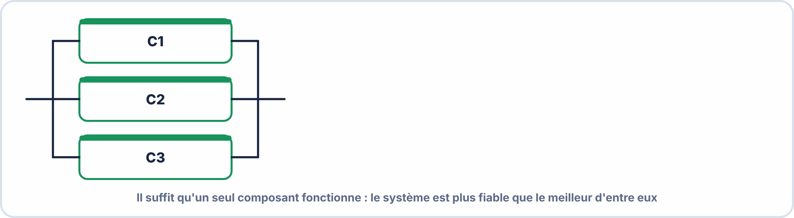

# 🗂️ AIDE-MÉMOIRE FIABILITÉ — À PLASTIFIER
## MTBF · MTTR · R(t) · Série · Parallèle · BAC PRO CIEL · E2 · 2ᵉ année S11

---

> *Conserver pour les exercices et l'évaluation*

---

## 🔑 Formules essentielles

```
λ = 1 / MTBF          (taux de panne, h⁻¹)

MTBF = TO / n          (temps moyen entre pannes)
MTTR = TA / n          (temps moyen de réparation)

D = MTBF / (MTBF + MTTR)    (disponibilité)

R(t) = e^(−λt)               (fiabilité à l'instant t)
F(t) = 1 − R(t)              (probabilité de panne avant t)

À t = MTBF : R = e^(−1) ≈ 0,368 = 36,8%
```

---

## 📐 Systèmes série

```
[C1] ─ [C2] ─ [C3]

Rs = R1 × R2 × R3

λs = λ1 + λ2 + λ3
MTBFs = 1 / λs

→ Rs < Rmin (plus fragile que le plus faible !)
```

---

## 📐 Systèmes parallèle



$$R_{s} = 1 - (1 - R_{1})(1 - R_{2})(1 - R_{3})$$

$R_{s} > R_{max}$ : le système est plus fiable que le plus fiable de ses composants.

---

## 📐 Système complexe

```
MÉTHODE :
1. Identifier les blocs parallèle → R_équiv
2. Réduire à un seul bloc
3. Calculer Rs du système série final
```

---

## 📊 Valeurs $e^{-x}$ utiles

$$e^{-0{,}1} = 0{,}905 e^{-0} \cdot ^2 = 0{,}819 e^{-0} \cdot ^3 = 0{,}741$$

$$e^{-0{,}4} = 0{,}670 e^{-0{,}5} = 0{,}607 e^{-1} = 0{,}368$$

$e^{-1{,}5}$ = 0,223   $e^{-2}$   = 0,135   $e^{-3}$   = 0,050  

---

## 🕐 Conversions

$$1 an = 8\,760\,\mathrm{h}$$

1 mois = 730 h  
1 semaine = 168 h  

---

## 🏗️ Classes de disponibilité

```
99%     → 3,65 jours arrêt/an
99,9%   → 8,76 heures arrêt/an  (three nines)
99,99%  → 52,6 min arrêt/an     (four nines)
99,999% → 5,26 min arrêt/an     (five nines — datacenter)
```

---

## ⚠️ Pièges courants

```
❌ MTBF ≠ durée de vie garantie
   → À t=MTBF, seulement 36,8% fonctionnent encore !

❌ Série → Rs < chaque Ri (pas la moyenne !)

❌ Confondre MTBF et MTTF
   → MTTF : composant non réparable (piles, LED)
   → MTBF : composant réparable

❌ Oublier de convertir les heures avant de calculer
   λt doit être sans unité (λ en h⁻¹ × t en h)
```

---

*Aide-Mémoire Fiabilité — À plastifier*
*BAC PRO CIEL | E2 Systèmes Électroniques | 2ᵉ année S11*
*Compétences S6.1 · S6.2 · S6.3 · S6.4 · S6.5 · C6.1*
