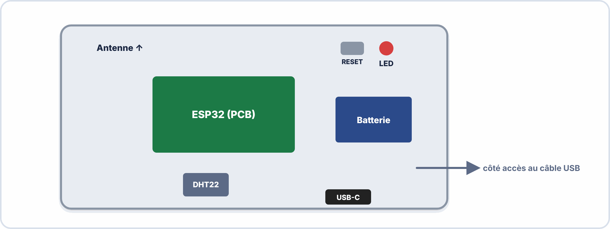
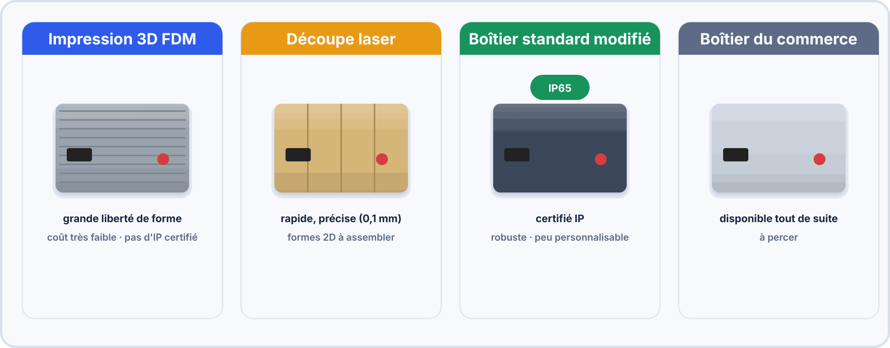
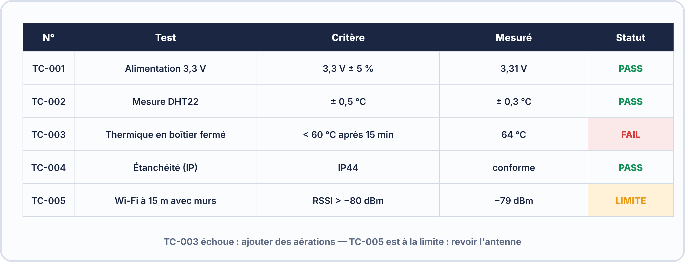

# 📖 FICHE COURS – S12 ANNÉE 2 – E2
## Prototypes Avancés : Intégration Mécanique, Boîtiers 3D, Tests en Conditions Réelles

**Nom : ________________  Prénom : ________________**

---

## 🎯 OBJECTIFS

- ✅ Identifier les contraintes d'un boîtier (mécaniques, thermiques, IP)
- ✅ Concevoir un boîtier ESP32 adapté avec FreeCAD ou gabarit découpe
- ✅ Intégrer les composants correctement (fixation, câblage, accès)
- ✅ Rédiger et exécuter un plan de tests en conditions réelles

---

## 1️⃣ DU PROTOTYPE LABO AU PRODUIT FONCTIONNEL

### Le problème du "ça marche sur la table"

> Un prototype qui fonctionne sur une breadboard en labo peut échouer pour une douzaine de raisons dans le monde réel :

| **Problème en conditions réelles** | **Cause technique** | **Solution par le boîtier** |
|---|---|---|
| L'ESP32 surchauffe | Boîtier fermé sans ventilation | Aérations, positionnement, matière |
| La connexion Wi-Fi est instable | Antenne métallique couverte | Fenêtre plastique, orientation antenne |
| Le connecteur USB se débranche | Pas de fixation mécanique | Embase panel-mount USB-C |
| Un fil se décroche en cas de vibration | Connexion breadboard | Soudure + gaine thermo |
| De la condensation abîme la carte | Boîtier non étanche | Joint torique, résine de conformal coating |
| L'utilisateur appuie sur le mauvais bouton | Boutons trop proches | Séparation, légende, couleur |

### Les 4 familles de contraintes à traiter

> [!NOTE] 1. MÉCANIQUES  : dimensions, fixation, vibration, choc
> 2. THERMIQUES  : dissipation, Tmax composants, ventilation  
> 3. ENVIRONNEMENTALES : IP (eau, poussière), UV, chimique  
> 4. ERGONOMIQUES : accès opérateur, étiquetage, connecteurs  

---

## 2️⃣ INDICES DE PROTECTION IP

### Définition

> L'**indice de protection IP** (Ingress Protection — norme IEC 60529) définit le niveau de protection d'un boîtier contre la pénétration de solides et de liquides. Il s'écrit **IP XY** où :
> - **X** = protection contre les corps solides (0 à 6)
> - **Y** = protection contre l'eau (0 à 8)

### Les niveaux les plus courants

| **IP** | **Solide** | **Liquide** | **Usage typique** |
|---|---|---|---|
| **IP20** | Doigts (> 12 mm) | Aucune | Matériel d'intérieur, armoires électriques |
| **IP44** | Outils > 1 mm | Projections tous sens | Salles de bain, ateliers |
| **IP54** | Poussière (partielle) | Projections tous sens | Extérieur abrité |
| **IP65** | Poussière totale | Jets d'eau basse pression | Extérieur plein air |
| **IP67** | Poussière totale | Immersion 1m / 30min | Stations météo, rugged |
| **IP68** | Poussière totale | Immersion > 1m (définie) | Équipements sous-marins |

> **En IoT terrain** : une station météo extérieure demande au minimum **IP55** ; un compteur d'eau enterré demande **IP68**.

---

## 3️⃣ CONCEPTION DU BOÎTIER

### Étape 1 — Inventaire des composants

> Avant de dessiner quoi que ce soit, mesurez tout ce qui doit entrer dans le boîtier :

```
Fiche de dimensions (à remplir pour chaque projet) :

Élément                  L (mm)   l (mm)   H (mm)   Remarque
─────────────────────── ──────── ──────── ──────── ──────────
PCB principal (ESP32)    51,4     28,2     12       Antenne +3mm
Capteur DHT22            15,5     11,5     25       Doit être exposé à l'air
Batterie LiPo 500mAh     51       34       5        Flexible
Connecteur USB-C panel   14       7        20       Découpe dans paroi
Bouton reset             6,8 Ø   —        15       Découpe ronde dans paroi
LED de statut            5 Ø     —        8        Découpe ronde dans paroi
─────────────────────── ──────── ──────── ──────── ──────────
Volume intérieur minimal : dimensions maxi × 1,2 (marge 20%)
```

### Étape 2 — Plan de montage (vue en coupe)

> Dessinez un plan simplifié (vue de dessus et vue latérale) montrant l'emplacement de chaque composant. Les composants qui génèrent de la chaleur (régulateurs, ESP32 en charge) sont placés **en haut** (convection naturelle ascendante).



### Étape 3 — Choix de la technologie de fabrication

| **Technologie** | **Avantages** | **Inconvénients** | **Idéal pour** |
|---|---|---|---|
| **Impression 3D FDM** | Formes complexes, coût faible (~50g PLA = 1€), délai 2–4h | Couches visibles, tolérance ±0,2mm | Boîtiers sur mesure, formes non planes |
| **Découpe laser** | Rapide (< 30 min), précision 0,1mm, matières variées | Formes 2D uniquement (assemblage requis) | Boîtiers plats (rack, panneau) |
| **Découpe vinyle** | Façades, étiquettes, marquage | Pas structurel | Étiquetage, sérigraphie |
| **Boîtier standard modifié** | Économique, certifié IP, disponible immédiatement | Peu personnalisable | Projets avec contraintes IP/CE |

---



---

## 4️⃣ IMPRESSION 3D FDM — GUIDE PRATIQUE

### Paramètres clés dans le slicer (Cura, PrusaSlicer)

| **Paramètre** | **Valeur standard** | **Impact** |
|---|---|---|
| Hauteur de couche | 0,2 mm | Précision surface vs vitesse |
| Remplissage (infill) | 20% | Résistance mécanique |
| Périmètres (walls) | 3 | Solidité des parois |
| Supports | Automatique | Pour saillants > 45° |
| Orientation | Maximiser les surfaces plates | Solidité dans sens Z faible |

### Tolérances à appliquer

```
Boîtier fermé avec couvercle :
  Jeu entre couvercle et boîtier : +0,3 mm (glissement)
  Trou pour vis M3 auto-taraudeuse plastique : Ø 2,6 mm
  Trou pour connecteur USB-C (14 mm × 7 mm) : +0,5 mm chaque dimension
  Fenêtre pour LED Ø 5mm : percer Ø 5,0 à 5,2 mm

Emboîtement press-fit (snap) :
  Languette male : dimension nominale
  Rainure female : dimension nominale + 0,1 mm
```

### Checklist avant lancement impression

```
□ Trou d'accès USB/alimentation inclus
□ Trou pour câbles (grommet ou passe-câble)
□ Accès au bouton RESET de l'ESP32
□ Aérations (si composants chauds)
□ Emplacement pour vis de fixation boîtier
□ Orientation de l'antenne Wi-Fi (vers l'extérieur si possible)
□ Marge de 2–3 mm entre PCB et paroi interne
□ Épaisseur de paroi ≥ 2 mm (rigidité)
```

---

## 5️⃣ INTÉGRATION ÉLECTRONIQUE DANS LE BOÎTIER

### Fixation du PCB

```
Option A — Colonnes d'espacement (standoffs) :
  PCB → vis M3 → colonne M3 femelle/mâle → fond du boîtier
  Avantage : démontable, professionnel
  Inconvénient : trous de fixation doivent être prévus dans le boîtier

Option B — Clips plastiques (snap-in) :
  Rails moulés dans le boîtier, PCB glisse et clique
  Avantage : sans outil
  Inconvénient : peu de vibration / force latérale

Option C — Velcro double face ou colle caoutchouc :
  Avantage : simple, universel
  Inconvénient : non professionnel, démontage difficile
```

### Câblage interne

```
Règles de câblage dans un boîtier :
  1. Longueur exacte : couper au bon millimètre, pas de surplus
  2. Attaches câbles : fixer les câbles à intervalles réguliers
  3. Gaines thermo sur chaque connexion individuelle
  4. Repérage : couleur ou étiquette (rouge = + ; noir = - ; couleur = signal)
  5. Connecteurs : utiliser des connecteurs Dupont ou JST plutôt que des fils soudés
     directement sur le PCB (facilite le démontage)
  6. Séparer haute tension (230V AC) de basse tension (5V/3,3V) si applicable
```

---

## 6️⃣ CONTRAINTES THERMIQUES

### Température de fonctionnement

| **Composant** | **Tmax absolue** | **Tmax recommandée** | **Puissance dissipée** |
|---|---|---|---|
| ESP32 (chip) | 125°C | 85°C | ~0,5W en fonctionnement normal |
| Régulateur 5V AMS1117 | 150°C | 85°C | P = (Vin-Vout) × I = (9V-5V) × 0,5A = 2W |
| DHT22 | 60°C | 40°C | Négligeable |
| Batterie LiPo | 60°C | 45°C | Génère de la chaleur en charge |

### Calcul simplifié de l'élévation de température

> Dans un boîtier fermé sans ventilation, la température intérieure s'élève de :

$$\Delta T \approx \frac{P_{totale}}{k \cdot S}$$

> Où P = puissance dissipée en W, S = surface du boîtier en m², k ≈ 5 W/m²·K (convection naturelle).

> **Règle pratique :** Pour 2W dissipés dans un boîtier 100cm² → ΔT ≈ 40°C → si Ta = 25°C → Tint ≈ 65°C. Le régulateur AMS1117 risque de déclencher sa protection thermique !

### Solutions de dissipation

```
1. Aérations passives : trous Ø 3–5mm en bas et en haut du boîtier
   (convection naturelle : air froid entre en bas, chaud sort en haut)

2. Radiateur collé sur le régulateur chaud
   (profil aluminium anodisé, 10cm² minimum pour 2W)

3. Ventilation forcée (petit ventilateur 5V) : si P > 5W

4. Choisir un régulateur efficace : 
   LDO classique → jusqu'à 50% de pertes
   Buck converter → 85–95% d'efficacité, génère très peu de chaleur
```

---

## 7️⃣ PLAN DE TESTS EN CONDITIONS RÉELLES

### Pourquoi un plan de tests ?

> Un plan de tests formel transforme le "je pense que ça marche" en "j'ai la preuve que ça marche". En stage, c'est ce qu'on vous demandera avant la mise en production d'un système.

### Structure d'un cas de test

> [!NOTE] TC-001 : Connectivité MQTT en conditions normales
>
> Objectif : Vérifier que l'ESP32 se connecte et publie en < 10s  
> Préconditions : Wi-Fi disponible, broker actif  
> Procédure :  
> 1. Mettre sous tension l'ESP32  
> 2. Chronomètre : démarrer à l'allumage  
> 3. Observer le moniteur série ou le broker MQTT  
> Mesures :  
> - Délai avant premier message MQTT publié : _____ s  
> - Contenu du message : _____  
> Critère d'acceptance : Délai ≤ 10 secondes ET message JSON valide  
> Résultat : PASS ☐    FAIL ☐  
> Commentaires : _________________________________________  

### Familles de tests pour un projet IoT embarqué

| **Famille** | **Ce qu'on teste** | **Instruments** |
|---|---|---|
| **Fonctionnel** | L'appareil fait ce qu'il est censé faire | Moniteur série, MQTT dashboard |
| **Thermique** | T° interne après X minutes de fonctionnement | Thermomètre IR ou sonde thermocouple |
| **Réseau** | Wi-Fi à différentes distances + obstacles | Moniteur série, RSSI |
| **Alimentation** | Durée de batterie, comportement en décharge | Multimètre, timer |
| **Mécanique** | Résistance choc léger, vibration, ouverture/fermeture boîtier | Manipulation manuelle |
| **Étanchéité** | Test IP (projection eau si IP44+) | Bouteille spray, papier absorbant |

---



---

## ✅ AUTO-ÉVALUATION

- [ ] Je sais identifier les 4 familles de contraintes d'un boîtier (mécaniques, thermiques, environnementales, ergonomiques)
- [ ] Je sais lire un indice IP (IP65 = poussière totale + jet d'eau basse pression)
- [ ] Je sais mesurer l'ESP32 et calculer les dimensions intérieures minimales d'un boîtier
- [ ] Je connais les tolérances à appliquer pour l'impression 3D FDM (±0,2 mm)
- [ ] Je sais positionner les aérations (entrée basse, sortie haute)
- [ ] Je sais rédiger un cas de test avec critère d'acceptance chiffré (pass/fail)
- [ ] Je sais calculer approximativement l'élévation de température dans un boîtier fermé

---

## 📚 VOCABULAIRE CLEF

| **Terme** | **Définition** |
|---|---|
| **IP XX** | Ingress Protection — indice de protection solide + liquide (IEC 60529) |
| **FDM** | Fused Deposition Modeling — impression 3D par dépôt de filament plastique fondu |
| **Kerf** | Jeu de découpe laser — épaisseur du trait de découpe (~0,1–0,3 mm) |
| **Standoff** | Colonne d'espacement — fixe le PCB à distance du fond du boîtier |
| **Panel-mount** | Connecteur ou commande monté dans la paroi du boîtier (USB, jack, bouton) |
| **Tolérances** | Jeu dimensionnel prévu pour compenser les écarts de fabrication |
| **Infill** | Taux de remplissage du plastique à l'intérieur d'une pièce imprimée en 3D |
| **Cas de test (TC)** | Test case — procédure définie avec critère d'acceptance mesurable |
| **Critère d'acceptance** | Valeur mesurée au-delà de laquelle le test est en échec |
| **RSSI** | Received Signal Strength Indicator — niveau du signal Wi-Fi en dBm (négatif) |
| **ΔT** | Élévation de température par rapport à l'ambiante |
| **Conformal coating** | Résine protectrice appliquée sur le PCB pour le protéger de l'humidité |

---

## 📌 POINTS-CLÉS À RETENIR

1. **Inventaire d'abord** — mesurer chaque composant avant de dessiner le boîtier
2. **Marge systématique** — +2–3 mm sur les dimensions intérieures, +0,5 mm sur les trous de connecteurs
3. **IP** : extérieur abrité → IP54 minimum ; extérieur plein air → IP65 minimum
4. **Thermique** : PLA tient jusqu'à ~55°C — si T interne > 50°C, passer au PETG ou prévoir aérations
5. **Checklist obligatoire** avant impression : USB/alimentation, reset, aérations, vis
6. **Plan de tests** = critère CHIFFRÉ, pas seulement "ça marche" — mesure réelle vs valeur attendue
7. **Aérations** : entrée en bas (air froid), sortie en haut (air chaud monte — convection naturelle)

---

**Document – BAC PRO CIEL – A2 – E2/U21 – Version 1.0 – 2026**
