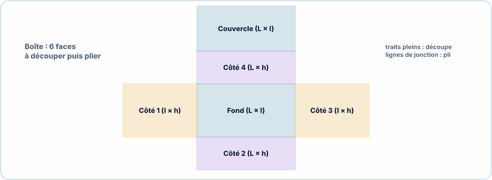

# 🔬 TD + TP – S12 ANNÉE 2 – E2
## Boîtier 3D pour ESP32 et Plan de Tests en Conditions Réelles

---

## 🎯 OBJECTIFS

- ✅ Mesurer les composants du prototype et calculer les dimensions du boîtier
- ✅ Concevoir le boîtier sur FreeCAD ou par gabarit de découpe
- ✅ Rédiger un plan de tests complet en 5 cas
- ✅ Exécuter les tests et documenter les résultats avec mesures réelles

---

## ⏱️ DURÉE : 90 min (conception) + 40 min (tests)

---

## 📋 CONTEXTE — VOTRE PROJET

> Vous allez concevoir le boîtier pour votre prototype ESP32 développé en S7-A2 (MQTT) ou S9-A2 (AWS IoT). Ce prototype doit être utilisable en extérieur **abrité** (serre agricole, local technique) — il doit donc répondre à **IP44**.

---

# PARTIE 1 — TD CONCEPTION (30 min)

## TD1 — Inventaire et Dimensions (6 pts)

### 1.1 — Mesurer les composants

> Utilisez un pied à coulisse ou une règle. Notez toutes les dimensions en mm.

| **Composant** | **Longueur (mm)** | **Largeur (mm)** | **Hauteur (mm)** | **Remarque** |
|---|---|---|---|---|
| PCB ESP32 DevKit | | | | Antenne : côté ? |
| Capteur DHT22 / autre | | | | Exposé à l'air ? |
| Câble USB d'alimentation | — | — | | Diamètre câble |
| Autre composant 1 | | | | |
| Autre composant 2 | | | | |

### 1.2 — Calculer les dimensions intérieures du boîtier

> Les dimensions intérieures doivent être les dimensions maximales des composants + 3 mm de marge sur chaque face.

```
Composant le plus large : _____ mm → Longueur intérieure min : _____ + 3 + 3 = _____ mm
Composant le plus large : _____ mm → Largeur intérieure min  : _____ + 3 + 3 = _____ mm
Composant le plus haut  : _____ mm → Hauteur intérieure min  : _____ + 3 + 3 = _____ mm
```

**Q1.** Votre capteur DHT22 doit-il être à l'intérieur ou à l'extérieur du boîtier ? Pourquoi ?

\_\_\_\_\_\_\_\_\_\_\_\_\_\_\_\_\_\_\_\_\_\_\_\_\_\_\_\_\_\_\_\_\_\_\_\_\_\_\_\_\_\_\_\_\_\_\_\_\_\_\_\_\_\_\_\_\_\_\_\_\_\_\_\_\_\_\_\_\_\_\_\_\_

### 1.3 — Dimensionner les ouvertures nécessaires

**Listez toutes les ouvertures à prévoir dans les parois du boîtier :**

| **Ouverture** | **Paroi (haut/bas/côté)** | **Dimensions (mm)** | **Type** |
|---|---|---|---|
| Câble USB d'alimentation | | Ø \_\_\_\_\_ | Trou + grommet |
| Capteur DHT22 | | \_\_\_\_\_ × \_\_\_\_\_ | Ouverture grillagée |
| LED de statut | | Ø \_\_\_\_\_ | Perçage |
| Bouton RESET | | Ø \_\_\_\_\_ | Perçage |
| Aérations thermiques | Haut + Bas | Ø 4 mm × \_\_\_ trous | Grille |

**Q2.** Où positionnerez-vous les aérations thermiques ? Justifiez en termes de convection naturelle.

\_\_\_\_\_\_\_\_\_\_\_\_\_\_\_\_\_\_\_\_\_\_\_\_\_\_\_\_\_\_\_\_\_\_\_\_\_\_\_\_\_\_\_\_\_\_\_\_\_\_\_\_\_\_\_\_\_\_\_\_\_\_\_\_\_\_\_\_\_\_\_\_\_

---

## TD2 — Schéma de Principe du Boîtier (6 pts)

### 2.1 — Dessiner la vue de dessus (intérieur) à l'échelle 1:1 ou 1:2

> Utilisez la grille ci-dessous (chaque carré = 5 mm).

```
┌──────────────────────────────────────────────────────────────────────┐
│  │  │  │  │  │  │  │  │  │  │  │  │  │  │  │  │  │  │  │  │  │  │  │
│  │  │  │  │  │  │  │  │  │  │  │  │  │  │  │  │  │  │  │  │  │  │  │
│──┼──┼──┼──┼──┼──┼──┼──┼──┼──┼──┼──┼──┼──┼──┼──┼──┼──┼──┼──┼──┼──┼──│
│  │  │  │  │  │  │  │  │  │  │  │  │  │  │  │  │  │  │  │  │  │  │  │
│  │  │  │  │  │  │  │  │  │  │  │  │  │  │  │  │  │  │  │  │  │  │  │
│──┼──┼──┼──┼──┼──┼──┼──┼──┼──┼──┼──┼──┼──┼──┼──┼──┼──┼──┼──┼──┼──┼──│
│  │  │  │  │  │  │  │  │  │  │  │  │  │  │  │  │  │  │  │  │  │  │  │
│  │  │  │  │  │  │  │  │  │  │  │  │  │  │  │  │  │  │  │  │  │  │  │
│──┼──┼──┼──┼──┼──┼──┼──┼──┼──┼──┼──┼──┼──┼──┼──┼──┼──┼──┼──┼──┼──┼──│
│  │  │  │  │  │  │  │  │  │  │  │  │  │  │  │  │  │  │  │  │  │  │  │
│  │  │  │  │  │  │  │  │  │  │  │  │  │  │  │  │  │  │  │  │  │  │  │
│──┼──┼──┼──┼──┼──┼──┼──┼──┼──┼──┼──┼──┼──┼──┼──┼──┼──┼──┼──┼──┼──┼──│
│  │  │  │  │  │  │  │  │  │  │  │  │  │  │  │  │  │  │  │  │  │  │  │
│  │  │  │  │  │  │  │  │  │  │  │  │  │  │  │  │  │  │  │  │  │  │  │
│──┼──┼──┼──┼──┼──┼──┼──┼──┼──┼──┼──┼──┼──┼──┼──┼──┼──┼──┼──┼──┼──┼──│
│  │  │  │  │  │  │  │  │  │  │  │  │  │  │  │  │  │  │  │  │  │  │  │
└──────────────────────────────────────────────────────────────────────┘
Échelle : 1 carré = 5 mm
```

**Légende à remplir :**
```
[PCB]     = Zone PCB ESP32
[DHT]     = Zone capteur
[BATT]    = Zone batterie
[USB]     = Ouverture câble USB
[LED]     = Ouverture LED
[▼] / [▲] = Aérations bas / haut
```

---

## TD3 — Choix de la Technologie (3 pts)

**Q3.** Votre boîtier doit répondre à IP44. L'impression 3D FDM en PLA standard est-elle suffisante ? Justifiez et proposez les adaptations nécessaires.

\_\_\_\_\_\_\_\_\_\_\_\_\_\_\_\_\_\_\_\_\_\_\_\_\_\_\_\_\_\_\_\_\_\_\_\_\_\_\_\_\_\_\_\_\_\_\_\_\_\_\_\_\_\_\_\_\_\_\_\_\_\_\_\_\_\_\_\_\_\_\_\_\_
\_\_\_\_\_\_\_\_\_\_\_\_\_\_\_\_\_\_\_\_\_\_\_\_\_\_\_\_\_\_\_\_\_\_\_\_\_\_\_\_\_\_\_\_\_\_\_\_\_\_\_\_\_\_\_\_\_\_\_\_\_\_\_\_\_\_\_\_\_\_\_\_\_

**Q4.** Votre composant le plus chaud est le régulateur 5V AMS1117 qui dissipe environ 1,5W (Vin=9V, Vout=5V, I=0,37A). L'ambiance est 30°C (serre l'été). La surface du boîtier est ~120 cm². Estimez la température intérieure et concluez sur la nécessité d'aérations.

$$\Delta T = \dfrac{P}{k \times S} où k = \dfrac{5\,\mathrm{W}}{m^2} \cdot K, S = 120\,\mathrm{cm}^2 = 0{,}012\,\mathrm{m}^2$$

$$\Delta T = \underline{\hspace{2.5em}} / (5 \times 0{,}012) = \underline{\hspace{2.5em}} °C$$

T_intérieure = $T_{\mathrm{ambiante}}$ + ΔT = 30 + \_\_\_\_\_ = \_\_\_\_\_ °C  
Conclusion :  

\_\_\_\_\_\_\_\_\_\_\_\_\_\_\_\_\_\_\_\_\_\_\_\_\_\_\_\_\_\_\_\_\_\_\_\_\_\_\_\_\_\_\_\_\_\_\_\_\_\_\_\_\_\_\_\_\_\_\_\_\_\_\_\_\_\_\_\_\_\_\_\_\_

---

# PARTIE 2 — TP CONCEPTION BOÎTIER (60 min)

## TP1 — Modélisation dans FreeCAD (ou gabarit découpe)

### Mode A — FreeCAD

```
Nouveau projet FreeCAD :
  1. Atelier Part Design
  2. Sketch → Rectangle aux dimensions calculées en TD1
  3. Pad (extrusion) → hauteur du fond (3 mm)
  4. Sketch sur face intérieure → Rectangle intérieur (parois)
  5. Pocket (évidement) → hauteur intérieure

Pour les trous/ouvertures :
  6. Sketch sur la paroi concernée → Cercle ou Rectangle
  7. Pocket (traversant) → ouverture

Exporter en STL pour impression :
  File → Export → STL Mesh
```

### Mode B — Gabarit découpe (si pas de FreeCAD)

> Découpez le patron du boîtier sur papier épais / carton (ép. 3 mm) :



**Q5.** Pour un boîtier Longueur × largeur × Hauteur = 80 × 60 × 40 mm avec parois de 3 mm, quelles sont les dimensions extérieures ?

```
Longueur extérieure = 80 + 3 + 3 = _____ mm
Largeur extérieure  = 60 + 3 + 3 = _____ mm
Hauteur extérieure  = 40 + 3 = _____ mm (fond seul, le couvercle est séparé)
```

### Validation par le formateur

> Avant de lancer l'impression ou la découpe, faire valider votre conception :

```
☐ Dimensions intérieures correctes (tous composants rentrent)
☐ Toutes les ouvertures présentes
☐ Aérations prévues
☐ Tolérances appliquées
☐ STL/gabarit exporté

→ Visa formateur : _______________________
```

---

# PARTIE 3 — PLAN DE TESTS (20 min)

## TP2 — Rédiger le Plan de Tests

> Rédigez 5 cas de tests pour valider votre prototype en conditions d'utilisation réelles (serre agricole, IP44).

**TC-001 — Test fonctionnel : connexion et première publication**

| **Champ** | **Contenu** |
|---|---|
| Objectif | |
| Préconditions | |
| Procédure | 1. / 2. / 3. |
| Mesure attendue | |
| Critère d'acceptance | Délai ≤ \_\_\_\_\_ s ET message JSON valide |

---

**TC-002 — Test thermique : température interne après 15 min**

| **Champ** | **Contenu** |
|---|---|
| Objectif | Vérifier que T° intérieure reste < 60°C |
| Préconditions | Boîtier fermé, fonctionnement normal |
| Procédure | 1. Allumer le prototype dans le boîtier fermé / 2. Attendre 15 min / 3. Mesurer T° |
| Instrument de mesure | |
| Mesure réelle | \_\_\_\_\_ °C |
| Critère d'acceptance | T < 60°C |
| Résultat | ☐ PASS   ☐ FAIL |

---

**TC-003 — Test réseau : portée Wi-Fi**

| **Champ** | **Contenu** |
|---|---|
| Objectif | |
| Procédure | 1. / 2. / 3. |
| Mesure : RSSI à 5m | \_\_\_\_\_ dBm |
| Mesure : RSSI à 15m | \_\_\_\_\_ dBm |
| Critère | RSSI > -80 dBm à 10m (connexion stable) |
| Résultat | ☐ PASS   ☐ FAIL |

---

**TC-004 — Test d'alimentation : autonomie batterie**

| **Champ** | **Contenu** |
|---|---|
| Objectif | |
| Procédure | 1. / 2. Chronomètre / 3. |
| Mesure : durée avant déconnexion | \_\_\_\_\_ heures |
| Critère | Autonomie ≥ \_\_\_\_\_ heures |
| Résultat | ☐ PASS   ☐ FAIL |

---

**TC-005 — Test mécanique / IP44 simulé**

| **Champ** | **Contenu** |
|---|---|
| Objectif | Vérifier l'étanchéité aux projections d'eau (IP44 simulé) |
| Procédure | 1. Fermer le boîtier / 2. Pulvériser de l'eau depuis 30 cm pendant 30s / 3. Ouvrir et inspecter |
| Mesure | Présence d'eau intérieure (oui/non) |
| Critère | Aucune trace d'eau intérieure |
| Résultat | ☐ PASS   ☐ FAIL |

---

# PARTIE 4 — EXÉCUTION DES TESTS (40 min)

## TP3 — Réaliser les Tests et Documenter

> Exécutez les 5 tests rédigés et complétez les résultats ci-dessus.

### Récapitulatif des résultats

| **Test** | **Critère** | **Mesure réelle** | **PASS/FAIL** | **Action corrective** |
|---|---|---|---|---|
| TC-001 Fonctionnel | Délai ≤ \_\_\_s | \_\_\_\_\_ s | | |
| TC-002 Thermique | T < 60°C | \_\_\_\_\_ °C | | |
| TC-003 Wi-Fi | RSSI > -80 dBm à 10m | \_\_\_\_\_ dBm | | |
| TC-004 Batterie | ≥ \_\_\_h | \_\_\_\_\_ h | | |
| TC-005 IP44 | Pas d'eau intérieure | | | |

**Q6.** Quel test a nécessité le plus d'itérations ou a échoué ? Quelle modification de conception avez-vous faite ou proposez-vous ?

\_\_\_\_\_\_\_\_\_\_\_\_\_\_\_\_\_\_\_\_\_\_\_\_\_\_\_\_\_\_\_\_\_\_\_\_\_\_\_\_\_\_\_\_\_\_\_\_\_\_\_\_\_\_\_\_\_\_\_\_\_\_\_\_\_\_\_\_\_\_\_\_\_
\_\_\_\_\_\_\_\_\_\_\_\_\_\_\_\_\_\_\_\_\_\_\_\_\_\_\_\_\_\_\_\_\_\_\_\_\_\_\_\_\_\_\_\_\_\_\_\_\_\_\_\_\_\_\_\_\_\_\_\_\_\_\_\_\_\_\_\_\_\_\_\_\_

**Q7.** Si votre test TC-002 (thermique) échoue (T > 60°C), citez 3 modifications du boîtier pour résoudre le problème :

1. \_\_\_\_\_\_\_\_\_\_\_\_\_\_\_\_\_\_\_\_\_\_\_\_\_\_\_\_\_\_\_\_\_\_\_\_\_\_\_\_\_\_\_\_\_\_\_\_\_\_\_\_\_\_\_\_\_\_\_\_\_\_\_\_\_\_\_\_\_\_\_
2. \_\_\_\_\_\_\_\_\_\_\_\_\_\_\_\_\_\_\_\_\_\_\_\_\_\_\_\_\_\_\_\_\_\_\_\_\_\_\_\_\_\_\_\_\_\_\_\_\_\_\_\_\_\_\_\_\_\_\_\_\_\_\_\_\_\_\_\_\_\_\_
3. \_\_\_\_\_\_\_\_\_\_\_\_\_\_\_\_\_\_\_\_\_\_\_\_\_\_\_\_\_\_\_\_\_\_\_\_\_\_\_\_\_\_\_\_\_\_\_\_\_\_\_\_\_\_\_\_\_\_\_\_\_\_\_\_\_\_\_\_\_\_\_

---

## 📊 BARÈME

| **Section** | **Points** |
|---|---|
| TD1 — Inventaire + dimensions (Q1+Q2) | /6 |
| TD2 — Schéma de principe | /4 |
| TD3 — Choix technologie + calcul thermique (Q3+Q4) | /5 |
| TP1 — Modélisation boîtier (FreeCAD/gabarit) + Q5 | /7 |
| TP2 — Plan de tests (5 cas complets) | /6 |
| TP3 — Exécution tests + tableau résultats + Q6+Q7 | /7 |
| Qualité présentation / soin du travail | /2 |
| **TOTAL** | **/37** |

> *Ramené à /20 : score × 0,54*

---

**Document – BAC PRO CIEL – A2 – E2/U21 – Version 1.0 – 2026**
