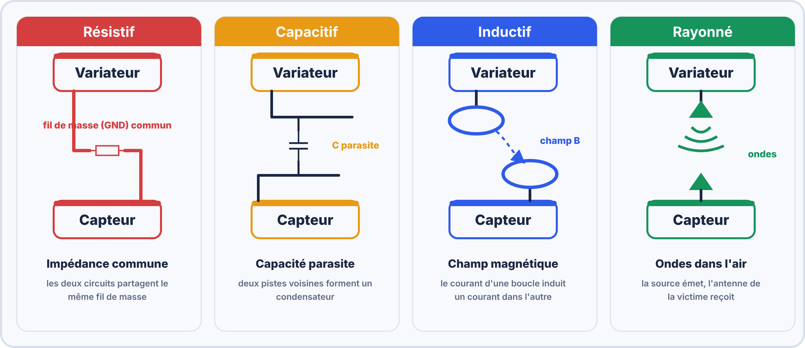
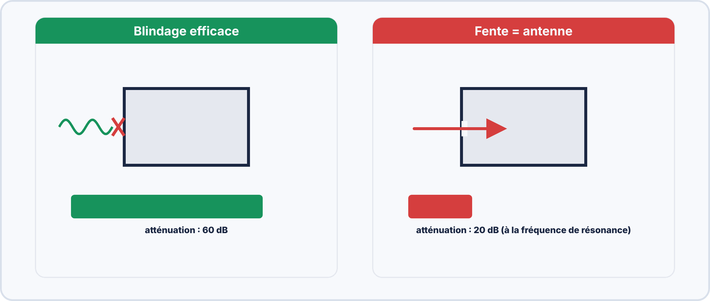
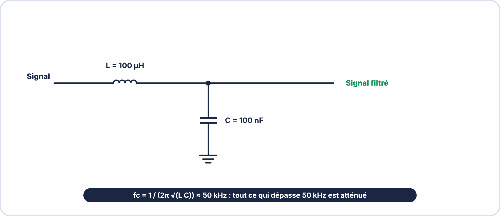
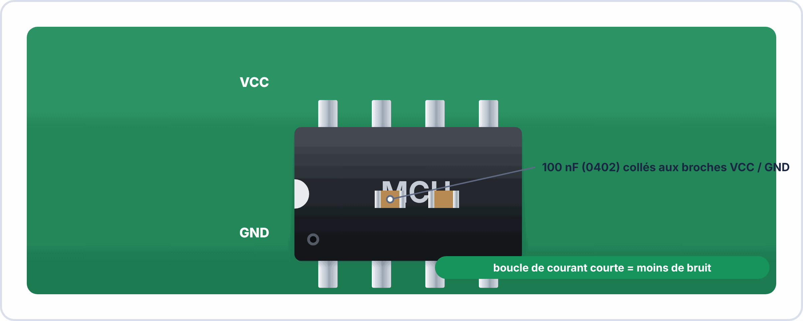
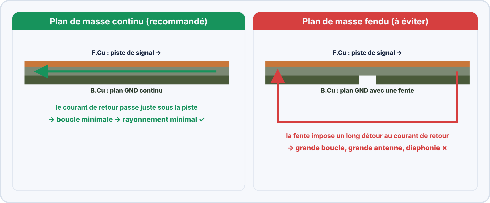
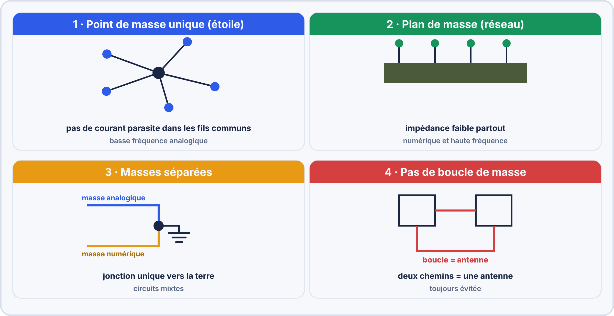

# 📘 FICHE DE COURS — S13 · 2ᵉ ANNÉE · E2
## CEM : Compatibilité Électromagnétique · Conduits/Rayonnés · Blindage · Filtrage · Mise à la Terre

---

> **Nom** : ___________________________
> **Date** : ___________________________
> **Compétences travaillées** : S7.1 · S7.2 · S7.3 · S7.4 · S7.5 · S7.6 · C7.1

---

## 🔑 Vocabulaire clé

| Terme | Définition |
|---|---|
| **CEM** | Compatibilité ÉlectroMagnétique — aptitude d'un équipement à fonctionner correctement dans son environnement sans perturber les autres |
| **Perturbation EM** | Signal parasite électrique ou électromagnétique non désiré |
| **Source** | Équipement qui génère une perturbation |
| **Victime** | Équipement perturbé par une source |
| **Couplage** | Mécanisme de transfert de la perturbation de la source à la victime |
| **Émission conduites** | Perturbations qui se propagent par les conducteurs électriques |
| **Émissions rayonnées** | Perturbations qui se propagent sous forme d'ondes électromagnétiques |
| **Immunité** | Capacité d'un équipement à résister aux perturbations extérieures |
| **Blindage** | Enveloppe conductrice qui atténue les champs EM |
| **Découplage** | Filtrage local des perturbations sur une alimentation (condensateur) |
| **Ferrite** | Matériau céramique magnétique qui absorbe les courants HF sur un conducteur |
| **Plan de masse** | Couche de cuivre continue reliée à la masse — chemin de retour des courants |
| **Marquage CE** | Déclaration de conformité aux directives européennes incluant la CEM |
| **Directive CEM** | Directive européenne 2014/30/UE — obligatoire pour vendre en Europe |
| **Classe B** | Classe d'équipement CEM pour l'usage résidentiel (normes les plus strictes) |

---

## 1️⃣ — La CEM : enjeux et définition

### Pourquoi la CEM ?

```
PROBLÈME :
  Les équipements électroniques génèrent des champs électromagnétiques.
  Ces champs peuvent perturber d'autres équipements.
  Exemples graves :
    → Un téléphone portable perturbe le pacemaker d'un patient
    → Un variateur de fréquence perturbe un capteur de sécurité
    → Un câble mal blindé perturbe une liaison de données industrielle

DOUBLE EXIGENCE DE LA CEM :
  1. EMISSION limitée : l'équipement ne doit PAS perturber les autres
  2. IMMUNITE garantie : l'équipement doit résister aux perturbations extérieures
  
  En résumé : "Ne perturbe pas · N'est pas perturbé"
```

### Le triangle SOURCE – COUPLAGE – VICTIME

> [!NOTE] SOURCE                COUPLAGE                VICTIME
> (Émetteur)                                    (Récepteur)  
>
> Moteur       ──── Par les fils ──────────────► Capteur  
> Variateur  
> Alimentation ──── Par les ondes ─────────────► WiFi  
> à découpage  
> ESP32        ──── Par les fils ──────────────► µC voisin  
> Téléphone    ──── Par les ondes ─────────────► Haut-parleur  
>
> SOLUTION : Agir sur le COUPLAGE (c'est le plus simple !)  
>           Ou améliorer l'IMMUNITE de la victime  
>           Ou réduire l'EMISSION de la source  

### Le marquage CE et la directive CEM

```
DIRECTIVE EUROPÉENNE 2014/30/UE (CEM) :
  Obligatoire pour vendre tout produit électronique en Union Européenne
  Incluse dans le marquage CE (avec d'autres directives : basse tension, etc.)
  
  L'équipement doit :
    ✓ Limiter ses émissions (rayonnées et conduites)
    ✓ Résister aux perturbations définies par des normes d'immunité
  
NORMES ASSOCIÉES :
  EN 55032 : Émissions pour équipements multimédia
  EN 55035 : Immunité pour équipements multimédia
  EN 61000-4-x : Séries de tests d'immunité (ESD, surge, burst, conduction...)
  
CLASSES D'ÉMISSIONS :
  Classe A : Usage industriel (limites moins strictes)
  Classe B : Usage résidentiel (limites plus strictes, car voisinage sensible)
```

---

## 2️⃣ — Les types de couplages et d'émissions

### Les 4 types de couplages

```
COUPLAGE 1 — RÉSISTIF (ou impédance commune) :
  Deux circuits partagent un fil ou une impédance de retour (masse commune)
  → Les courants de l'un créent une tension parasite pour l'autre
  Exemple : LED puissante et capteur analogique branchés sur le même fil GND

COUPLAGE 2 — CAPACITIF :
  Deux conducteurs proches forment un condensateur parasite
  → Les tensions s'influencent (surtout aux hautes fréquences)
  Exemple : Deux pistes PCB parallèles et proches

COUPLAGE 3 — INDUCTIF :
  Un conducteur parcouru par un courant variable crée un champ magnétique
  → Ce champ induit un courant dans un conducteur voisin (transformateur parasite)
  Exemple : Câble d'alimentation à fort courant près d'un câble signal

COUPLAGE 4 — RAYONNÉ :
  Source rayonne des ondes EM dans l'air
  → Ces ondes induisent des signaux dans les récepteurs proches
  Exemple : Moteur brushless → bruit radio sur FM · Téléphone → GSM burst
```

### Émissions conduites vs rayonnées

```
ÉMISSIONS CONDUITES (Fréquence : 150 kHz à 30 MHz) :
  → Se propagent PAR les câbles et les bus d'alimentation
  → Le câble d'alimentation joue le rôle d'antenne d'entrée
  → Solution : filtres sur les câbles, condensateurs de découplage

ÉMISSIONS RAYONNÉES (Fréquence : 30 MHz à 1 GHz et plus) :
  → Se propagent DANS L'AIR comme des ondes radio
  → L'équipement lui-même (ou ses câbles) rayonnent
  → Solution : blindage, câbles blindés, minimiser les boucles de courant

Pourquoi 30 MHz est la frontière ?
  En dessous de 30 MHz, les longueurs d'onde sont grandes (>10 m)
  → les équipements sont trop petits pour rayonner efficacement
  → mais les câbles sont de bonnes antennes → émissions conduites
  Au-dessus de 30 MHz, les longueurs d'onde deviennent comparables
  aux dimensions des équipements → rayonnement efficace
```

---



---

## 3️⃣ — Le blindage

### Blindage électrique (cage de Faraday)

```
PRINCIPE :
  Une enveloppe conductrice continue empêche les champs électriques de pénétrer
  ou de sortir. Le blindage doit être :
  ✓ Continu (pas de fente, pas de trou)
  ✓ Relié à la masse (à UNE seule extrémité pour éviter les courants de boucle)
  ✓ À faible impédance

EFFICACITÉ :
  Bonne contre les champs ÉLECTRIQUES (E) → protection contre ESD, couplage capacitif
  Moins bonne contre les champs MAGNÉTIQUES basses fréquences
  
EXEMPLES :
  Câble coaxial (signal TV, BNC) → conducteur central + tresse blindage
  Câble STP (réseau Cat5e blindé) → paire torsadée + blindage global
  Boîtier métallique d'un équipement
  Zone blindée sur un PCB (cage RF)
```

### Blindage magnétique

```
PRINCIPE :
  Les matériaux à haute perméabilité magnétique (µ élevée) dévient les lignes de champ
  magnétique — le blindage "canalise" le flux plutôt que de le bloquer.

MATÉRIAUX :
  Fer doux (µr ≈ 200-1000)         → blindage champs BF (transformateurs)
  Mu-metal (µr ≈ 20 000-100 000)   → blindage très efficace (oscilloscopes, appareils de mesure)
  Ferrite (µr variable avec la fréq) → filtrage HF (ferrites sur câbles)

EXEMPLES :
  Transformateurs d'alimentation enveloppés dans une coque en fer
  Boîtiers d'oscilloscopes en fer ou acier
```

### L'effet de fente

```
⚠️ UN BLINDAGE AVEC UNE FENTE EST TRÈS INEFFICACE !

Si la fente a une longueur L > λ/2 à la fréquence à bloquer :
  La fente se comporte comme une ANTENNE qui émet ou reçoit efficacement.

Exemple :
  Fente de 15 cm → bonne antenne pour λ = 30 cm → f = 1 GHz
  → Un boîtier avec une fente de 15 cm n'est PAS blindé à 1 GHz !

Règle pratique :
  Toutes les ouvertures (ventilation, connecteurs) doivent être < λ/20 à la fréquence d'intérêt
  Ou munies d'une grille conductrice (honeycomb)
```

---



---

## 4️⃣ — Filtrage : condensateurs de découplage et ferrites

### Condensateurs de découplage

```
RÔLE :
  Filtrer les perturbations HF sur les rails d'alimentation d'un CI.
  Fournir instantanément le courant lors des commutations (réservoir local).

PLACEMENT CRITIQUE :
  ⚠️ Doit être placé AU PLUS PRÈS des pins VCC et GND du CI.
  Plus la piste entre le condensateur et le CI est longue → plus l'inductance parasite
  de la piste annule l'effet du condensateur.
  Règle d'or : distance < 1 mm si possible.

COMBINAISON :
  100 nF (céramique) → filtrage de 1 MHz à 100 MHz (commutations logiques)
  10 µF (tantale/céramique) → filtrage de 1 kHz à 1 MHz (charge dynamique)
  100 µF (élec.) → filtrage de 10 Hz à 100 kHz (chutes de tension basse fréquence)
  → Les deux ensembles couvrent un large spectre !

POURQUOI 100 nF ?
  C'est un compromis : petite taille (peut être proche du CI), efficace en HF,
  faible ESR (Equivalent Series Resistance), et très bon marché.
```

### Ferrites et perles de ferrite (ferrite beads)

```
RÔLE :
  Absorber l'énergie des courants haute fréquence et la dissiper en chaleur.
  Contrairement à un filtre LC qui réfléchit l'énergie, la ferrite l'absorbe.

COMPORTEMENT :
  Basse fréquence → la ferrite est transparente (faible impédance → signal passe)
  Haute fréquence → la ferrite présente une forte impédance résistive → atténuation

APPLICATIONS :
  Sur les câbles USB (ferrite clip-on visible sur la plupart des câbles)
  Entre l'alimentation et un CI sensible (ferrite bead en série sur VCC)
  Sur les câbles de données industriels

CODE :
  Sur un schéma, une ferrite bead est symbolisée par un rectangle avec une croix,
  ou le symbole d'une inductance avec une barre de ferrite en dessous.
```

### Filtre LC passe-bas (filtre CEM actif)



Fréquence de coupure : fc = 1 / (2π$\sqrt{LC}$)  

Exemple : L = 100µH · C = 100nF  

$$fc = \dfrac{1}{2\pi  \times \sqrt{100 \times 10^{-6} \times 100 \times 10^{-9}}}$$

$$= \dfrac{1}{2\pi  \times \sqrt{10^{-11}}}$$

$$= \dfrac{1}{2\pi  \times 3{,}16 \times 10^{-6}}$$

$$= 50\,360\,\mathrm{\mathrm{Hz}} \approx 50\,\mathrm{\mathrm{kHz}}$$

→ Tout ce qui est > 50 kHz est fortement atténué.  

---



---

## 5️⃣ — Mise à la terre et plan de masse

### La masse : point de référence commun

```
CONFUSION FRÉQUENTE :
  GND (Ground, 0 V logique) ≠ Terre électrique (PE, Protection Earth)
  
  GND     : référence de tension du circuit électronique (0 V du schéma)
  Terre   : conducteur relié physiquement au sol (sécurité + CEM)
  
  Idéalement, GND et Terre sont reliés ensemble (en un seul point)
  pour que les courants parasites aient un chemin de retour défini.

IMPORTANCE DE LA MASSE EN CEM :
  Tout courant a un chemin d'aller ET un chemin de retour.
  Si le chemin de retour n'est pas maîtrisé → boucle parasite → antenne → rayonnement
  Le plan de masse offre un chemin de retour à très faible impédance.
```

### Le plan de masse sur un PCB

```
DÉFINITION : Une couche de cuivre continue (ou quasi-continue) reliée à GND.

AVANTAGES :
  ✓ Chemin de retour des courants à très faible impédance
  ✓ Réduit les boucles de courant (donc le rayonnement)
  ✓ Écrantage entre les couches F.Cu et B.Cu (pour PCB 2 couches)
  ✓ Découplage passif naturel (capacité distribuée)
  ✓ Dissipation thermique des composants (heat spreading)

BONNES PRATIQUES :
  → Plan de masse sur B.Cu (face arrière), pistes sur F.Cu (face avant)
  → Ne pas "couper" le plan de masse avec des pistes ou des trous
  → Relier le plan à la masse en PLUSIEURS points (vias de masse)
  → Garder les pistes de signal courtes et les passer au-dessus du plan
```

### Plan de masse fendu vs continu



- **Plan continu** : le courant de retour emprunte le chemin de moindre impédance, juste sous la piste. La boucle est minimale, donc le rayonnement aussi.
- **Plan fendu** : la fente force le courant de retour à faire un long détour. La boucle devient une grande antenne et les deux parties du plan se couplent.

### Règles de mise à la terre



1. **Point de masse unique (étoile)** : toutes les masses reviennent à un seul point, idéal pour l'analogique basse fréquence.
2. **Plan de masse (réseau)** : toutes les masses sont reliées à un plan continu, idéal pour le numérique et la haute fréquence.
3. **Masses séparées** : les masses analogique et numérique se rejoignent en un point de jonction unique vers la terre.
4. **Pas de boucle de masse** : deux chemins différents entre deux points de masse forment une antenne.

---

## 6️⃣ — Règles CEM pour la conception de PCB

### Checklist CEM PCB (synthèse pratique)

```
✓ PISTES :
  → Pistes courtes (< λ/20 à la fréquence de travail)
  → Éviter les pistes à 90° (génèrent des coins parasites) → préférer 45°
  → Pistes différentielles de même longueur (appariées)
  → Pistes d'alimentation larges

✓ CONDENSATEURS DE DÉCOUPLAGE :
  → 100nF + 10µF sur chaque VCC/GND de CI
  → Placés au plus près des pins (< 1mm si possible)
  → Reliés directement au plan de masse (via court)

✓ PLAN DE MASSE :
  → Plan continu sur B.Cu
  → Pas de fentes (pas de pistes qui traversent le plan)
  → Vias de masse fréquents (stitching vias)
  → Séparer masse analogique et masse numérique si circuit mixte

✓ COMPOSANTS :
  → Composants bruyants (horloge, oscilla teur, CPU) au centre
  → Composants sensibles (ADC, ampli op, capteur) éloignés
  → Connecteurs en bordure de carte
  → Cristaux oscillateurs avec une cage de blindage ou un plan de masse local

✓ CÂBLES :
  → Câbles blindés pour les signaux analogiques
  → Paires torsadées pour les signaux différentiels (I2C, UART, Ethernet)
  → Ferrites sur les câbles d'alimentation et les câbles d'interface
  → Garder les câbles courts
```

---

## 📌 Les essentiels à retenir pour l'examen

> ✅ CEM = ne pas perturber + ne pas être perturbé → cadre : **directive 2014/30/UE · marquage CE**
> ✅ 3 acteurs : **Source → Couplage → Victime**
> ✅ 4 types de couplage : **résistif · capacitif · inductif · rayonné**
> ✅ Émissions **conduites** (câbles, < 30 MHz) vs **rayonnées** (ondes, > 30 MHz)
> ✅ Blindage = cage conductrice continue reliée à la masse → efficace si **pas de fente > λ/2**
> ✅ Condensateur de **découplage** 100nF → **au plus près** des pins VCC/GND du CI
> ✅ **Ferrite** = absorbe l'énergie HF (pas de réflexion) → sur câbles USB, alimentation
> ✅ Plan de masse **continu** → chemin de retour direct → boucle minimale → peu de rayonnement
> ✅ Plan de masse **fendu** → détour du courant → grande boucle → fort rayonnement → **à éviter !**
> ✅ GND ≠ Terre : GND = référence schéma · Terre = conducteur de sécurité physique

---

*Fiche de Cours CEM — BAC PRO CIEL | E2 Systèmes Électroniques | 2ᵉ année S13*
*Compétences : S7.1 · S7.2 · S7.3 · S7.4 · S7.5 · S7.6 · C7.1*
