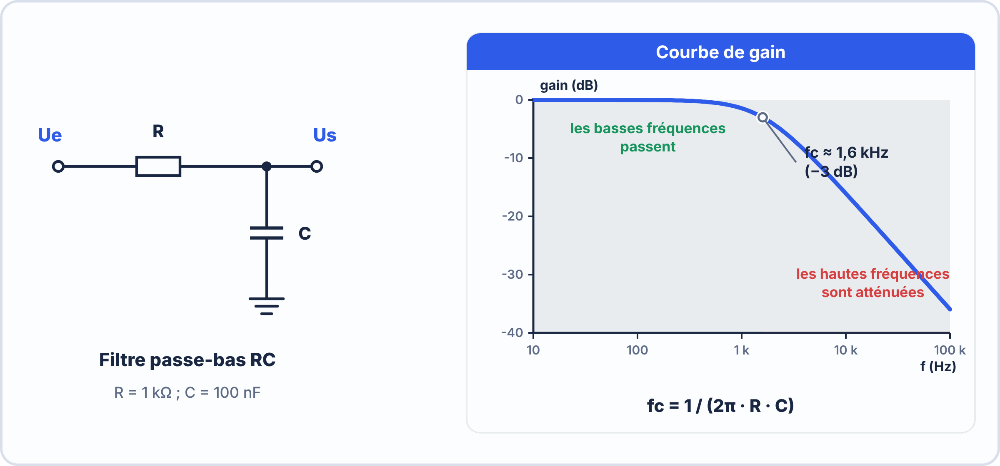

# 🔬 TRAVAUX PRATIQUES + EXERCICES — S13 · 2ᵉ ANNÉE · E2
## CEM : Identifier les Violations · Condensateurs de Découplage · Plan de Masse

---

> **Nom** : ___________________________ **Binôme** : ___________________________
> **Date** : ___________________________
> **Durée** : 80 minutes · **Fiche de cours autorisée** · **KiCad disponible**

---

## 📌 Compétences travaillées

| Code | Compétence |
|---|---|
| **S7.1** | Identifier source, victime, couplage dans un schéma |
| **S7.4** | Expliquer le blindage et ses limites |
| **S7.5** | Placer correctement les condensateurs de découplage |
| **S7.6** | Évaluer la qualité d'un plan de masse |
| **C7.1** | Appliquer les règles CEM dans un PCB KiCad |

---

## 🟢 EXERCICE 1 — Identifier les couplages (15 min)

> Chaque scénario décrit une situation d'interférence. Pour chacun :
> - Identifie la source et la victime
> - Identifie le type de couplage dominant
> - Propose une solution

**Scénario A** :

```
Une ESP32 alimente une LED sur GPIO2. Chaque fois que la LED commute (100 Hz),
le capteur analogique sur GPIO34 lit des pics de tension sur la valeur de la LDR.
Les deux composants partagent le même fil GND de la breadboard.
```

```
Source   : ___________________________________________________________________
Victime  : ___________________________________________________________________
Couplage : ☐ Résistif ☐ Capacitif ☐ Inductif ☐ Rayonné
Raison   : ___________________________________________________________________
Solution : ___________________________________________________________________
```

**Scénario B** :

```
Deux pistes PCB parallèles et proches, longues de 10 cm :
  - Piste 1 : signal UART TX 115200 baud (transitions rapides)
  - Piste 2 : signal analogique d'un capteur de température (0-3,3V lent)
Le capteur donne des lectures erratiques corrélées aux transmissions UART.
```

```
Source   : ___________________________________________________________________
Victime  : ___________________________________________________________________
Couplage : ☐ Résistif ☐ Capacitif ☐ Inductif ☐ Rayonné
Raison   : ___________________________________________________________________
Solution (2 propositions) :
  1. _________________________________________________________________________
  2. _________________________________________________________________________
```

**Scénario C** :

```
Dans un tableau électrique, le câble d'alimentation d'un moteur (230V, 5A)
chemine en parallèle sur 2 mètres avec le câble d'un capteur de position (0-10V).
Le capteur donne des valeurs qui "sautent" à chaque démarrage du moteur.
```

```
Source   : ___________________________________________________________________
Victime  : ___________________________________________________________________
Couplage : ☐ Résistif ☐ Capacitif ☐ Inductif ☐ Rayonné
Raison   : ___________________________________________________________________
Solution (câblage) : ___________________________________________________________
```

---

## 🟡 EXERCICE 2 — Analyser un PCB pour les règles CEM (20 min)

> Examine le schéma de PCB ci-dessous (ou le fichier KiCad fourni par l'enseignant).
> Identifie les violations CEM et propose des corrections.

```
DESCRIPTION DU PCB DÉFAILLANT :

  ┌──────────────────────────────────────────────────────────────────────┐
  │                        PCB — Vue de dessus (F.Cu)                   │
  │                                                                      │
  │  VCC ─────────────────────────────────── ESP32 ─── LED ─── GND      │
  │                                               │                      │
  │  Capteur ADC ─── longue piste 15cm ─────── GPIO34                   │
  │                                               │                      │
  │  [Condensateur 100µF] ─── à 5cm du CI ─── VCC/GND ESP32            │
  │                                                                      │
  │  Plan de masse B.Cu :  █████████ │ ██████████████                   │
  │                                  ↑                                   │
  │                              Fente causée par une piste             │
  │                              qui traverse le plan                   │
  └──────────────────────────────────────────────────────────────────────┘
```

**Q2.1** — Identifie les violations CEM dans ce PCB (au moins 4) :

```
Violation 1 : _________________________________________________________________
  Problème CEM : _______________________________________________________________
  Correction   : _______________________________________________________________

Violation 2 : _________________________________________________________________
  Problème CEM : _______________________________________________________________
  Correction   : _______________________________________________________________

Violation 3 : _________________________________________________________________
  Problème CEM : _______________________________________________________________
  Correction   : _______________________________________________________________

Violation 4 : _________________________________________________________________
  Problème CEM : _______________________________________________________________
  Correction   : _______________________________________________________________
```

**Q2.2** — Pour la piste longue de 15 cm du capteur ADC :
À partir de quelle fréquence cette piste commence-t-elle à se comporter comme une antenne ?
(Règle : antenne efficace si longueur > λ/20, avec λ = c/f et c = 3×10⁸ m/s)

Longueur de piste L = 15 cm = 0,15 m  

$$L > λ/20 \to λ < 20 \times L = 20 \times 0{,}15 = \underline{\hspace{2.5em}} m$$

$$f > c / λ = 3 \times 10⁸ / \underline{\hspace{2.5em}} = \underline{\hspace{2.5em}} Hz = \underline{\hspace{2.5em}} MHz$$

Conclusion : Cette piste se comporte comme une antenne à partir de _______ MHz.  
À 100 MHz (fréquence ESP32 WiFi préparation) elle a une longueur de λ/20 = _____ m.  

---

## 🟠 EXERCICE 3 — Placer les condensateurs de découplage dans KiCad (25 min)

> Ouvre un projet KiCad de ton choix (projet CLIMASENS ou projet S6).

**3.1** — Dans le Schematic Editor, ajoute les condensateurs de découplage autour des alimentations des CI :

```
Pour chaque CI (ESP32, NE555, etc.) :
  ☐ Ajouter un condensateur 100nF (Device:C · empreinte : Capacitor_SMD:C_0402_1005Metric)
    entre VCC et GND du CI
  ☐ Ajouter un condensateur 10µF si disponible (Capacitor_SMD:C_0805)
  ☐ Vérifier ERC : 0 erreur
```

**3.2** — Dans le PCB Editor, respecter les règles de placement :

```
☐ Les condensateurs de découplage sont placés AU PLUS PRÈS des pins VCC/GND
  (distance cible : < 2mm idéalement)
☐ Le via GND du condensateur est en dessous du pad GND du condensateur
  (chemin de retour le plus court possible)
☐ Mesurer la distance entre le condensateur et le CI :
  Distance C1 → U1 : _______ mm (☐ conforme si < 3mm · ☐ à rapprocher)
```

**3.3** — Vérifier le plan de masse :

```
☐ Le plan de masse B.Cu est-il continu (sans fente due à des pistes) ?
  → Si des pistes traversent le plan : les rediriger ou passer par F.Cu
☐ Le DRC signale-t-il des problèmes liés au plan de masse ?
  Erreurs : _____________________________________________________________
```

**3.4** — Capture d'écran :
Faire une capture du PCB montrant les condensateurs de découplage bien placés.

---

## 🔵 EXERCICE 4 — Filtres RC et fréquence de coupure (15 min)

> Un filtre passe-bas RC est souvent utilisé pour filtrer les perturbations HF
> avant l'entrée d'un ADC (convertisseur analogique-numérique).



```
Fréquence de coupure : fc = 1 / (2π × R × C)
```

**Q4.1** — Calcule la fréquence de coupure pour :

Filtre A : R = 1 kΩ · C = 100 nF  

$$fc = \dfrac{1}{2π \times \underline{\hspace{2.5em}} \times \underline{\hspace{2.5em}}} = \underline{\hspace{2.5em}} Hz = \underline{\hspace{2.5em}} kHz$$

Filtre B : R = 10 kΩ · C = 10 nF  

$$fc = \dfrac{1}{2π \times \underline{\hspace{2.5em}} \times \underline{\hspace{2.5em}}} = \underline{\hspace{2.5em}} Hz = \underline{\hspace{2.5em}} kHz$$

Filtre C : R = 100 Ω · C = 1 µF  

$$fc = \dfrac{1}{2π \times \underline{\hspace{2.5em}} \times \underline{\hspace{2.5em}}} = \underline{\hspace{2.5em}} Hz = \underline{\hspace{2.5em}} kHz$$

**Q4.2** — Pour un ADC qui lit un signal de **température** (variation maximale de 1 Hz),
tu veux bloquer toutes les perturbations au-dessus de 100 Hz.
Quel filtre (A, B ou C) est le mieux adapté ? Justifie.

```
Filtre choisi : ___  ·  Sa fréquence de coupure : _______ Hz/kHz
Justification :
  - fc doit être ______ (au-dessus / en-dessous) de 100 Hz pour bloquer les perturbations
  - Le filtre choisi a fc = _______ Hz → ☐ correct ☐ incorrect
  
Problème avec le filtre C pour ce cas :
  ___________________________________________________________________________
```

**Q4.3** — En CEM, pourquoi un condensateur seul (sans résistance en série) est-il insuffisant comme filtre anti-bruit pour un ADC ?

```
Un condensateur seul (directement entre signal et GND) :
  → Atténue bien les signaux ☐ BF ☐ HF
  → Mais peut charger la source et modifier la valeur du signal DC
  → La résistance R crée une impédance de source qui... __________________________
  → Sans R : si la perturbation HF est très intense, le condensateur 
     peut se comporter comme un court-circuit à HF et ________________________
```

---

## ✅ Auto-évaluation

| Compétence | Maîtrisé | En cours | À revoir |
|---|---|---|---|
| Identifier source, victime, couplage | ☐ | ☐ | ☐ |
| Distinguer émissions conduites et rayonnées | ☐ | ☐ | ☐ |
| Expliquer le rôle du condensateur de découplage | ☐ | ☐ | ☐ |
| Placer les condensateurs au plus près du CI | ☐ | ☐ | ☐ |
| Identifier les violations CEM dans un PCB | ☐ | ☐ | ☐ |
| Calculer la fréquence de coupure d'un filtre RC | ☐ | ☐ | ☐ |
| Expliquer le rôle du plan de masse continu | ☐ | ☐ | ☐ |

---
