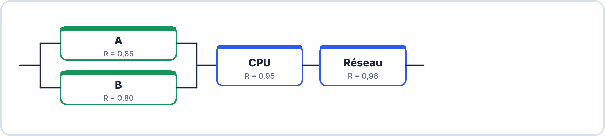

# 🔬 ATELIERS DE REMÉDIATION CIBLÉE — S15 · 2ᵉ ANNÉE · E2
## 4 Ateliers Différenciés : PCB · ESP32/MQTT · Fiabilité · CEM

---

> **Nom** : \_\_\_\_\_\_\_\_\_\_\_\_\_\_\_\_\_\_\_\_\_\_\_\_\_\_\_
> **Atelier(s) choisi(s) selon diagnostic** : ☐ A — PCB  ☐ B — ESP32/MQTT  ☐ C — Fiabilité  ☐ D — CEM

---

## 🟦 ATELIER A — PCB et KiCad (pour score < 4/5 en thème 1)

**Durée cible : 30 min · KiCad disponible**

### Rappel express (5 min)

```
FLUX KICAD en 30 secondes :
  Schéma (ERC=0) → Empreintes → Update PCB → Contour → Placement → Routage → DRC → Gerber

CALQUES ESSENTIELS :
  F.Cu = pistes avant (rouge)  ·  B.Cu = pistes arrière (bleu)
  Edge.Cuts = contour (jaune)  ·  F.Silkscreen = sérigraphie (blanc)

RÈGLES MINIMALES :
  Clearance ≥ 0,2 mm  ·  Piste signal : 0,35 mm  ·  Piste power : 0,8 mm
  Via : 0,8 mm ext / 0,4 mm perçage
```

### Exercice A1 — Identifier les erreurs dans ce schéma KiCad (10 min)

> Description d'un schéma KiCad avec des problèmes :


```
Erreurs à trouver (il y en a 4) :

  1. La résistance R1 n'a pas de valeur saisie (champ Value vide)
     → Problème : ___________________________________________________________
     → Correction : __________________________________________________________

  2. Il n'y a pas de PWR_FLAG sur le net +5V
     → Problème visible : ____________________________________________________
     → Correction : __________________________________________________________

  3. La LED D1 est branchée avec la cathode vers le +5V (sens inversé)
     → Problème : ___________________________________________________________
     → Correction : __________________________________________________________

  4. ERC signale "Pin not connected" sur la broche "K" de la LED
     → Raison : ______________________________________________________________
     → Correction : __________________________________________________________
```

??? success "Réponses"

    1. Valeur vide → impossible de lire ou commander le composant, BOM incomplète. Correction : renseigner le champ Value (par exemple 330 Ω).  
    2. Pas de PWR_FLAG → l'ERC signale « power pin not driven » : KiCad ne sait pas qu'une source alimente ce net. Correction : poser un PWR_FLAG sur +5V.  
    3. LED inversée → elle ne s'allume jamais. Correction : anode côté +5V (via la résistance), cathode vers GND.  
    4. Raison : la cathode (K) n'est reliée à rien. Correction : la relier à GND (ou poser un No Connect si la broche est volontairement libre).

### Exercice A2 — Calculer la clearance (5 min)

```
Un PCB a :
  Piste A : largeur 0,35 mm
  Piste B : largeur 0,35 mm
  Distance bord à bord entre les deux pistes : 0,12 mm

La clearance configurée est 0,20 mm.

Y a-t-il une violation DRC ? ☐ Oui ☐ Non
De combien ? _______ mm (si violation)
Que fait le DRC dans ce cas : ________________________________________________
```

??? success "Réponses"
    **Oui**, il y a violation : $0{,}20 - 0{,}12 = 0{,}08\,\mathrm{mm}$ de moins que le minimum. Le DRC place un **marqueur d'erreur** sur le PCB à cet endroit ; il ne bloque pas la fabrication, mais la carte n'est pas conforme tant que l'erreur n'est pas corrigée (écarter les pistes).

### Exercice A3 — Questions gerber (10 min)

```
Q.A.3a — Quels fichiers Gerber sont obligatoires pour commander un PCB chez JLCPCB ?
Citer au moins 5 :
  1. ___________________________  4. ___________________________
  2. ___________________________  5. ___________________________
  3. ___________________________

Q.A.3b — Après export, quelle étape de vérification est recommandée avant d'envoyer au fabricant ?
_______________________________________________________________________________

Q.A.3c — Dans GerbView, que signifient les zones NOIRES sur le calque F.Mask ?
_______________________________________________________________________________
```

??? success "Réponses"
    **Q.A.3a** — F.Cu, B.Cu, F.Mask, B.Mask, F.Silkscreen, Edge.Cuts, plus le fichier de perçage (.drl).  
    **Q.A.3b** — **Ouvrir les fichiers dans un visualiseur** (GerbView ou visualiseur en ligne) pour vérifier ce qui sera réellement fabriqué.  
    **Q.A.3c** — Les zones noires indiquent les **ouvertures du masque de soudure** : le cuivre y reste apparent (pastilles à souder).

---

## 🟩 ATELIER B — ESP32, WiFi, MQTT, Node-RED (pour score < 4/5 en thème 2)

**Durée cible : 30 min · Arduino IDE disponible**

### Rappel express (5 min)

```
ESP32 :
  Mode STA   : WiFi.begin(ssid, pass)  → IP par DHCP
  Mode AP    : WiFi.softAP(ssid, pass) → IP = 192.168.4.1
  WebServer  : server.on("/route", handler)  +  server.handleClient() dans loop()

MQTT :
  3 acteurs : Publisher · Subscriber · Broker
  mqtt.connect(client_id) · mqtt.subscribe(topic) · mqtt.publish(topic, msg)
  mqtt.loop() dans loop() = OBLIGATOIRE
  Client ID UNIQUE par ESP32 !

NODE-RED :
  msg.payload = la donnée  ·  msg.topic = nom de la série (chart)
  Deploy = valider les modifications
  Dashboard : http://localhost:1880/ui
```

### Exercice B1 — Corriger ce code Arduino (15 min)

> Ce code contient 4 erreurs. Identifie-les et corrige-les.

```cpp
??? success "Réponses"
    1. `Serial.begin(9600)` : sur ESP32, utiliser **115200** (messages de démarrage lisibles).  
    2. `while (WiFi.status() == WL_CONNECTED)` : condition **inversée** ; il faut `!=`.  
    3. `mqtt.connect("ESP32")` : identifiant **non unique** et connexion **non testée** ; utiliser un ID unique et vérifier le retour de `connect`.  
    4. `delay(5000)` + absence de `mqtt.loop()` : le client MQTT n'est jamais entretenu ; appeler `mqtt.loop()` à chaque tour de `loop()` et remplacer `delay` par `millis()`.  
    *(Le repérage exact des 4 erreurs est une proposition à valider par l'enseignant.)*

#include <WiFi.h>
#include <PubSubClient.h>

const char* ssid    = "MonWifi";
const char* pass    = "monpass";
const char* broker  = "broker.hivemq.com";
const char* topic   = "ecole/salle/temp";

WiFiClient   client;
PubSubClient mqtt(client);

void setup() {
  Serial.begin(9600);                // Erreur 1 : _________________________
  WiFi.begin(ssid, pass);
  while (WiFi.status() == WL_CONNECTED) { delay(500); }  // Erreur 2 : ____
  
  mqtt.setServer(broker, 1883);
  mqtt.connect("ESP32");             // Erreur 3 : _________________________
  mqtt.subscribe(topic);
}

void loop() {
  float temp = 23.5;
  mqtt.publish(topic, String(temp).c_str());
  delay(5000);                       // Erreur 4 : _________________________
}
```

```
Erreur 1 : _____________________ · Correction : ______________________________
Erreur 2 : _____________________ · Correction : ______________________________
Erreur 3 : _____________________ · Correction : ______________________________
Erreur 4 : _____________________ · Correction : ______________________________
```

### Exercice B2 — Node-RED (10 min)

```
Q.B.2a — Décris le flow minimum pour recevoir un message MQTT et afficher
          la valeur de "temperature" sur une gauge dashboard :
  
  Nœud 1 : ____________________ → Rôle : ______________________________________
  Nœud 2 : ____________________ → Rôle : ______________________________________
  Nœud 3 : ____________________ → Rôle : ______________________________________
  Nœud 4 : ____________________ → Rôle : ______________________________________

Q.B.2b — Un apprenant constate que sa gauge ne se met pas à jour.
          Le debug montre que msg.payload = '{"temperature":23.5}'.
          Que faut-il ajouter entre mqtt-in et la gauge ?

  → Problème : msg.payload est de type _____________ (pas un nombre)
  → Solution : ajouter le nœud __________________ puis un nœud function :
    msg.payload = __________________________________;
    return msg;

Q.B.2c — Pour afficher 3 courbes (température, humidité, CO₂) sur UN SEUL chart,
          que doit contenir msg.topic dans chaque flow ?

  Flow 1 (temp) → msg.topic = "_______________"
  Flow 2 (hum)  → msg.topic = "_______________"
  Flow 3 (CO₂)  → msg.topic = "_______________"
```

??? success "Réponses"
    **Q.B.2a** — Nœud 1 : `mqtt in` → reçoit le message ; nœud 2 : `json` → convertit la chaîne en objet ; nœud 3 : `function` → extrait `msg.payload.temperature` ; nœud 4 : `ui_gauge` → affiche la valeur.  
    **Q.B.2b** — `msg.payload` est de type **chaîne (string)** ; ajouter un nœud **json** puis un nœud function : `msg.payload = msg.payload.temperature;`.  
    **Q.B.2c** — `msg.topic = "temperature"`, `msg.topic = "humidite"`, `msg.topic = "co2"` : un topic **différent** par courbe.

---

## 🟧 ATELIER C — Fiabilité : MTBF, MTTR, R(t) (pour score < 2/3 en thème 4)

**Durée cible : 30 min · Calculatrice obligatoire**

### Rappel express (3 min)

λ = 1/MTBF               MTBF = TO/n           MTTR = TA/n  
D = MTBF/(MTBF+MTTR)     R(t) = $e^{-\lambda t}$        F(t) = 1 − R(t)  

À t = MTBF : R = $e^{-1}$ = 0,368 (36,8% encore OK)  

Série    : Rs = R1 × R2 × R3  
Parallèle: Rs = 1 − (1−R1)(1−R2)(1−R3)  

$$e^{-0{,}1}=0{,}905 e^{-0{,}2}=0{,}819 e^{-0{,}3}=0{,}741 e^{-0{,}5}=0{,}607 e^{-1}=0{,}368$$

### Exercice C1 — MTBF/MTTR/D (10 min)

Un automate industriel a fonctionné 2 ans (24h/24) et a subi 5 pannes :  
Panne 1 : 2h00   Panne 2 : 30 min   Panne 3 : 45 min  
Panne 4 : 3h15   Panne 5 : 1h30  

a) TA total = \_\_\_\_\_\_\_ h  

$$b) TO = 2 \times 8760 - TA = \underline{\hspace{2.5em}} h$$

c) MTBF = TO / n = \_\_\_\_\_\_\_ h = \_\_\_\_\_\_\_ jours  
d) MTTR = TA / n = \_\_\_\_\_\_\_ h  
e) D = MTBF / (MTBF + MTTR) = \_\_\_\_\_\_\_  = \_\_\_\_\_\_\_ %  
f) Exigence D ≥ 99,9% : ☐ Conforme ☐ Non conforme  

??? success "Réponses"
    a) $TA = 2 + 0{,}5 + 0{,}75 + 3{,}25 + 1{,}5 = 8\,\mathrm{h}$.  
    b) $TO = 2 \times 8760 - 8 = 17\,512\,\mathrm{h}$.  
    c) $MTBF = \dfrac{17\,512}{5} = 3\,502{,}4\,\mathrm{h} \approx 146$ jours.  
    d) $MTTR = \dfrac{8}{5} = 1{,}6\,\mathrm{h}$.  
    e) $D = \dfrac{3\,502{,}4}{3\,502{,}4 + 1{,}6} \approx 0{,}9995 = 99{,}95\,\%$.  
    f) $99{,}95\,\% \geq 99{,}9\,\%$ : **conforme**.

### Exercice C2 — Loi exponentielle (10 min)

Capteur DHT22 : MTBF = 50 000 h  

$$a) \lambda  = \dfrac{1}{50000} = \underline{\hspace{2.5em}} h^{-1}$$

b) R après 1 an (8760h) :  

$$\lambda t = \underline{\hspace{2.5em}} \times 8760 = \underline{\hspace{2.5em}}$$

$$R(8760) = e^{\underline{\hspace{2.5em}}} = \underline{\hspace{2.5em}} = \underline{\hspace{2.5em}} %$$

c) Sur 200 capteurs, après 1 an : \_\_\_\_\_\_\_ encore fonctionnels  

d) Pour R(t) ≥ 90% :  

$$e^{-\lambda t} \geq 0{,}90 \to -\lambda t \geq \ln(0{,}90) \approx -0{,}105$$

t ≤ 0,105 / λ = \_\_\_\_\_\_\_ h = \_\_\_\_\_\_\_ mois  

??? success "Réponses"
    a) $\lambda = \dfrac{1}{50\,000} = 2 \times 10^{-5}\,\mathrm{h^{-1}}$.  
    b) $\lambda t = 2 \times 10^{-5} \times 8760 = 0{,}1752$ ; $R(8760) = e^{-0{,}1752} \approx 0{,}839 = 83{,}9\,\%$.  
    c) $200 \times 0{,}839 \approx 168$ capteurs encore fonctionnels.  
    d) $t \leq \dfrac{0{,}105}{2 \times 10^{-5}} \approx 5\,270\,\mathrm{h} \approx 7{,}2$ mois.

### Exercice C3 — Système mixte (10 min)



```
a) R_capteurs (parallèle) = 1 − (1 − _______)(1 − _______) = _______

b) Rs global = _______ × _______ × _______ = _______ = _______ %

c) Quel est le maillon le plus faible ? _________ (R = _______)

d) Si on ajoute un C identique à B en parallèle :
   R_B-nouveau = 1 − (0,20)(0,20) = _______
   R_capteurs-nouveau = 1 − (0,15)(______) = _______
   Rs-nouveau = _______ × 0,95 × 0,98 = _______ %
   Gain : _______ points
```

??? success "Réponses"
    a) $R_{capteurs} = 1 - (1 - 0{,}85)(1 - 0{,}80) = 1 - 0{,}15 \times 0{,}20 = 0{,}97$.  
    b) $R_s = 0{,}97 \times 0{,}95 \times 0{,}98 \approx 0{,}903 = 90{,}3\,\%$.  
    c) Dans la chaîne en série, le maillon le plus faible est le **CPU** ($R = 0{,}95$) ; le composant individuellement le moins fiable est le capteur B ($R = 0{,}80$), mais la mise en parallèle le compense.  
    d) $R_{B,nouveau} = 1 - 0{,}2 \times 0{,}2 = 0{,}96$ ; $R_{capteurs,nouveau} = 1 - 0{,}15 \times 0{,}04 = 0{,}994$ ; $R_{s,nouveau} = 0{,}994 \times 0{,}95 \times 0{,}98 \approx 0{,}925 = 92{,}5\,\%$ ; gain : environ **+2,2 points**.

---

## 🟥 ATELIER D — CEM (pour score < 3/4 en thème 5)

**Durée cible : 30 min · Calculatrice disponible**

### Rappel express (3 min)

```
3 acteurs : Source → Couplage → Victime
4 couplages : Résistif (masse commune) · Capacitif (pistes proches)
              Inductif (boucle courant) · Rayonné (ondes EM)

Conduit < 30 MHz (câbles) · Rayonné > 30 MHz (ondes)

Blindage : continu + mis à la masse · fente < λ/20
Découplage : 100nF + 10µF au plus près du CI (<1mm)
Ferrite : absorbe l'énergie HF sur les câbles
Plan de masse : continu → courant de retour direct → petite boucle → peu de rayonnement
Fente dans le plan → détour → grande boucle → fort rayonnement !

fc filtre RC = 1 / (2π × R × C)
```

### Exercice D1 — Couplages (10 min)

```
Pour chaque situation, identifie le type de couplage dominant et propose une solution :

Situation 1 : Une piste UART (transitions à 115200 baud) passe parallèle
              sur 8 cm à côté d'une piste de capteur analogique.
  Couplage : ________________   Solution : ______________________________________

Situation 2 : Un relais 12V commute un moteur. Le courant du moteur passe
              dans le même fil de masse que le microcontrôleur voisin.
  Couplage : ________________   Solution : ______________________________________

Situation 3 : Un téléphone 4G posé sur une table perturbe les données WiFi
              d'un ESP32 situé à 30 cm.
  Couplage : ________________   Solution : ______________________________________
```

??? success "Réponses"

    - **Situation 1** : couplage **capacitif** (pistes parallèles proches). Solution : éloigner les pistes ou intercaler une piste de garde à la masse.  
    - **Situation 2** : couplage **résistif** (impédance commune de la masse). Solution : masses séparées reliées en un seul point, diode de roue libre sur le relais.  
    - **Situation 3** : couplage **rayonné**. Solution : éloigner le téléphone, blinder le boîtier, filtrer.

### Exercice D2 — Calculs CEM (10 min)

a) Un boîtier doit bloquer les rayonnements WiFi (2,4 GHz).  
Quelle est la taille maximale des fentes d'aération ?  

$$\lambda  = 3 \times 10^{8} / 2{,}4 \times 10^{9} = \underline{\hspace{2.5em}} m = \underline{\hspace{2.5em}} cm$$

Fente max = λ/20 = \_\_\_\_\_\_\_ cm = \_\_\_\_\_\_\_ mm  

b) Un filtre RC protège un ADC. Le signal utile est à 5 Hz maximum.  
On veut fc = 50 Hz. Avec R = 33 kΩ, calculer C :  

$$C = \dfrac{1}{2\pi  \times fc \times R} = \dfrac{1}{2\pi  \times \underline{\hspace{2.5em}} \times \underline{\hspace{2.5em}}}$$

C = \_\_\_\_\_\_\_ F = \_\_\_\_\_\_\_ nF (valeur commerciale : \_\_\_\_\_\_\_ nF)  

c) À partir de quelle fréquence une piste de 20 cm se comporte-t-elle comme une antenne ?  

$$L > \lambda /20 \to \lambda  < 20 \times 0{,}20 = \underline{\hspace{2.5em}} m$$

$$f > c/\lambda  = 3 \times 10^{8} / \underline{\hspace{2.5em}} = \underline{\hspace{2.5em}} \mathrm{MHz}$$

??? success "Réponses"
    a) $\lambda = \dfrac{3 \times 10^{8}}{2{,}4 \times 10^{9}} = 0{,}125\,\mathrm{m} = 12{,}5\,\mathrm{cm}$ ; fente max $= \dfrac{\lambda}{20} = 0{,}625\,\mathrm{cm} = 6{,}25\,\mathrm{mm}$.  
    b) $C = \dfrac{1}{2\pi \times 50 \times 33\,000} \approx 9{,}6 \times 10^{-8}\,\mathrm{F} \approx 96\,\mathrm{nF}$ ; valeur commerciale : **100 nF**.  
    c) $\lambda < 20 \times 0{,}20 = 4\,\mathrm{m}$ ; $f > \dfrac{3 \times 10^{8}}{4} = 75\,\mathrm{MHz}$.

### Exercice D3 — Règles PCB CEM (10 min)

```
Classe chaque affirmation comme VRAIE (V) ou FAUSSE (F) :

___ 1. Un plan de masse avec une fente améliore le blindage entre les deux zones.
___ 2. Le condensateur de découplage doit être au plus près du CI pour être efficace.
___ 3. Les émissions conduites se propagent par les ondes radio.
___ 4. Une ferrite absorbe l'énergie HF et la dissipe en chaleur.
___ 5. GND (masse logique) et Terre (PE) sont toujours le même conducteur.
___ 6. Plus une boucle de courant est grande, plus elle rayonne.
___ 7. Un filtre RC passe-bas laisse passer les fréquences inférieures à fc.
___ 8. En mode AP, l'ESP32 peut aussi être connecté à un réseau WiFi (STA) simultanément.

Pour chaque FAUSSE : corriger en une phrase :
  N°___ : ____________________________________________________________________
  N°___ : ____________________________________________________________________
```

??? success "Réponses"
    1 **F** ; 2 **V** ; 3 **F** ; 4 **V** ; 5 **F** ; 6 **V** ; 7 **V** ; 8 **V**.  
    Corrections : 1 — une fente **dégrade** le blindage (le courant de retour fait un détour : grande boucle) ; 3 — les émissions conduites se propagent **par les câbles**, pas par ondes ; 5 — la masse logique et la terre (PE) sont **deux conducteurs distincts** (reliés en un point si nécessaire).

---
