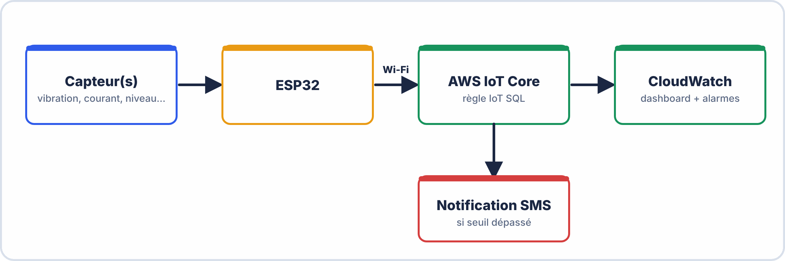

# 📋 CAHIER DES CHARGES — PROJET A2
## Industrie 4.0 : Système IoT de Supervision et Maintenance Prédictive

**Équipe : ________________  Sujet : ___  Date : ________________**

---

## 🏭 CONTEXTE CLIENT

> **INDUSTECH SAS** fabrique des équipements industriels légers. Le responsable maintenance vous confie la mission suivante :
>
> *"Nos machines tombent en panne de façon imprévisible, causant des arrêts de production coûteux. Nous voulons un système IoT qui surveille les paramètres critiques de nos équipements en temps réel et nous alerte AVANT la panne. Nous voulons aussi comprendre nos cycles de défaillance (MTBF) pour planifier les maintenances."*

---

## 📐 ARCHITECTURE GÉNÉRALE REQUISE



---

## ✅ EXIGENCES FONCTIONNELLES OBLIGATOIRES

### EF1 — Acquisition de données

- [ ] Au moins **2 grandeurs mesurées** (ex: vibration + température, courant + température)
- [ ] Fréquence de publication : toutes les **5 secondes maximum**
- [ ] Format JSON structuré avec au minimum :

```json
{
  "device_id": "industech-machine-01",
  "timestamp": 1710000000,
  "mesure1": 23.4,
  "mesure2": 0.87,
  "unite1": "°C",
  "unite2": "A",
  "alarme": false
}
```

### EF2 — Connexion sécurisée

- [ ] Connexion AWS IoT Core via **MQTT TLS port 8883**
- [ ] Authentification par **certificats X.509**
- [ ] Reconnexion automatique en cas de coupure
- [ ] LWT configuré (`status: "offline"` si déconnexion brutale)

### EF3 — Règle IoT + CloudWatch

- [ ] **Au moins 1 règle IoT SQL** qui route les données vers CloudWatch
- [ ] **Au moins 2 métriques CloudWatch** alimentées
- [ ] **Dashboard CloudWatch** avec au minimum :
  - Graphique en courbes (évolution dans le temps)
  - Widget chiffre (valeur instantanée)
- [ ] **1 alarme CloudWatch** configurée avec seuil pertinent

### EF4 — Logique de maintenance prédictive

- [ ] Détection d'un **seuil d'alerte** dans le code ESP32 (valeur dépassée → champ `"alarme": true`)
- [ ] **Calcul du MTBF** à partir des données collectées (voir section MTBF)
- [ ] **Tableau de bord maintenance** : afficher les derniers 10 events d'alarme

---

## ✅ EXIGENCES NON FONCTIONNELLES

| **Exigence** | **Critère mesurable** |
|---|---|
| Disponibilité | Le système publie sans interruption pendant **15 minutes** de test |
| Latence | Le délai entre mesure et apparition dans CloudWatch < **30 secondes** |
| Sécurité | Connexion refusée si le certificat est désactivé |
| Documentabilité | Schéma KiCad + code commenté + plan de tests rempli |
| Boîtier | Au minimum un prototype de boîtier (dessin ou impression 3D) |

---

## 📐 CALCUL DU MTBF — GUIDE

### Définition

> **MTBF** (Mean Time Between Failures) = durée moyenne entre deux pannes consécutives sur un équipement. En maintenance prédictive IoT, on étend ce concept aux **événements d'alarme** : quelle est la durée moyenne entre deux dépassements de seuil ?

### Formule

$$\boxed{MTBF = \frac{\text{Durée totale d'observation}}{\text{Nombre de défaillances (alarmes)}} }$$

### Exemple de calcul

```
Données collectées sur 2 heures de test :
  Début d'observation   : 14h00
  Fin d'observation     : 16h00
  Durée totale          : 120 minutes

  Alarmes déclenchées :
    14h12 → vibration > 2g   (alarme 1)
    14h45 → vibration > 2g   (alarme 2)
    15h23 → vibration > 2g   (alarme 3)
    15h58 → vibration > 2g   (alarme 4)

  Nombre d'alarmes = 4

MTBF = 120 min / 4 = 30 minutes entre deux alarmes

Interprétation :
  "En moyenne, une alarme de vibration se produit toutes les 30 min.
   À ce rythme, une maintenance doit être planifiée dans les X heures
   pour éviter une panne mécanique."
```

### Table de vos données MTBF (à remplir pendant le projet)

| **# Alarme** | **Horodatage** | **Valeur déclenchante** | **Durée depuis la précédente** |
|---|---|---|---|
| 1 | | | — |
| 2 | | | ___ min |
| 3 | | | ___ min |
| 4 | | | ___ min |
| 5 | | | ___ min |
| **MTBF calculé** | | | ___ min |

**Interprétation :** _________________________________________________________
_________________________________________________________________________

---

## 📋 LIVRABLES ATTENDUS

### Livrable 1 — Dossier Technique (remis avant la soutenance)

```
☐ Diagramme bloc de l'architecture (main-d'œuvre + matière + méthode)
☐ Schéma KiCad du circuit capteur (au moins partiellement)
☐ Code ESP32 commenté (fichier .ino)
☐ Capture du dashboard CloudWatch annoté
☐ Tableau MTBF avec calcul et interprétation
☐ Plan de tests exécuté (au moins 5 cas, résultats réels)
☐ Fiche de maintenance si un problème a été rencontré et résolu
```

### Livrable 2 — Démonstation Live (soutenance)

```
☐ Matériel fonctionnel (ESP32 publie en temps réel)
☐ Dashboard visible et à jour
☐ Démonstration d'une alarme (dépasser le seuil)
☐ Répondre aux questions jury sans notes
```

---

## 📊 BARÈME DU PROJET

| **Livrable** | **Points** |
|---|---|
| Architecture + diagramme bloc | /15 |
| Circuit + schéma KiCad | /20 |
| Code ESP32 (qualité + fonctionnel) | /20 |
| Dashboard CloudWatch (2 métriques + 1 alarme) | /20 |
| Calcul MTBF + interprétation | /15 |
| Plan de tests (5 cas exécutés) | /10 |
| Soutenance (présentation + démo + questions) | /20 |
| **TOTAL** | **/120** |

> *Ramené à /20 : score × (20/120)*

---

## 📅 JALONS

| **Jalon** | **Fin de phase** | **Vérification formateur** |
|---|---|---|
| J1 — Architecture validée | 0h30 | Visa sur diagramme bloc |
| J2 — Circuit opérationnel | 1h30 | Signal capteur visible sur oscillo/série |
| J3 — AWS connecté + publication | 3h00 | Message visible dans console AWS |
| J4 — Dashboard + MTBF | 3h45 | Métriques visibles + tableau MTBF |
| J5 — Tests + documentation | 4h00 | Plan de tests rempli |

---

**Document – BAC PRO CIEL – A2 – E2/U21 – Version 1.0 – 2026**
