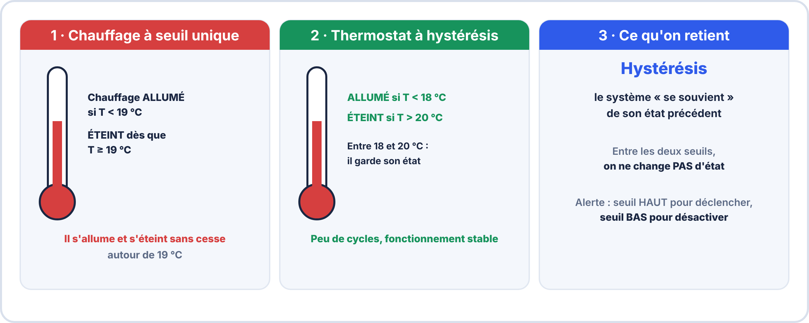
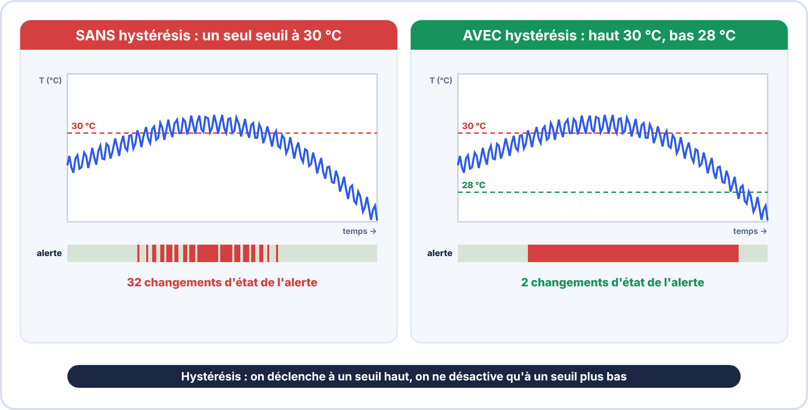

# 📘 FICHE DE COURS — S17 · 2ᵉ ANNÉE · E2

> [!NOTE] 🔶 Approfondissement
> Cette partie va **au-delà de l'essentiel** attendu pour l'épreuve E2. À faire **après** le parcours essentiel (voir l'onglet « L'essentiel en 1 an »), si tu as du temps ou si tu vises plus haut.

## Industrie 4.0 : KPI · Alertes Intelligentes · Métrologie · PV

---

> **Nom** : \_\_\_\_\_\_\_\_\_\_\_\_\_\_\_\_\_\_\_\_\_\_\_\_\_\_\_
> **Date** : \_\_\_\_\_\_\_\_\_\_\_\_\_\_\_\_\_\_\_\_\_\_\_\_\_\_\_
> **Compétences** : S5.4 · S5.5 · S5.6 · C5.3 · C3.1 · S8.1

---

## 🔑 Vocabulaire clé

| Terme | Définition |
|---|---|
| **KPI** | Key Performance Indicator — indicateur clé de performance (ex: uptime, nb alertes/jour) |
| **Hystérésis** | Bande morte autour d'un seuil d'alerte pour éviter les oscillations (fausses alertes) |
| **Dashboard** | Interface visuelle regroupant les indicateurs importants d'un système |
| **SCADA** | Supervisory Control And Data Acquisition — supervision industrielle temps réel |
| **PV de métrologie** | Procès-Verbal — document officiel consignant les mesures et leur analyse |
| **Étalonnage** | Comparer un instrument à une référence connue pour établir les écarts |
| **Incertitude de mesure** | Intervalle dans lequel se trouve la valeur vraie avec une probabilité donnée |
| **Exactitude** | Accord entre la mesure et la valeur vraie (absence de biais systématique) |
| **Fidélité** | Répétabilité des mesures dans les mêmes conditions (faible dispersion) |
| **Résolution** | Plus petit changement détectable par un instrument (ex: 0,1°C pour le DHT22) |
| **Dérive** | Variation lente d'un capteur au cours du temps (vieillissement) |
| **Alarme** | Signal déclenché quand une valeur franchit un seuil critique |
| **Classe de précision** | Spécification normalisée de l'erreur maximale d'un instrument |

---

## 1️⃣ — L'Industrie 4.0 : du capteur à la décision

### 🧱 Ce qu'il faut savoir avant de commencer

| Notion | En simple |
|---|---|
| **Industrie 4.0** | Des usines et des équipements **connectés** : les machines mesurent, envoient leurs données et on **décide** avec ces données. |
| **KPI** | *Key Performance Indicator* : un **chiffre clé** qui résume l'état d'un système (ex. « disponibilité : 99,8 % »). |
| **Alerte** | Une **notification** envoyée quand une valeur sort de la plage normale. |
| **Seuil** | La valeur à partir de laquelle on considère qu'il y a un problème. |
| **Étalonnage** | Comparer un instrument à une **référence** pour connaître son écart. |

> [!TIP] 💡 En clair : de la mesure à la décision
> Un capteur mesure, le microcontrôleur transmet, le dashboard **affiche**, mais c'est le **KPI** et l'**alerte** qui permettent d'**agir** sans regarder l'écran en permanence. Un bon système sait aussi **dire s'il faut faire confiance à la mesure** : c'est la **métrologie** (partie 4).


### La pyramide de l'information industrielle


### Les KPI d'un système de surveillance

```
KPI TYPIQUES POUR UNE STATION IoT :
  Disponibilité (uptime)     : % de temps opérationnel (cible : > 99,5%)
  Fraîcheur des données      : délai entre mesure et affichage (cible : < 30s)
  Nb alertes actives         : nombre d'alertes non acquittées
  Nb anomalies / 24h         : tendance de la fiabilité capteurs
  Écart T° / référence       : indicateur qualité de mesure (métrologie)
  Consommation batterie      : % restant (si alimentation autonome)

Affichage dans Node-RED :
  Nœud "text" avec template {{msg.payload}} pour la valeur
  Nœud "gauge" pour les % (uptime, batterie)
  Nœud "ui_table" pour les listes d'alertes
```


**Exemple de calcul d'un KPI.** La station est restée hors service **1 h** sur **30 jours** (720 h).

1. Temps de fonctionnement : 720 − 1 = **719 h**.
2. Disponibilité : 719 / 720 ≈ **0,9986**, soit **99,86 %**.
3. Comparaison à la cible (99,5 %) : **objectif atteint**.

### ✅ Vérifie que tu as compris

**Q1.** Quel KPI mesure le délai entre la mesure du capteur et son affichage ?

??? success "Réponse"
    La **fraîcheur des données**.

**Q2.** Une station a été arrêtée 6 h sur 30 jours. Quelle est sa disponibilité ?

??? success "Réponse"
    (720 − 6) / 720 = 714/720 ≈ **99,17 %** : sous la cible de 99,5 %.

---

## 2️⃣ — Alertes intelligentes : au-delà du seuil simple

### Avant tout : l'hystérésis, c'est quoi ?

> [!TIP] 💡 En clair
> Un système a de l'**hystérésis** lorsque son **changement d'état ne se fait pas au même seuil** dans un sens et dans l'autre. On **déclenche** à un seuil, mais on ne **revient en arrière** qu'à un **autre seuil**, volontairement décalé. Entre les deux seuils, le système **garde son état** : il « se souvient » de ce qu'il faisait.

Exemple de la vie courante : le **thermostat d'un chauffage**.



**À retenir pour la suite :** pour une alerte, on utilise un **seuil haut** pour la **déclencher** et un **seuil bas** pour la **désactiver**. La zone entre les deux s'appelle la **bande morte**.

### Problème des alertes naïves

Une alerte **naïve** n'utilise qu'**un seul seuil** : `SI température > 30 °C ALORS alerte`.

**Le problème** : si la température oscille entre 29,8 °C et 30,2 °C, l'alerte se déclenche et s'annule **des dizaines de fois par minute**. Conséquences : fausses alertes, **notifications en rafale**, et un opérateur qui finit par **tout ignorer**.



### Trois solutions

| Solution | Principe | Exemple | Intérêt |
|---|---|---|---|
| **1 · Hystérésis** (bande morte) | Deux seuils : déclenchement **haut**, désactivation **bas** | Alerte à 30 °C, annulée seulement à 28 °C | Évite les oscillations autour du seuil ; standard des systèmes de régulation |
| **2 · Temporisation** | L'alerte part seulement si la condition reste vraie pendant $\Delta t$ secondes | Coup de chaleur de 2 s ignoré | Filtre les pics transitoires |
| **3 · Dérivée** | On surveille la **vitesse** de variation : $\dfrac{\Delta T}{\Delta t} > 2\ ^{\circ}\mathrm{C/min}$ | Montée rapide de température | Détecte la tendance **avant** que le seuil soit atteint ; sert à la maintenance prédictive |

### Implémentation Node-RED — Hystérésis

```javascript
// Nœud function "Hystérésis Température"
// Variables persistantes entre les appels : context.get/set

var temp     = msg.payload;
var seuilHaut = 30.0;    // °C — seuil de déclenchement
var seuilBas  = 28.0;    // °C — seuil de désactivation (hystérésis)

// Lire l'état de l'alerte précédente (persistant)
var alerteActive = context.get("alerteActive") || false;

if (!alerteActive && temp >= seuilHaut) {
    // Déclenchement de l'alerte
    alerteActive = true;
    context.set("alerteActive", true);
    msg.payload  = { etat: "ALERTE", valeur: temp, heure: new Date().toLocaleTimeString() };
    return msg;
} else if (alerteActive && temp <= seuilBas) {
    // Annulation de l'alerte
    alerteActive = false;
    context.set("alerteActive", false);
    msg.payload  = { etat: "OK", valeur: temp, heure: new Date().toLocaleTimeString() };
    return msg;
}

return null;  // Pas de changement d'état → ne rien envoyer
```

### Journal des alertes (nœud ui_table)

```javascript
// Nœud function "Journal alertes"
// Maintenir un tableau des N dernières alertes

var MAX_ALERTES = 20;
var journal = context.get("journal") || [];

// Ajouter la nouvelle alerte
journal.unshift({
    "Heure"  : new Date().toLocaleString("fr-FR"),
    "Type"   : msg.payload.etat,
    "Valeur" : msg.payload.valeur + " °C",
    "Statut" : msg.payload.etat === "ALERTE" ? "🔴" : "🟢"
});

// Garder seulement les MAX_ALERTES dernières
if (journal.length > MAX_ALERTES) journal.pop();

context.set("journal", journal);
msg.payload = journal;
return msg;
// → Vers nœud ui_table qui affiche le tableau dans le dashboard
```


> [!TIP] 💡 En clair : pourquoi l'hystérésis ?
> Rappel : on sépare le seuil de **déclenchement** (30 °C) de celui de **retour à la normale** (28 °C) ; entre les deux, **l'état ne change pas**, comme pour le thermostat vu plus haut.
>
> **Suivons le code** avec des mesures successives (état initial : pas d'alerte) :
>
> | Mesure | Alerte avant | Que fait le code ? | Message envoyé |
> |---|---|---|---|
> | 29,8 °C | non | 29,8 < 30 → rien | aucun |
> | 30,1 °C | non | ≥ 30 → **déclenche** | « ALERTE » |
> | 29,7 °C | oui | 29,7 > 28 → rien | aucun |
> | 30,2 °C | oui | déjà active → rien | aucun |
> | 27,9 °C | oui | ≤ 28 → **annule** | « OK » |
>
> `context.get / context.set` **mémorisent l'état** entre deux messages : sans cela, la fonction oublierait si l'alerte est active.

### ✅ Vérifie que tu as compris

**Q1.** Avec seuils de 30 °C et 28 °C, la température passe de 31 °C à 29 °C. L'alerte est-elle annulée ?

??? success "Réponse"
    **Non** : elle ne s'annule qu'à **28 °C ou moins**.

**Q2.** À quoi sert `return null` à la fin de la fonction ?

??? success "Réponse"
    À **ne rien envoyer** quand l'état ne change pas : pas de message en double.

**Q3.** Cite un avantage de l'alerte sur la dérivée.

??? success "Réponse"
    Elle détecte une **montée rapide avant d'atteindre le seuil** (maintenance prédictive).

---


---

## 3️⃣ — Requêtes InfluxDB Flux avancées

### Moyenne mobile (lissage des données)

```javascript
// Moyenne sur les 5 derniers points
from(bucket: "iot_salle")
  |> range(start: -1h)
  |> filter(fn: (r) => r._measurement == "sonde_climasens")
  |> filter(fn: (r) => r._field == "temperature")
  |> timedMovingAverage(every: 30s, period: 5m)
  // Lisse les pics → courbe plus lisse pour le dashboard

// Ou : moyenne par fenêtre de 5 minutes
  |> aggregateWindow(every: 5m, fn: mean, createEmpty: false)
```

### Min/Max journalier

```javascript
// Valeurs extrêmes des dernières 24h
from(bucket: "iot_salle")
  |> range(start: -24h)
  |> filter(fn: (r) => r._measurement == "sonde_climasens")
  |> filter(fn: (r) => r._field == "temperature")
  |> aggregateWindow(every: 24h, fn: min)   // ou fn: max

// Dans un nœud function Node-RED, formatter pour affichage :
msg.payload = "Min 24h: " + parseFloat(msg.payload[0]._value).toFixed(1) + "°C";
```

### Détection d'anomalies (dépassement seuil en base)

```javascript
// Compter les minutes où T° > 30°C sur les dernières 24h
from(bucket: "iot_salle")
  |> range(start: -24h)
  |> filter(fn: (r) => r._measurement == "sonde_climasens")
  |> filter(fn: (r) => r._field == "temperature")
  |> filter(fn: (r) => r._value > 30.0)   // Ne garder que les dépassements
  |> count()
  // Résultat : nombre de points au-dessus du seuil
```

### Calcul de tendance (dérivée)

```javascript
// Taux de variation de la température (°C/minute)
from(bucket: "iot_salle")
  |> range(start: -30m)
  |> filter(fn: (r) => r._measurement == "sonde_climasens")
  |> filter(fn: (r) => r._field == "temperature")
  |> derivative(unit: 1m, nonNegative: false)
  // Valeur positive = température monte (°C par minute)
  // Valeur négative = température descend
  // Si dérivée > 2°C/min → alerte montée rapide
```


> [!TIP] 💡 En clair : lire une requête Flux
> Chaque ligne de Flux **transforme** les données de la ligne précédente (`|>` = « puis »). Modèle à retenir : **`from`** (où ?) → **`range`** (quand ?) → **`filter`** (quoi ?) → **opération** (que calculer : `mean`, `count`, `derivative`…).
>
> - **Moyenne par fenêtre** (`aggregateWindow`) : un point **toutes les 5 min** = la moyenne de chaque bloc. **Courbe plus lisse, moins de points.**
> - **Dérivée** : **vitesse de variation** (°C par minute). **Positive** = ça monte.
> - **`count`** après un filtre `> 30` : **combien de mesures** ont dépassé le seuil.

### ✅ Vérifie que tu as compris

**Q1.** Quelle étape de Flux permet de ne garder que la dernière heure ?

??? success "Réponse"
    `range(start: -1h)`.

**Q2.** Que représente une dérivée de +3 °C/min ?

??? success "Réponse"
    La température **monte de 3 °C par minute** (montée rapide).

---

## 4️⃣ — Métrologie industrielle

### Pourquoi faire de la métrologie ?

```
La métrologie répond à la question : "Peut-on faire confiance à nos mesures ?"

SANS MÉTROLOGIE :
  → On ne sait pas si le capteur dérive ou est correct
  → Une alerte à 30°C pourrait se déclencher à 28°C ou 32°C réellement
  → Impossible de certifier la conformité du produit surveillé

AVEC MÉTROLOGIE :
  → On connaît l'écart systématique (biais) → on peut le corriger
  → On connaît l'incertitude → on peut définir des seuils appropriés
  → On peut comparer à une valeur de référence traçable
```

### Les trois qualités d'une mesure

```
1. EXACTITUDE : la mesure est-elle proche de la valeur vraie ?
   → Évaluée par l'étalonnage (comparer à un étalon)
   → Défaut d'exactitude = erreur systématique (biais)
   
2. FIDÉLITÉ : la mesure est-elle reproductible ?
   → Évaluée par la répétabilité (mêmes conditions)
   → Défaut de fidélité = erreur aléatoire (dispersion)
   
3. RÉSOLUTION : quel est le plus petit changement détectable ?
   → DHT22 : résolution 0,1°C en température, 0,1% en humidité
   → Imposée par le convertisseur numérique du capteur

Capteur exact et non fidèle : mesures dispersées autour de la valeur vraie
Capteur fidèle et non exact : mesures regroupées mais décalées de la valeur vraie
```

### Calcul d'incertitude

INCERTITUDE DE TYPE B (seule applicable si 1 seule mesure) :  
Tirée des spécifications du fabricant  

Exemple : DHT22 — précision température : ±0,5°C  
Distribution uniforme → $u_{B}$ = 0,5 / $\sqrt{3}$ = 0,5 / 1,732 ≈ 0,29°C  

INCERTITUDE DE TYPE A (si n mesures répétées) :  
$u_{A}$ = s / $\sqrt{n}$  
s   = écart-type des mesures  
n   = nombre de mesures  

INCERTITUDE COMBINÉE :  

$$u_{\mathrm{c}} = \sqrt{u_A^2 + u_{B}^2}$$

INCERTITUDE ÉLARGIE (pour probabilité de couverture P ≈ 95%) :  
U = k × $u_{c}$     avec k = 2 (facteur d'élargissement)  

EXPRESSION DU RÉSULTAT :  
T = (valeur mesurée) ± U  [°C]  (P = 95%)  
Exemple : T = 23,4 ± 0,6 °C  (P = 95%)  


> [!TIP] 💡 En clair : la cible et les flèches
> Imagine des fléchettes sur une cible. **Exactitude** : elles sont **centrées sur le milieu**. **Fidélité** : elles sont **groupées** entre elles (même si loin du centre). Un capteur peut être **fidèle mais pas exact** (groupées au mauvais endroit : un **biais** qu'on peut corriger) ou **exact mais pas fidèle** (dispersées autour du centre).

**Exemple complet de calcul d'incertitude** : 5 mesures d'un DHT22 (précision ± 0,5 °C) : 23,1 · 23,4 · 23,3 · 23,5 · 23,2 °C.

1. **Moyenne** : $\bar{T} = \dfrac{23{,}1 + 23{,}4 + 23{,}3 + 23{,}5 + 23{,}2}{5} = 23{,}3\,°\mathrm{C}$.
2. **Écart-type** : les écarts à la moyenne sont −0,2 ; 0,1 ; 0 ; 0,2 ; −0,1. La somme des carrés vaut 0,10, donc $s = \sqrt{\dfrac{0{,}10}{4}} \approx 0{,}16\,°\mathrm{C}$.
3. **Type A** : $u_A = \dfrac{s}{\sqrt{n}} = \dfrac{0{,}16}{\sqrt{5}} \approx 0{,}07\,°\mathrm{C}$.
4. **Type B** (constructeur ± 0,5 °C) : $u_B = \dfrac{0{,}5}{\sqrt{3}} \approx 0{,}29\,°\mathrm{C}$.
5. **Combinée** : $u_c = \sqrt{0{,}07^2 + 0{,}29^2} \approx 0{,}30\,°\mathrm{C}$.
6. **Élargie** : $U = 2 \times 0{,}30 = 0{,}6\,°\mathrm{C}$.

**Résultat** : $T = (23{,}3 \pm 0{,}6)\,°\mathrm{C}$ (probabilité 95 %).

> [!NOTE] 🔎 Ce qu'on retient
> Ici, la précision du **constructeur** (type B) **domine** : répéter la mesure ne change presque rien. Pour mieux faire, il faut un **meilleur capteur** ou un **étalonnage**.

### ✅ Vérifie que tu as compris

**Q1.** Des mesures groupées mais décalées de 2 °C par rapport à l'étalon : exactitude ou fidélité en défaut ?

??? success "Réponse"
    L'**exactitude** (biais de 2 °C) ; la **fidélité** est bonne.

**Q2.** Pourquoi multiplie-t-on par k = 2 ?

??? success "Réponse"
    Pour obtenir un niveau de confiance d'environ **95 %**.

**Q3.** Quelle incertitude s'applique quand on n'a qu'une seule mesure ?

??? success "Réponse"
    L'incertitude de **type B** (spécification du constructeur).

---


---

## 5️⃣ — Le PV de métrologie : structure et contenu

### Qu'est-ce qu'un PV de métrologie ?

```
PV = Procès-Verbal de métrologie

C'est le document officiel qui :
  ✓ Décrit le système de mesure et les conditions de l'essai
  ✓ Consigne les mesures effectuées (tableau de valeurs)
  ✓ Compare à une référence ou aux spécifications
  ✓ Calcule les écarts et les incertitudes
  ✓ Conclut sur la conformité ou la non-conformité du système
  ✓ Préconise des actions correctives si nécessaire

Dans l'industrie : le PV est signé par l'opérateur ET validé par un responsable métrologie.
Pour le BAC PRO : le PV constitue la preuve de C3.1 et S8.1.
```

### Structure d'un PV de métrologie professionnel

```
1. ENTÊTE :
   Titre · Référence document · Version · Date · Auteur · Statut

2. OBJET ET DOMAINE D'APPLICATION :
   Décrire ce qu'on mesure et pourquoi ce PV est rédigé

3. RÉFÉRENCES :
   Normes et documents applicables (datasheet, normes ISO...)

4. MATÉRIEL UTILISÉ :
   Description de l'instrument · numéro de série · date d'étalonnage

5. CONDITIONS DE MESURE :
   Conditions ambiantes au moment de l'essai

6. RÉSULTATS (tableau) :
   Mesures acquises · Valeur de référence · Écart · Incertitude

7. ANALYSE :
   L'écart est-il dans les limites ? Biais systématique ?

8. CONCLUSION :
   Conforme / Non conforme · Recommandations

9. SIGNATURES :
   Opérateur · Responsable métrologie
```


> [!TIP] 💡 En clair : un PV de métrologie répond à quatre questions
> **Qu'a-t-on mesuré** et avec quoi (matériel, étalonnage) ? **Dans quelles conditions** ? **Qu'a-t-on trouvé** (valeurs, écarts, incertitude) ? **Que conclut-on** (conforme ou non, avec quel critère) ? Un PV **sans signature** ou **sans critère de conformité** n'est pas exploitable.

### ✅ Vérifie que tu as compris

**Q1.** Pourquoi indiquer la date d'étalonnage de l'instrument ?

??? success "Réponse"
    Pour prouver que l'instrument était **valide** au moment de la mesure.

**Q2.** Quelle règle de conclusion applique-t-on avec l'incertitude ?

??? success "Réponse"
    On compare **la plage valeur ± U** à la tolérance : tout dedans = conforme ; en partie dehors = non garanti.

---

## 📌 Les essentiels à retenir

> ✅ **KPI** = indicateurs clés pour piloter un système (uptime, nb alertes, fraîcheur données)
> ✅ **Hystérésis** = deux seuils (haut/bas) pour éviter les fausses alertes
> ✅ `context.get/set` dans Node-RED = stocker l'état entre deux appels de function
> ✅ **Alerte sur dérivée** = détecter une tendance AVANT d'atteindre le seuil critique
> ✅ InfluxDB Flux : `timedMovingAverage()` pour lisser · `derivative()` pour la tendance
> ✅ **Exactitude** = proche de la vérité · **Fidélité** = reproductible
> ✅ Incertitude Type B : `u_B = tolérance / √3` (distribution uniforme)
> ✅ Incertitude élargie : `U = 2 × u_c` (facteur k=2, P=95%)
> ✅ PV = document officiel consignant mesures + analyse + conclusion de conformité

---

*Fiche de Cours Industrie 4.0 + Métrologie — BAC PRO CIEL | E2 | 2ᵉ année S17*
*Compétences : S5.4 · S5.5 · S5.6 · C5.3 · C3.1 · S8.1*
