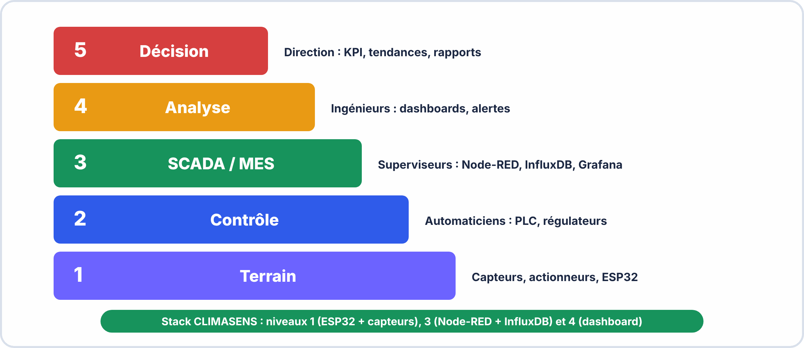
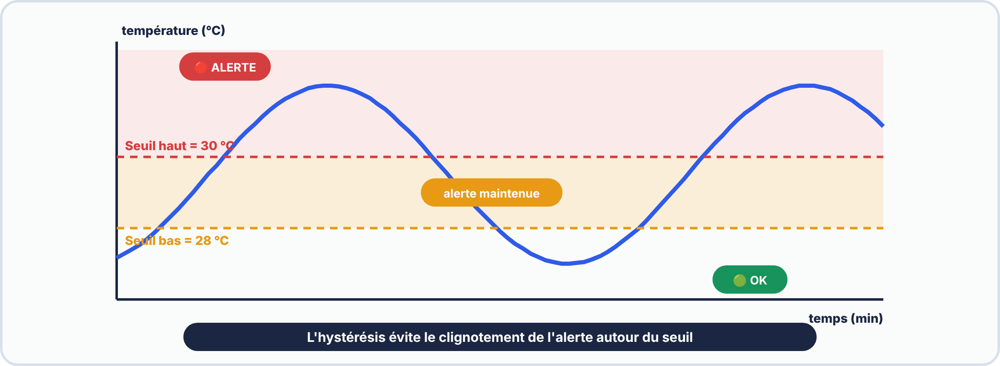

# 📘 FICHE DE COURS — S17 · 2ᵉ ANNÉE · E2
## Industrie 4.0 : KPI · Alertes Intelligentes · Métrologie · PV

---

> **Nom** : ___________________________
> **Date** : ___________________________
> **Compétences** : S5.4 · S5.5 · S5.6 · C5.3 · C3.1 · S8.1

---

## 🔑 Vocabulaire clé

| Terme | Définition |
|---|---|
| **KPI** | Key Performance Indicator — indicateur clé de performance (ex: uptime, nb alertes/jour) |
| **Hystérésis** | Bande morte autour d'un seuil d'alerte pour éviter les oscillations (fausses alertes) |
| **Dashboard** | Interface visuelle regroupant les indicateurs importants d'un système |
| **SCADA** | Supervisory Control And Data Acquisition — supervision industrielle temps réel |
| **PV de métrologie** | Procès-Verbal — document officiel consignant les mesures et leur analyse |
| **Étalonnage** | Comparer un instrument à une référence connue pour établir les écarts |
| **Incertitude de mesure** | Intervalle dans lequel se trouve la valeur vraie avec une probabilité donnée |
| **Exactitude** | Accord entre la mesure et la valeur vraie (absence de biais systématique) |
| **Fidélité** | Répétabilité des mesures dans les mêmes conditions (faible dispersion) |
| **Résolution** | Plus petit changement détectable par un instrument (ex: 0,1°C pour le DHT22) |
| **Dérive** | Variation lente d'un capteur au cours du temps (vieillissement) |
| **Alarme** | Signal déclenché quand une valeur franchit un seuil critique |
| **Classe de précision** | Spécification normalisée de l'erreur maximale d'un instrument |

---

## 1️⃣ — L'Industrie 4.0 : du capteur à la décision

### La pyramide de l'information industrielle



### Les KPI d'un système de surveillance

```
KPI TYPIQUES POUR UNE STATION IoT :
  Disponibilité (uptime)     : % de temps opérationnel (cible : > 99,5%)
  Fraîcheur des données      : délai entre mesure et affichage (cible : < 30s)
  Nb alertes actives         : nombre d'alertes non acquittées
  Nb anomalies / 24h         : tendance de la fiabilité capteurs
  Écart T° / référence       : indicateur qualité de mesure (métrologie)
  Consommation batterie      : % restant (si alimentation autonome)

Affichage dans Node-RED :
  Nœud "text" avec template {{msg.payload}} pour la valeur
  Nœud "gauge" pour les % (uptime, batterie)
  Nœud "ui_table" pour les listes d'alertes
```

---

## 2️⃣ — Alertes intelligentes : au-delà du seuil simple

### Problème des alertes naïves

```
ALERTE NAÏVE (seuil fixe) :
  IF température > 30°C → ALERTE
  
  Problème : si la température oscille entre 29,8°C et 30,2°C
  → L'alerte se déclenche et s'annule des dizaines de fois par minute
  → Fausses alertes, notification flooding, opérateur qui ignore tout

SOLUTION 1 — Hystérésis (bande morte) :
  Seuil HAUT de déclenchement : 30°C
  Seuil BAS  de désactivation : 28°C
  
  → L'alerte se déclenche à 30°C et ne s'annule qu'à 28°C
  → Évite les oscillations autour du seuil
  → Standard industriel pour tous les systèmes de régulation

SOLUTION 2 — Temporisation :
  L'alerte n'est déclenchée que si la condition est vraie pendant Δt secondes
  → Filtre les pics transitoires (ex: coup de chaleur de 2 secondes)

SOLUTION 3 — Alerte sur dérivée :
  IF ΔT/Δt > 2°C/min → ALERTE (montée rapide de température)
  → Détecte les tendances AVANT que le seuil soit atteint
  → Maintenance prédictive
```

### Implémentation Node-RED — Hystérésis

```javascript
// Nœud function "Hystérésis Température"
// Variables persistantes entre les appels : context.get/set

var temp     = msg.payload;
var seuilHaut = 30.0;    // °C — seuil de déclenchement
var seuilBas  = 28.0;    // °C — seuil de désactivation (hystérésis)

// Lire l'état de l'alerte précédente (persistant)
var alerteActive = context.get("alerteActive") || false;

if (!alerteActive && temp >= seuilHaut) {
    // Déclenchement de l'alerte
    alerteActive = true;
    context.set("alerteActive", true);
    msg.payload  = { etat: "ALERTE", valeur: temp, heure: new Date().toLocaleTimeString() };
    return msg;
} else if (alerteActive && temp <= seuilBas) {
    // Annulation de l'alerte
    alerteActive = false;
    context.set("alerteActive", false);
    msg.payload  = { etat: "OK", valeur: temp, heure: new Date().toLocaleTimeString() };
    return msg;
}

return null;  // Pas de changement d'état → ne rien envoyer
```

### Journal des alertes (nœud ui_table)

```javascript
// Nœud function "Journal alertes"
// Maintenir un tableau des N dernières alertes

var MAX_ALERTES = 20;
var journal = context.get("journal") || [];

// Ajouter la nouvelle alerte
journal.unshift({
    "Heure"  : new Date().toLocaleString("fr-FR"),
    "Type"   : msg.payload.etat,
    "Valeur" : msg.payload.valeur + " °C",
    "Statut" : msg.payload.etat === "ALERTE" ? "🔴" : "🟢"
});

// Garder seulement les MAX_ALERTES dernières
if (journal.length > MAX_ALERTES) journal.pop();

context.set("journal", journal);
msg.payload = journal;
return msg;
// → Vers nœud ui_table qui affiche le tableau dans le dashboard
```

---



---

## 3️⃣ — Requêtes InfluxDB Flux avancées

### Moyenne mobile (lissage des données)

```javascript
// Moyenne sur les 5 derniers points
from(bucket: "iot_salle")
  |> range(start: -1h)
  |> filter(fn: (r) => r._measurement == "sonde_climasens")
  |> filter(fn: (r) => r._field == "temperature")
  |> timedMovingAverage(every: 30s, period: 5m)
  // Lisse les pics → courbe plus lisse pour le dashboard

// Ou : moyenne par fenêtre de 5 minutes
  |> aggregateWindow(every: 5m, fn: mean, createEmpty: false)
```

### Min/Max journalier

```javascript
// Valeurs extrêmes des dernières 24h
from(bucket: "iot_salle")
  |> range(start: -24h)
  |> filter(fn: (r) => r._measurement == "sonde_climasens")
  |> filter(fn: (r) => r._field == "temperature")
  |> aggregateWindow(every: 24h, fn: min)   // ou fn: max

// Dans un nœud function Node-RED, formatter pour affichage :
msg.payload = "Min 24h: " + parseFloat(msg.payload[0]._value).toFixed(1) + "°C";
```

### Détection d'anomalies (dépassement seuil en base)

```javascript
// Compter les minutes où T° > 30°C sur les dernières 24h
from(bucket: "iot_salle")
  |> range(start: -24h)
  |> filter(fn: (r) => r._measurement == "sonde_climasens")
  |> filter(fn: (r) => r._field == "temperature")
  |> filter(fn: (r) => r._value > 30.0)   // Ne garder que les dépassements
  |> count()
  // Résultat : nombre de points au-dessus du seuil
```

### Calcul de tendance (dérivée)

```javascript
// Taux de variation de la température (°C/minute)
from(bucket: "iot_salle")
  |> range(start: -30m)
  |> filter(fn: (r) => r._measurement == "sonde_climasens")
  |> filter(fn: (r) => r._field == "temperature")
  |> derivative(unit: 1m, nonNegative: false)
  // Valeur positive = température monte (°C par minute)
  // Valeur négative = température descend
  // Si dérivée > 2°C/min → alerte montée rapide
```

---

## 4️⃣ — Métrologie industrielle

### Pourquoi faire de la métrologie ?

```
La métrologie répond à la question : "Peut-on faire confiance à nos mesures ?"

SANS MÉTROLOGIE :
  → On ne sait pas si le capteur dérive ou est correct
  → Une alerte à 30°C pourrait se déclencher à 28°C ou 32°C réellement
  → Impossible de certifier la conformité du produit surveillé

AVEC MÉTROLOGIE :
  → On connaît l'écart systématique (biais) → on peut le corriger
  → On connaît l'incertitude → on peut définir des seuils appropriés
  → On peut comparer à une valeur de référence traçable
```

### Les trois qualités d'une mesure

```
1. EXACTITUDE : la mesure est-elle proche de la valeur vraie ?
   → Évaluée par l'étalonnage (comparer à un étalon)
   → Défaut d'exactitude = erreur systématique (biais)
   
2. FIDÉLITÉ : la mesure est-elle reproductible ?
   → Évaluée par la répétabilité (mêmes conditions)
   → Défaut de fidélité = erreur aléatoire (dispersion)
   
3. RÉSOLUTION : quel est le plus petit changement détectable ?
   → DHT22 : résolution 0,1°C en température, 0,1% en humidité
   → Imposée par le convertisseur numérique du capteur

Capteur exact et non fidèle : mesures dispersées autour de la valeur vraie
Capteur fidèle et non exact : mesures regroupées mais décalées de la valeur vraie
```

### Calcul d'incertitude

INCERTITUDE DE TYPE B (seule applicable si 1 seule mesure) :  
Tirée des spécifications du fabricant  

Exemple : DHT22 — précision température : ±0,5°C  
Distribution uniforme → u_B = 0,5 / √3 = 0,5 / 1,732 ≈ 0,29°C  

INCERTITUDE DE TYPE A (si n mesures répétées) :  
u_A = s / √n  
s   = écart-type des mesures  
n   = nombre de mesures  

INCERTITUDE COMBINÉE :  

$$u_{\mathrm{c}} = \sqrt(u_A^2 + u_B^2)$$

INCERTITUDE ÉLARGIE (pour probabilité de couverture P ≈ 95%) :  
U = k × u_c     avec k = 2 (facteur d'élargissement)  

EXPRESSION DU RÉSULTAT :  
T = (valeur mesurée) ± U  [°C]  (P = 95%)  
Exemple : T = 23,4 ± 0,6 °C  (P = 95%)  

---


---

## 5️⃣ — Le PV de métrologie : structure et contenu

### Qu'est-ce qu'un PV de métrologie ?

```
PV = Procès-Verbal de métrologie

C'est le document officiel qui :
  ✓ Décrit le système de mesure et les conditions de l'essai
  ✓ Consigne les mesures effectuées (tableau de valeurs)
  ✓ Compare à une référence ou aux spécifications
  ✓ Calcule les écarts et les incertitudes
  ✓ Conclut sur la conformité ou la non-conformité du système
  ✓ Préconise des actions correctives si nécessaire

Dans l'industrie : le PV est signé par l'opérateur ET validé par un responsable métrologie.
Pour le BAC PRO : le PV constitue la preuve de C3.1 et S8.1.
```

### Structure d'un PV de métrologie professionnel

```
1. ENTÊTE :
   Titre · Référence document · Version · Date · Auteur · Statut

2. OBJET ET DOMAINE D'APPLICATION :
   Décrire ce qu'on mesure et pourquoi ce PV est rédigé

3. RÉFÉRENCES :
   Normes et documents applicables (datasheet, normes ISO...)

4. MATÉRIEL UTILISÉ :
   Description de l'instrument · numéro de série · date d'étalonnage

5. CONDITIONS DE MESURE :
   Conditions ambiantes au moment de l'essai

6. RÉSULTATS (tableau) :
   Mesures acquises · Valeur de référence · Écart · Incertitude

7. ANALYSE :
   L'écart est-il dans les limites ? Biais systématique ?

8. CONCLUSION :
   Conforme / Non conforme · Recommandations

9. SIGNATURES :
   Opérateur · Responsable métrologie
```

---

## 📌 Les essentiels à retenir

> ✅ **KPI** = indicateurs clés pour piloter un système (uptime, nb alertes, fraîcheur données)
> ✅ **Hystérésis** = deux seuils (haut/bas) pour éviter les fausses alertes
> ✅ `context.get/set` dans Node-RED = stocker l'état entre deux appels de function
> ✅ **Alerte sur dérivée** = détecter une tendance AVANT d'atteindre le seuil critique
> ✅ InfluxDB Flux : `timedMovingAverage()` pour lisser · `derivative()` pour la tendance
> ✅ **Exactitude** = proche de la vérité · **Fidélité** = reproductible
> ✅ Incertitude Type B : `u_B = tolérance / √3` (distribution uniforme)
> ✅ Incertitude élargie : `U = 2 × u_c` (facteur k=2, P=95%)
> ✅ PV = document officiel consignant mesures + analyse + conclusion de conformité

---

*Fiche de Cours Industrie 4.0 + Métrologie — BAC PRO CIEL | E2 | 2ᵉ année S17*
*Compétences : S5.4 · S5.5 · S5.6 · C5.3 · C3.1 · S8.1*
