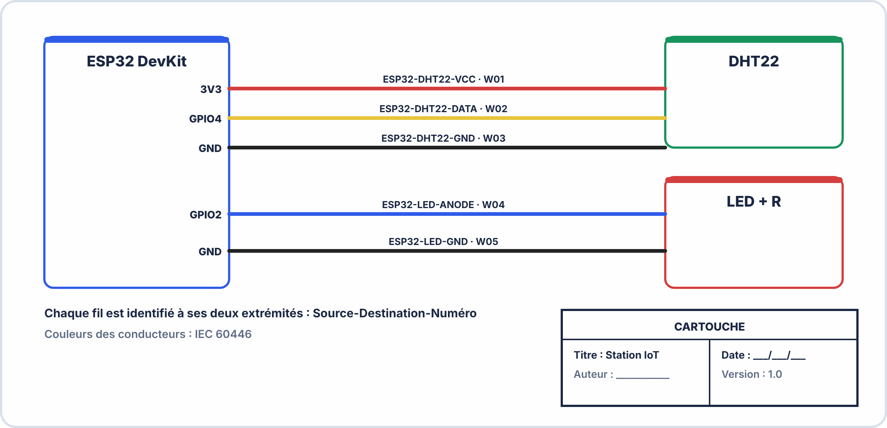

# 📖 FICHE COURS – S18 ANNÉE 2 – E2
## Documentation Technique : DAT, Schémas de Câblage, BOM, Procédures

---

## 🎯 OBJECTIFS

- ✅ Connaître la structure et le contenu d'un DAT professionnel
- ✅ Produire un schéma de câblage conforme aux conventions
- ✅ Rédiger une BOM complète avec références fournisseurs
- ✅ Écrire une procédure d'installation et de maintenance vérifiable

---

## 1️⃣ POURQUOI DOCUMENTER ?

> Un système sans documentation est un système que personne d'autre ne peut maintenir. Et "personne d'autre", c'est souvent vous-même — 6 mois après l'avoir conçu.

### Ce qu'une bonne documentation permet

| **Situation** | **Sans doc** | **Avec doc** |
|---|---|---|
| Technicien inconnu intervient | Repart de zéro (3h de reverse engineering) | Intervention en 30 min |
| Composant à remplacer | "C'était quoi déjà la référence ?" | BOM → commande immédiate |
| Panne à 3h du matin | Le système entier est mystérieux | Arbre de diagnostic déjà rédigé |
| Évolution du système | "Qu'est-ce qui existe déjà ?" | DAT-E décrit l'existant |
| Audit qualité / certification | Pas de preuve du travail réalisé | Preuves datées, versionnées, signées |

---

## 2️⃣ LE DAT — DOSSIER DES ARCHITECTURES TECHNIQUES

### Définition

> Le **DAT** (Dossier des Architectures Techniques) est le document de référence qui décrit l'architecture complète d'un système — matériels, logiciels, configurations, connexions, procédures. Il est la mémoire technique d'un projet.

### Les deux types de DAT

| **Type** | **Contenu** | **Quand** |
|---|---|---|
| **DAT-E** (Existant) | Architecture telle qu'elle existe AVANT l'intervention | Audit avant travaux, reprise d'un existant |
| **DAT-I** (Instruit) | Architecture cible APRÈS l'intervention ou évolution | Nouveau déploiement, migration |

> En BAC PRO CIEL, votre projet A2 est un **DAT-I** : vous documentez ce que vous venez de construire — c'est aussi appelé **as-built** ("tel que construit").

---

## 3️⃣ STRUCTURE D'UN DAT PROFESSIONNEL

### Les 13 sections obligatoires

> [!NOTE] 1. PAGE DE GARDE
>   Titre, version, date, statut (brouillon / validé), auteur(s)  
>
> 2. HISTORIQUE DES RÉVISIONS  
>   Tableau : version, date, auteur, description du changement  
>
> 3. OBJET ET PÉRIMÈTRE  
>   "Ce document décrit..." — ce qui est couvert ET ce qui n'est  
>   pas couvert  
>
> 4. ARCHITECTURE GÉNÉRALE  
>   Diagramme bloc : composants + flux de données + protocoles  
>
> 5. DESCRIPTION DES COMPOSANTS  
>   Tableau : composant, référence, rôle, version firmware/hard  
>
> 6. SCHÉMAS DE CÂBLAGE  
>   Câblage électrique + réseau + liaison de données  
>
> 7. BOM (Bill Of Materials)  
>   Liste exhaustive : référence, qté, fournisseur, prix unitaire  
>
> 8. CONFIGURATION  
>   IP, ports, topics MQTT, seuils, certificats, paramètres  
>
> 9. PROCÉDURE D'INSTALLATION  
>   Étapes ordonnées, test de validation à la fin  
>
> 10. PROCÉDURE DE MAINTENANCE CORRECTIVE  
>    Arbre de décision + actions correctives type  
>
> 11. PROCÉDURE DE REPRISE D'ACTIVITÉ  
>    Comment redémarrer après une panne majeure  
>
> 12. GLOSSAIRE  
>    Définitions des termes techniques utilisés  
>
> 13. ANNEXES  
>    Code source, captures d'écran, fiches techniques capteurs  

### Page de garde type

━━━━━━━━━━━━━━━━━━━━━━━━━━━━━━━━━━━━━━━━━━━━━━━━━━━━━━━
DOSSIER DES ARCHITECTURES TECHNIQUES
━━━━━━━━━━━━━━━━━━━━━━━━━━━━━━━━━━━━━━━━━━━━━━━━━━━━━━━
Projet   : Station IoT Surveillance Vibratoire
Client   : INDUSTECH SAS
Référence: DAT-ESP32-VIB-001
Version  : 1.0
Date     : 2026-03-20
Statut   : ☐ Brouillon  ☑ Pour Validation  ☐ Validé
━━━━━━━━━━━━━━━━━━━━━━━━━━━━━━━━━━━━━━━━━━━━━━━━━━━━━━━
Auteur(s): Alice DUPONT, Baptiste MARTIN
Relecteur: [Formateur]
━━━━━━━━━━━━━━━━━━━━━━━━━━━━━━━━━━━━━━━━━━━━━━━━━━━━━━━

HISTORIQUE DES RÉVISIONS
| Version | Date | Auteur | Description |
|---|---|---|---|
| 0.1 | 2026-03-15 | A. DUPONT | Création initiale |
| 1.0 | 2026-03-20 | A. DUPONT | Version complète validée |

---

## 4️⃣ SCHÉMAS DE CÂBLAGE

### Principes fondamentaux

> Un schéma de câblage n'est pas un dessin artistique — c'est un document normatif qui doit permettre à **quelqu'un qui n'a jamais vu le projet** de câbler correctement le système.

### Les 5 éléments obligatoires d'un schéma de câblage

```
1. TITRE et référence (en cartouche)
2. LÉGENDE des symboles et couleurs
3. REPÉRAGE des fils (étiquettes aux deux extrémités)
4. RÉFÉRENCES des composants (correspondant à la BOM)
5. NUMÉRO DE VERSION et date
```

### Conventions de couleur (IEC 60446)

| **Couleur** | **Usage** | **Application IoT** |
|---|---|---|
| **Rouge / Marron** | + (positif) | VCC 5V, VCC 3.3V, Vin |
| **Noir / Bleu** | − (négatif) / Neutre | GND, masse |
| **Vert-Jaune** | Terre (PE) | Masse de protection si 230V |
| **Orange** | Signal analogique | Sortie ADC capteur courant |
| **Violet** | Bus numérique | SDA I2C, MOSI SPI |
| **Blanc** | Signal logique secondaire | SCL I2C, SCLK SPI, CS |
| **Jaune** | Signal numérique GPIO | GPIO32, GPIO34… |
| **Gris** | Signal de commande | Relais, buzzer |

### Repérage des fils

> Chaque fil est identifié par une **étiquette placée aux deux extrémités**, selon le format :

$$\boxed{[Source]-[Destination]-[Numéro]}$$

```
Exemples :
  ESP32-DHT22-VCC    → Alimentation 3,3V de l'ESP32 vers le DHT22
  ESP32-DHT22-DATA   → Données DHT22 → pin 4 de l'ESP32
  BATT-REG-01        → Fil 01 batterie → régulateur
  REG-ESP32-3V3      → Sortie 3,3V du régulateur vers ESP32

Sur le schéma :
  ┌─────────────────────────────────────────────────────────┐
  │ Fil 1 : ▷ESP32-DHT22-VCC◁                              │
  │         ESP32 (3V3) ────────────────── DHT22 (VCC)      │
  │                     [ROUGE, 20cm]                       │
  └─────────────────────────────────────────────────────────┘
```

---



---

### Outils recommandés

| **Outil** | **Type** | **Usage** |
|---|---|---|
| **Draw.io** (draw.io) | Web / Desktop — gratuit | Schémas d'architecture, diagrammes de blocs |
| **KiCad Eeschema** | Desktop — gratuit | Schémas électroniques normalisés, netlist |
| **Fritzing** | Desktop — payant | Schémas de montage sur breadboard (proto) |
| **LibreOffice Draw** | Desktop — gratuit | Schémas simples, intégration dans DAT |
| **LucidChart** | Web — freemium | Diagrammes professionnels collaboratifs |

> **Conseil :** Pour le DAT, Draw.io ou KiCad produit des schémas exportables en SVG/PDF — format idéal pour l'intégration dans le document.

---

## 5️⃣ LA BOM — BILL OF MATERIALS

### Définition

> La **BOM** est la liste exhaustive de tous les composants nécessaires pour reproduire le système. Elle est l'outil de référence pour la commande de pièces de rechange et la réplication du système.

### Structure d'une BOM professionnelle

| **Colonne** | **Contenu** | **Exemple** |
|---|---|---|
| **Réf. interne** | Identifiant dans votre schéma | U1, R1, C1... |
| **Désignation** | Description fonctionnelle | Microcontrôleur Wi-Fi |
| **Valeur / Modèle** | Spécification technique | ESP32-WROOM-32D |
| **Quantité** | Nombre nécessaire | 1 |
| **Référence fournisseur** | Numéro de pièce chez RS/Mouser/Farnell | RS: 190-4421 |
| **Fournisseur** | Nom du fournisseur | RS Components |
| **Prix unitaire HT** | Prix d'achat unitaire | 7,50 € |
| **Prix total HT** | Qté × PU | 7,50 € |
| **Remarque** | Substitut possible, délai, criticité | Substitut: ESP32-DevKitC-32D |

### Exemple de BOM pour le projet IoT

| **Réf.** | **Désignation** | **Modèle** | **Qté** | **Fournisseur** | **PU HT** | **Total** |
|---|---|---|---|---|---|---|
| U1 | Microcontrôleur Wi-Fi | ESP32 DevKit v1 | 1 | AZ-Delivery | 7,99 € | 7,99 € |
| U2 | Capteur vibration | ADXL345 module | 1 | AZ-Delivery | 4,99 € | 4,99 € |
| U3 | Capteur température | DHT22 module | 1 | AZ-Delivery | 3,49 € | 3,49 € |
| REG1 | Régulateur 3.3V | AMS1117-3.3 | 1 | Mouser: 996-AMS1117-3.3 | 0,35 € | 0,35 € |
| R1 | Résistance pull-up SDA | 4,7kΩ 1/4W | 2 | Mouser | 0,05 € | 0,10 € |
| C1 | Condensateur découplage | 100nF CMS 0805 | 4 | Mouser | 0,08 € | 0,32 € |
| BAT1 | Batterie LiPo | 18650 3,7V 2000mAh | 1 | Conrad | 3,95 € | 3,95 € |
| PCB1 | Boîtier impression 3D | PETG 80×60×40 mm | 1 | Impression en labo | ~1,00 € | 1,00 € |
| — | Câbles Dupont | 20 cm, mixtes | 20 | Kit | — | ~0,50 € |
| | | | | **TOTAL** | | **22,69 €** |

---

## 6️⃣ LA SECTION CONFIGURATION

> La section Configuration documente tous les **paramètres qui ne sont pas visibles dans les schémas** mais qui sont indispensables pour que le système fonctionne.

### Exemple de table de configuration complète

```
━━━━━━━━━━━━━━━━━━━━━━━━━━━━━━━━━━━━━━━━━━━━━━━━━━━━━━━━━━━━
SECTION 8 — CONFIGURATION
━━━━━━━━━━━━━━━━━━━━━━━━━━━━━━━━━━━━━━━━━━━━━━━━━━━━━━━━━━━━

8.1 RÉSEAU ET CONNECTIVITÉ
  SSID Wi-Fi       : [NOM_RESEAU]  ← Ne pas mettre le mot de passe en clair
  Fréquence        : 2,4 GHz (IEEE 802.11 b/g/n)
  Adresse IP       : DHCP (IP assignée dynamiquement)
  Hostname         : industech-machine-01

8.2 AWS IOT CORE
  Endpoint         : xxxxxx-ats.iot.eu-west-1.amazonaws.com
  Port             : 8883 (MQTT TLS)
  Client ID        : industech-machine-01
  Certificats      : Stockés dans le firmware (voir Annexe A)
  Région AWS       : eu-west-1 (Paris)
  
8.3 TOPICS MQTT
  Publication data : industech/machine01/capteurs
  Publication status: industech/machine01/status
  Subscription cmd : industech/machine01/commande
  LWT              : industech/machine01/status → {"status":"offline"}
  QoS Publication  : 1 (at least once)

8.4 SEUILS DE MAINTENANCE
  Seuil alerte     : vibration > 2,5 g (RMS)
  Seuil critique   : vibration > 4,0 g (arrêt préventif recommandé)
  MTBF cible       : > 60 min (niveau surveillance normale)
  Fréquence publication : 5 secondes
  
8.5 CLOUDWATCH
  Espace de noms   : Industrie40/CIEL
  Métriques        : Vibration, Temperature, MTBF_min, NbAlarmes
  Alarme           : Vibration > 2.5 pendant 2 périodes consécutives → SNS
  Dashboard        : Dashboard-IoT-CIEL-Machine01
━━━━━━━━━━━━━━━━━━━━━━━━━━━━━━━━━━━━━━━━━━━━━━━━━━━━━━━━━━━━
```

---

## 7️⃣ LES PROCÉDURES

### Structure d'une procédure professionnelle

> Une procédure est une **suite d'étapes numérotées**, chacune avec une action précise et une vérification. Elle doit être exécutable par quelqu'un qui ne connaît pas le système.

### Procédure d'installation type

```
━━━━━━━━━━━━━━━━━━━━━━━━━━━━━━━━━━━━━━━━━━━━━━━━━━━━━━━━━━━━
PROCÉDURE D'INSTALLATION — REF: PROC-INSTALL-001
Date création : 2026-03-20  Version : 1.0
━━━━━━━━━━━━━━━━━━━━━━━━━━━━━━━━━━━━━━━━━━━━━━━━━━━━━━━━━━━━

PRÉREQUIS :
  ☐ Compte AWS actif avec droits IoT Core
  ☐ Arduino IDE 2.x installé avec bibliothèques PubSubClient, Wire
  ☐ Driver USB-Serial CP210x installé
  ☐ Accès Wi-Fi 2.4 GHz disponible

ÉTAPES :
  1. Câblage hardware
     ☐ 1.1 Connecter ADXL345 : SDA→GPIO21, SCL→GPIO22, VCC→3.3V, GND→GND
     ☐ 1.2 Connecter DHT22 : DATA→GPIO4, VCC→3.3V, GND→GND
     ☐ 1.3 Insérer résistances pull-up 4.7kΩ : SDA→3.3V, SCL→3.3V
     Validation : Vérifier continuité au multimètre sur chaque connexion

  2. Configuration AWS IoT Core
     ☐ 2.1 Créer le Thing "industech-machine-01" dans la console AWS
     ☐ 2.2 Générer et télécharger les 3 certificats X.509
     ☐ 2.3 Attacher la Policy "iot-ciel-lab-policy" au certificat
     ☐ 2.4 Relever l'endpoint AWS IoT Core
     Validation : Le Thing apparaît dans la liste, statut "actif"

  3. Chargement du firmware
     ☐ 3.1 Ouvrir TP_AWS_IoT_ESP32.ino dans Arduino IDE
     ☐ 3.2 Coller les 3 certificats dans les variables ca_cert / device_cert / private_key
     ☐ 3.3 Renseigner SSID, password, endpoint, client_id
     ☐ 3.4 Compiler et téléverser (115200 bauds)
     Validation : Moniteur série affiche "Connecté !" et "✓ {...}"

  4. Vérification cloud
     ☐ 4.1 Console AWS → IoT Core → MQTT Test → Subscribe "industech/#"
     ☐ 4.2 Attendre 10 secondes, vérifier réception des messages
     ☐ 4.3 Vérifier Dashboard CloudWatch → métriques alimentées
     Validation : ≥ 3 messages reçus dans la console MQTT test

  5. Test d'alarme
     ☐ 5.1 Agiter l'ADXL345 au-dessus du seuil (2,5g)
     ☐ 5.2 Vérifier "alarme": true dans le payload JSON
     ☐ 5.3 Vérifier le déclenchement de l'alarme CloudWatch
     Validation : Alarme CloudWatch passe en état IN_ALARM

RÉSULTAT ATTENDU : Système opérationnel, données visibles dans CloudWatch
━━━━━━━━━━━━━━━━━━━━━━━━━━━━━━━━━━━━━━━━━━━━━━━━━━━━━━━━━━━━
```

### Procédure de maintenance corrective type

```
━━━━━━━━━━━━━━━━━━━━━━━━━━━━━━━━━━━━━━━━━━━━━━━━━━━━━━━━━━━━
PROCÉDURE MAINTENANCE — REF: PROC-MAINT-001
Symptôme couvert : ESP32 ne publie plus sur MQTT
━━━━━━━━━━━━━━━━━━━━━━━━━━━━━━━━━━━━━━━━━━━━━━━━━━━━━━━━━━━━

1. Vérifier la connectivité Wi-Fi
   Action  : Ouvrir le moniteur série, observer RSSI et état Wi-Fi
   Si OK   : Passer à l'étape 2
   Si NON  : Vérifier SSID/password — relancer `WiFi.begin()`

2. Vérifier la connexion MQTT
   Action  : Lire `mqtt.state()` dans le moniteur série
   -2 FAILED : IP broker incorrecte → corriger l'endpoint
   -7 BAD_CREDENTIALS : Certificats corrompus → régénérer
   -8 UNAUTHORIZED : Policy IAM → vérifier la console AWS

3. Vérifier les métriques CloudWatch
   Action  : Console AWS → CloudWatch → Dashboard
   Si vide depuis > 15 min → règle IoT désactivée ou rôle IAM révoqué

4. Validation après correction
   Action  : Confirmer réception de ≥ 3 messages dans MQTT Test
━━━━━━━━━━━━━━━━━━━━━━━━━━━━━━━━━━━━━━━━━━━━━━━━━━━━━━━━━━━━
```

---

## 8️⃣ QUALITÉ DE LA DOCUMENTATION

### Les 5 critères d'une bonne documentation

| **Critère** | **Description** | **Comment vérifier** |
|---|---|---|
| **Complète** | Toutes les sections sont présentes | Checklist des 13 sections |
| **Exacte** | Correspond à la réalité installée (as-built) | Test d'installation par quelqu'un d'autre |
| **Claire** | Compréhensible sans l'auteur | Peer review — un binôme peut-il l'utiliser ? |
| **Versionnable** | Tableau de révisions, numéro de version | Page de garde avec historique |
| **Maintenable** | Peut être mise à jour facilement | Format numérique (pas de captures non éditables) |

### Erreurs à éviter

```
❌ "Le système fonctionne bien"  → Pas d'information technique
❌ "Voir le code"  → Le code n'est pas une procédure
❌ "IP : voir le post-it sur le boîtier"  → Non documenté
❌ Schéma sans légende ni repères  → Illisible par un tiers
❌ BOM sans références fournisseurs  → Non commandable
❌ Procédure sans test de validation  → On ne sait pas si ça a fonctionné
❌ Un seul fichier Word sans sommaire ni version  → Non professionnel
```

---


---

## ✅ AUTO-ÉVALUATION

- [ ] Je connais les 2 types de DAT (DAT-E et DAT-I) et la différence entre eux
- [ ] Je sais structurer un DAT en 13 sections
- [ ] Je connais les codes couleurs IEC 60446 pour le câblage
- [ ] Je sais repérer un fil selon le format Source-Destination-Numéro
- [ ] Je sais rédiger une BOM avec toutes les colonnes nécessaires (dont référence fournisseur)
- [ ] Je sais trouver les références fournisseurs sur Mouser, RS Components ou Farnell
- [ ] Je sais rédiger une procédure d'installation avec étapes numérotées et tests de validation
- [ ] Je comprends la valeur du peer review (faire valider par quelqu'un d'autre)

---

## 📚 VOCABULAIRE CLEF

| **Terme** | **Définition** |
|---|---|
| **DAT** | Dossier des Architectures Techniques — document de référence d'un système |
| **DAT-E** | DAT Existant — documentation de l'architecture actuelle avant intervention |
| **DAT-I** | DAT Instruit — documentation de l'architecture cible après intervention |
| **As-built** | "Tel que construit" — documentation reflétant la réalité installée |
| **BOM** | Bill Of Materials — liste exhaustive des composants avec références et prix |
| **Cartouche** | Zone en bas à droite d'un schéma contenant titre, version, auteur, date |
| **Repérage fil** | Étiquette aux deux extrémités d'un fil identifiant sa source et sa destination |
| **IEC 60446** | Norme internationale fixant les codes couleurs des conducteurs électriques |
| **Peer review** | Relecture par un pair — technique de vérification de la documentation |
| **Procédure** | Suite d'étapes ordonnées et vérifiables pour accomplir une tâche |
| **Versioning** | Gestion des versions d'un document avec historique des modifications |
| **CMMS / GMAO** | Logiciel de Gestion de Maintenance Assistée par Ordinateur |

---

## 📌 POINTS-CLÉS À RETENIR

1. **DAT** = mémoire technique du projet — sans lui, tout doit être refait à chaque intervention
2. **DAT-I** = documentation as-built — décrit ce qui est **vraiment** installé, pas ce qui était prévu
3. Schéma de câblage = **5 éléments obligatoires** : titre, légende, repères, références, version
4. Codes couleurs **IEC 60446** : rouge/marron=+, noir/bleu=−, vert-jaune=terre, violet=bus
5. **BOM** = au moins 8 colonnes : réf. interne, désignation, modèle, quantité, fournisseur, réf. fournisseur, PU, total
6. Procédure = numérotée + **case à cocher** + test de validation à la fin de chaque bloc
7. Peer review = meilleur outil pour vérifier qu'une documentation est utilisable

---

**Document – BAC PRO CIEL – A2 – E2/U21 – Version 1.0 – 2026**
