# 🔭 Fiche d'utilisation : OWON SDS5032E(V)

> **Oscilloscope numérique 2 voies, 30 MHz, 250 MS/s, 10 000 points par voie, écran couleur 8″.**
> Cette fiche se suit **l'appareil sous les yeux**, du plus simple au plus avancé. Les illustrations viennent du manuel du constructeur.
>
> *Source des illustrations : manuel d'utilisation OWON SDS5032E(V), édition V1.5.3 (© Lilliput / OWON).*

> [!TIP] 🔬 T'entraîner d'abord sur le simulateur
> **OscilloLab** reproduit cet appareil (face avant, menus, réactions) : [ouvrir OscilloLab](https://yahnlp.github.io/OscilloLab/) puis suivre le **pas à pas** des TP, avec le bouton **👆 Montre-moi**. Mode d'emploi : [Utiliser OscilloLab](../oscillolab.md).

## 🎯 Ce que tu sauras faire avec cette fiche

- allumer l'appareil, le **remettre à zéro** et **compenser ta sonde** ;
- **régler** sensibilité, base de temps, déclenchement, couplage ;
- **lire** l'écran et **mesurer** (carreaux, mesures automatiques, curseurs) ;
- **capturer** un signal unique, **sauvegarder** une image ;
- éviter les **pièges** classiques.

---

## 1. Les caractéristiques à connaître

| Caractéristique | Valeur |
|---|---|
| **Voies** | 2 (CH1, CH2), **non isolées** : leurs masses sont reliées |
| **Bande passante** | 30 MHz (avec la sonde sur **×10** ; limitée à **5 MHz** sur ×1) |
| **Échantillonnage** | jusqu'à 250 MS/s (temps réel) |
| **Mémoire** | 10 000 points par voie |
| **Écran** | 8″ couleur, 800 × 600 pixels |
| **Fonctions** | Autoset, Autoscale, FFT, mode XY, mesures automatiques, curseurs, enregistrement de séquences |
| **Ports** | USB hôte (clé USB), USB appareil (PC), LAN, option VGA |

> [!WARNING] ⚠️ Sécurité : lis ceci avant de brancher
> - Les **deux voies ont la même masse** : les deux pinces crocodile se branchent sur **le même point de masse** du circuit. Deux masses à deux potentiels différents créent un **court-circuit**.
> - **Ne mesure jamais directement le secteur (230 V)** avec cet oscilloscope.
> - Au-dessus de **42 V crête (30 V efficaces)**, il faut des sondes **isolées** adaptées.
> - Garde toujours les doigts **derrière l'anneau de sécurité** de la sonde.

## 2. Découvrir la face avant

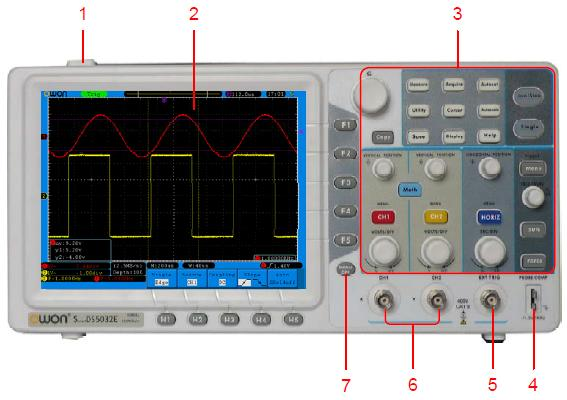

| N° | Élément | À quoi ça sert |
|---|---|---|
| 1 | Interrupteur | allumer / éteindre |
| 2 | Écran | tracés, mesures, menus |
| 3 | Zone de commande | touches et boutons (détail plus bas) |
| 4 | **Sortie de compensation** | carré **5 V / 1 kHz** pour régler la sonde |
| 5 | EXT TRIG | entrée de déclenchement externe |
| 6 | **CH1, CH2** | entrées des voies (BNC) |
| 7 | Menu off | fait disparaître le menu |

### La zone de commande

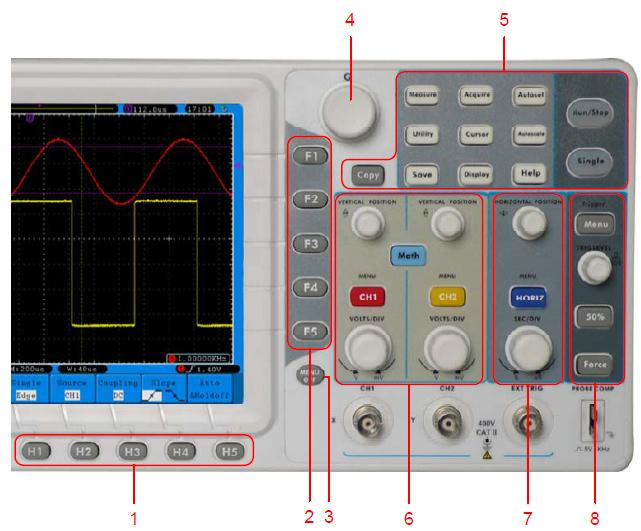

| N° | Zone | Contenu |
|---|---|---|
| 1 | **H1 à H5** (sous l'écran) | choisir une option dans le menu affiché en bas |
| 2 | **F1 à F5** (à droite de l'écran) | choisir une valeur dans le sous-menu affiché à droite |
| 3 | **Menu off** | fermer le menu |
| 4 | **Bouton M** (multifonction) | parcourir une liste ou régler une valeur ; un appui valide ou ferme |
| 5 | **12 touches de fonction** | Measure, Acquire, Utility, Cursor, Autoscale, Save, Display, Help, **Autoset, Run/Stop, Single, Copy** |
| 6 | **Zone verticale** | MENU CH1, MENU CH2, Math, 2 boutons POSITION, 2 boutons VOLTS/DIV |
| 7 | **Zone horizontale** | HORIZ MENU, bouton HORIZONTAL POSITION, bouton SEC/DIV |
| 8 | **Zone déclenchement** | bouton TRIG LEVEL, touches 50 %, Force, Trigger Menu |

> [!TIP] 💡 Comment lire un menu
> Appuie sur une touche de fonction (par exemple **Measure**) : le menu apparaît **en bas** (touches H) et ses options à **droite** (touches F). Un symbole **M** dans le menu signifie « tourne le bouton M pour choisir ».

## 3. Lire l'écran

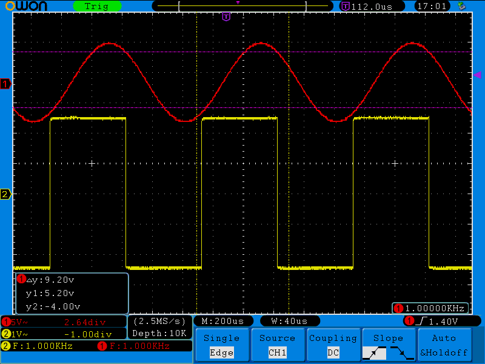

| Zone | Ce que tu lis |
|---|---|
| **En haut, à gauche** | l'état du déclenchement : **Auto** (acquisition sans déclenchement), **Trig** (déclenché), **Ready** (en attente), **Scan** (défilement lent), **Stop** (arrêté) |
| **En haut, au centre** | la position du déclenchement dans la mémoire (⊤ violet) |
| **À gauche du tracé** | le **repère du zéro** de chaque voie (1 rouge, 2 jaune) |
| **En bas, à gauche** | pour chaque voie : **couplage** (— DC, ~ AC), **sensibilité** (V/div) et **position du zéro** |
| **En bas, au centre** | **cadence d'échantillonnage**, profondeur mémoire, **base de temps** (M : …) |
| **En bas, à droite** | **niveau de déclenchement**, pente, et la **fréquence** du signal déclencheur |
| **Barre du bas** | le **menu** en cours (les touches H1 à H5) |

> [!TIP] 💡 Le réflexe de lecture
> **Avant de lire un tracé**, lis toujours **V/div** et **s/div** en bas de l'écran. Un tracé n'a de sens qu'avec ces deux nombres.

---

## 4. La mise en route en 6 étapes

1. **Allume** l'appareil. Attends la fin de l'initialisation.
2. **Remets les réglages d'usine** : touche **Utility** → **H1** (menu *Function*) → tourne le **bouton M** jusqu'à *Adjust* → **H3** *Default*.
3. **Règle ta sonde** : interrupteur de la sonde sur **10X** *et* menu de la voie sur **X10** (voir ci-dessous).
4. **Branche la sonde** sur la sortie de compensation (pointe) et la pince de masse sur sa borne de masse.
5. Appuie sur **Autoset** : un **carré de 1 kHz et 5 V crête-à-crête** apparaît en quelques secondes.
6. **Compense la sonde** (voir ci-dessous).

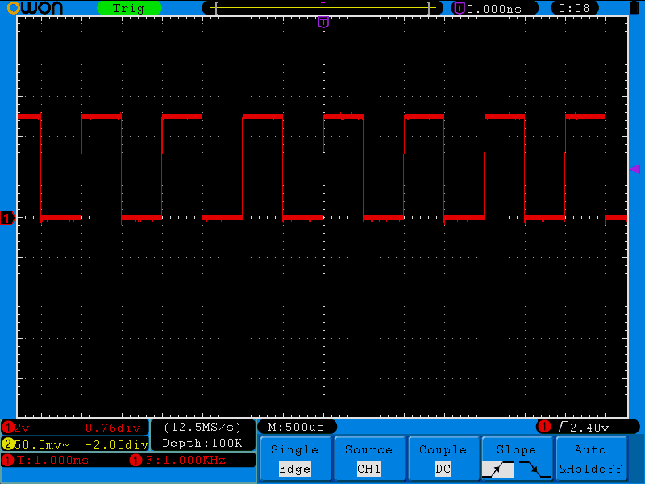

### Le coefficient de la sonde : deux réglages qui doivent être identiques

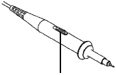

Le coefficient de la sonde se règle **à deux endroits** :

1. **L'interrupteur sur la sonde** : 1X ou 10X.
2. **Le menu de la voie** : touche **MENU CH1** (ou CH2) → **H3** *Probe* → **X10** (avec **F2** par exemple).

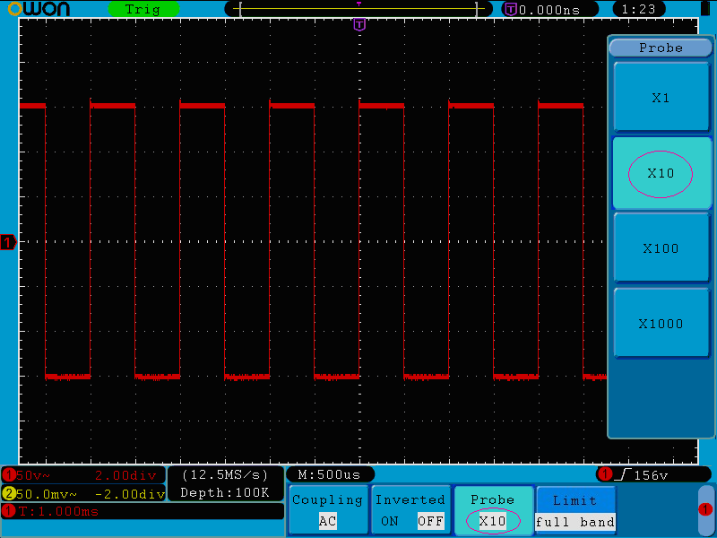

> [!WARNING] ⚠️ L'erreur n° 1
> Interrupteur sur **10X** mais menu sur **X1** : toutes les tensions affichées sont **10 fois trop petites**. Les deux réglages doivent **toujours** être identiques. En **1X**, la bande passante tombe à **5 MHz**.

### La compensation de la sonde

La sonde doit être **réglée** pour chaque voie : sinon, les signaux rapides sont déformés.

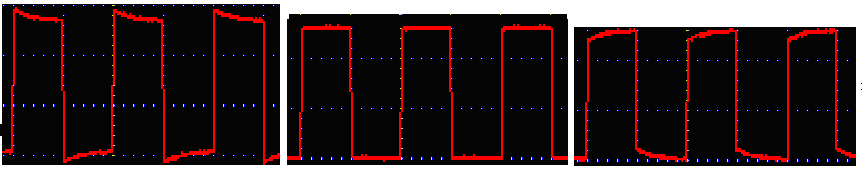

Avec un petit tournevis, tourne le **trimmer** de la sonde jusqu'à obtenir un **carré bien droit** (au centre sur l'image).

### L'auto-calibration (Self Cal)

À faire à chaque **changement de température de 5 °C ou plus**. **Débranche toutes les sondes** de l'entrée. Touche **Utility** → **H1** *Function* → bouton **M** : *Adjust* → **H2** *Self Cal* → suis l'indication à l'écran.

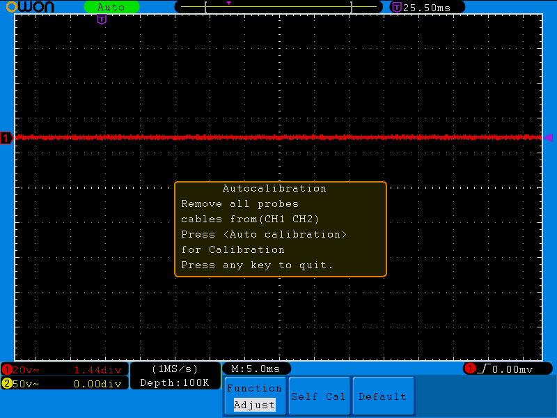

---

## 5. Les trois zones de réglage

### Vertical : la tension

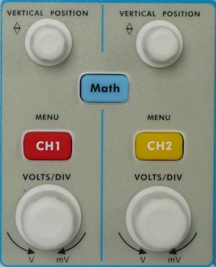

| Commande | Effet |
|---|---|
| **VOLTS/DIV** | change la **sensibilité** (V par carreau) : plus petit = signal agrandi |
| **VERTICAL POSITION** | déplace le **tracé** vers le haut ou vers le bas (le repère du zéro bouge avec) |
| **MENU CH1 / CH2** | ouvre le menu de la voie ; un appui sur une voie allumée **sans menu** l'affiche, un appui avec menu affiché **l'éteint** |

**Le menu d'une voie** :

| Option | Valeurs | Usage |
|---|---|---|
| **Coupling** (H1) | **DC**, **AC**, **GND** | DC : tout le signal ; AC : retire la composante continue ; GND : coupe l'entrée (voir le zéro) |
| **Inverted** (H2) | ON, OFF | retourne le tracé |
| **Probe** (H3) | X1, X10, X100, X1000 | **doit correspondre** à la sonde |

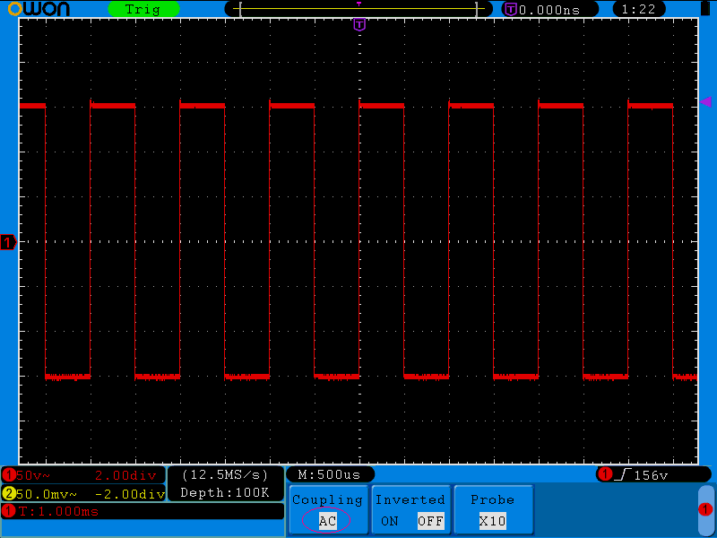

### Horizontal : le temps

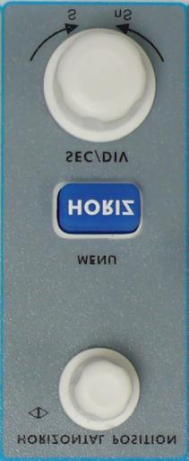

| Commande | Effet |
|---|---|
| **SEC/DIV** | change la **base de temps** (temps par carreau) |
| **HORIZONTAL POSITION** | déplace le tracé horizontalement (le point de déclenchement bouge avec) |
| **HORIZ MENU** | **Main** (base principale), **Set** (définir une zone à agrandir), **Zoom** (agrandir la zone) |

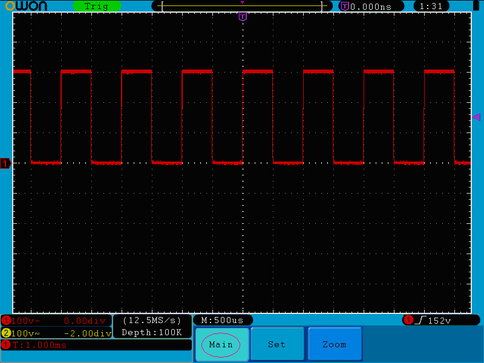

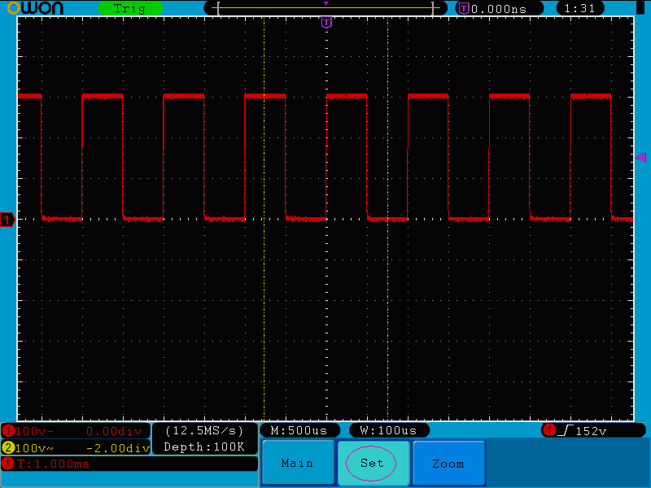

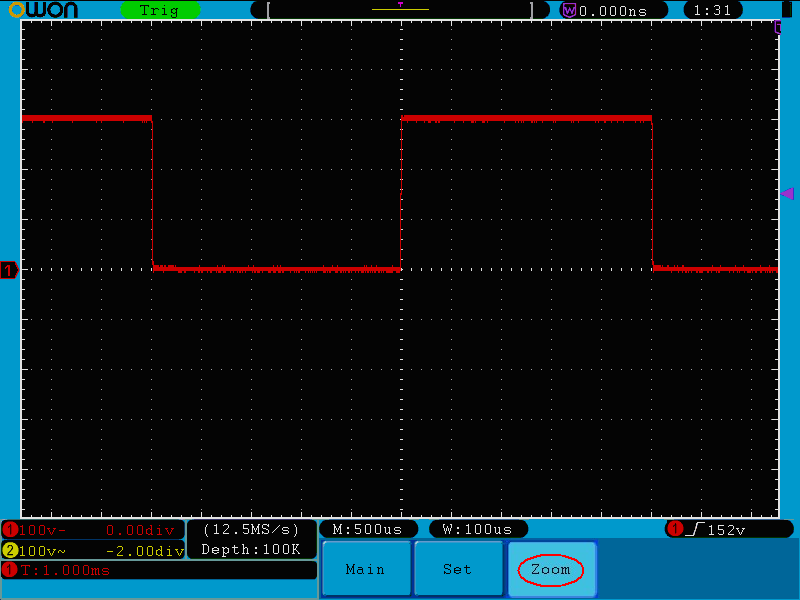

> [!TIP] 💡 Le zoom, c'est quoi ?
> Tu fixes l'acquisition d'un signal long, puis tu **agrandis une partie** pour voir un détail (un parasite, un front) sans refaire la capture.

### Déclenchement : stabiliser l'image

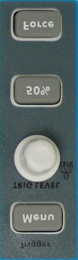

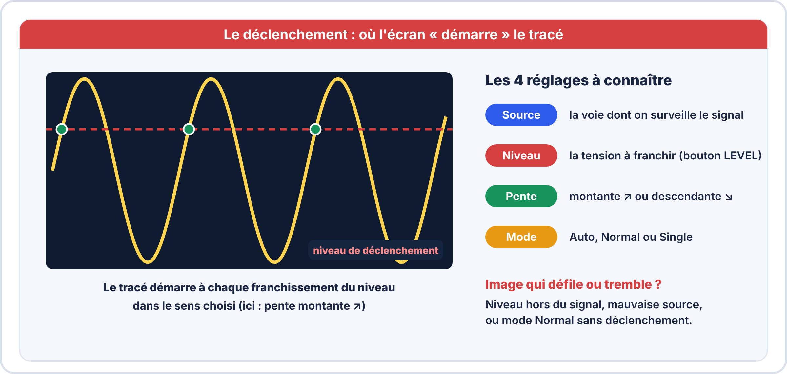

| Commande | Effet |
|---|---|
| **TRIG LEVEL** | règle le **niveau** de déclenchement ; **un appui** le remet à zéro |
| **50 %** | place le niveau **au milieu** du signal : à essayer **en premier** si l'image tremble |
| **Force** | force un déclenchement (utile en modes Normal et Single) |
| **Trigger Menu** | ouvre le menu de déclenchement |

**Le menu Edge** (déclenchement sur front, le plus utilisé) :

| Option | Valeurs |
|---|---|
| **Source** | CH1, CH2, EXT, EXT/5 (ou la ligne secteur) |
| **Coupling** | DC (tout), AC (sans continu), HF (rejette les hautes fréquences), LF (rejette les basses) |
| **Slope** | front **montant** ou **descendant** |
| **Mode** | **Auto** (affiche même sans déclenchement), **Normal** (affiche seulement quand déclenché), **Single** (une seule acquisition puis arrêt) |
| **Holdoff** | temps d'attente avant un nouveau déclenchement (100 ns à 10 s) : stabilise des signaux complexes |

> [!WARNING] ⚠️ Image qui défile ou qui tremble ?
> Vérifie dans cet ordre : **source** (est-ce bien la voie du signal ?), **niveau** (dans l'amplitude du signal : appuie sur **50 %**), **pente**, **mode** (Auto). En **Normal** sans signal qui franchit le niveau, l'écran **reste figé** sur l'ancien tracé.

---

## 6. Mesurer

### Par lecture des carreaux

Rappel : $U_{pp} = \text{carreaux (hauteur)} \times \text{V/div}$ et $T = \text{carreaux (largeur d'une période)} \times \text{s/div}$, puis $f = \dfrac{1}{T}$. C'est la méthode à savoir **refaire sans calculatrice** ; elle dépend de ta lecture.

### Par les mesures automatiques (touche Measure)

Procédure pour afficher la **période** et la **fréquence** de CH1 :

1. Touche **Measure** → **H1** (menu *Add*).
2. **F2** : choisis la **source** (CH1).
3. **F1** : le type s'affiche à gauche ; tourne **M** pour choisir *Period*, puis **F4** (*Add*).
4. Recommence pour *Freq*, puis pour une autre voie si besoin (**8 mesures au maximum**).

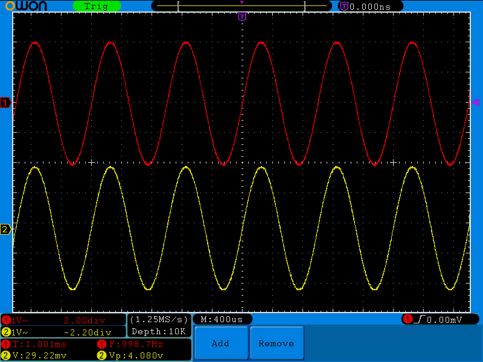

**20 grandeurs sont proposées.** Les principales :

| Tension | Sens |
|---|---|
| **Vpp** | tension crête à crête |
| **Vmax / Vmin** | valeurs extrêmes |
| **Vavg** | valeur moyenne |
| **Vrms** | valeur efficace vraie |
| **Vtop / Vbase** | plateau haut / bas d'un signal carré |
| **Vamp** | amplitude (Vtop − Vbase) |
| **Overshoot / Preshoot** | dépassements |

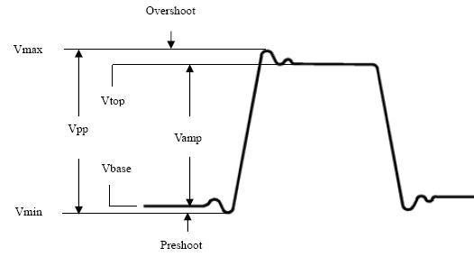

| Temps | Sens |
|---|---|
| **Freq / Period** | fréquence, période |
| **Rise time / Fall time** | temps de montée (10 % à 90 %) / de descente |
| **+Width / −Width** | largeur de l'impulsion positive / négative (à 50 %) |
| **+Duty / −Duty** | rapport cyclique : $+\text{Width}/\text{Period}$ |
| **Delay 1→2** | retard entre les deux voies |

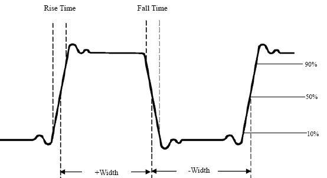

> [!WARNING] ⚠️ Les mesures automatiques ne marchent pas
> sur une trace **sauvegardée**, sur une trace **mathématique**, en mode **XY** ou en mode **Scan**. Et **la voie doit être allumée**.

### Par les curseurs (touche Cursor)

**Voltage** (deux lignes horizontales) ou **Time** (deux lignes verticales) : on place les deux curseurs sur les points voulus, la **différence** s'affiche.

**Particularité de cet appareil** : le **curseur 1** se déplace avec **VERTICAL POSITION de CH1** et le **curseur 2** avec **VERTICAL POSITION de CH2**.

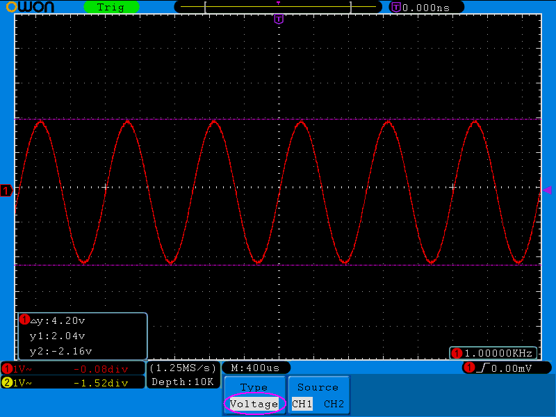

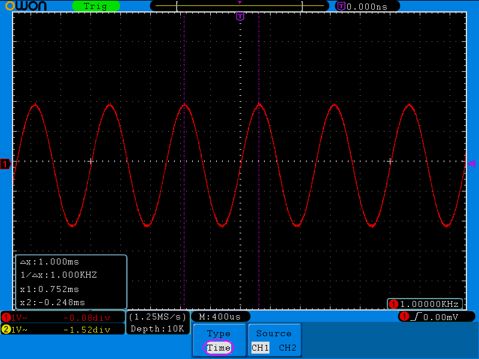

1. Touche **Cursor**.
2. **H2** : source (CH1 ou CH2).
3. **H1** : type (*Voltage* ou *Time*) avec **F2** / **F3**.
4. Place les curseurs avec les deux boutons **VERTICAL POSITION**.
5. Lis le résultat dans la fenêtre en bas à gauche de l'écran (la fréquence s'affiche en mode *Time*).

---

## 7. Acquisition et affichage

### Touche Acquire : trois modes d'échantillonnage

| Mode | Usage |
|---|---|
| **Sample** | normal |
| **Peak detect** | révèle les **parasites très brefs** (pics, bavures) |
| **Average** (4, 16, 64, 128) | **réduit le bruit** aléatoire |

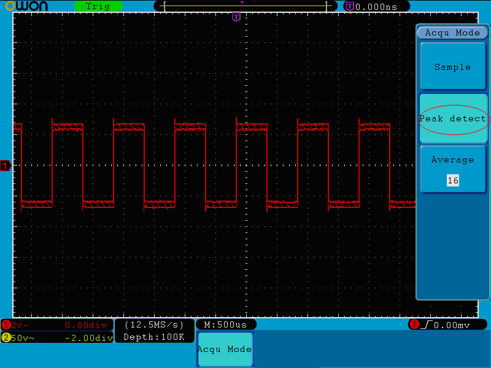

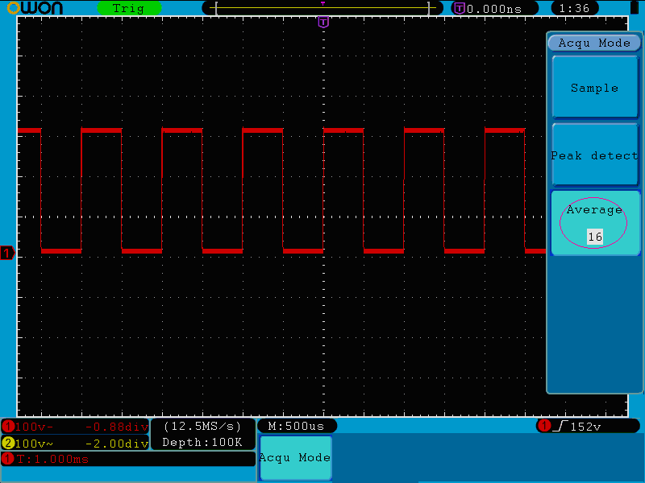

### Touche Display

| Option | Effet |
|---|---|
| **Type** : *Vect* ou *Dots* | tracé continu ou points d'échantillonnage |
| **Persist** | garde les anciens tracés à l'écran (1 s, 2 s, 5 s ou infini) : visualise une **gigue** ou un **bruit** |
| **XY Mode** | CH1 en X et CH2 en Y (courbes de Lissajous) |
| **Cymometer** | fréquencemètre intégré (6 chiffres) |

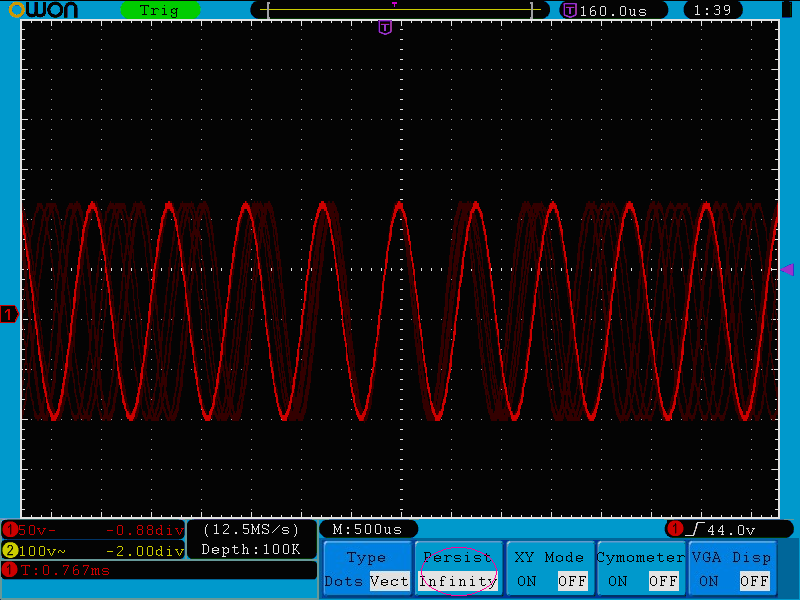

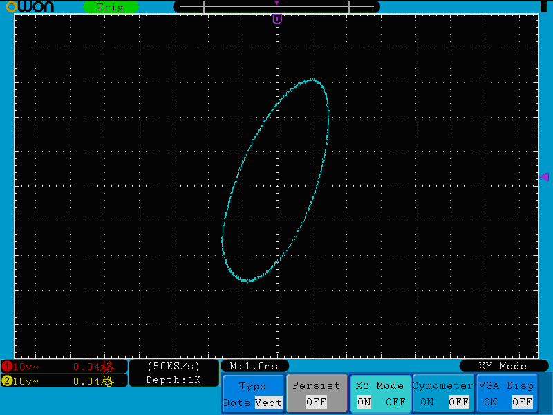

---

## 8. Capturer et sauvegarder

### Capturer un événement unique (monocoup)

1. Règle **V/div** et **s/div** pour voir le signal.
2. **Trigger Menu** : *Edge*, **Source** = la voie, **Slope** = front attendu, **niveau** à environ 50 % du signal (ou 2 V pour un signal logique TTL).
3. Touche **Single** : l'appareil **attend** le déclenchement, acquiert **une fois** et s'arrête.
4. Touche **Run/Stop** pour relancer.

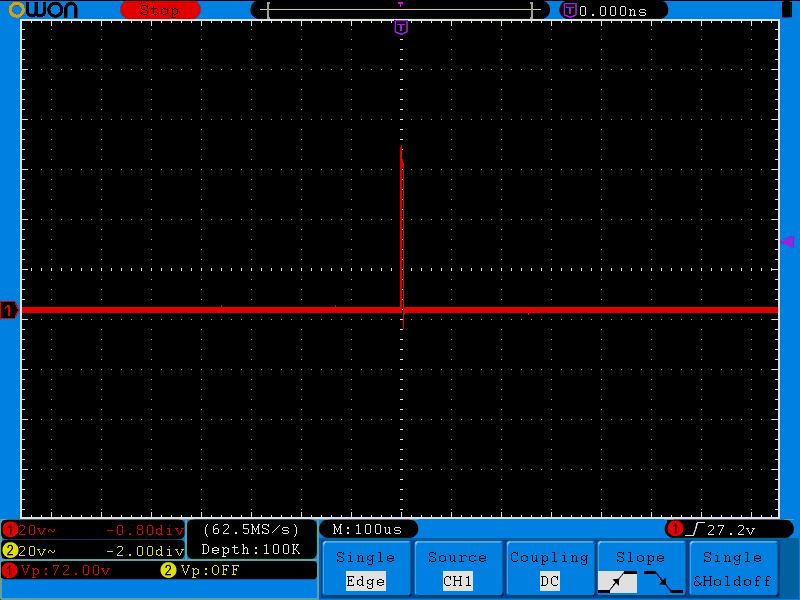

### Sauvegarder une image de l'écran

1. Insère une **clé USB** dans le port **USB hôte** (sur le côté).
2. Touche **Save** → **H1** : *Type* → **Image**.
3. **H4** : saisie du **nom de fichier** (clavier à l'écran, bouton **M** pour choisir, appui pour valider, puis *Enter*).
4. Le fichier est enregistré en **BMP** sur la clé.

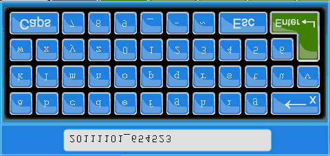

### Sauvegarder une trace ou des réglages

- **Save** → *Type* : **Wave** (une trace dans l'une des **15 mémoires** internes ou sur la clé en format **BIN**, lisible avec le logiciel OWON), **Setting** (les réglages de l'appareil), **Image**, **Record** (séquence).
- La touche **Copy** enregistre **directement** la trace selon les réglages du menu *Save*.

---

## 9. Fonctions utiles à connaître

| Fonction | Où | À quoi ça sert |
|---|---|---|
| **Autoset** | touche | règle automatiquement sensibilité, base de temps et déclenchement : **très pratique pour démarrer**, mais ses réglages ne sont pas toujours adaptés |
| **Autoscale** | touche | version plus fine : on choisit d'ajuster horizontal, vertical ou les deux, et d'afficher une ou plusieurs périodes |
| **Math** | touche | CH1 + CH2, CH1 − CH2, CH2 − CH1, CH1 × CH2, CH1 ÷ CH2 ou **FFT** |
| **FFT** | Math | spectre du signal (fréquences présentes) |
| **Help** | touche | aide en ligne |
| **Run/Stop** | touche | fige l'écran pour l'analyser |

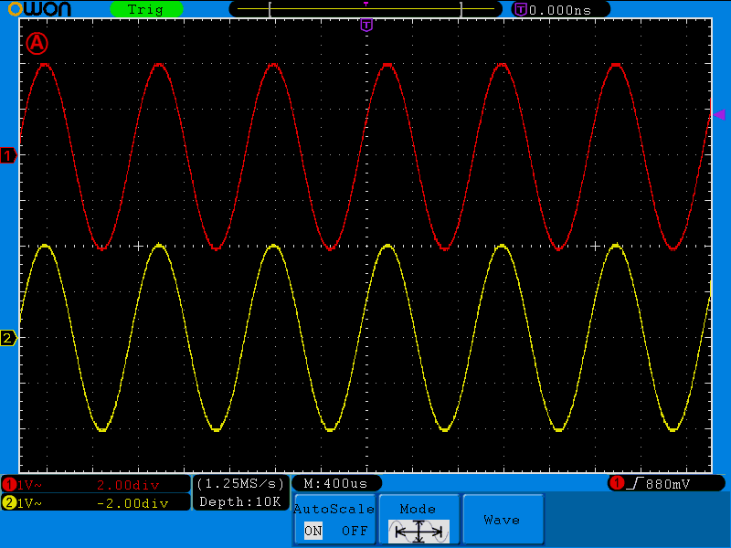

---

## 10. Aide-mémoire : « je ne vois rien »

| Symptôme | Cause probable | Solution |
|---|---|---|
| Écran **vide**, pas de trace | voie éteinte, couplage **GND**, base de temps ou sensibilité inadaptée | **MENU CH1** pour allumer, couplage DC, **Autoset** |
| **Ligne plate** au centre | pas de signal, ou pince de masse mal placée | vérifier le branchement de la **pointe** et de la **masse** |
| Signal **10 fois trop petit** | sonde ×10, menu en X1 | aligner **interrupteur** et **menu** |
| Signal **10 fois trop grand** | sonde ×1, menu en X10 | aligner interrupteur et menu |
| Image **instable** | niveau hors signal, mauvaise source, mode Normal | **50 %**, vérifier source et pente, mode **Auto** |
| Carré **arrondi ou avec bosses** | sonde non compensée | **compenser** la sonde |
| Signal **écrasé en haut ou en bas** | sensibilité trop grande (signal hors écran) | augmenter **V/div**, recentrer avec **POSITION** |
| **Ondulation** invisible sur une alimentation | couplage DC | passer en **AC** et réduire V/div |
| Trace **aplatie** à 0 V | tension non reliée à la bonne masse | vérifier la masse commune des voies |

## ✅ Passeport : je maîtrise l'OWON quand je sais…

- [ ] allumer, **remettre les réglages d'usine** et brancher une sonde ;
- [ ] régler le **coefficient de sonde** aux deux endroits et **compenser** ;
- [ ] **centrer** un signal avec POSITION et VOLTS/DIV ;
- [ ] obtenir **3 périodes** stables avec SEC/DIV et TRIG LEVEL ;
- [ ] choisir le **couplage** DC ou AC ;
- [ ] mesurer avec les **carreaux**, les **mesures automatiques** et les **curseurs** ;
- [ ] **capturer** un événement avec **Single** ;
- [ ] **sauvegarder une image** sur clé USB.
