# 🔭 Fiche d'utilisation : RIGOL DS1104Z (Plus)

> **Oscilloscope numérique 4 voies, 100 MHz, de la série DS1000Z.**
> Cette fiche se suit **l'appareil sous les yeux**. Elle s'applique aussi au **DS1054Z** (même famille, même face avant, 50 MHz).
>
> *Source des illustrations : « Guide d'utilisation d'un oscilloscope numérique, cas du RIGOL DS1054Z », Abdallah Darkawi, Polytech Nantes, 2016 (archive ouverte HAL, cel-01359571), et documentation RIGOL de la série DS1000Z.*

> [!NOTE] 🔎 À propos de cette fiche
> L'appareil peut être réglé en **français** ou en **anglais** (menu Utility) : les noms de menus de cette fiche sont donnés dans les **deux langues** quand c'est utile.

## 🎯 Ce que tu sauras faire avec cette fiche

- allumer, **remettre à zéro** et **compenser ta sonde** ;
- **régler** sensibilité, base de temps, déclenchement et couplage ;
- **lire** l'écran et **mesurer** (carreaux, mesures rapides, curseurs, statistiques) ;
- utiliser **plusieurs voies** à la fois ;
- **capturer** un signal unique, **enregistrer** une image ou un fichier CSV sur clé USB.

---

## 1. Les caractéristiques à connaître

| Caractéristique | Valeur |
|---|---|
| **Voies analogiques** | **4** (CH1 à CH4), **masse commune** |
| **Bande passante** | **100 MHz** (DS1104Z Plus) ; 50 MHz pour le DS1054Z |
| **Échantillonnage** | **1 GSa/s** avec **1 voie**, **500 MSa/s** avec 2 voies, **250 MSa/s** avec 3 ou 4 voies |
| **Écran** | LCD 7 pouces (800 × 480) |
| **Fonctions** | Autoset, mesures et **statistiques**, curseurs, FFT, mathématiques, enregistrement, impression rapide |
| **Voies logiques** | **uniquement** sur un modèle **MSO** (ou avec l'option MSO et la sonde logique 16 voies) |
| **Décodage série** (RS232, I²C, SPI) | souvent **en option** : vérifie sur ton appareil |

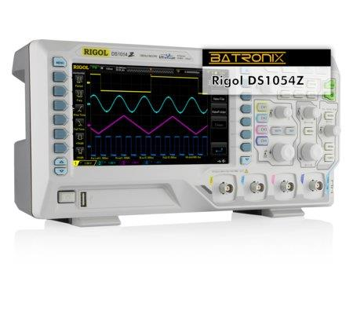

> [!WARNING] ⚠️ Sécurité
> - Les **quatre voies partagent la même masse** : les pinces de masse se branchent sur **le même point** du circuit.
> - **Ne mesure pas directement le secteur** avec une sonde classique.
> - Respecte les tensions maximales indiquées sur la sonde et sur l'appareil.
> - Les doigts restent **derrière l'anneau de sécurité** de la sonde.

## 2. Découvrir la face avant

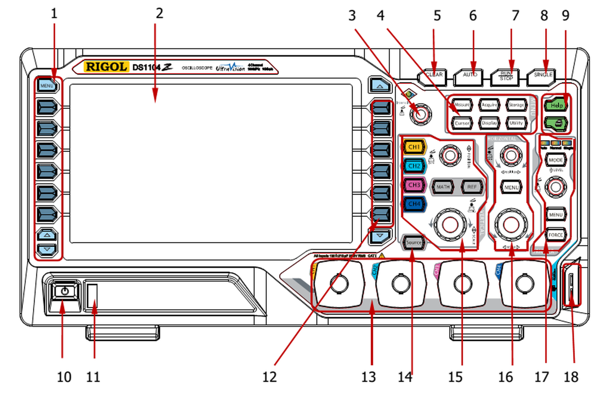

| N° | Élément | À quoi ça sert |
|---|---|---|
| 1 | **Touches de mesure rapide** (à gauche de l'écran) | afficher d'un appui des mesures usuelles : période, fréquence, temps de montée… (la touche **MENU** en haut change de série de mesures) |
| 2 | **Écran** | tracés, mesures, menus |
| 3 | **Bouton multifonction** | parcourir une liste, ajuster une valeur ; **un appui valide** |
| 4 | **Touches de menu** | **Measure, Acquire, Storage, Cursor, Display, Utility** |
| 5 | **CLEAR** | efface les tracés de l'écran |
| 6 | **AUTO** | réglage automatique (équivalent de l'Autoset) |
| 7 | **RUN/STOP** | lance ou fige l'acquisition |
| 8 | **SINGLE** | une seule acquisition, puis arrêt |
| 9 | **Help** et **Quick Print** | aide en ligne ; **capture rapide de l'écran** sur clé USB |
| 10 | **Interrupteur** | allumer / éteindre |
| 11 | **USB HOST** | clé USB |
| 12 | **Touches de menu à l'écran** (à droite de l'écran) | choisir une option du menu affiché |
| 13 | **Entrées CH1 à CH4** | voies analogiques (BNC) |
| 14 | **Source** | générateur de signal (modèles « -S » uniquement) |
| 15 | **VERTICAL** | touches **CH1 à CH4**, **MATH**, **REF**, boutons **POSITION** (haut) et **SCALE** (bas) |
| 16 | **HORIZONTAL** | bouton **POSITION**, touche **MENU**, bouton **SCALE** |
| 17 | **TRIGGER** | touche **MODE** (Auto, Normal, Single : un voyant indique le mode), bouton **LEVEL**, touche **MENU**, touche **FORCE** |
| 18 | **Sortie de compensation** et **borne de masse** | pour compenser la sonde |

> [!TIP] 💡 Les deux jeux de boutons verticaux
> Il y a **un seul bouton POSITION et un seul SCALE** pour les quatre voies : ils agissent sur **la voie sélectionnée** (celle dont la touche CH est allumée). Chaque voie a **sa couleur** : CH1 **jaune**, CH2 **cyan**, CH3 **magenta**, CH4 **bleu**.

## 3. Lire l'écran

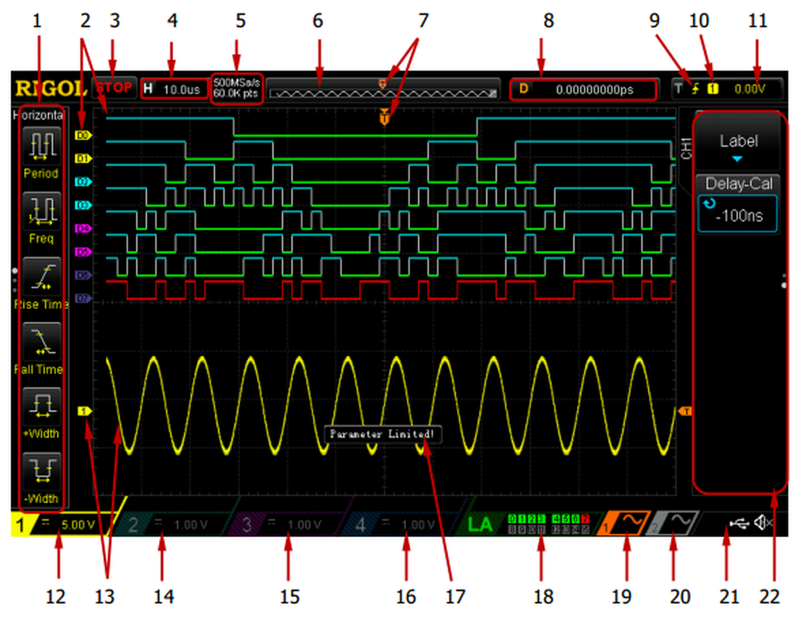

| N° | Zone | Ce que tu lis |
|---|---|---|
| 1 | Mesures rapides | colonne de touches virtuelles à gauche : période, fréquence, temps de montée… |
| 2 | Voies logiques | **uniquement** sur un modèle MSO |
| 3 | **État** | **RUN**, **STOP**, **T'D** (déclenché), **WAIT** (attend le déclenchement), **AUTO** |
| 4 | **Base de temps** | temps par carreau (H) |
| 5 | **Échantillonnage** | cadence (par exemple 500 MSa/s) et nombre de points |
| 6 | **Mémoire** | taille du signal enregistré par rapport à l'écran |
| 7 | **Position du déclenchement** | repère T |
| 8 | **Position horizontale** | décalage (D) |
| 9 | **Type de déclenchement** | par exemple front montant |
| 10 | **Source** du déclenchement | numéro de la voie |
| 11 | **Niveau** du déclenchement | en volts |
| 12 | **Sensibilité de CH1** | volts par carreau |
| 13 | **Voie et couleur** | repère du zéro de la voie |
| 14 à 16 | **Sensibilité de CH2, CH3, CH4** | volts par carreau |
| 17 | **Bulle de message** | messages de l'appareil |
| 18 | État des entrées **logiques** | n'existe pas sur le DS1054Z / DS1104Z Plus sans option |
| 19 et 20 | **Formes de la source 1 et 2** | générateur de signal (modèles « -S ») |
| 21 | **Zone de notification** | clé USB, son |
| 22 | **Menu** | les options du menu en cours, sur le côté droit |

> [!TIP] 💡 Le réflexe de lecture
> **Avant de lire le tracé**, lis toujours la **sensibilité** (V par carreau, repères 12 à 16) et la **base de temps** (repère 4).

---

## 4. La mise en route en 6 étapes

1. **Allume** l'appareil (interrupteur de la face avant).
2. **Remets les réglages d'usine** : touche **Storage**, puis **Default**.
3. **Règle le coefficient de la sonde** : appuie sur **CH1**, puis dans le menu de la voie choisis **Probe : 10X** (la même valeur que l'interrupteur de la sonde).
4. **Branche la sonde** : la **pointe** sur la **sortie de compensation** (*Compensation Signal Output Terminal*), la **pince de masse** sur la **borne de masse** placée juste à côté (*Ground Terminal*).
5. Appuie sur **AUTO** : un **carré** apparaît.
6. **Compense la sonde** si le carré n'est pas droit.

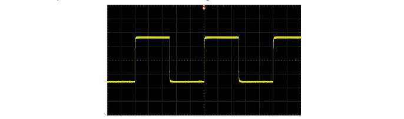

### La compensation de la sonde

Une sonde **non compensée** ou **mal compensée** provoque des erreurs de mesure. Compare le signal aux trois formes ci-dessous :

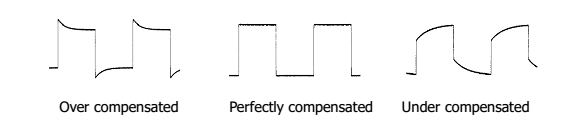

Avec un **outil non métallique** (petit tournevis plastique), ajuste le trimmer de la sonde jusqu'à obtenir un **carré parfait**. Recommence pour **chaque voie** utilisée.

> [!WARNING] ⚠️ L'erreur n° 1
> Sonde sur **10X** mais menu de la voie sur **1X** : toutes les tensions affichées sont **10 fois trop petites**. Les deux réglages doivent **toujours** être identiques.

### Les 8 gestes à faire dans cet ordre

1. Allumer l'oscilloscope.
2. Régler la luminosité de l'affichage si besoin.
3. Régler la **sensibilité verticale** (calibre).
4. Régler la **base de temps** (sensibilité horizontale).
5. Choisir la **source** du déclenchement (la voie à surveiller).
6. Choisir le **couplage** du déclenchement (AC ou DC).
7. Régler le **niveau** du déclenchement.
8. **Lire**, interpréter et **enregistrer** les données.

---

## 5. Les trois zones de réglage

### Vertical : la tension

| Commande | Effet |
|---|---|
| **CHx** | allume la voie et **ouvre son menu** ; un second appui sur la touche allumée **éteint** la voie |
| **SCALE** (vertical) | **sensibilité** (V par carreau) : plus petit = signal agrandi ; selon la version, un **appui** sur le bouton permet un réglage **fin** |
| **POSITION** (vertical) | déplace le tracé de la voie sélectionnée |

**Le menu d'une voie** :

| Option | Valeurs | Usage |
|---|---|---|
| **Couplage** (*Coupling*) | **DC**, **AC**, **GND** | DC : tout le signal ; AC : retire la composante continue ; GND : coupe l'entrée (visualise le zéro) |
| **BW Limit** | OFF, **20 MHz** | filtre les hautes fréquences (réduit le bruit) |
| **Probe** | 1X, **10X**, … | **doit correspondre** à la sonde |
| **Invert** | ON, OFF | retourne le tracé |

### Horizontal : le temps

| Commande | Effet |
|---|---|
| **SCALE** (horizontal) | base de temps (s par carreau) |
| **POSITION** (horizontal) | décale le tracé : permet de voir **avant** ou **après** le déclenchement ; un **appui** remet le déclenchement **au centre** |
| **MENU** | mode de base de temps (YT, XY, Roll), zoom |

### Déclenchement : stabiliser l'image

| Commande | Effet |
|---|---|
| **LEVEL** | règle le **niveau** de déclenchement |
| **MODE** | passe entre **Auto**, **Normal** et **Single** |
| **FORCE** | force un déclenchement |
| **MENU** | ouvre le menu de déclenchement : **type** (*Bord* / Edge, *Impulsion* / Pulse, *Pente* / Slope, *Vidéo*, *Motif* / Pattern, *Durée*…), **source**, **pente**, **mode**, **réglages** |

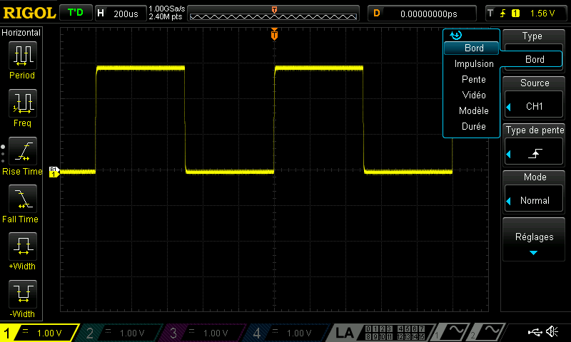

La **source** peut être une des voies (CH1 à CH4) ou le **réseau 50 Hz** (*AC Line*). La **pente** peut être **montante** (valeur par défaut), **descendante** ou **les deux**.

**Les trois modes** :

| Mode | Comportement |
|---|---|
| **Auto** | affiche **même sans déclenchement** (idéal pour démarrer) |
| **Normal** | n'affiche **que** quand le signal franchit le niveau ; sinon, **l'ancien tracé reste** |
| **Single** | **une seule** acquisition, puis arrêt |

> [!WARNING] ⚠️ Image qui défile ou qui tremble ?
> Vérifie dans cet ordre : **source** (la bonne voie ?), **niveau** (**dans** l'amplitude du signal), **pente**, **mode** (Auto).

---

## 6. Mesurer

### Par lecture des carreaux

$U_{pp} = \text{carreaux (hauteur)} \times \text{V/div}$ ; $T = \text{carreaux (largeur d'une période)} \times \text{s/div}$ ; $f = \dfrac{1}{T}$.

### Par les mesures rapides (touches à gauche de l'écran)

Les touches placées **à gauche de l'écran** affichent d'un appui des mesures usuelles (**période**, **fréquence**, **temps de montée**, **temps de descente**, **largeur positive**, **largeur négative**…). La touche **MENU** en haut de cette colonne permet de passer à une autre série de mesures.

### Par les mesures automatiques (touche Measure)

1. Appuie sur **Measure**.
2. Choisis la **source** (CH1 à CH4) et la **grandeur** à mesurer (tension : **Vpp**, **Vmax**, **Vmin**, **Vrms**, **Vavg**… ; temps : **période**, **fréquence**, **temps de montée**, **largeur**, **rapport cyclique**…).
3. Le résultat apparaît **en bas de l'écran** (jusqu'à **5 mesures** à la fois).

| Option | Effet |
|---|---|
| **All Measure** | affiche **toutes** les grandeurs de la voie choisie |
| **Statistic** | donne pour chaque mesure la valeur **courante, moyenne, minimale et maximale** : pratique pour estimer la **dispersion** |
| **Reset Stat.** | efface l'historique |

> [!TIP] 💡 Statistiques et incertitude
> Les statistiques donnent une idée de la **dispersion** de la mesure (utile pour l'incertitude de **type A** : écart-type et moyenne).

### Par les curseurs (touche Cursor)

Les modes disponibles : **Manual** (tu places toi-même les curseurs A et B), **Track** (les curseurs suivent le tracé), **Auto** (placement automatique), **XY**.

1. Appuie sur **Cursor**, choisis **Manual**.
2. Choisis **Type** : **Y** pour une **tension** (lignes horizontales) ou **X** pour un **temps** (lignes verticales).
3. Place les curseurs **A** et **B** avec le **bouton multifonction**.
4. Lis **ΔX** (temps), **1/ΔX** (fréquence correspondante) ou **ΔY** (tension).

## 7. Acquisition et affichage

### Touche Acquire

| Mode | Usage |
|---|---|
| **Normal** | normal |
| **Averages** | **moyenne** : réduit le **bruit aléatoire** |
| **Peak Detect** | révèle les **parasites brefs** |
| **High Resolution** | réduit le bruit sur les bases de temps lentes |

### Touche Display

- **Type** : **Vectors** (tracé continu) ou **Dots** (points).
- **Persist** : garde les anciens tracés (visualiser une gigue ou un bruit).
- **Grid** et **Brightness** : aspect de l'écran.

## 8. Capturer et sauvegarder

### Capturer un événement unique

1. Règle sensibilité et base de temps pour voir le signal.
2. **Menu de déclenchement** : *Edge*, **source** = la voie, **pente** adaptée, **niveau** à environ 50 % de l'amplitude.
3. Appuie sur **SINGLE** : l'état passe à **WAIT** (en attente), puis à **STOP** après le déclenchement.
4. **RUN/STOP** relance l'acquisition.

### Enregistrer une image de l'écran : la touche Quick Print

1. Insère une **clé USB** formatée en **FAT32** dans le port **USB HOST**.
2. Appuie sur la touche d'**impression rapide** (*Quick Print*, à côté de **Help**).

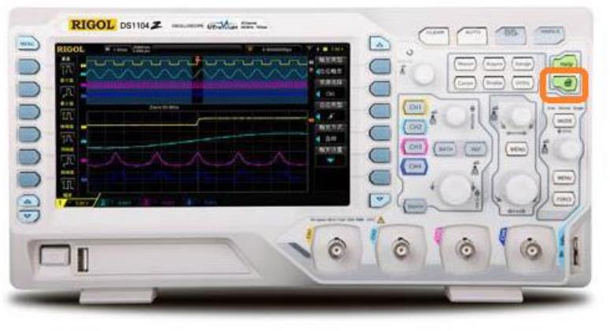

Par défaut, l'image est enregistrée **telle qu'elle est**, avec un **fond noir**.

### Enregistrer une image à fond blanc (pour un document ou une impression)

1. Touche **Utility** (page 1/3), puis la **flèche vers le bas** (page 2/3) : choisis **Print Set**.
2. Règle la **palette** sur **Gray Scale** (niveaux de gris).
3. Page 2/2 : active **Invert : ON** (inversion des couleurs).

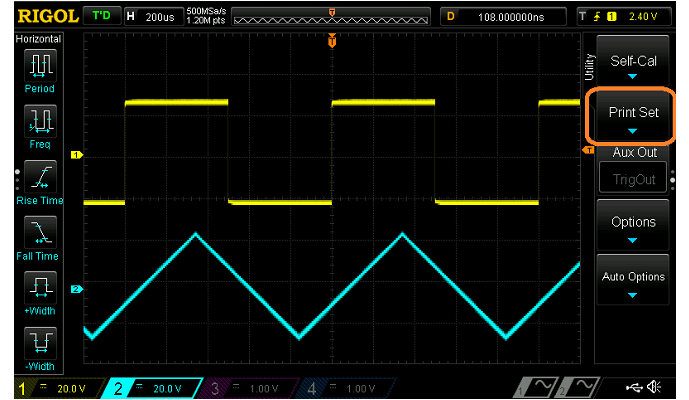

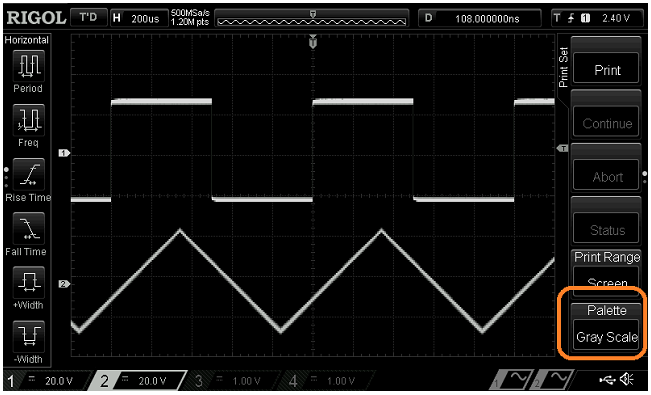

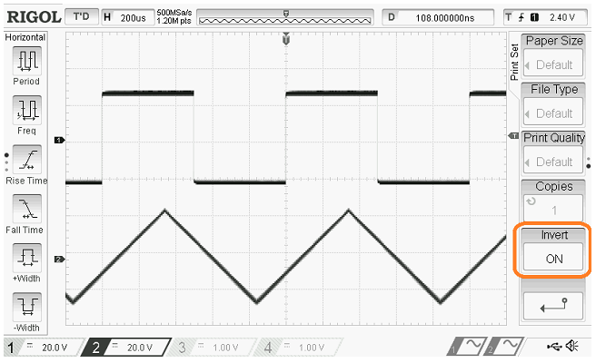

### Enregistrer les données en CSV (pour un tableur)

1. Insère la clé USB (FAT32).
2. **Storage** (page 1/2), puis l'option de **stockage**.
3. Choisis **CSV** à la place de *Image*.
4. Dans le **gestionnaire de disque**, choisis la **clé USB** (et non la mémoire interne).
5. Choisis le **type de fichier** : *.csv.
6. **New File** pour créer un fichier à la racine de la clé (ou **New Folder** pour un dossier), puis **OK**.

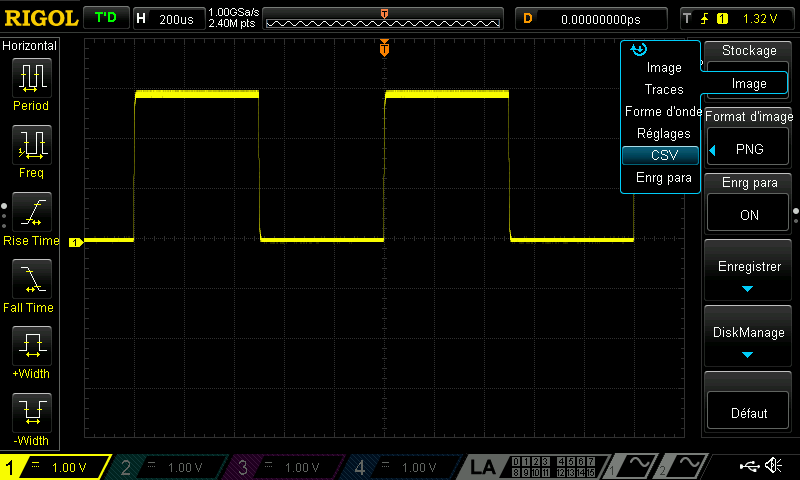

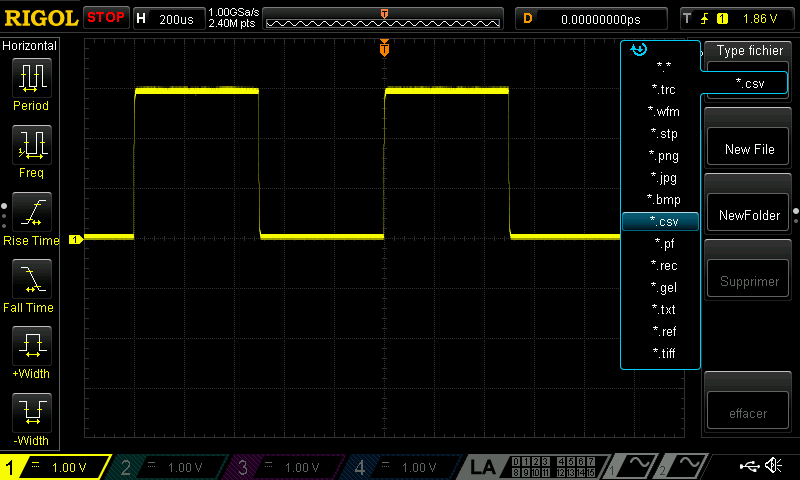

> [!TIP] 💡 Aussi disponible
> **Storage** permet de sauvegarder les **traces**, les **réglages** (*Setup*) et de les **recharger**.

---

## 9. Les voies logiques (modèles MSO uniquement)

Un modèle **MSO** (ou équipé de l'option MSO) possède une touche **LA** et **16 voies logiques** (D0 à D15) : on branche la **sonde logique** et on observe **plusieurs signaux numériques** en même temps (bus I²C, SPI, UART). Sans cette option, l'appareil reste un oscilloscope **à 4 voies analogiques**.

---

## 10. Aide-mémoire : « je ne vois rien »

| Symptôme | Cause probable | Solution |
|---|---|---|
| Écran **sans trace** | voie éteinte, couplage **GND**, sensibilité ou base de temps inadaptée | touche **CHx** pour allumer, couplage **DC**, **AUTO** |
| **Ligne plate** | pas de signal, pince de masse mal placée | vérifier **pointe** et **masse** |
| Signal **10 fois trop petit** | sonde ×10, menu de la voie en 1X | aligner **interrupteur** et **menu** |
| Image **instable** | niveau hors signal, mauvaise source, mode Normal | vérifier **source**, **niveau**, mode **Auto** |
| **Plusieurs tracés** de même couleur ? | confusion entre voies | repérer la **couleur** : CH1 jaune, CH2 cyan, CH3 magenta, CH4 bleu |
| Carré **arrondi ou avec bosses** | sonde non compensée | **compenser** |
| **Ondulation** invisible | couplage DC | passer en **AC** et réduire V/div |
| Mesure **absurde** | mauvaise source choisie dans **Measure** | vérifier la **source** de la mesure |

## ✅ Passeport : je maîtrise le Rigol quand je sais…

- [ ] allumer, **remettre à zéro** et régler la **sonde** ;
- [ ] **compenser** une sonde ;
- [ ] **centrer** un signal avec POSITION et SCALE ;
- [ ] obtenir **3 périodes** stables avec le déclenchement ;
- [ ] choisir le **couplage** DC ou AC ;
- [ ] afficher **deux voies** et les distinguer par leur **couleur** ;
- [ ] mesurer avec les **carreaux**, **Measure** (avec **Statistic**) et les **curseurs** ;
- [ ] **capturer** un événement avec **SINGLE** ;
- [ ] **sauvegarder une image** sur clé USB.
