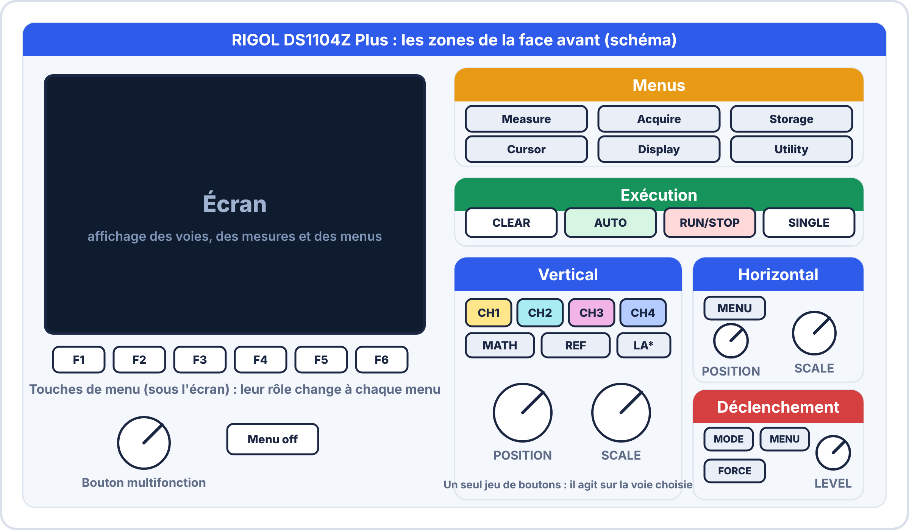
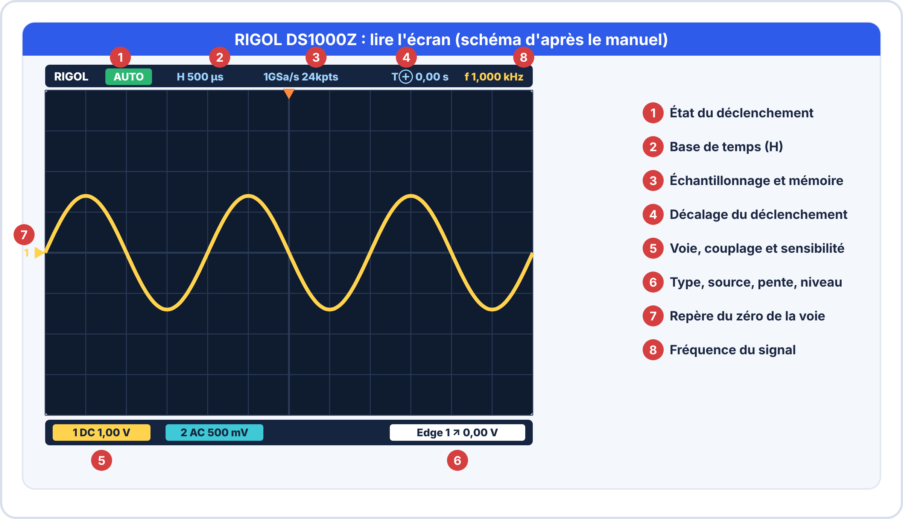

# 🔭 Fiche d'utilisation : RIGOL DS1104Z (Plus)

> **Oscilloscope numérique 4 voies, 100 MHz, de la série DS1000Z.**
> Cette fiche se suit **l'appareil sous les yeux**. Les noms de touches sont ceux de la série DS1000Z.

> [!NOTE] 🔎 À propos des sources de cette fiche
> Les schémas ci-dessous ont été **dessinés** d'après la documentation de la série DS1000Z (*MSO1000Z/DS1000Z User's Guide*). Le fichier fourni au projet ne contient que la **page de garde** du manuel : les captures d'écran du constructeur seront ajoutées lorsque le manuel complet sera disponible. En cas de doute sur le **nom exact d'un menu**, regarde l'écran de ton appareil : il peut varier légèrement selon la version du logiciel interne.

## 🎯 Ce que tu sauras faire avec cette fiche

- allumer, **remettre à zéro** et **compenser ta sonde** ;
- **régler** sensibilité, base de temps, déclenchement et couplage ;
- **lire** l'écran et **mesurer** (carreaux, mesures automatiques, curseurs, statistiques) ;
- utiliser **plusieurs voies** à la fois ;
- **capturer** un signal unique et **sauvegarder** une image.

---

## 1. Les caractéristiques à connaître

| Caractéristique | Valeur |
|---|---|
| **Voies analogiques** | **4** (CH1 à CH4), **masse commune** |
| **Bande passante** | 100 MHz |
| **Échantillonnage** | jusqu'à 1 GSa/s ; **la cadence diminue** quand on utilise plus de voies ou une base de temps lente |
| **Fonctions** | Autoset, mesures automatiques et **statistiques**, curseurs, FFT, mathématiques, mode XY, enregistrement |
| **Voies logiques** | **uniquement** sur un modèle **MSO** (ou avec l'option MSO et la sonde logique 16 voies) |
| **Décodage série** (RS232, I²C, SPI) | souvent **en option** : vérifie sur ton appareil |

> [!WARNING] ⚠️ Sécurité
> - Les **quatre voies partagent la même masse** : les pinces de masse se branchent sur **le même point** du circuit.
> - **Ne mesure pas directement le secteur** avec une sonde classique.
> - Respecte les tensions maximales indiquées sur la sonde et sur l'appareil.
> - Les doigts restent **derrière l'anneau de sécurité** de la sonde.

## 2. Découvrir la face avant

| Zone | Contenu |
|---|---|
| **Vertical** | touches **CH1 à CH4** (chaque voie a sa couleur), **MATH**, **REF**, et **deux boutons** : **POSITION** et **SCALE**. Ils agissent sur **la voie sélectionnée** (celle dont le menu est ouvert) |
| **Horizontal** | **MENU**, bouton **POSITION** (déplace le déclenchement), bouton **SCALE** (base de temps) |
| **Déclenchement** | **MODE** (Auto, Normal, Single), bouton **LEVEL** (niveau), **FORCE**, **MENU** |
| **Exécution** | **CLEAR** (efface l'écran), **AUTO** (réglage automatique), **RUN/STOP**, **SINGLE** |
| **Menus** | **Measure**, **Acquire**, **Storage**, **Cursor**, **Display**, **Utility** |
| **Menus à l'écran** | les touches **sous l'écran** choisissent les options du menu affiché ; le **bouton multifonction** parcourt les listes et ajuste les valeurs |

> [!TIP] 💡 Le principe commun
> Appuie sur une touche de menu (par exemple **Measure**) : un menu **s'affiche à l'écran** ; les touches placées sous ou à côté de l'écran choisissent les options. Le **bouton multifonction** sert à **faire défiler** et à **régler**. **Menu off** (ou un second appui) referme le menu.

## 3. Lire l'écran

| N° | Zone | Ce que tu lis |
|---|---|---|
| 1 | **État** | **RUN** (en acquisition), **STOP**, **AUTO**, **WAIT** (attend le déclenchement), **T'D** (déclenché) |
| 2 | **Base de temps** | temps par carreau (H) |
| 3 | **Échantillonnage** | cadence et profondeur de mémoire |
| 4 | **Décalage du déclenchement** | position du déclenchement par rapport au centre de l'écran |
| 5 | **Voies** | **couleur de la voie**, **couplage** et **sensibilité** par carreau |
| 6 | **Déclenchement** | type, source, pente et niveau |
| 7 | **Repère du zéro** | niveau 0 V de chaque voie |
| 8 | **Fréquence** | fréquence du signal qui déclenche |

> [!TIP] 💡 Le réflexe de lecture
> **Avant de lire le tracé**, lis toujours la **sensibilité** (V par carreau) et la **base de temps** (s par carreau).

---

## 4. La mise en route en 6 étapes

1. **Allume** l'appareil (interrupteur de la face avant).
2. **Remets les réglages d'usine** : menu **Storage** puis **Default** (selon la version, une touche dédiée peut exister).
3. **Règle le coefficient de la sonde** : appuie sur **CH1**, puis dans le menu de la voie choisis **Probe : 10X** (la même valeur que l'interrupteur de la sonde).
4. **Branche la sonde** sur la **sortie de compensation** de la face avant (carré de **1 kHz**) et la pince de masse sur la borne de masse.
5. Appuie sur **AUTO** : un **carré** apparaît.
6. **Compense la sonde** : avec un petit tournevis, tourne le trimmer de la sonde jusqu'à avoir un **carré bien droit** (sans bosse ni arrondi sur les angles).

> [!WARNING] ⚠️ L'erreur n° 1
> Sonde sur **10X** mais menu de la voie sur **1X** : toutes les tensions affichées sont **10 fois trop petites**. Les deux réglages doivent **toujours** être identiques.

---

## 5. Les trois zones de réglage

### Vertical : la tension

| Commande | Effet |
|---|---|
| **CHx** | allume la voie et **ouvre son menu** ; un second appui sur la touche allumée **éteint** la voie |
| **SCALE** (vertical) | **sensibilité** (V par carreau) : plus petit = signal agrandi ; selon la version, un **appui** sur le bouton permet un réglage **fin** |
| **POSITION** (vertical) | déplace le tracé de la voie sélectionnée |

**Le menu d'une voie** :

| Option | Valeurs | Usage |
|---|---|---|
| **Couplage** (*Coupling*) | **DC**, **AC**, **GND** | DC : tout le signal ; AC : retire la composante continue ; GND : coupe l'entrée (visualise le zéro) |
| **BW Limit** | OFF, **20 MHz** | filtre les hautes fréquences (réduit le bruit) |
| **Probe** | 1X, **10X**, … | **doit correspondre** à la sonde |
| **Invert** | ON, OFF | retourne le tracé |

### Horizontal : le temps

| Commande | Effet |
|---|---|
| **SCALE** (horizontal) | base de temps (s par carreau) |
| **POSITION** (horizontal) | décale le tracé : permet de voir **avant** ou **après** le déclenchement ; un **appui** remet le déclenchement **au centre** |
| **MENU** | mode de base de temps (YT, XY, Roll), zoom |

### Déclenchement : stabiliser l'image

| Commande | Effet |
|---|---|
| **LEVEL** | règle le **niveau** de déclenchement |
| **MODE** | passe entre **Auto**, **Normal** et **Single** |
| **FORCE** | force un déclenchement |
| **MENU** | ouvre le menu de déclenchement : **type** (Edge, Pulse, Slope, Video, …), **source**, **pente**, **couplage**, **holdoff** |

**Les trois modes** :

| Mode | Comportement |
|---|---|
| **Auto** | affiche **même sans déclenchement** (idéal pour démarrer) |
| **Normal** | n'affiche **que** quand le signal franchit le niveau ; sinon, **l'ancien tracé reste** |
| **Single** | **une seule** acquisition, puis arrêt |

> [!WARNING] ⚠️ Image qui défile ou qui tremble ?
> Vérifie dans cet ordre : **source** (la bonne voie ?), **niveau** (**dans** l'amplitude du signal), **pente**, **mode** (Auto).

---

## 6. Mesurer

### Par lecture des carreaux

$U_{pp} = \text{carreaux (hauteur)} \times \text{V/div}$ ; $T = \text{carreaux (largeur d'une période)} \times \text{s/div}$ ; $f = \dfrac{1}{T}$.

### Par les mesures automatiques (touche Measure)

1. Appuie sur **Measure**.
2. Choisis la **source** (CH1 à CH4) et la **grandeur** à mesurer (tension : **Vpp**, **Vmax**, **Vmin**, **Vrms**, **Vavg**… ; temps : **période**, **fréquence**, **temps de montée**, **largeur**, **rapport cyclique**…).
3. Le résultat apparaît **en bas de l'écran** (jusqu'à **5 mesures** à la fois).

| Option | Effet |
|---|---|
| **All Measure** | affiche **toutes** les grandeurs de la voie choisie |
| **Statistic** | donne pour chaque mesure la valeur **courante, moyenne, minimale et maximale** : pratique pour estimer la **dispersion** |
| **Reset Stat.** | efface l'historique |

> [!TIP] 💡 Statistiques et incertitude
> Les statistiques donnent une idée de la **dispersion** de la mesure (utile pour l'incertitude de **type A** : écart-type et moyenne).

### Par les curseurs (touche Cursor)

Les modes disponibles : **Manual** (tu places toi-même les curseurs A et B), **Track** (les curseurs suivent le tracé), **Auto** (placement automatique), **XY**.

1. Appuie sur **Cursor**, choisis **Manual**.
2. Choisis **Type** : **Y** pour une **tension** (lignes horizontales) ou **X** pour un **temps** (lignes verticales).
3. Place les curseurs **A** et **B** avec le **bouton multifonction**.
4. Lis **ΔX** (temps), **1/ΔX** (fréquence correspondante) ou **ΔY** (tension).

## 7. Acquisition et affichage

### Touche Acquire

| Mode | Usage |
|---|---|
| **Normal** | normal |
| **Averages** | **moyenne** : réduit le **bruit aléatoire** |
| **Peak Detect** | révèle les **parasites brefs** |
| **High Resolution** | réduit le bruit sur les bases de temps lentes |

### Touche Display

- **Type** : **Vectors** (tracé continu) ou **Dots** (points).
- **Persist** : garde les anciens tracés (visualiser une gigue ou un bruit).
- **Grid** et **Brightness** : aspect de l'écran.

## 8. Capturer et sauvegarder

### Capturer un événement unique

1. Règle sensibilité et base de temps pour voir le signal.
2. **Menu de déclenchement** : *Edge*, **source** = la voie, **pente** adaptée, **niveau** à environ 50 % de l'amplitude.
3. Appuie sur **SINGLE** : l'état passe à **WAIT** (en attente), puis à **STOP** après le déclenchement.
4. **RUN/STOP** relance l'acquisition.

### Sauvegarder une image

1. Insère une **clé USB** dans le port **USB** de la face avant.
2. **Storage** → type **Image**, puis **format** (BMP, PNG…) et **nom** de fichier.
3. Variante rapide : si l'appareil dispose d'une touche **Print**, la clé étant insérée, un appui enregistre l'image.

> [!TIP] 💡 Aussi disponible
> **Storage** permet de sauvegarder les **traces** (CSV pour un tableur), les **réglages** (*Setup*) et de les **recharger**.

## 9. Les voies logiques (modèles MSO uniquement)

Un modèle **MSO** (ou équipé de l'option MSO) possède une touche **LA** et **16 voies logiques** (D0 à D15) : on branche la **sonde logique** et on observe **plusieurs signaux numériques** en même temps (bus I²C, SPI, UART). Sans cette option, l'appareil reste un oscilloscope **à 4 voies analogiques**.

---

## 10. Aide-mémoire : « je ne vois rien »

| Symptôme | Cause probable | Solution |
|---|---|---|
| Écran **sans trace** | voie éteinte, couplage **GND**, sensibilité ou base de temps inadaptée | touche **CHx** pour allumer, couplage **DC**, **AUTO** |
| **Ligne plate** | pas de signal, pince de masse mal placée | vérifier **pointe** et **masse** |
| Signal **10 fois trop petit** | sonde ×10, menu de la voie en 1X | aligner **interrupteur** et **menu** |
| Image **instable** | niveau hors signal, mauvaise source, mode Normal | vérifier **source**, **niveau**, mode **Auto** |
| **Plusieurs tracés** de même couleur ? | confusion entre voies | repérer la **couleur** : CH1 jaune, CH2 cyan, CH3 magenta, CH4 bleu |
| Carré **arrondi ou avec bosses** | sonde non compensée | **compenser** |
| **Ondulation** invisible | couplage DC | passer en **AC** et réduire V/div |
| Mesure **absurde** | mauvaise source choisie dans **Measure** | vérifier la **source** de la mesure |

## ✅ Passeport : je maîtrise le Rigol quand je sais…

- [ ] allumer, **remettre à zéro** et régler la **sonde** ;
- [ ] **compenser** une sonde ;
- [ ] **centrer** un signal avec POSITION et SCALE ;
- [ ] obtenir **3 périodes** stables avec le déclenchement ;
- [ ] choisir le **couplage** DC ou AC ;
- [ ] afficher **deux voies** et les distinguer par leur **couleur** ;
- [ ] mesurer avec les **carreaux**, **Measure** (avec **Statistic**) et les **curseurs** ;
- [ ] **capturer** un événement avec **SINGLE** ;
- [ ] **sauvegarder une image** sur clé USB.
