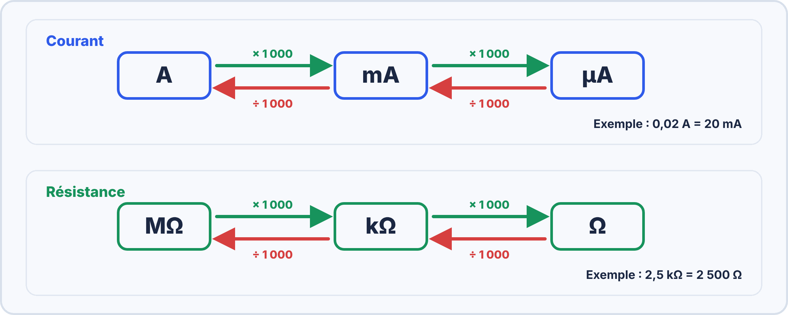
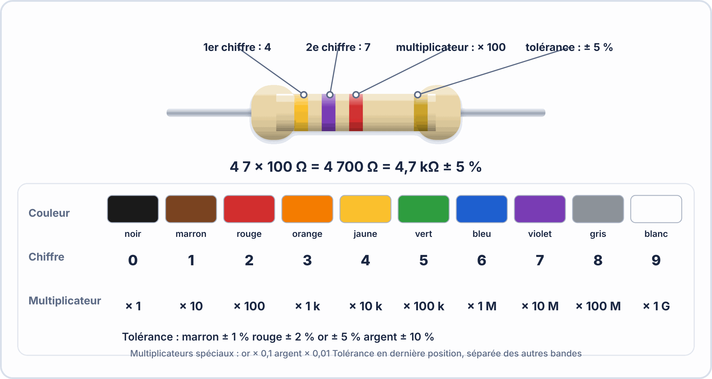

# 📘 FICHE DE COURS ÉLÈVE - U2 ÉLECTRONIQUE - SEMAINE 1

## ⚡ CODE COULEURS DES RÉSISTANCES ET LOI D'OHM

---

## 📋 INFORMATIONS

| **Élément** | **Détail** |
|-------------|------------|
| **Bloc** | U2 - Réalisation et maintenance de systèmes électroniques |
| **Semaine** | S1 / Année 1 |
| **Thématique** | Diagnostic prérequis, Code couleurs, Loi d'Ohm |
| **Durée cours** | 50 minutes |

---

## 🎯 OBJECTIFS D'APPRENTISSAGE

À la fin de ce cours, je serai capable de :

✅ Décoder le code couleurs des résistances  
✅ Comprendre les 3 grandeurs électriques : U, I, R  
✅ Appliquer la loi d'Ohm (U = R × I)  
✅ Convertir les unités (Ω, kΩ, MΩ / A, mA, µA)  
✅ Identifier les principaux composants électroniques  
✅ Calculer une valeur manquante dans un circuit  

---

## 1️⃣ LES 3 GRANDEURS ÉLECTRIQUES FONDAMENTALES

### 📖 Définitions

| **Grandeur** | **Symbole** | **Unité** | **Définition** | **Analogie hydraulique** |
|-------------|------------|-----------|----------------|--------------------------|
| **Tension** | **U** | Volt (V) | Différence de potentiel électrique | Pression de l'eau |
| **Intensité** | **I** | Ampère (A) | Quantité de charges qui circulent | Débit de l'eau |
| **Résistance** | **R** | Ohm (Ω) | Opposition au passage du courant | Étroitesse du tuyau |

### 🌊 L'analogie de l'eau

**Comprendre l'électricité comme un circuit d'eau :**


**Points clés de l'analogie :**

| **Électricité** | **Eau** |
|----------------|---------|
| Générateur (pile) | Pompe / Château d'eau |
| Tension (V) | Pression de l'eau |
| Intensité (A) | Débit de l'eau |
| Résistance (Ω) | Étroitesse du tuyau |
| Charge (LED, moteur) | Turbine / Roue à eau |

---

## 2️⃣ LA LOI D'OHM

### 📖 Définition

La **loi d'Ohm** est la relation mathématique fondamentale qui lie tension, intensité et résistance :

$$U = R \times I$$

### 🔺 Le triangle mnémotechnique

**Pour retrouver facilement les 3 formules :**


$$U = R \times I \qquad I = \dfrac{U}{R} \qquad R = \dfrac{U}{I}$$

**Comment utiliser le triangle :**

1. **Cacher ce que vous cherchez** avec le doigt
2. **Lire ce qui reste** :

| **Je cherche** | **Je cache** | **Formule** | **Calcul** |
|---------------|--------------|-------------|------------|
| **U** (Tension) | U | R et I côte à côte | $U = R \times I$ |
| **R** (Résistance) | R | U au-dessus de I | $R = \dfrac{U}{I}$ |
| **I** (Intensité) | I | U au-dessus de R | $I = \dfrac{U}{R}$ |

### 📝 Exemples d'application

#### Exemple 1 : Calculer la tension U

**Données :**

- Résistance : R = 1000 Ω
- Intensité : I = 0,01 A

**Calcul :**

$$
\begin{aligned}
U &= R \times I \\
U &= 1000 \times 0{,}01 \\
U &= 10\,\mathrm{V}
\end{aligned}
$$

??? success "Réponse"
    La tension est de **10 Volts**.

---

#### Exemple 2 : Calculer la résistance R

**Données :**

- Tension : U = 12 V
- Intensité : I = 0,02 A

**Calcul :**

$$
\begin{aligned}
R &= \dfrac{U}{I} \\
R &= \dfrac{12}{0{,}02} \\
R &= 600\,\mathrm{\Omega }
\end{aligned}
$$

??? success "Réponse"
    La résistance est de **600 Ohms**.

---

#### Exemple 3 : Calculer l'intensité I

**Données :**

- Tension : U = 5 V
- Résistance : R = 500 Ω

**Calcul :**

$$
\begin{aligned}
I &= \dfrac{U}{R} \\
I &= \dfrac{5}{500} \\
I &= 0{,}01\,\mathrm{A} = 10\,\mathrm{mA}
\end{aligned}
$$

??? success "Réponse"
    L'intensité est de **0,01 Ampère** ou **10 milliampères**.

---

## 3️⃣ LES UNITÉS ET CONVERSIONS

### 📊 Les multiples et sous-multiples

#### Pour la RÉSISTANCE (Ohm)

| **Unité** | **Symbole** | **Conversion** | **Exemple** |
|-----------|------------|----------------|-------------|
| Ohm | Ω | 1 Ω | Résistance faible |
| Kilo-ohm | kΩ | $1\,\mathrm{k\Omega } = 1\,000\,\mathrm{\Omega }$ | **Résistance standard** |
| Méga-ohm | MΩ | $1\,\mathrm{M\Omega } = 1\,000\,000\,\mathrm{\Omega }$ | Résistance élevée |

**Conversions utiles :**

- 100 Ω = 0,1 kΩ
- 1 000 Ω = 1 kΩ
- 10 000 Ω = 10 kΩ
- 1 000 000 Ω = 1 000 kΩ = 1 MΩ

---

#### Pour l'INTENSITÉ (Ampère)

| **Unité** | **Symbole** | **Conversion** | **Exemple** |
|-----------|------------|----------------|-------------|
| Ampère | A | 1 A | Moteur électrique |
| Milliampère | mA | $1\,\mathrm{mA} = 0{,}001\,\mathrm{A}$ | **LED standard** |
| Microampère | µA | $1\,\mathrm{\mu A} = 0{,}000001\,\mathrm{A}$ | Composants très faibles |

**Conversions utiles :**

- 1 A = 1 000 mA
- 0,01 A = 10 mA
- 20 mA = 0,02 A
- 500 mA = 0,5 A

---

#### Pour la TENSION (Volt)

| **Unité** | **Symbole** | **Conversion** | **Exemple** |
|-----------|------------|----------------|-------------|
| Volt | V | 1 V | Pile |
| Millivolt | mV | $1\,\mathrm{mV} = 0{,}001\,\mathrm{V}$ | Signaux faibles |
| Kilovolt | kV | $1\,\mathrm{kV} = 1\,000\,\mathrm{V}$ | Haute tension |

**Tensions courantes :**

- Pile AA : 1,5 V
- Pile 9V : 9 V
- USB : 5 V
- Batterie voiture : 12 V
- Secteur France : 230 V

---

### 🔄 Tableau de conversion rapide

**Méthode :** Pour convertir, déplacer la virgule !



---

## 4️⃣ LE CODE COULEURS DES RÉSISTANCES

### 📖 Principe

Les **résistances** utilisent un système de **bagues colorées** pour indiquer leur valeur en Ohms.

**Pourquoi des couleurs ?**  
→ Les résistances sont petites, impossible d'écrire "1000 Ω" dessus !

### 🎨 Le tableau des couleurs

| **Couleur** | **Chiffre** | **Multiplicateur** | **Moyen mnémotechnique** |
|------------|------------|-------------------|-------------------------|
| ⚫ **Noir** | 0 | × 1 | **N**e **0** mettez rien |
| 🟤 **Marron** | 1 | × 10 | **M**arron = **1** |
| 🔴 **Rouge** | 2 | × 100 | **R**ouge = **2** |
| 🟠 **Orange** | 3 | × 1 000 | **O**range = **3** |
| 🟡 **Jaune** | 4 | × 10 000 | **J**aune = **4** |
| 🟢 **Vert** | 5 | × 100 000 | **V**ert = **5** |
| 🔵 **Bleu** | 6 | × 1 000 000 | **B**leu = **6** |
| 🟣 **Violet** | 7 | - | **V**iolet = **7** |
| ⚪ **Gris** | 8 | - | **G**ris = **8** |
| ⚪ **Blanc** | 9 | - | **B**lanc = **9** |

### 🔢 Comment décoder une résistance ?

**Une résistance à 4 bagues :**



**Formule :**

```
Valeur = (Bague1 × 10 + Bague2) × Multiplicateur
```

---

### 📝 Exemples de décodage

#### Exemple 1 : Marron - Noir - Rouge

| **Bague** | **Couleur** | **Valeur** |
|-----------|------------|------------|
| Bague 1 | 🟤 Marron | 1 |
| Bague 2 | ⚫ Noir | 0 |
| Bague 3 | 🔴 Rouge | × 100 |

**Calcul :**

$$(1 \times 10 + 0) \times 100 = 10 \times 100 = 1\,000\,\mathrm{\Omega } = 1\,\mathrm{k\Omega }$$

??? success "Réponse"
    **1 000 Ω** ou **1 kΩ**

---

#### Exemple 2 : Jaune - Violet - Orange

| **Bague** | **Couleur** | **Valeur** |
|-----------|------------|------------|
| Bague 1 | 🟡 Jaune | 4 |
| Bague 2 | 🟣 Violet | 7 |
| Bague 3 | 🟠 Orange | × 1 000 |

**Calcul :**

$$(4 \times 10 + 7) \times 1\,000 = 47 \times 1\,000 = 47\,000\,\mathrm{\Omega } = 47\,\mathrm{k\Omega }$$

??? success "Réponse"
    **47 000 Ω** ou **47 kΩ**

---

#### Exemple 3 : Marron - Noir - Jaune

| **Bague** | **Couleur** | **Valeur** |
|-----------|------------|------------|
| Bague 1 | 🟤 Marron | 1 |
| Bague 2 | ⚫ Noir | 0 |
| Bague 3 | 🟡 Jaune | × 10 000 |

**Calcul :**

$$(1 \times 10 + 0) \times 10\,000 = 10 \times 10\,000 = 100\,000\,\mathrm{\Omega } = 100\,\mathrm{k\Omega }$$

??? success "Réponse"
    **100 000 Ω** ou **100 kΩ**

---

### 🎨 La 4e bague : la tolérance

| **Couleur** | **Tolérance** | **Signification** |
|------------|--------------|------------------|
| 🟡 **Or** | ± 5% | Précision standard |
| ⚪ **Argent** | ± 10% | Précision normale |
| 🔴 **Rouge** | ± 2% | Précision élevée |
| 🟤 **Marron** | ± 1% | Très haute précision |

**Exemple :**  
Une résistance de 1 kΩ ± 5% peut avoir une valeur réelle entre **950 Ω et 1 050 Ω**.

---

## 5️⃣ LES COMPOSANTS ÉLECTRONIQUES DE BASE

### 📦 Tableau récapitulatif

| **Composant** | **Symbole** | **Rôle** | **Caractéristique** | **Polarité** |
|--------------|------------|----------|---------------------|--------------|
| 🟤 **Résistance** | { width="210" } | Limiter le courant | Valeur en Ω (code couleurs) | Non |
| 🔴 **LED** | { width="210" } | Émettre de la lumière | Tension ~2V, Courant ~20mA | Oui (+ = patte longue) |
| ⚫ **Diode** | { width="210" } | Laisser passer le courant dans un seul sens | Bague = cathode (-) | Oui |
| 🟡 **Condensateur** | { width="210" } | Stocker de l'énergie électrique | Valeur en F (Farad) | Parfois (électrolytique) |
| 🔵 **Transistor** | { width="210" } | Amplifier ou commuter un signal | 3 pattes : B, C, E | Oui |
| 🔋 **Pile** | { width="210" } | Fournir une tension | Tension en V | Oui (+ et -) |

---

### 🔍 Focus : La LED (Light Emitting Diode)

**Caractéristiques principales :**

| **Paramètre** | **Valeur typique** |
|--------------|-------------------|
| Tension directe (Vf) | 1,8 V (rouge) à 3,3 V (bleu/blanc) |
| Courant nominal | 20 mA (0,02 A) |
| Polarité | Oui : patte longue = anode (+) |

**⚠️ IMPORTANT :** Une LED doit **toujours** être protégée par une **résistance de limitation** !

**Calcul de la résistance de limitation :**

$$R_{\text{LED}} = \dfrac{V_{cc} - V_{F}}{I_{\text{LED}}}$$

**Exemple :**  
Alimenter une LED rouge (Vf = 2V) avec une pile de 9V :

$$R_{\mathrm{LED}} = \dfrac{9\,\mathrm{V} - 2\,\mathrm{V}}{0{,}02\,\mathrm{A}} = \dfrac{7\,\mathrm{V}}{0{,}02\,\mathrm{A}} = 350\,\mathrm{\Omega }$$

→ On choisira une résistance de 330 Ω ou 470 Ω (valeur standard)  


---

## 6️⃣ EXERCICES D'APPLICATION

### 🧮 Exercice 1 : Décodage de résistances

**Décodez les résistances suivantes :**

1. 🟤 Marron - 🔴 Rouge - 🟠 Orange = _______ Ω = _______ kΩ
2. 🟡 Jaune - 🟣 Violet - 🔴 Rouge = _______ Ω = _______ kΩ
3. 🟢 Vert - 🔵 Bleu - 🟤 Marron = _______ Ω = _______ kΩ

??? success "Réponses"

    1. 12 000 Ω = 12 kΩ  
    2. 4 700 Ω = 4,7 kΩ  
    3. 560 Ω = 0,56 kΩ

---

### 🧮 Exercice 2 : Loi d'Ohm

**Calculez la valeur manquante :**

1. U = 12V, R = 600Ω → I = _______ A = _______ mA
2. I = 0,05A, R = 200Ω → U = _______ V
3. U = 9V, I = 0,003A → R = _______ Ω = _______ kΩ

??? success "Réponses"

    1. $I = \dfrac{U}{R} = \dfrac{12}{600} = 0{,}02\,\mathrm{A} = 20\,\mathrm{mA}$  
    2. $U = R \times I = 200 \times 0{,}05 = 10\,\mathrm{V}$  
    3. $R = \dfrac{U}{I} = \dfrac{9}{0{,}003} = 3\,000\,\Omega = 3\,\mathrm{k\Omega}$

---

### 🧮 Exercice 3 : Conversions

**Convertissez les valeurs suivantes :**

1. 4 700 Ω = _______ kΩ
2. 0,025 A = _______ mA
3. 2,2 MΩ = _______ Ω
4. 150 mA = _______ A

??? success "Réponses"

    1. 4 700 Ω = 4,7 kΩ  
    2. 0,025 A = 25 mA  
    3. 2,2 MΩ = 2 200 000 Ω  
    4. 150 mA = 0,15 A

---

## 📝 VOCABULAIRE CLÉ À MAÎTRISER

| **Terme** | **Définition** |
|-----------|----------------|
| **Tension (U)** | Différence de potentiel électrique (Volt) |
| **Intensité (I)** | Quantité de courant qui circule (Ampère) |
| **Résistance (R)** | Opposition au passage du courant (Ohm) |
| **Loi d'Ohm** | Relation U = R × I |
| **Code couleurs** | Système de bagues colorées sur les résistances |
| **LED** | Diode électroluminescente qui émet de la lumière |
| **Polarité** | Sens de branchement d'un composant (+ et -) |
| **Anode** | Borne positive (+) d'une LED ou diode |
| **Cathode** | Borne négative (-) d'une LED ou diode |
| **Multimètre** | Appareil de mesure (tension, intensité, résistance) |
| **Circuit série** | Composants branchés les uns après les autres |
| **Circuit parallèle** | Composants branchés sur des branches différentes |

---

## ✅ AUTO-ÉVALUATION : AI-JE COMPRIS ?

Cochez les affirmations vraies :

- [ ] La tension se mesure en Ampères
- [ ] La formule de la loi d'Ohm est U = R × I
- [ ] Une résistance Marron-Noir-Orange vaut 10 kΩ
- [ ] Une LED peut se brancher directement sur une pile sans résistance
- [ ] 1 kΩ = 1 000 Ω
- [ ] La patte longue d'une LED est la cathode (-)
- [ ] L'intensité se mesure en Volts
- [ ] 20 mA = 0,02 A

??? success "Réponses"
    ✅ Vrai : 2 (U = R × I), 3 (Marron=1, Noir=0, Orange=×1000 → 10 000 Ω = 10 kΩ), 5 (1 kΩ = 1 000 Ω), 8 (20 mA = 0,02 A)  
    ❌ Faux : 1 (tension = Volt), 4 (il faut TOUJOURS une résistance de limitation), 6 (patte longue = anode +), 7 (intensité = Ampère)

---

## 🔗 POUR ALLER PLUS LOIN

### 📚 Ressources complémentaires

- 🎥 **Vidéo** : "La loi d'Ohm expliquée" - e-penser (YouTube)
- 🎥 **Vidéo** : "Code couleurs résistances" - Électronique Passion (YouTube)
- 📱 **App mobile** : "Resistor Color Code" (calculateur de résistances)
- 🛠️ **Simulateur** : [https://www.falstad.com/circuit/](https://www.falstad.com/circuit/)
- 📖 **Livre** : "L'électronique pour les débutants" - Jean-Pierre Oehmichen

### 🎯 Exercices supplémentaires

1. Décodez 10 résistances trouvées chez vous (vieux appareils)
2. Calculez la résistance de limitation pour une LED verte (Vf = 2,2V) avec une pile de 12V
3. Convertissez 50 valeurs entre Ω, kΩ, MΩ et mA, A

---

## 🏢 APPLICATION EN ENTREPRISE

**Situations professionnelles où vous utiliserez ces notions :**

✅ **Identifier une résistance** sur une carte électronique défectueuse  
✅ **Calculer la résistance de limitation** pour remplacer une LED grillée  
✅ **Mesurer avec un multimètre** les tensions et intensités d'un circuit  
✅ **Lire un schéma électrique** pour comprendre un montage  
✅ **Diagnostiquer une panne** en vérifiant les valeurs de résistances  

**Missions possibles en entreprise cette semaine :**

- Observer les cartes électroniques et identifier les composants
- Demander au tuteur de montrer un schéma électrique
- Photographier une carte et annoter les composants

---

## 🔧 FORMULES À RETENIR (MÉMO)

### Triangle de la loi d'Ohm


$$U = R \times I \qquad I = \dfrac{U}{R} \qquad R = \dfrac{U}{I}$$

### Conversions rapides

$$
\begin{aligned}
1\,\mathrm{k\Omega } &= 1\,000\,\mathrm{\Omega } \\
1\,\mathrm{M\Omega } &= 1\,000\,000\,\mathrm{\Omega } \\
1\,\mathrm{A} &= 1\,000\,\mathrm{mA} \\
1\,\mathrm{mA} &= 0{,}001\,\mathrm{A}
\end{aligned}
$$

### Résistance de limitation LED

$$R_{\mathrm{LED}} = \dfrac{V_{cc} - V_{\mathrm{F}}}{I_{\mathrm{LED}}}$$

---

**💡 ASTUCE RÉVISION :** Imprimez cette fiche et gardez-la toujours avec vous ! Le code couleurs et la loi d'Ohm sont LA BASE de toute l'électronique. Vous les utiliserez tous les jours pendant 3 ans ! ⚡**
