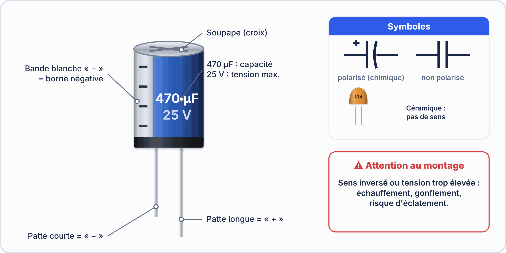
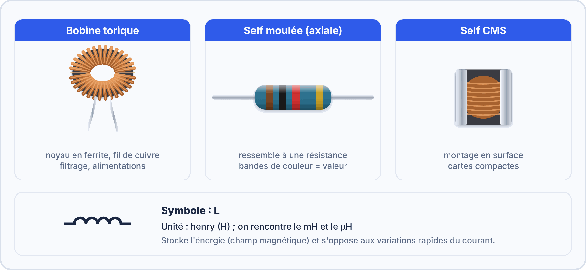
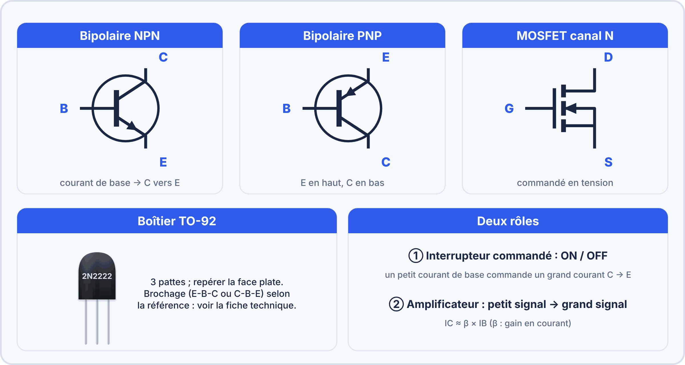
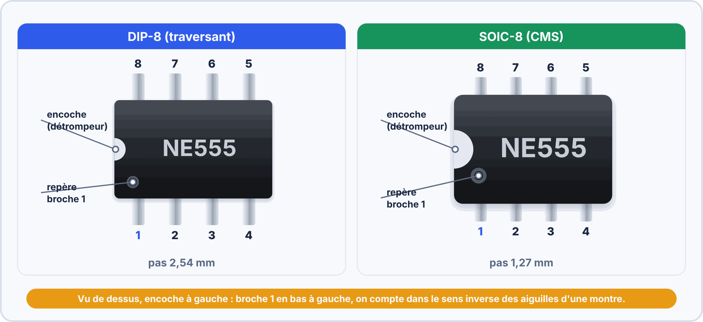
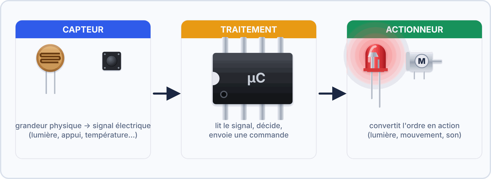
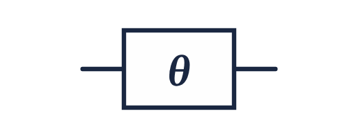
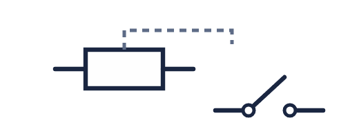

# 🧩 Les familles de composants électroniques

*Bac Pro CIEL – Seconde – E2 – S01*

Un montage électronique est un **assemblage de petites pièces**. Pour le comprendre, il faut savoir **reconnaître** chaque famille, savoir **à quoi elle sert** et savoir **comment la brancher**. C'est le but de cette fiche.

### 🤔 À ton avis ?

Si tu ouvres une télécommande ou une box Internet, tu vois des dizaines de petites pièces sur une carte verte. **Sont-elles toutes identiques ?** Qu'est-ce qui les différencie ?

??? question "Voir une réponse possible"
    Non : chaque pièce a un **rôle précis**. Certaines **freinent** le courant, d'autres **stockent** de l'énergie, d'autres **laissent passer le courant dans un seul sens**, d'autres **commandent** un signal ou **traitent** de l'information. On les range en **familles**.

---

## 1. Deux grandes familles : passifs et actifs

| Famille | Idée | Exemples |
|---|---|---|
| **Composants passifs** | Ils **subissent** le circuit : ils freinent, stockent ou filtrent. Ils ne peuvent ni amplifier ni décider. | résistance, condensateur, bobine |
| **Composants actifs** | Ils **contrôlent** le courant, l'**orientent**, l'**amplifient** ou **traitent** l'information. Ils ont besoin d'une alimentation. | diode, LED, transistor, circuit intégré |

> [!TIP] 💡 En clair : l'analogie de l'eau
> Imagine un circuit d'eau. Chaque composant a son équivalent :
>
> - la **résistance** est un **tuyau étroit** ;
> - le **condensateur** est un **petit réservoir** ;
> - la **bobine** est une **roue lourde** : elle est difficile à lancer et difficile à arrêter ;
> - la **diode** est un **clapet anti-retour** : l'eau passe dans un sens seulement ;
> - le **transistor** est un **robinet commandé** par un petit débit ;
> - le **circuit intégré** est une **station de pompage automatique**.

### ✅ Vérifie que tu as compris

**Q1.** Un condensateur est-il un composant passif ou actif ? Pourquoi ?

??? success "Réponse"
    **Passif** : il stocke de l'énergie mais il ne peut ni amplifier, ni décider.

**Q2.** Quel composant joue le rôle de « clapet anti-retour » ?

??? success "Réponse"
    La **diode** : elle laisse passer le courant dans un seul sens.

---

## 2. Les composants passifs

### 🟤 La résistance

| | |
|---|---|
| **Son rôle** | Limiter le courant (comme un tuyau étroit). |
| **Symbole** | { width="150" } |
| **Unité** | ohm (Ω), avec k et M : 1 kΩ = 1 000 Ω |
| **Polarité** | **Non** : on peut la brancher dans les deux sens. |
| **Comment le reconnaître** | petit cylindre beige avec des **bagues de couleur** (voir le code des couleurs) |
| **On le rencontre** | partout : protéger une LED, tirer un signal (pull-up), diviser une tension |

> [!NOTE] Valeur et puissance
> En plus de sa valeur en ohms, une résistance supporte une **puissance maximale** (souvent ¼ W). Si le courant est trop fort, elle **chauffe** et peut brûler.

### 🟡 Le condensateur

| | |
|---|---|
| **Son rôle** | Stocker un peu d'énergie et la rendre vite : il **lisse** une tension et **filtre** les parasites. |
| **Symbole** | { width="150" } { width="150" } |
| **Unité** | farad (F), le plus souvent µF (microfarad) ou nF (nanofarad) |
| **Polarité** | **Oui pour l'électrolytique** (cylindre) : la bande marquée « − » va vers la masse. **Non** pour le céramique (petite pastille). |
| **Comment le reconnaître** | cylindre bleu ou noir avec une **bande** (électrolytique) ou petite pastille jaune ou beige (céramique) |
| **On le rencontre** | près des circuits intégrés (découplage), dans les alimentations, dans les filtres |

> [!WARNING] ⚠️ Attention à la polarité
> Un condensateur électrolytique branché à l'envers peut **chauffer, gonfler, voire éclater**. Vérifie toujours la bande « − » avant de souder.

### 🌀 La bobine (inductance)

| | |
|---|---|
| **Son rôle** | S'opposer aux **variations** du courant : elle stocke de l'énergie sous forme **magnétique**. |
| **Symbole** | une suite de boucles |
| **Unité** | henry (H), le plus souvent mH ou µH |
| **Polarité** | **Non** (une bobine simple). |
| **Comment le reconnaître** | fil de cuivre **enroulé**, parfois autour d'un noyau en forme d'anneau |
| **On le rencontre** | alimentations à découpage, filtres, **relais** et **moteurs** (qui contiennent des bobines) |

### ✅ Vérifie que tu as compris

**Q1.** Quel composant passif a une polarité à respecter ?

??? success "Réponse"
    Le **condensateur électrolytique** (cylindre avec une bande « − »).

**Q2.** Quelle est l'unité d'un condensateur ? Cite deux sous‑multiples.

??? success "Réponse"
    Le **farad (F)**, avec le **µF** (microfarad) et le **nF** (nanofarad).

**Q3.** À quoi sert une résistance en série avec une LED ?

??? success "Réponse"
    À **limiter le courant** pour ne pas détruire la LED.

---

## 3. Les composants actifs

### 🔴 La diode et la LED

| | |
|---|---|
| **Son rôle** | Laisser passer le courant **dans un seul sens** (de l'**anode** vers la **cathode**). La **LED** émet en plus de la **lumière**. |
| **Symbole** | { width="150" } { width="150" } |
| **Unité** | tension de seuil en volts : ≈ 0,7 V (diode), ≈ 2 V (LED rouge) |
| **Polarité** | **Oui** : anode (+) et cathode (−). Sur la LED, la **patte longue** est l'anode. Sur la diode, la **bague** marque la cathode. |
| **Comment le reconnaître** | petit cylindre noir avec une bague (diode) ; dôme coloré avec deux pattes (LED) |
| **On le rencontre** | protéger un montage contre une inversion de polarité, signaler un état (LED) |

> [!WARNING] ⚠️ Une LED sans résistance est détruite
> Une LED n'accepte qu'un courant faible (environ 20 mA). Elle doit toujours être **protégée par une résistance en série**.

### 🔵 Le transistor

| | |
|---|---|
| **Son rôle** | **Commander** un fort courant avec un petit : il joue le rôle d'**interrupteur commandé** ou d'**amplificateur**. |
| **Symbole** | { width="150" } |
| **Unité** | pas d'unité propre : on donne ses limites (tension et courant maximum) |
| **Polarité** | **Oui** : trois pattes à ne pas confondre : **B** (base, commande), **C** (collecteur), **E** (émetteur). |
| **Comment le reconnaître** | petit boîtier noir demi‑rond (TO‑92) avec **3 pattes** et une référence (BC547, 2N2222) |
| **On le rencontre** | commander un moteur, un relais, une LED de forte puissance à partir d'une carte Arduino |

### ⚫ Le circuit intégré (CI)

| | |
|---|---|
| **Son rôle** | Regrouper **des centaines à des milliards de transistors** dans une seule puce qui réalise une fonction complète. |
| **Symbole** | { width="150" } |
| **Unité** | pas d'unité : on lit sa référence et sa fiche technique |
| **Polarité** | **Oui** : on repère la **broche 1** grâce à l'**encoche** ou au **point** sur le boîtier. |
| **Comment le reconnaître** | boîtier noir rectangulaire avec **plusieurs pattes** de chaque côté |
| **On le rencontre** | NE555 (temporisation), L293D (commande de moteur), ATmega328P (le cerveau de l'Arduino) |

### ✅ Vérifie que tu as compris

**Q1.** Sur une LED, comment reconnaît‑on l'anode ?

??? success "Réponse"
    C'est la **patte la plus longue** (le côté plat du boîtier indique la cathode).

**Q2.** Quels sont les noms des trois pattes d'un transistor bipolaire ?

??? success "Réponse"
    **B** (base), **C** (collecteur) et **E** (émetteur).

**Q3.** Comment repère‑t‑on la broche 1 d'un circuit intégré ?

??? success "Réponse"
    Grâce à l'**encoche** ou au **point** gravé sur le boîtier : on compte ensuite les broches dans le sens inverse des aiguilles d'une montre.

---

## 4. Capteurs, actionneurs et pièces de liaison

| Famille | Rôle | Exemples |
|---|---|---|
| **Capteurs** | Transforment une grandeur du monde réel (température, lumière, appui) en **signal électrique**. | LM35 (température), DHT22 (température et humidité), LDR (lumière), bouton |
| **Actionneurs** | Transforment un **signal électrique** en action visible, sonore ou mécanique. | LED, buzzer, moteur, relais |
| **Liaison et protection** | Relient les composants entre eux ou les protègent. | fils, breadboard, connecteurs, interrupteurs, **fusibles** |

{ width="150" } { width="150" } { width="150" } { width="150" } { width="150" }

> [!TIP] 💡 En clair
> Un montage complet suit presque toujours la même chaîne : un **capteur** mesure, une **carte** (par exemple Arduino) décide, un **actionneur** agit. Les composants des familles précédentes servent à faire fonctionner chaque maillon.

---

## 5. Comment un composant est‑il monté sur la carte ?

| Technologie | Principe | Avantages | Limites |
|---|---|---|---|
| **Traversant (THT)** | Les pattes **traversent** la carte et sont soudées de l'autre côté. | Solide, facile à souder à la main | Plus gros, il faut percer la carte |
| **CMS (SMD)** | Le composant se **pose en surface** sur des pastilles. | Très petit, montage automatique | Soudure plus délicate, difficile à la main |

Dans les séances de soudure (S04), tu travailles avec des composants **traversants**.

---

## 6. Tableau de synthèse

| Famille | Composant | Rôle en une phrase | Polarité ? |
|---|---|---|---|
| Passif | Résistance | Limite le courant | Non |
| Passif | Condensateur | Stocke et filtre | Oui si électrolytique |
| Passif | Bobine | S'oppose aux variations du courant | Non |
| Actif | Diode | Laisse passer dans un seul sens | Oui |
| Actif | LED | Diode qui émet de la lumière | Oui |
| Actif | Transistor | Commande un fort courant avec un petit | Oui (B, C, E) |
| Actif | Circuit intégré | Fonction complète dans une puce | Oui (broche 1) |

### ✅ Pour finir

**Q1.** Tu veux commander un moteur depuis une carte Arduino. Quel composant actif te permet de piloter un fort courant avec un petit signal ?

??? success "Réponse"
    Un **transistor** (ou un circuit intégré de commande de moteur comme le **L293D**).

**Q2.** Cite trois composants qui ont une polarité.

??? success "Réponse"
    La **diode**, la **LED**, le **condensateur électrolytique** (et le transistor, le circuit intégré).

**Q3.** Un composant a **deux pattes**, aucune polarité et des bagues de couleur. Qui est‑ce ?

??? success "Réponse"
    Une **résistance**.

> [!SUCCESS] 🧠 À retenir
> - **Passifs** : résistance, condensateur, bobine. **Actifs** : diode, LED, transistor, circuit intégré.
> - Une **LED** se protège toujours avec une **résistance en série**.
> - Le **condensateur électrolytique**, la **diode** et la **LED** ont une **polarité** : un branchement à l'envers peut les détruire.
> - On distingue les montages **traversants** (THT) et **CMS** (SMD).
