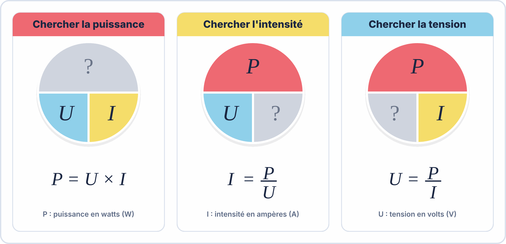

# 🖥️ Exercices et TP sur le simulateur ElectroLab

> [!NOTE]
> **Comment faire ?** 1) Télécharge le fichier `.json` (clic droit → *Enregistrer le lien sous*). 2) Dans [ElectroLab](https://yahnlp.github.io/ElectroLab/), clique sur **Ouvrir** et choisis ce fichier. 3) Réponds aux questions sur ta feuille ou dans ton portfolio. Mode d'emploi : [Utiliser ElectroLab](../../ressources/electrolab.md).

## Découverte du multimètre : tension, courant, loi d'Ohm

*Bac Pro CIEL (seconde) · durée indicative : 1 h*

Une alimentation de laboratoire alimente une résistance de 470 Ω. Vous apprenez à brancher un <b>voltmètre en dérivation</b> et un <b>ampèremètre en série</b>, puis à vérifier la loi d'Ohm.

### 🎯 Objectifs

- Régler une alimentation de laboratoire (tension, limitation de courant)
- Brancher correctement un voltmètre (parallèle) et un ampèremètre (série)
- Mesurer une résistance à l'ohmmètre (hors tension !)
- Vérifier U = R × I et calculer la puissance P = U × I

### 🛠️ Marche à suivre

1. Ouvrez l'alimentation AL1 (double-clic) : réglez <b>10 V</b>. Gardez la limitation de courant à 0,2 A.
2. Avec <b>MM1</b> en mode <b>V⎓</b>, câblez-le <b>aux bornes de R1</b> (cordon rouge sur le côté +, noir côté −) et relevez U.
3. Coupez la sortie de l'alimentation (OFF), puis mesurez R1 avec le mode <b>Ω</b> aux bornes de R1. Que se passe-t-il si la sortie reste ON ?
4. Pour mesurer le courant il faut <b>ouvrir le circuit</b> : supprimez le fil entre AL1(+) et R1, insérez <b>MM2</b> (mode mA) à la place, remettez la sortie ON et relevez I.
5. Calculez R = U / I et P = U × I, puis répondez aux questions.

### ❓ Questions

1. Valeur de R1 mesurée à l'ohmmètre, alimentation coupée (en Ω)
2. Tension U aux bornes de R1 pour une alimentation réglée à 10 V (en V)
3. Courant I dans le circuit (en mA)
4. Puissance dissipée par R1 (en mW)
5. Quelle loi relie U, R et I ?  
    - ☐ Loi de Joule  
    - ☐ Loi d'Ohm  
    - ☐ Loi des mailles  
    - ☐ Loi de Faraday
6. La résistance R1 est du type 1/4 W. À 15 V (P = U²/R ≈ 480 mW), que se passe-t-il ?  
    - ☐ Rien de particulier  
    - ☐ Elle surchauffe et finit par être détruite  
    - ☐ Sa valeur diminue de moitié  
    - ☐ Le courant devient nul

### 📥 Fichiers à ouvrir dans ElectroLab

- [`ohm.json`](tp/ohm.json)

> **Version avec correction automatique :** dans ElectroLab, menu **TP ▾** → *Découverte du multimètre : tension, courant, loi d'Ohm*.
