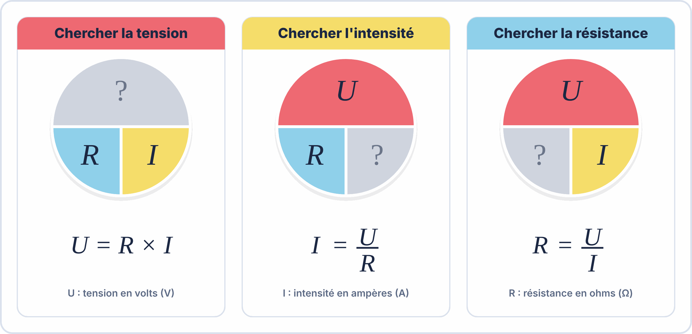
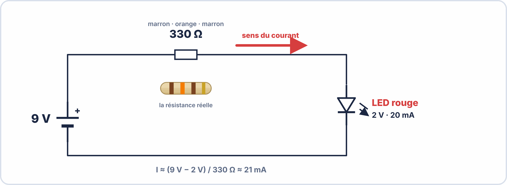
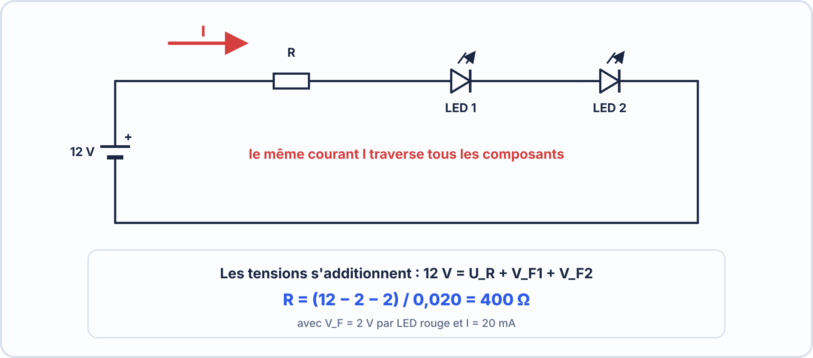
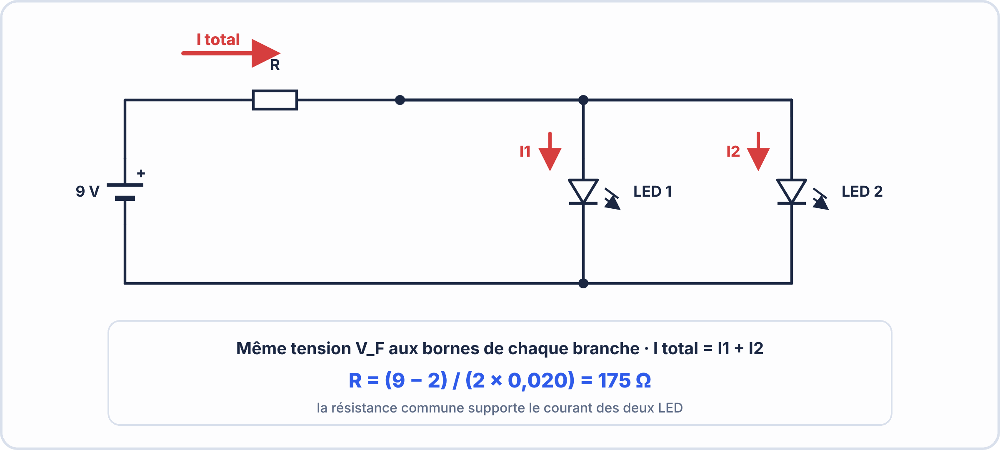
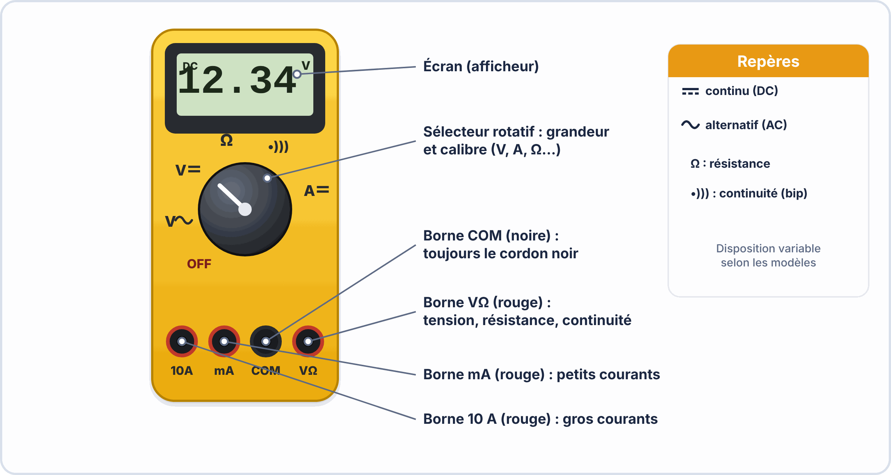

# 📘 FICHE DE COURS — S2 / Module E2
## Diodes LED · Circuits Série & Parallèle · Loi d'Ohm appliquée

---

> **BAC Pro CIEL — 1ère année** | MFR de Pontonx  
> Nom : _________________________ Prénom : _________________________ Date : _________

---

## 🗝️ Vocabulaire clé à maîtriser pour l'examen

| Terme | Définition à retenir |
|---|---|
| **LED** | Light Emitting Diode — Diode électroluminescente qui émet de la lumière quand elle est traversée par un courant dans le bon sens |
| **Anode (+)** | Borne positive de la LED — broche la plus longue — sens d'entrée du courant conventionnel |
| **Cathode (−)** | Borne négative de la LED — broche la plus courte — côté méplat sur le boîtier |
| **Tension de seuil (V_F)** | Tension minimale pour que la LED s'allume (Forward Voltage) : ≈ 2 V rouge, ≈ 2,1 V vert, ≈ 3,3 V bleu |
| **Courant nominal (I_F)** | Courant de fonctionnement normal de la LED : généralement 20 mA = 0,02 A |
| **Résistance de limitation** | Résistance placée en série avec la LED pour protéger de l'excès de courant |
| **Loi d'Ohm** | U = R × I — Relation entre tension (V), résistance (Ω) et courant (A) |
| **Circuit série** | Les composants sont branchés les uns après les autres — même courant partout |
| **Circuit parallèle** | Les composants sont branchés côte à côte — même tension aux bornes de chacun |
| **Datasheet** | Document technique du fabricant donnant toutes les caractéristiques d'un composant |

---

## 1. La diode LED : structure et fonctionnement

### 1.1 Qu'est-ce qu'une LED ?

Une LED est un composant **semiconducteur** qui transforme l'énergie électrique en lumière. Elle ne laisse passer le courant que **dans un seul sens** (du + vers le −, de l'anode vers la cathode).

> ⚠️ **Règle d'or** : Une LED sans résistance de protection grille immédiatement. Ne jamais brancher une LED directement sur une alimentation.

### 1.2 Symbole et identification physique

| Caractéristique | Rouge | Vert | Bleu | Blanc |
|---|---|---|---|---|
| Tension V_F typique | 1,8 – 2,2 V | 2,0 – 2,5 V | 3,0 – 3,5 V | 3,0 – 3,5 V |
| Courant I_F nominal | 20 mA | 20 mA | 20 mA | 20 mA |
| Courant I_F maximum | 30 mA | 30 mA | 30 mA | 30 mA |

---

## 2. La Loi d'Ohm — Rappel et application

### 2.1 La formule fondamentale

$$U = R \times I$$

| Symbole | Grandeur | Unité | Instrument |
|---|---|---|---|
| **U** | Tension (différence de potentiel) | Volt (V) | Voltmètre — en parallèle |
| **R** | Résistance | Ohm (Ω) | Ohmmètre — hors circuit |
| **I** | Intensité du courant | Ampère (A) — souvent mA | Ampèremètre — en série |

### 2.2 Le triangle mnémotechnique

### 2.3 Les trois formules à retenir

| Je cherche... | La formule | Exemple numérique |
|---|---|---|
| La tension U | **U = R × I** | R = 150 Ω, I = 20 mA → U = 150 × 0,02 = **3 V** |
| La résistance R | **R = U / I** | U = 7 V, I = 20 mA → R = 7 / 0,02 = **350 Ω** |
| Le courant I | **I = U / R** | U = 5 V, R = 250 Ω → I = 5 / 250 = **0,02 A = 20 mA** |

> 💡 **Attention aux unités !** Les calculs se font avec des Ampères (A), pas des milliampères (mA).  
> Conversion : **20 mA = 0,020 A** (diviser par 1000)

---

## 3. Calcul de la résistance de limitation d'une LED

### 3.1 La logique du calcul

Quand on branche une LED sur une alimentation, il faut "absorber" la tension en surplus avec une résistance.

### 3.2 La formule de calcul

$$R = \frac{V_{alim} - V_F}{I_F}$$

Où :
- **V_alim** = tension de l'alimentation (en Volts)
- **V_F** = tension de seuil de la LED (en Volts, lue dans la datasheet)
- **I_F** = courant nominal de la LED (en **Ampères** — convertir les mA !)

### 3.3 Exemples de calcul pas à pas

**Exemple 1 — LED rouge sur alimentation 9 V**

> *Données : V_alim = 9 V | LED rouge : V_F = 2 V, I_F = 20 mA = 0,02 A*

| Étape | Calcul | Résultat |
|---|---|---|
| 1. Tension à absorber | V_R = V_alim − V_F = 9 − 2 | **V_R = 7 V** |
| 2. Calcul R | R = V_R / I_F = 7 / 0,02 | **R = 350 Ω** |
| 3. Valeur normalisée E24 | La valeur normalisée la plus proche ≥ 350 Ω | **R = 390 Ω** *(on choisit la valeur supérieure pour protéger la LED)* |

**Exemple 2 — LED bleue sur alimentation 5 V (Arduino)**

> *Données : V_alim = 5 V | LED bleue : V_F = 3,3 V, I_F = 20 mA = 0,02 A*

| Étape | Calcul | Résultat |
|---|---|---|
| 1. Tension à absorber | V_R = 5 − 3,3 | **V_R = 1,7 V** |
| 2. Calcul R | R = 1,7 / 0,02 | **R = 85 Ω** |
| 3. Valeur normalisée E24 | Valeur supérieure la plus proche | **R = 100 Ω** |

---

## 4. Circuits série et circuits parallèle

### 4.1 Le circuit série

**Règles du circuit série :**

| Paramètre | Comportement en série |
|---|---|
| **Courant I** | Identique partout : I_total = I_LED1 = I_LED2 |
| **Tension U** | Se répartit : V_alim = V_R + V_F1 + V_F2 |
| **Si une LED grille** | Le circuit est coupé → toutes les LEDs s'éteignent |
| **Résistance R** | R = (V_alim − V_F1 − V_F2) / I_F |

**Exemple — 2 LEDs rouges en série sur 9 V :**

> R = (9 − 2 − 2) / 0,02 = 5 / 0,02 = **250 Ω → choisir 270 Ω**

---

### 4.2 Le circuit parallèle

**Règles du circuit parallèle :**

| Paramètre | Comportement en parallèle |
|---|---|
| **Tension U** | Identique aux bornes de chaque LED : V_F1 = V_F2 |
| **Courant I** | Se divise : I_total = I_LED1 + I_LED2 |
| **Si une LED grille** | Les autres continuent à fonctionner |
| **Résistance R** | R = (V_alim − V_F) / I_total avec I_total = N × I_F |

**Exemple — 2 LEDs rouges en parallèle sur 9 V :**

> I_total = 2 × 20 mA = 40 mA = 0,04 A  
> R = (9 − 2) / 0,04 = 7 / 0,04 = **175 Ω → choisir 180 Ω**

---

### 4.3 Tableau de comparaison série vs parallèle

| Critère | Série | Parallèle |
|---|---|---|
| Même courant partout | ✅ Oui | ❌ Non (se divise) |
| Même tension partout | ❌ Non (se divise) | ✅ Oui |
| Panne d'une LED | ⚠️ Tout s'éteint | ✅ Les autres restent allumées |
| Luminosité par LED | ✅ Identique si identiques | ✅ Identique si identiques |
| Exemple d'utilisation | Guirlandes anciennes | Éclairage LED moderne |

---

## 5. Lire une datasheet (fiche technique)

Une **datasheet** est le document officiel du fabricant. Elle contient toutes les valeurs limites à ne **jamais dépasser**.

### 5.1 Données essentielles à repérer

| Paramètre datasheet | Signification | Exemple LED rouge 5 mm |
|---|---|---|
| **V_F (Forward Voltage)** | Tension de seuil en fonctionnement | 2,0 V typ. — 2,5 V max |
| **I_F (Forward Current)** | Courant de fonctionnement normal | 20 mA |
| **I_FM (Peak Forward Current)** | Courant maximum instantané | 100 mA |
| **V_R (Reverse Voltage)** | Tension inverse maximale tolérée | 5 V max |
| **P_D (Power Dissipation)** | Puissance maximale dissipée | 65 mW |
| **λ (Wavelength)** | Longueur d'onde — couleur émise | 625 nm (rouge) |

> 📌 **Règle pratique** : On prend toujours la valeur **typique** (typ.) pour calculer, et on vérifie qu'on ne dépasse pas la valeur **maximale** (max).

---

## 6. Utilisation du multimètre

| Mesure | Position sélecteur | Branchement | Unité lue |
|---|---|---|---|
| Tension continue | **DCV** (choisir calibre > U mesurée) | **En parallèle** avec l'élément | Volts (V) |
| Courant continu | **DCA** | **En série** dans le circuit | Ampères (A) ou mA |
| Résistance | **Ω** | **Hors circuit** (composant non alimenté) | Ohms (Ω) |
| Continuité | Symbole **))) ou 🔊** | En série | Bip si continuité |
| Test diode | Symbole **→|** | Anode sur rouge, cathode sur noir | Affiche V_F |

---

## 📝 Fiche mémo — À garder dans le portfolio

| Je dois... | La formule / règle |
|---|---|
| Calculer R pour une LED | **R = (V_alim − V_F) / I_F** |
| Trouver I en circuit série | **I identique partout** |
| Trouver U en circuit série | **V_total = somme des tensions** |
| Trouver U en circuit parallèle | **V identique aux bornes de chaque branche** |
| Convertir 20 mA en A | **÷ 1000 → 0,02 A** |
| Reconnaître l'anode | **Broche la plus longue** |
| Choisir une valeur E24 | **Valeur normalisée supérieure la plus proche** |

---

## ✅ Compétences RNCP travaillées dans ce cours

| Code | Compétence | Niveau |
|---|---|---|
| C2.1 | Préparer les ressources matérielles à la réalisation | ⭐⭐ Application |
| C2.2 | Réaliser des câblages et montages à partir d'un schéma | ⭐⭐ Application |
| C3.1 | Rendre compte de son activité par écrit | ⭐ Découverte |
| S2 | Électricité — Loi d'Ohm, dipôles, circuits | ⭐⭐⭐ Maîtrise |
| S3 | Composants électroniques — diodes, LED | ⭐⭐ Application |

---

*BAC Pro CIEL — S2 Module E2 | MFR de Pontonx | © Yahn LE PRETTRE*
