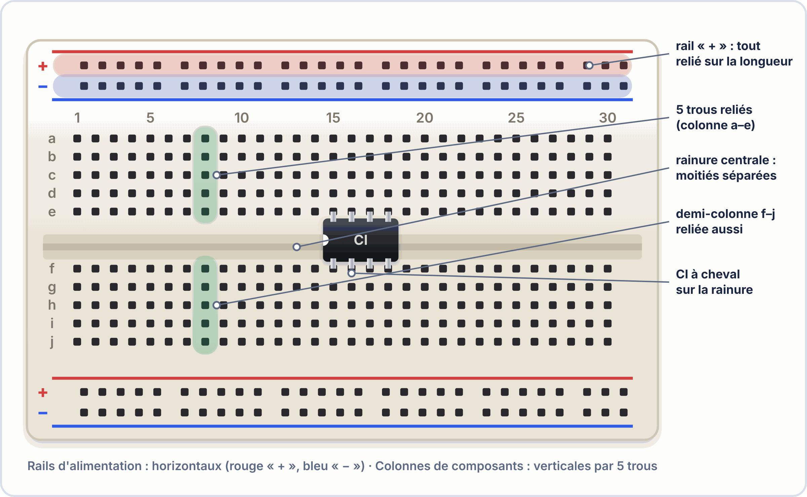
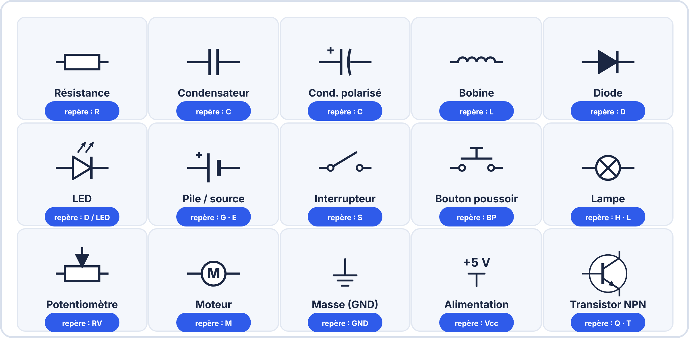
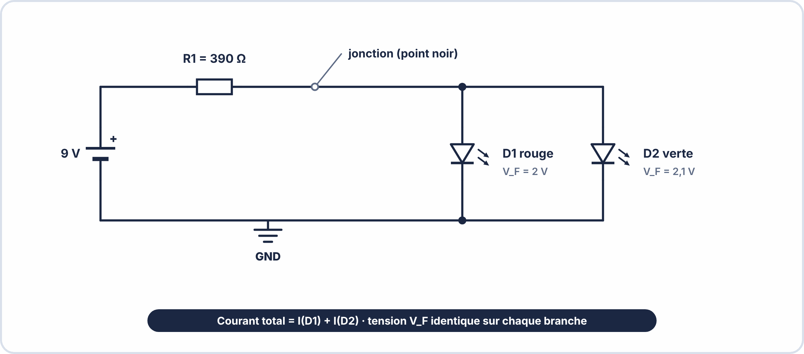
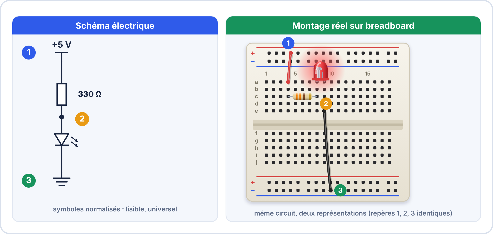
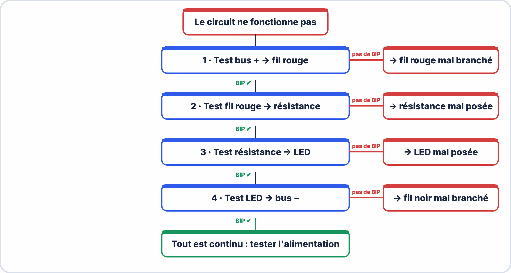
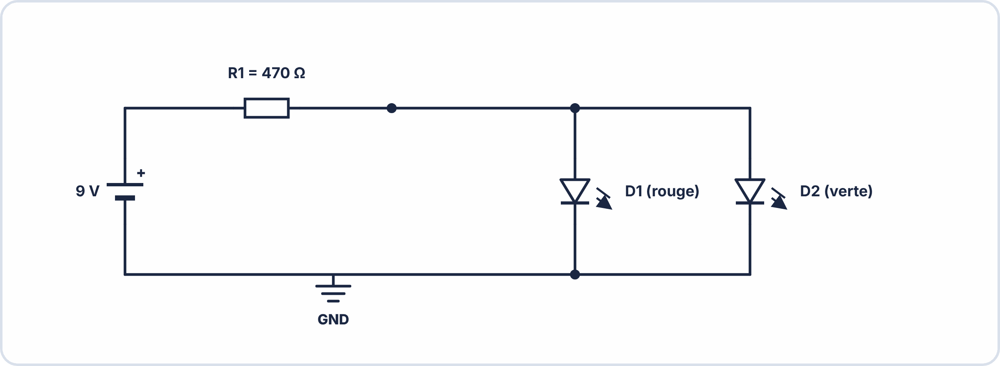

# 📘 FICHE DE COURS — S3 / Module E2
## Breadboard · Schémas Électriques Normés · Test de Continuité

---

## 🗝️ Vocabulaire clé à maîtriser pour l'examen

| Terme | Définition à retenir |
|---|---|
| **Breadboard** (platine d'essais) | Support de prototypage sans soudure permettant de monter et démonter des circuits rapidement |
| **Rangée** | Ligne horizontale de 5 trous connectés ensemble à l'intérieur de la breadboard |
| **Bus d'alimentation** | Colonnes verticales sur les bords de la breadboard (rouge = +, bleue = −) reliant tous les trous de la colonne |
| **Rainure centrale** | Séparation physique au milieu de la breadboard — les deux moitiés sont indépendantes |
| **Schéma électrique** | Représentation normée et symbolique d'un circuit électrique |
| **Symbole IEC** | Représentation graphique standardisée d'un composant électronique (norme IEC 60617) |
| **Jonction** | Point de connexion entre deux conducteurs sur un schéma — matérialisé par un **point noir •** |
| **Croisement** | Deux conducteurs qui se croisent sans se connecter — **pas de point noir** |
| **Test de continuité** | Mesure avec un multimètre pour vérifier qu'un conducteur est bien ininterrompu (bip = conducteur intact) |
| **Circuit ouvert** | Circuit interrompu — le courant ne peut pas circuler — pas de bip en continuité |
| **Court-circuit** | Connexion directe entre + et − sans résistance — dangereux — courant très élevé |
| **Masse (GND)** | Référence de potentiel zéro volt — pôle négatif de l'alimentation |


### 🤔 À ton avis ?

Tu prépares un montage à tester. Pourquoi ne soude-t-on pas directement les composants ?

??? question "Voir une réponse possible"
    Parce qu'on se **trompe** souvent au début ! La **breadboard** (platine d'essai) permet de **brancher et débrancher** les composants sans soudure : on teste, on corrige, puis on soude quand le montage est bon.
    
    Dans cette séance, tu apprends à **câbler** sur une breadboard, à **lire un schéma** normalisé et à **chercher une panne** avec le test de continuité.

---

## 1. La breadboard — Anatomie et utilisation

### 1.1 Structure interne



La breadboard est divisée en **3 zones fonctionnelles** :

| Zone | Couleur repère | Connexion interne | Utilisation |
|---|---|---|---|
| **Bus alimentation gauche/droit** | Rouge (+) et Bleu (−) | Toute la colonne verticale connectée | Distribuer l'alimentation |
| **Zone composants (haut)** | Vert clair | Rangée de 5 trous horizontaux (A à E) | Insérer les composants et fils |
| **Zone composants (bas)** | Vert foncé | Rangée de 5 trous horizontaux (F à J) | Insérer les composants et fils |
| **Rainure centrale** | Blanc / encoche | **SÉPARATION — rien n'est connecté** | Accueillir les circuits intégrés (CI) |

> ⚠️ **Attention** : Sur certaines breadboards 830 points, le bus vertical est **coupé en son milieu**. Toujours tester la continuité du bus avant la première utilisation !

### 1.2 Règles d'insertion des composants

| Règle | Explication | Illustration |
|---|---|---|
| **Un composant par rangée** | Les deux broches d'un composant doivent être dans des rangées différentes | ✅ LED en E5 et E6 — ❌ LED en E5 et D5 |
| **Traverser la rainure pour les CI** | Les circuits intégrés (puces) enjambent la rainure | Puce DIP-8 : broches gauche en A-E, broches droite en F-J |
| **Ne jamais forcer** | Si ça résiste, c'est mal aligné | Vérifier l'alignement avant d'appuyer |
| **Fils courts** | Préférer des fils courts et proches du support | Évite les erreurs de câblage et améliore la lisibilité |

### 1.3 Exemple de câblage correct vs incorrect


> [!TIP] 💡 En clair
> La breadboard est une plaque percée de trous. **Sous les trous, des lames métalliques relient certains trous entre eux** :
>
> - sur chaque **groupe de 5 trous** (repérés par les lettres a à e, ou f à j), les 5 trous sont **reliés** ;
> - les deux **bandes d'alimentation** (rouge + et bleue −) sont reliées **sur toute leur longueur** ;
> - la **rainure centrale** ne relie **rien** : elle sépare les deux moitiés. Les circuits intégrés se posent **à cheval** sur la rainure.
>
> **Pour connecter deux composants, on met leurs pattes dans le même groupe de 5 trous.**

### ✅ Vérifie que tu as compris

**Q1.** Pourquoi les deux pattes d'une résistance ne doivent-elles pas être dans le même groupe de 5 trous ?

??? success "Réponse"
    Parce que les 5 trous sont **reliés** : la résistance serait **court-circuitée** (le courant passerait à côté d'elle).

**Q2.** À quoi sert la rainure centrale ?

??? success "Réponse"
    Elle **sépare** les deux moitiés de la plaque, ce qui permet de poser un **circuit intégré** à cheval sans relier ses broches entre elles.

**Q3.** Où branche-t-on le fil rouge de l'alimentation ?

??? success "Réponse"
    Sur la **bande rouge (+)**, et le fil noir sur la **bande bleue (−)**.

> [!WARNING] ⚠️ Erreurs fréquentes
> - Mettre deux pattes dans le même groupe de 5 trous.
> - Oublier que certaines breadboards ont un bus d'alimentation **coupé au milieu**.

> [!SUCCESS] 🧠 À retenir
> - Les 5 trous d'un même groupe sont reliés entre eux.
> - La rainure centrale ne relie rien.
> - Rouge = +, bleu = −.

---

## 2. Les schémas électriques normés IEC

### 2.1 Pourquoi des normes ?

Un schéma électrique est un **langage universel**. Un technicien en France et un technicien au Japon lisent le même schéma s'il respecte la norme **IEC 60617** (norme internationale). Sans normes, chaque dessin serait différent et impossible à partager.

### 2.2 Les symboles IEC à maîtriser



| Composant | Symbole IEC | Remarque |
|---|---|---|
| Source de tension continue | { width="210" } | La grande barre est toujours le pôle positif |
| Résistance | { width="210" } | Symbole européen — les USA utilisent un zigzag |
| LED | { width="210" } | Les flèches représentent la lumière émise |
| Interrupteur (NF ouvert) | { width="210" } | NF = normalement fermé, NO = normalement ouvert |
| Condensateur | { width="210" } | Pour les condensateurs polarisés, une barre est incurvée (−) |
| Jonction (connexion) | { width="210" } | Obligatoire quand deux fils se connectent |
| Croisement (pas de connexion) | { width="210" } | Deux fils se croisent mais ne se touchent pas |
| Masse GND | { width="210" } | Référence 0 V du circuit |

### 2.3 Règles de dessin d'un schéma

Un bon schéma est **lisible, logique et normé**. Voici les règles à respecter :

| Règle | Bonne pratique | Erreur à éviter |
|---|---|---|
| **Angles droits** | Tous les fils sont horizontaux ou verticaux | Fils obliques ou courbés |
| **Sens de lecture** | De gauche à droite et de haut en bas | Circuit en spirale illisible |
| **Source à gauche** | La source de tension est toujours à gauche | Source au milieu du schéma |
| **Masse en bas** | Le fil de retour (GND) est en bas | GND en haut ou au milieu |
| **Taille des symboles** | Tous les symboles de même type ont la même taille | Résistance géante et LED minuscule |
| **Étiquetage** | Chaque composant porte sa valeur (R1 = 390 Ω, D1 = LED rouge) | Composants sans étiquettes |
| **Jonctions** | Toujours indiquer un point noir sur les connexions | Ambiguïté connexion/croisement |

### 2.4 Exemple de schéma normé complet




> [!TIP] 💡 En clair
> Un **schéma électrique** est un dessin **simplifié** du circuit. Il ne montre pas où sont les composants sur la plaque, mais **comment ils sont reliés**. Pour que tout le monde le lise de la même façon, les symboles sont **normalisés** (norme **IEC 60617**).
>
> En pratique : **un trait = un fil**, **un point noir = une jonction**, et chaque composant porte son **nom** et sa **valeur** (R1 = 330 Ω).

### ✅ Vérifie que tu as compris

**Q1.** Pourquoi utilise-t-on des symboles normalisés ?

??? success "Réponse"
    Pour que **tous les techniciens** lisent le même schéma de la même façon, sans ambiguïté.

**Q2.** Que signifie un point noir à l'intersection de deux fils ?

??? success "Réponse"
    Que les deux fils sont **connectés** (une jonction). Sans point, les fils se croisent sans se toucher.

**Q3.** Comment reconnaît-on le sens d'une LED sur un schéma ?

??? success "Réponse"
    Le **triangle** pointe vers la **cathode** (la barre) ; deux petites flèches indiquent la lumière émise.

> [!SUCCESS] 🧠 À retenir
> - Un schéma décrit les liaisons, pas la position des pièces.
> - Symboles normalisés, noms et valeurs sur chaque composant.

---

## 3. Lire un schéma et le transposer en montage

### 3.1 La méthode de lecture — 5 étapes

| Étape | Action | Question à se poser |
|---|---|---|
| **1 — Repérer la source** | Trouver la source de tension | Quelle est la tension ? Où est le + ? Où est le − ? |
| **2 — Tracer le chemin** | Suivre le fil depuis le + jusqu'au − | Quels composants sont traversés ? Dans quel ordre ? |
| **3 — Identifier le type de circuit** | Série ou parallèle ? | Y a-t-il des jonctions (•) qui divisent le courant ? |
| **4 — Relever les valeurs** | Lire les étiquettes | Quelles sont les valeurs de R ? Quelle couleur de LED ? |
| **5 — Vérifier la cohérence** | Les flèches de diodes sont-elles dans le bon sens ? | La LED est-elle orientée correctement (anode vers +) ? |

### 3.2 La méthode de transposition schéma → breadboard



**Procédure de transposition — 5 étapes pratiques :**

```
Étape 1 → Identifier le + et le − de l'alimentation
           Brancher le fil rouge au bus + et le fil noir au bus −

Étape 2 → Poser le premier composant après la source
           (généralement la résistance de protection)

Étape 3 → Poser les composants suivants dans l'ordre du schéma
           Chaque connexion = même rangée de breadboard

Étape 4 → Boucler le circuit en revenant au −

Étape 5 → Vérifier visuellement avant de mettre sous tension
           (sens de la LED, rangées correctes, aucun court-circuit)
```


> [!TIP] 💡 En clair
> Lire un schéma, puis le monter, se fait **toujours dans le même ordre** :
>
> 1. repère la **source** (+ et −) ;
> 2. **suis le chemin** du + jusqu'au − ;
> 3. note l'**ordre des composants** ;
> 4. relève les **valeurs** ;
> 5. **vérifie** les sens (LED, diodes).
>
> Pour passer au montage : **un fil rouge pour le +, un noir pour le −**, puis tu poses les composants **dans l'ordre du schéma**, chaque liaison correspondant à un **même groupe de 5 trous**.

### ✅ Vérifie que tu as compris

**Q1.** Par quoi commence-t-on pour lire un schéma ?

??? success "Réponse"
    Par la **source** de tension : on repère le + et le −, puis on suit le chemin du courant.

**Q2.** Que doit-on vérifier avant de mettre sous tension ?

??? success "Réponse"
    Le **sens de la LED**, les **rangées** correctes, l'**absence de court-circuit**.

**Q3.** Sur le schéma, R1 et D1 sont reliées par un fil. Comment le traduit-on sur la breadboard ?

??? success "Réponse"
    En mettant une patte de R1 et la patte d'**anode** de D1 dans le **même groupe de 5 trous**.

> [!SUCCESS] 🧠 À retenir
> - Lis le schéma du + vers le −, puis monte dans le même ordre.

---

## 4. Le test de continuité

### 4.1 Principe physique


Le test de continuité envoie un **très faible courant** entre les deux sondes du multimètre. Si le courant peut circuler librement (résistance quasi nulle), le multimètre émet un **signal sonore (bip)**. Si le courant est bloqué (circuit ouvert, fil coupé), il n'y a **pas de bip**.

### 4.2 Utilisation du multimètre — Mode continuité

| Étape | Action |
|---|---|
| **1** | Placer le sélecteur sur le symbole **)))** ou **🔊** (continuité) |
| **2** | Brancher la sonde noire dans la borne **COM** |
| **3** | Brancher la sonde rouge dans la borne **VΩ** (même borne que pour les tensions) |
| **4** | **Mettre le circuit hors tension** avant de tester (couper l'alimentation) |
| **5** | Toucher les deux points à tester avec les sondes |
| **6** | Interpréter : **BIP** = continuité OK · **Silence** = circuit ouvert |

> ⚠️ **Important** : Le test de continuité doit toujours être réalisé **hors tension**. Sinon, les résultats sont faussés et on risque d'endommager le multimètre.

### 4.3 Méthode de diagnostic par continuité — Approche systématique



Quand un circuit ne fonctionne pas, on teste de façon **méthodique par dichotomie** (on divise le problème en deux à chaque fois) :

**Tableau de diagnostic systématique :**

| Étape de test | Point de mesure | Résultat attendu | Si KO : cause probable |
|---|---|---|---|
| 1 | Bus + de A à Z (bout en bout) | **BIP** | Bus coupé au milieu — courant de deux demi-rails |
| 2 | Fil rouge : source → premier composant | **BIP** | Fil mal inséré dans la breadboard |
| 3 | Résistance (bout à bout) | **BIP** (résistance ≠ 0) | Résistance grillée (rare) ou mauvaise rangée |
| 4 | LED (anode → cathode, sens direct) | **Pas de BIP** (normal pour une diode) | Si BIP : LED en court-circuit → défectueuse |
| 5 | Fil de retour GND | **BIP** | Fil mal inséré en retour |

> 💡 **Note** : Une diode/LED ne donne **pas** de bip en test de continuité classique car sa résistance directe est > 0 Ω. Utiliser le **mode test diode** (symbole →|) du multimètre pour tester une LED : affichera la tension $V_{F}$ ≈ 2 V si la LED est bonne.


> [!TIP] 💡 En clair
> Quand un montage ne marche pas, **ne devine pas** : **teste**. Le test de **continuité** vérifie si le courant peut **passer** entre deux points : le multimètre fait **BIP** si oui, **silence** si le chemin est coupé.
>
> **Règle absolue :** on teste **hors tension**.
>
> On avance **par étapes** (dichotomie) : on teste d'abord la moitié du circuit, puis on réduit la zone en cause, jusqu'à trouver le fil ou le contact défectueux.

### ✅ Vérifie que tu as compris

**Q1.** Que veut dire un BIP du multimètre en mode continuité ?

??? success "Réponse"
    Il existe un **chemin conducteur** entre les deux points : le fil ou le contact est bon.

**Q2.** Pourquoi faut-il tester hors tension ?

??? success "Réponse"
    Une tension présente **fausse la mesure** et peut **endommager** le multimètre.

**Q3.** Le fil rouge est bien branché mais la LED reste éteinte. Que testes-tu en premier ?

??? success "Réponse"
    Le **bus +** de bout en bout, puis le fil rouge, puis chaque liaison jusqu'à la LED : on avance **étape par étape**.

> [!WARNING] ⚠️ Erreurs fréquentes
> - Tester un montage encore alimenté.
> - Croire qu'une LED « bipe » en test de continuité : pour une diode, utilise plutôt le **mode test diode**.

> [!SUCCESS] 🧠 À retenir
> - Continuité = BIP si le chemin est fermé.
> - Toujours hors tension, étape par étape.

---

## 5. Exercices d'application

### Exercice 1 — Lire un schéma (5 min)

*Répondre aux questions à partir du schéma suivant :*



1. D1 et D2 sont-elles en **série** ou en **parallèle** ?
2. Quelle est la tension aux bornes de R1 ? *($V_{\mathrm{alim}}$ − $V_{F}$ = ?)* 
3. Quel courant traverse R1 ? *($I_{\mathrm{total}}$ = U_R1 / R1)*
4. Quel courant traverse D1 seule ?

*Réponses :*

1. \_\_\_\_\_\_\_\_\_\_\_\_\_ 2. \_\_\_\_\_\_\_\_\_\_\_\_\_ V   3. \_\_\_\_\_\_\_\_\_\_\_\_\_ mA   4. \_\_\_\_\_\_\_\_\_\_\_\_\_ mA

??? success "Réponses"

    1. D1 et D2 sont en **parallèle** (leurs deux bornes sont reliées aux mêmes points).  
    2. $U_{R1} = V_{alim} - V_F = 9 - 2 = 7\,\mathrm{V}$  
    3. $I_{total} = \dfrac{U_{R1}}{R_1} = \dfrac{7}{470} \approx 0{,}0149\,\mathrm{A} \approx 14{,}9\,\mathrm{mA}$  
    4. Les deux branches sont identiques en courant : $I_{D1} = \dfrac{14{,}9}{2} \approx 7{,}4\,\mathrm{mA}$

### Exercice 2 — Dessiner un schéma (10 min)

*Dessiner le schéma IEC normé du montage décrit ci-dessous :*

> "Une alimentation 9 V alimente deux résistances de 220 Ω (R1 et R2) en série. Une LED rouge (D1) est connectée après R2. Le tout est bouclé sur la masse."

> [!NOTE] ✏️ À toi de dessiner
> Dessine ton schéma sur ta feuille ou dans ton dossier (zone prévue pour le schéma).

---

## ✅ Compétences RNCP travaillées

| Code | Compétence | Niveau |
|---|---|---|
| C2.1 | Préparer les ressources matérielles à la réalisation | ⭐⭐⭐ Maîtrise |
| C2.2 | Réaliser des câblages et montages à partir d'un schéma | ⭐⭐⭐ Maîtrise |
| C2.3 | Vérifier la conformité d'une réalisation | ⭐⭐ Application |
| C3.1 | Rendre compte de son activité de façon écrite | ⭐⭐ Application |
| S2 | Loi d'Ohm — consolidation | ⭐⭐ Application |
| S3 | Composants électroniques — lecture datasheet | ⭐⭐ Application |
| S4 | Instruments de mesure — multimètre continuité | ⭐⭐ Application |

---

## 📝 Mémo rapide — À garder dans le portfolio

| Je veux... | Je fais... |
|---|---|
| Tester si un fil est intact | Mode **)))** multimètre → BIP = OK |
| Tester une LED | Mode **→\|** multimètre → affiche $V_{F}$ ≈ 2 V si OK |
| Lire un schéma | Source à gauche → suivre le chemin → composants dans l'ordre |
| Savoir si deux points breadboard sont connectés | Même numéro de rangée, même demi-breadboard |
| Identifier une jonction sur schéma | **Point noir •** sur le croisement |
| Identifier un croisement sans connexion | **Pont en arc** ou croisement simple sans point |

---

*BAC Pro CIEL — S3 Module E2 | MFR de Pontonx | © Yahn LE PRETTRE*
